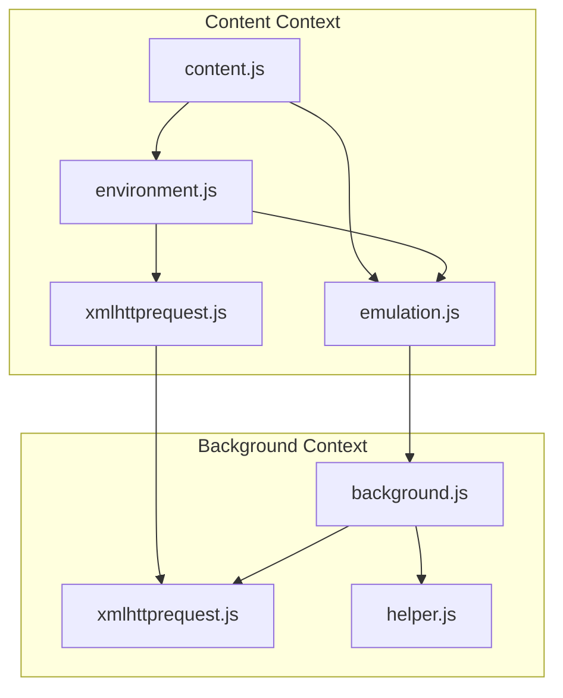
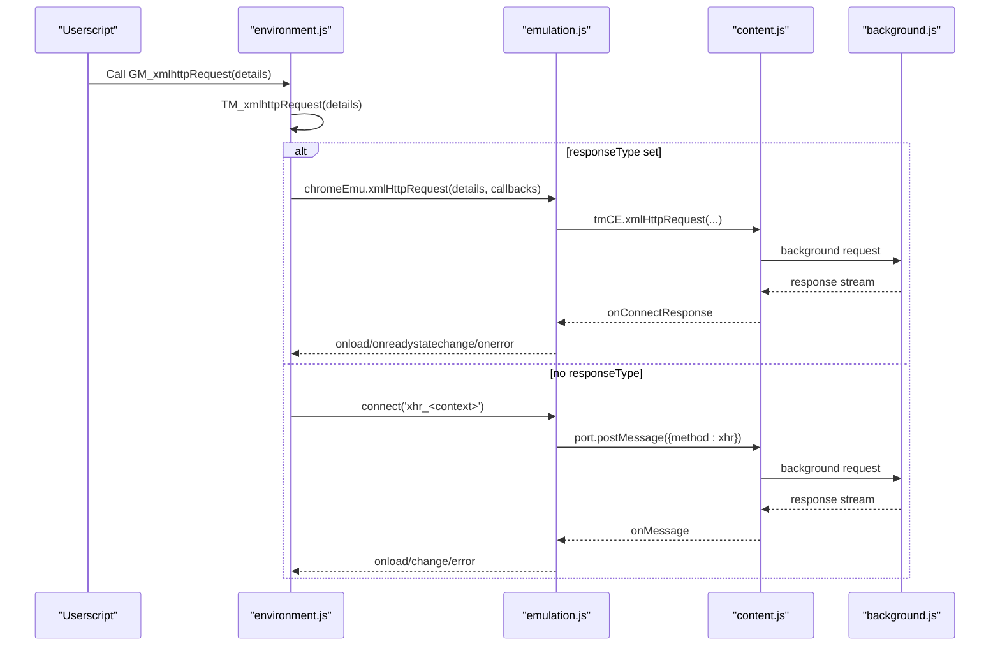
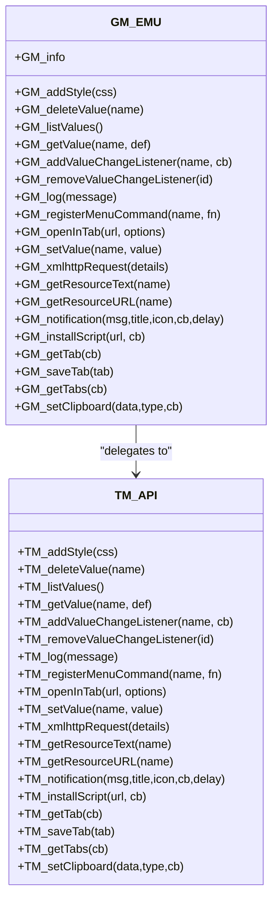
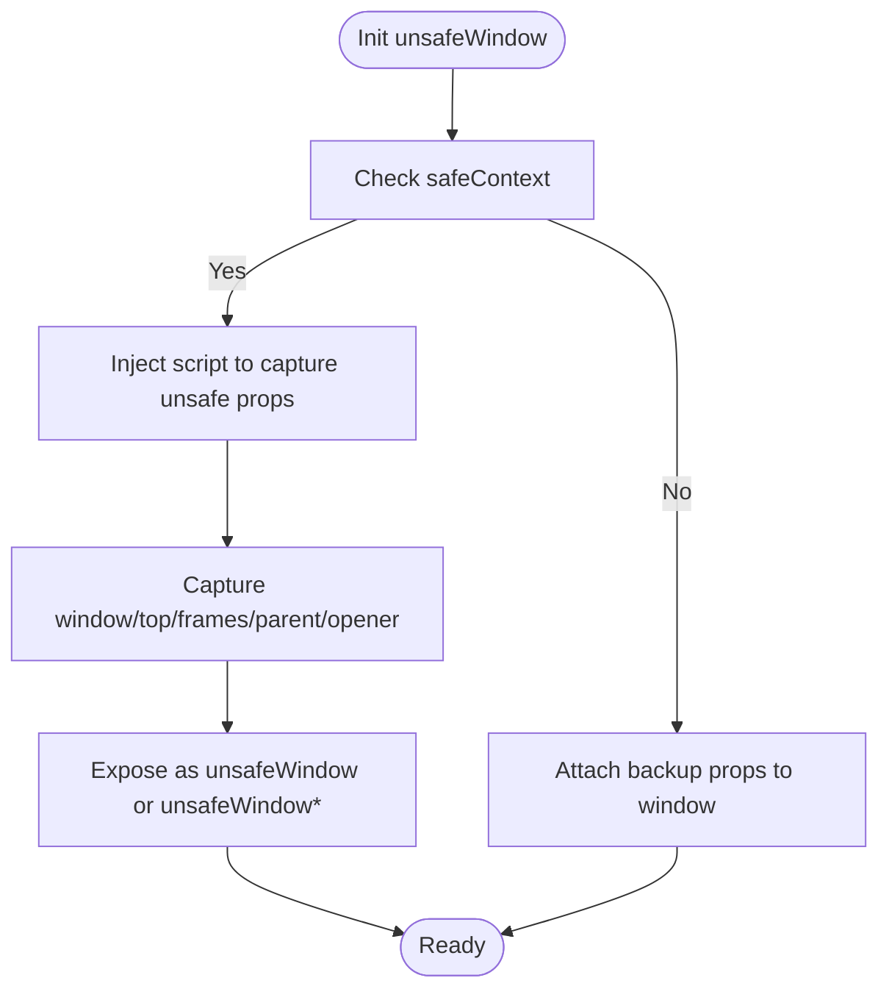
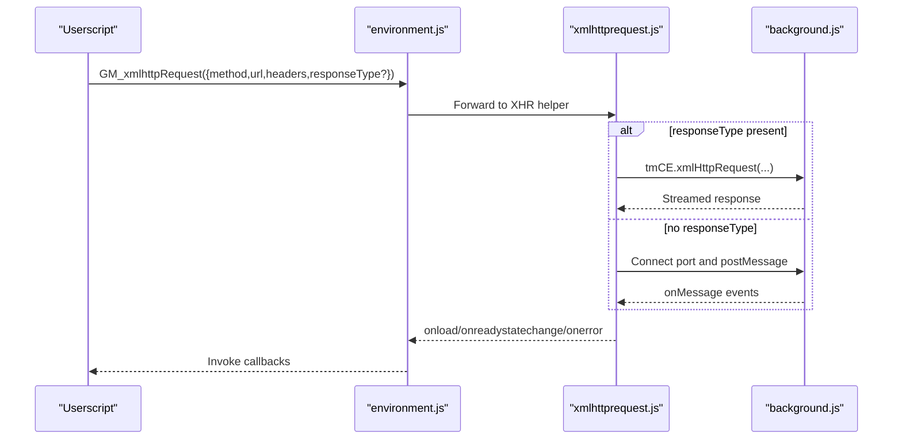
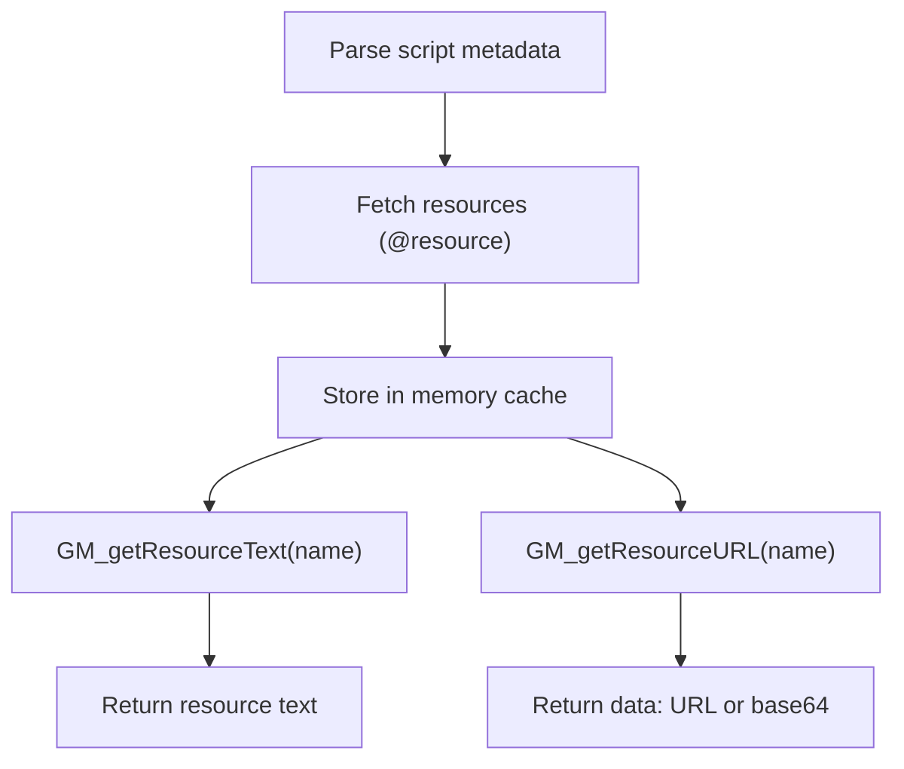
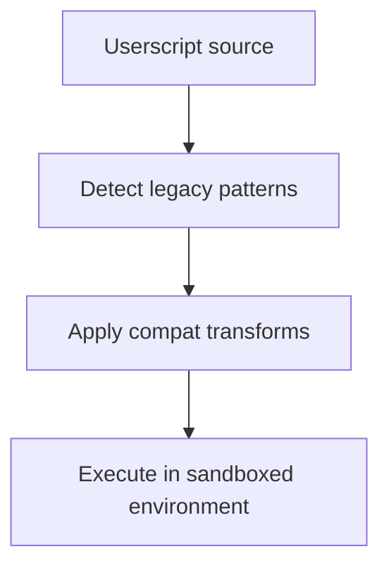
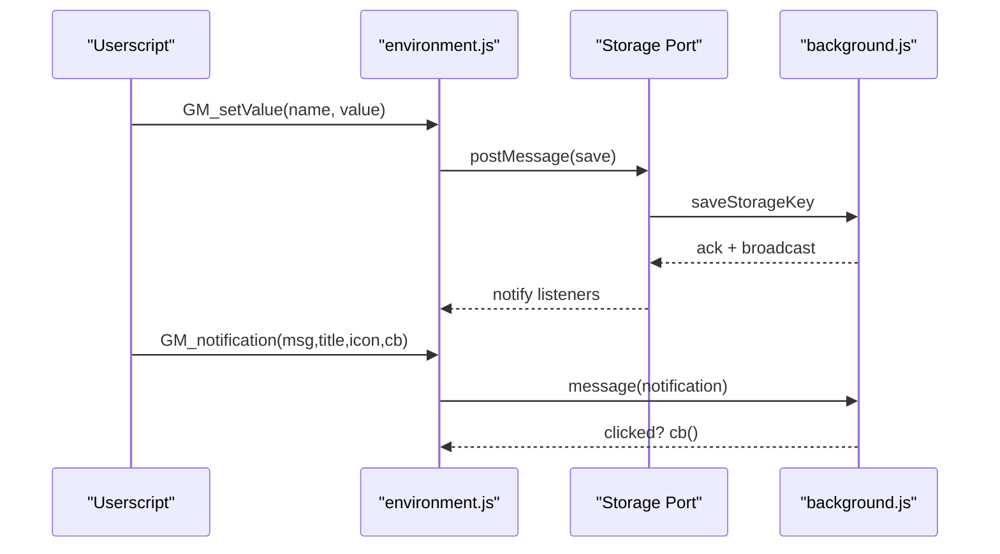
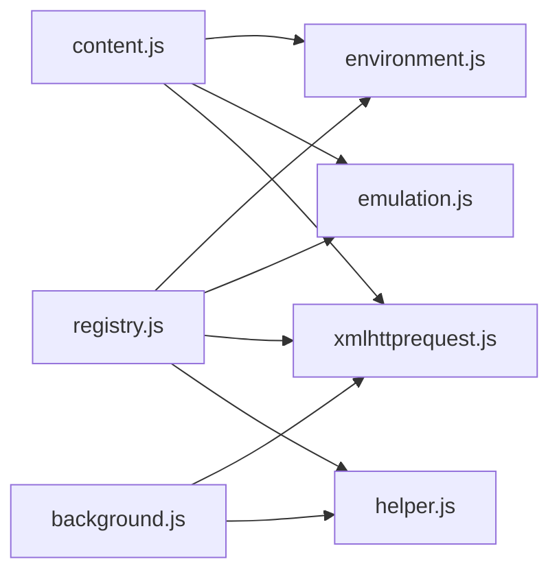

# API Compatibility Layer

<cite>
**Referenced Files in This Document**
- [README.md](file://README.md)
- [compat.js](file://src/compat.js)
- [emulation.js](file://src/emulation.js)
- [xmlhttprequest.js](file://src/xmlhttprequest.js)
- [environment.js](file://src/environment.js)
- [content.js](file://src/content.js)
- [helper.js](file://src/helper.js)
- [background.js](file://src/background.js)
- [registry.js](file://src/registry.js)
</cite>

## Table of Contents
1. [Introduction](#introduction)
2. [Project Structure](#project-structure)
3. [Core Components](#core-components)
4. [Architecture Overview](#architecture-overview)
5. [Detailed Component Analysis](#detailed-component-analysis)
6. [Dependency Analysis](#dependency-analysis)
7. [Performance Considerations](#performance-considerations)
8. [Troubleshooting Guide](#troubleshooting-guide)
9. [Conclusion](#conclusion)

## Introduction
This document explains Tampermonkey’s API compatibility layer: how it emulates userscript APIs (including GM_* functions), provides full unsafeWindow access, manages resources, and handles cross-origin requests. It also covers compatibility modes, version differences, migration paths from other userscript managers, practical usage patterns, and performance considerations.

## Project Structure
The compatibility layer spans several modules:
- Environment and API surface: environment.js defines the userscript runtime, GM_* aliases, storage, notifications, and resource access.
- Emulation bridge: emulation.js exposes a Chrome Extension-like API to the page context.
- Cross-origin requests: xmlhttprequest.js wraps XHR with safety and retries; background.js integrates with webRequest and caches resources.
- Compatibility helpers: compat.js transforms legacy syntax and metadata constructs.
- UnsafeWindow and eventing: content.js initializes unsafeWindow and coordinates messaging between background and content contexts.
- Shared utilities: helper.js provides URL matching, escaping, serialization, and helpers used across modules.
- Module loader: registry.js loads and registers modules.

**Diagram sources**
- [environment.js:646-1131](file://src/environment.js#L646-L1131)
- [emulation.js:9-329](file://src/emulation.js#L9-L329)
- [xmlhttprequest.js:1-161](file://src/xmlhttprequest.js#L1-L161)
- [content.js:1065-1198](file://src/content.js#L1065-L1198)
- [background.js:1-500](file://src/background.js#L1-L500)

**Section sources**
- [README.md:12-17](file://README.md#L12-L17)
- [registry.js:11-86](file://src/registry.js#L11-L86)

## Core Components
- GM_* API emulation: environment.js exposes GM_* functions (e.g., GM_registerMenuCommand, GM_getResourceText, GM_getResourceURL, GM_notification) as aliases to internal TM_* functions.
- unsafeWindow: content.js builds a safe proxy to the page window and injects a property bag to expose unsafeWindow when possible, falling back to a wrapper-safe approach.
- Cross-origin requests: xmlhttprequest.js validates schemes and forwards requests; background.js uses webRequest and caches resources.
- Compatibility mode: compat.js transforms legacy constructs (metadata blocks, foreach, array destructuring, for ... in) and disables strict mode.
- Storage and notifications: environment.js implements GM_listValues, GM_getValue, GM_setValue, GM_addValueChangeListener, and GM_notification.

**Section sources**
- [environment.js:646-1131](file://src/environment.js#L646-L1131)
- [content.js:455-608](file://src/content.js#L455-L608)
- [xmlhttprequest.js:17-153](file://src/xmlhttprequest.js#L17-L153)
- [compat.js:14-26](file://src/compat.js#L14-L26)

## Architecture Overview
The compatibility layer orchestrates three primary flows:
- API surface: environment.js defines GM_* and TM_* functions and injects them into the userscript namespace.
- Messaging bridge: emulation.js translates Chrome Extension APIs into a userscript-friendly interface; content.js coordinates message passing and unsafeWindow initialization.
- Request pipeline: xmlhttprequest.js validates and executes XHR; background.js applies webRequest policies, caches resources, and manages redirects.

**Diagram sources**
- [environment.js:693-747](file://src/environment.js#L693-L747)
- [emulation.js:52-82](file://src/emulation.js#L52-L82)
- [content.js:309-342](file://src/content.js#L309-L342)
- [background.js:4503-4514](file://src/background.js#L4503-L4514)

## Detailed Component Analysis

### GM_* API Surface and Aliases
- GM_* functions are defined as methods on a GM_EMU object and injected into the userscript namespace. They delegate to TM_* functions for storage, notifications, resource access, and tab operations.
- Supported functions include GM_registerMenuCommand, GM_xmlhttpRequest, GM_getResourceText, GM_getResourceURL, GM_notification, GM_setValue, GM_getValue, GM_deleteValue, GM_listValues, GM_addValueChangeListener, GM_removeValueChangeListener, GM_openInTab, GM_getTab, GM_saveTab, GM_getTabs, GM_setClipboard, and GM_installScript.

**Diagram sources**
- [environment.js:1053-1131](file://src/environment.js#L1053-L1131)
- [environment.js:1167-1194](file://src/environment.js#L1167-L1194)

**Section sources**
- [environment.js:1053-1131](file://src/environment.js#L1053-L1131)
- [environment.js:1167-1194](file://src/environment.js#L1167-L1194)

### unsafeWindow Access
- In content.js, unsafeWindow is constructed by injecting a script into the unsafe page context and capturing the exposed properties (window, top, frames, parent, opener). If a script blocker prevents direct access, Tampermonkey falls back to a wrapper-safe approach and logs detection.
- The unsafeWindow object is then attached to the page window as a non-writable property to emulate full access.

**Diagram sources**
- [content.js:455-608](file://src/content.js#L455-L608)

**Section sources**
- [content.js:455-608](file://src/content.js#L455-L608)

### Cross-Origin Requests and Security
- xmlhttprequest.js validates URLs to allow http/https or local images, throws on invalid schemes, and forwards headers. It supports progress reporting and retries on error.
- background.js integrates with webRequest to modify headers and bypass CSP for inline scripts and eval in the extension context. It caches @requires and resources to reduce network overhead.
- Requests are routed either via chromeEmu.xmlHttpRequest (when responseType is set) or via a dedicated port connection.

**Diagram sources**
- [environment.js:693-747](file://src/environment.js#L693-L747)
- [xmlhttprequest.js:17-153](file://src/xmlhttprequest.js#L17-L153)
- [background.js:4503-4514](file://src/background.js#L4503-L4514)

**Section sources**
- [xmlhttprequest.js:12-153](file://src/xmlhttprequest.js#L12-L153)
- [background.js:5886-5914](file://src/background.js#L5886-L5914)

### Resource Management
- Resources are resolved during script parsing and fetched on-demand. background.js stores resources in memory and serves them as base64 data URLs or raw text depending on type.
- GM_getResourceText returns the stored text; GM_getResourceURL returns a data URL or base64-encoded representation.

**Diagram sources**
- [background.js:2564-2593](file://src/background.js#L2564-L2593)
- [environment.js:980-998](file://src/environment.js#L980-L998)

**Section sources**
- [background.js:2564-2593](file://src/background.js#L2564-L2593)
- [environment.js:980-998](file://src/environment.js#L980-L998)

### Compatibility Modes and Legacy Support
- compat.js transforms legacy constructs:
  - Metadata blocks: converts CDATA sections into a Chrome-compatible format.
  - foreach loops: converts to standard for...in with hasOwnProperty checks.
  - Array left-hand assignments: expands destructuring into indexed assignments.
  - for ... in statements: normalizes spacing and adds hasOwnProperty guards.
  - Strict mode: escapes “use strict” to prevent errors.
- Options are exposed in the UI to toggle these transformations per script.

**Diagram sources**
- [compat.js:14-270](file://src/compat.js#L14-L270)

**Section sources**
- [compat.js:14-270](file://src/compat.js#L14-L270)
- [options.js:1124-1143](file://src/options.js#L1124-L1143)

### Storage and Notifications
- Storage: GM_listValues, GM_getValue, GM_setValue, GM_deleteValue, GM_addValueChangeListener, GM_removeValueChangeListener are implemented using a typed storage backend and broadcast change events via a dedicated port.
- Notifications: GM_notification sends a message to the background to show a native notification with optional click callback.

**Diagram sources**
- [environment.js:820-850](file://src/environment.js#L820-L850)
- [environment.js:1018-1028](file://src/environment.js#L1018-L1028)

**Section sources**
- [environment.js:820-850](file://src/environment.js#L820-L850)
- [environment.js:1018-1028](file://src/environment.js#L1018-L1028)

### Migration Paths and Version Differences
- Version updates include data migrations for script options, storage, and compatibility flags. For example, compatibility options were extended to include require handling.
- The project README confirms support for full unsafeWindow access and all GM_* functions, including GM_registerMenuCommand, GM_getResourceText, GM_getResourceURL, and GM_notification.

**Section sources**
- [background.js:249-384](file://src/background.js#L249-L384)
- [README.md:12-17](file://README.md#L12-L17)

## Dependency Analysis
The compatibility layer relies on a modular registry to load and wire components. The content context initializes environment and emulation modules, sets up unsafeWindow, and coordinates messaging. Background handles cross-origin requests, caching, and webRequest integration.

**Diagram sources**
- [registry.js:11-86](file://src/registry.js#L11-L86)
- [content.js:80-91](file://src/content.js#L80-L91)
- [background.js:28-35](file://src/background.js#L28-L35)

**Section sources**
- [registry.js:11-86](file://src/registry.js#L11-L86)
- [content.js:80-91](file://src/content.js#L80-L91)
- [background.js:28-35](file://src/background.js#L28-L35)

## Performance Considerations
- Prefer GM_xmlhttpRequest with responseType to leverage streaming and reduce memory overhead.
- Use @resource and @require judiciously; background caches resources to minimize repeated fetches.
- Avoid excessive use of GM_notification and GM_addValueChangeListener to reduce IPC overhead.
- Keep scripts in document-end or document-body run-at modes to avoid blocking page load unnecessarily.

## Troubleshooting Guide
Common issues and resolutions:
- Invalid scheme errors: Ensure URLs use http/https or local images; xmlhttprequest.js rejects unsupported schemes.
- Script blockers: If unsafeWindow retrieval fails, Tampermonkey logs detection and falls back to a wrapper-safe approach.
- CORS and CSP: background.js modifies CSP and headers for extension contexts; if blocked, verify webRequest permissions and CSP policy.
- Compatibility failures: Enable compat options (foreach, for-in, array-left, metadata) in script settings to transform legacy syntax.

**Section sources**
- [xmlhttprequest.js:115-117](file://src/xmlhttprequest.js#L115-L117)
- [content.js:487-499](file://src/content.js#L487-L499)
- [background.js:5904-5914](file://src/background.js#L5904-L5914)
- [options.js:1124-1143](file://src/options.js#L1124-L1143)

## Conclusion
Tampermonkey’s API compatibility layer provides a robust emulation of userscript APIs, full unsafeWindow access, and efficient cross-origin request handling. By combining environment-defined GM_* aliases, emulation bridges, and background webRequest integration, it maintains broad compatibility with existing userscripts while enforcing security and performance best practices.