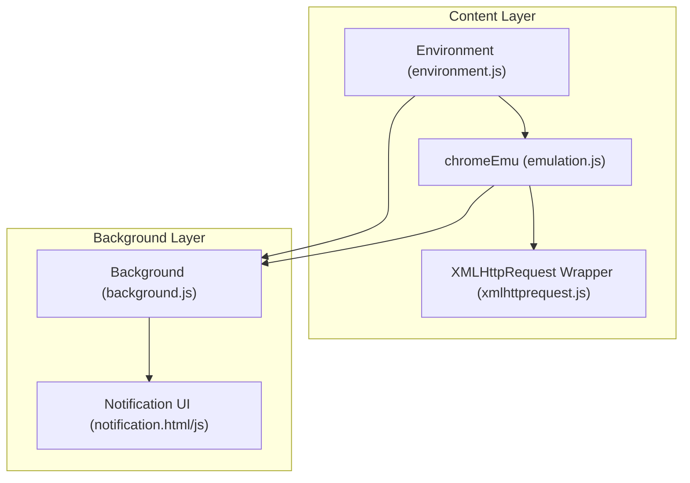
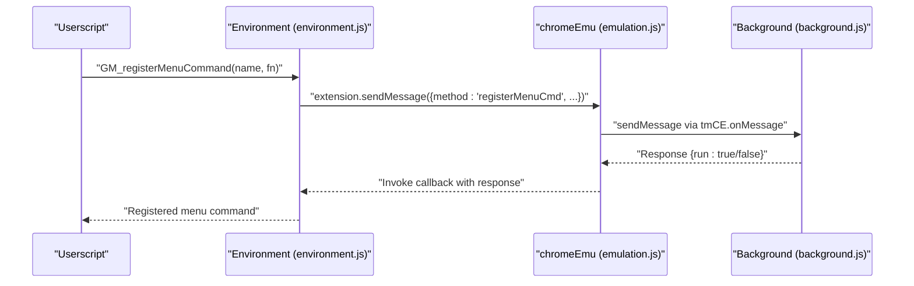
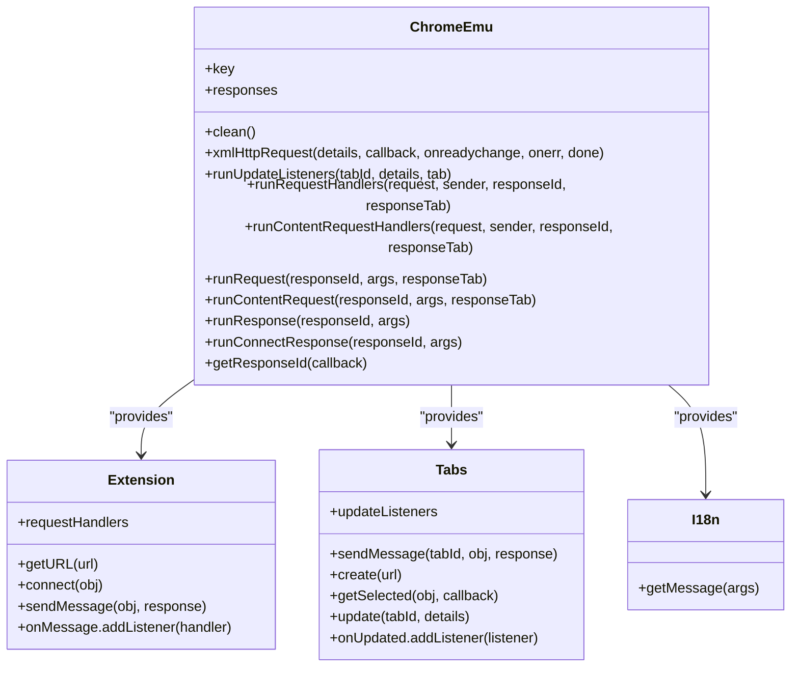
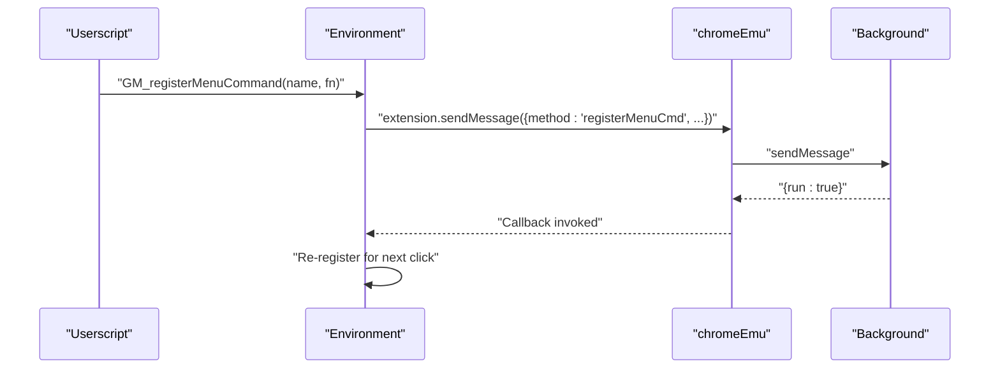
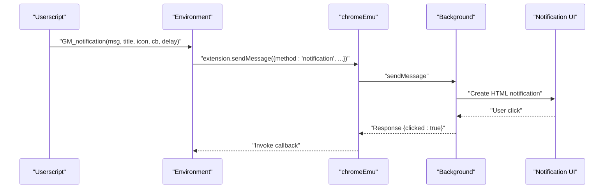
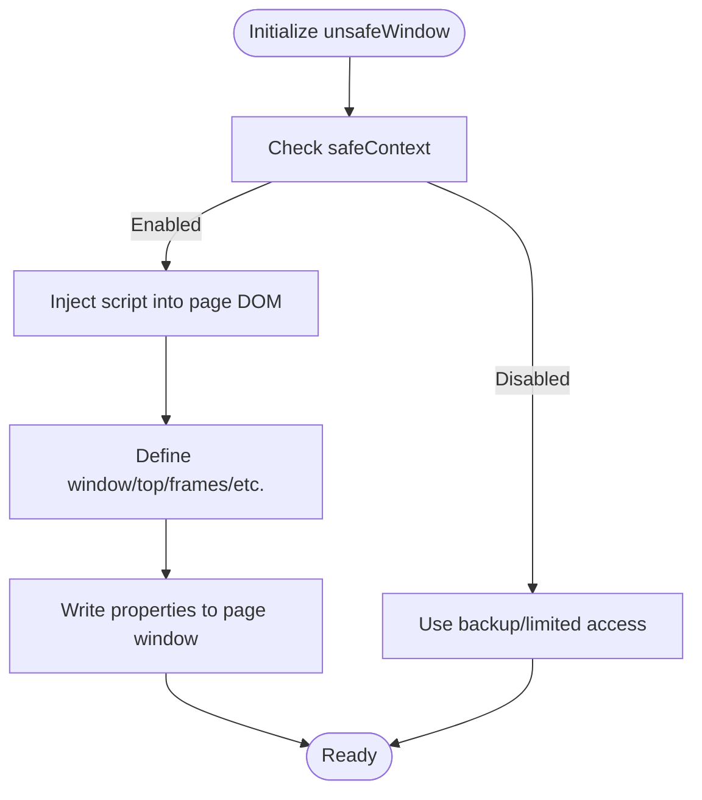
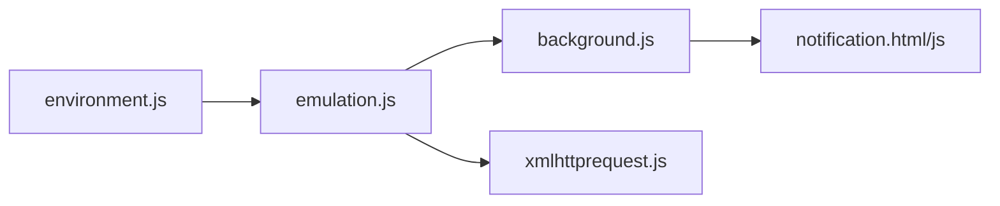

# API Emulation

<cite>
**Referenced Files in This Document**
- [emulation.js](file://src/emulation.js)
- [content.js](file://src/content.js)
- [background.js](file://src/background.js)
- [environment.js](file://src/environment.js)
- [xmlhttprequest.js](file://src/xmlhttprequest.js)
- [notification.js](file://src/notification.js)
- [notification.html](file://src/notification.html)
</cite>

## Table of Contents
1. [Introduction](#introduction)
2. [Project Structure](#project-structure)
3. [Core Components](#core-components)
4. [Architecture Overview](#architecture-overview)
5. [Detailed Component Analysis](#detailed-component-analysis)
6. [Dependency Analysis](#dependency-analysis)
7. [Performance Considerations](#performance-considerations)
8. [Troubleshooting Guide](#troubleshooting-guide)
9. [Conclusion](#conclusion)

## Introduction
This document explains Tampermonkey’s API emulation system that enables userscripts to call Greasemonkey-style APIs (GM_*) and access a subset of native Chrome Extension APIs through a compatibility layer. It focuses on:
- The chromeEmu object structure and its role in bridging userscript calls to Chrome Extension messaging
- Implementation of GM_* functions (GM_registerMenuCommand, GM_getResourceText, GM_getResourceURL, GM_notification)
- unsafeWindow access patterns and environment initialization
- Parameter transformations and return value conversions across the emulation boundary
- Practical usage patterns, compatibility notes, and troubleshooting guidance

## Project Structure
The emulation system spans three layers:
- Content layer: injects the environment, exposes GM_* and TM_* APIs, and manages chromeEmu
- Background layer: handles cross-process requests, permissions, notifications, and storage
- Shared helpers: XMLHTTPRequest wrapper and message routing utilities

**Diagram sources**
- [emulation.js:40-329](file://src/emulation.js#L40-L329)
- [environment.js:1053-1131](file://src/environment.js#L1053-L1131)
- [xmlhttprequest.js:17-153](file://src/xmlhttprequest.js#L17-L153)
- [background.js:3276-3338](file://src/background.js#L3276-L3338)
- [notification.html:1-22](file://src/notification.html#L1-L22)

**Section sources**
- [emulation.js:9-329](file://src/emulation.js#L9-L329)
- [environment.js:1053-1131](file://src/environment.js#L1053-L1131)
- [xmlhttprequest.js:17-153](file://src/xmlhttprequest.js#L17-L153)
- [background.js:3276-3338](file://src/background.js#L3276-L3338)
- [notification.html:1-22](file://src/notification.html#L1-L22)

## Core Components
- chromeEmu: A bridge object that exposes Chrome Extension APIs to userscripts and mediates asynchronous responses via response IDs. It encapsulates:
  - Extension messaging and port communication
  - Tab operations
  - Internationalization
  - XMLHTTPRequest emulation
  - Lifecycle cleanup
- Environment (environment.js): Initializes the userscript execution environment, defines GM_* shims, and wires unsafeWindow access
- Background (background.js): Implements cross-process handlers for menu commands, notifications, storage, and permissions
- XMLHTTPRequest wrapper: Normalizes request/response semantics and retries for cross-origin and local file access

**Section sources**
- [emulation.js:40-329](file://src/emulation.js#L40-L329)
- [environment.js:1053-1131](file://src/environment.js#L1053-L1131)
- [background.js:3276-3338](file://src/background.js#L3276-L3338)
- [xmlhttprequest.js:17-153](file://src/xmlhttprequest.js#L17-L153)

## Architecture Overview
The emulation layer uses a message-passing model:
- Userscripts call GM_* functions (exposed via environment.js)
- GM_* functions delegate to TM_* helpers that route via chromeEmu to background handlers
- Background handlers perform privileged operations and return results asynchronously
- chromeEmu assigns unique response IDs and dispatches callbacks in the content layer

**Diagram sources**
- [environment.js:1082-1084](file://src/environment.js#L1082-L1084)
- [emulation.js:256-273](file://src/emulation.js#L256-L273)
- [background.js:3276-3338](file://src/background.js#L3276-L3338)

## Detailed Component Analysis

### chromeEmu Object Structure and Responsibilities
- Key areas:
  - Extension messaging: getURL, connect, sendMessage, onMessage
  - Tabs: sendMessage, create, getSelected, update, onUpdated
  - i18n: getMessage
  - XMLHTTPRequest: xmlHttpRequest
  - Lifecycle: runRequest/runResponse/runConnectResponse, response ID management, cleanup
- Design:
  - Uses response IDs to correlate asynchronous replies
  - Encodes/decodes JSON payloads and wraps callbacks
  - Bridges content and background via tmCE helpers

**Diagram sources**
- [emulation.js:40-329](file://src/emulation.js#L40-L329)

**Section sources**
- [emulation.js:40-329](file://src/emulation.js#L40-L329)

### GM_* Function Implementations

#### GM_registerMenuCommand
- Purpose: Registers a persistent menu command for the userscript
- Flow:
  - Environment calls TM_registerMenuCommand
  - Sends a register message via chromeEmu.extension.sendMessage
  - Background responds with {run: true} when clicked
  - Environment re-registers automatically for subsequent clicks

**Diagram sources**
- [environment.js:1082-1084](file://src/environment.js#L1082-L1084)
- [emulation.js:256-273](file://src/emulation.js#L256-L273)
- [background.js:3276-3338](file://src/background.js#L3276-L3338)

**Section sources**
- [environment.js:1082-1084](file://src/environment.js#L1082-L1084)
- [emulation.js:256-273](file://src/emulation.js#L256-L273)
- [background.js:3276-3338](file://src/background.js#L3276-L3338)

#### GM_getResourceText
- Purpose: Returns the inlined text content of a named resource embedded in the userscript metadata
- Implementation:
  - Environment scans the script’s resources and returns the matching resource text
  - Returns null if not found

**Section sources**
- [environment.js:1098-1099](file://src/environment.js#L1098-L1099)

#### GM_getResourceURL
- Purpose: Returns the inlined URL for a named resource
- Implementation:
  - Environment scans the script’s resources and returns the resource URL
  - Returns null if not found

**Section sources**
- [environment.js:1102-1103](file://src/environment.js#L1102-L1103)

#### GM_notification
- Purpose: Displays a notification with optional icon, title, and callback on click
- Implementation:
  - Environment constructs defaults (title from script name, icon from script icon)
  - Sends a notification request via chromeEmu.extension.sendMessage
  - Background renders a notification UI and forwards click events back to content

**Diagram sources**
- [environment.js:1106-1108](file://src/environment.js#L1106-L1108)
- [emulation.js:256-273](file://src/emulation.js#L256-L273)
- [background.js:3276-3338](file://src/background.js#L3276-L3338)
- [notification.html:1-22](file://src/notification.html#L1-L22)
- [notification.js:15-98](file://src/notification.js#L15-L98)

**Section sources**
- [environment.js:1106-1108](file://src/environment.js#L1106-L1108)
- [background.js:3276-3338](file://src/background.js#L3276-L3338)
- [notification.html:1-22](file://src/notification.html#L1-L22)
- [notification.js:15-98](file://src/notification.js#L15-L98)

### unsafeWindow Access Patterns
- Purpose: Allow userscripts to access the page’s global scope when safeContext is enabled
- Mechanism:
  - Environment initializes unsafeWindow by injecting a script element into the page DOM
  - It defines properties like window, top, frames, parent, opener on a temporary object and then writes them into the page window
  - Provides a TM_do mechanism to execute code in the page context safely
- Fallback:
  - If unsafeWindow retrieval fails (e.g., due to script blockers), environment reports detection and may prompt the user

**Diagram sources**
- [environment.js:455-608](file://src/environment.js#L455-L608)
- [content.js:455-608](file://src/content.js#L455-L608)

**Section sources**
- [environment.js:455-608](file://src/environment.js#L455-L608)
- [content.js:455-608](file://src/content.js#L455-L608)

### API Mapping and Parameter Transformations
- GM_xmlhttpRequest
  - When responseType is set, content layer uses chromeEmu.xmlHttpRequest with callbacks for onLoad/onReadyStateChange/onError
  - Otherwise, it opens a persistent port and streams change events
  - Response normalization: converts native XHR state to a uniform shape with responseXML, responseText, response, status, statusText, headers, and finalUrl
- GM_getResourceText/GM_getResourceURL
  - No transformation; returns inlined resource text or URL from the script metadata
- GM_notification
  - Defaults title to script name and icon to script icon if omitted
  - Background composes a clickable HTML notification and forwards click events back to content
- unsafeWindow access
  - Properties are copied into the page window or exposed via TM_do for controlled execution

**Section sources**
- [environment.js:1094-1096](file://src/environment.js#L1094-L1096)
- [environment.js:1017-1028](file://src/environment.js#L1017-L1028)
- [xmlhttprequest.js:17-153](file://src/xmlhttprequest.js#L17-L153)
- [emulation.js:52-82](file://src/emulation.js#L52-L82)

## Dependency Analysis
- Content-to-background messaging:
  - chromeEmu.onMessage/onContentRequest route requests to background handlers
  - tmCE.onResponse/onContentResponse dispatch responses back to chromeEmu
- Environment-to-chromeEmu:
  - GM_* functions call TM_* helpers which use chromeEmu.sendMessage/connect
- Background-to-content:
  - Background handlers send responses via chrome.extension.sendMessage
  - Notification UI interacts with background via custom events

**Diagram sources**
- [environment.js:1053-1131](file://src/environment.js#L1053-L1131)
- [emulation.js:217-453](file://src/emulation.js#L217-L453)
- [background.js:3276-3338](file://src/background.js#L3276-L3338)
- [notification.html:1-22](file://src/notification.html#L1-L22)
- [notification.js:15-98](file://src/notification.js#L15-L98)

**Section sources**
- [environment.js:1053-1131](file://src/environment.js#L1053-L1131)
- [emulation.js:217-453](file://src/emulation.js#L217-L453)
- [background.js:3276-3338](file://src/background.js#L3276-L3338)
- [notification.html:1-22](file://src/notification.html#L1-L22)
- [notification.js:15-98](file://src/notification.js#L15-L98)

## Performance Considerations
- Message serialization/deserialization overhead:
  - JSON encoding/decoding occurs for every cross-process call; minimize payload sizes
- Response ID management:
  - Unique IDs are generated per request; ensure callbacks are cleaned up to prevent leaks
- XMLHTTPRequest:
  - Retries are attempted on non-200 status; consider setting appropriate retry counts to avoid repeated network calls
- Notification UI:
  - HTML notifications are shown via background; clicking triggers event dispatch and cleanup timers

[No sources needed since this section provides general guidance]

## Troubleshooting Guide
Common issues and remedies:
- GM_notification not clickable
  - Ensure background notification UI is reachable and custom events are dispatched properly
  - Verify that the notifyId is registered and the click handler is attached
- unsafeWindow access blocked
  - Script blockers may prevent unsafeWindow retrieval; environment logs a warning and may prompt for permission
- XMLHTTPRequest failures
  - Non-HTTP URLs are rejected by the XHR wrapper; ensure URLs are valid
  - Cross-origin restrictions apply; consider CORS-compatible endpoints
- Menu command not firing
  - Confirm registration response {run: true} is received and re-registration occurs after execution

**Section sources**
- [environment.js:487-499](file://src/environment.js#L487-L499)
- [xmlhttprequest.js:114-152](file://src/xmlhttprequest.js#L114-L152)
- [background.js:3310-3322](file://src/background.js#L3310-L3322)

## Conclusion
Tampermonkey’s API emulation layer provides a robust compatibility bridge between userscripts and Chrome Extension capabilities. Through chromeEmu, GM_* functions are mapped to background handlers with careful parameter transformation and response coordination. unsafeWindow access is provided when safeContext is enabled, and notifications leverage a dedicated UI. Understanding the message flow, response ID lifecycle, and environment initialization helps diagnose and optimize userscript behavior.