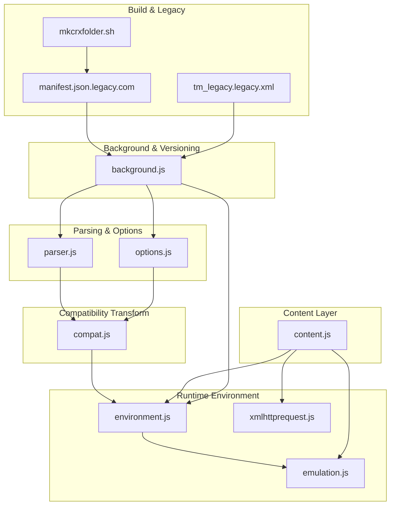
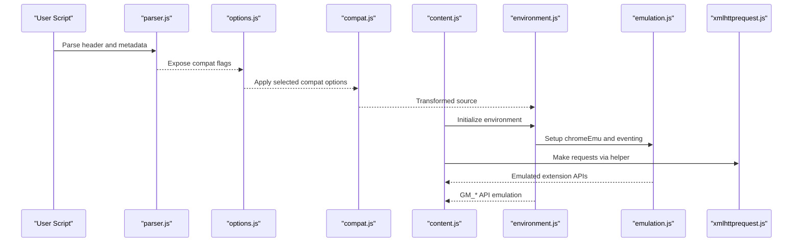
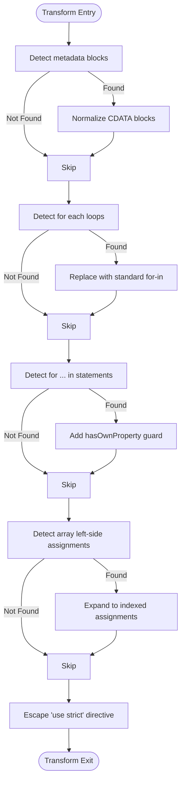
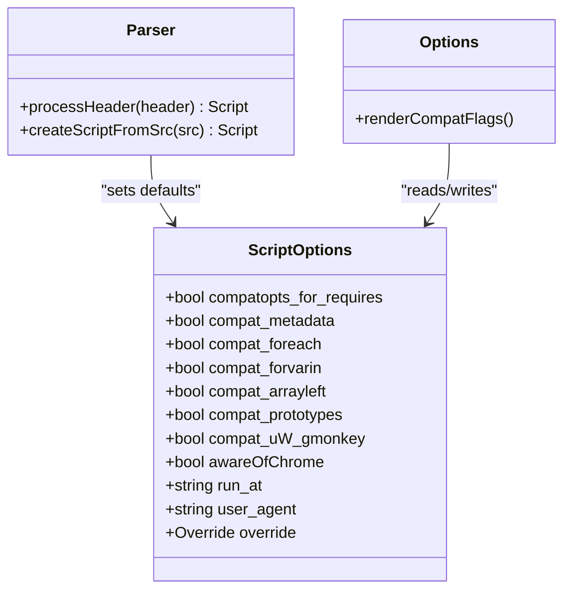
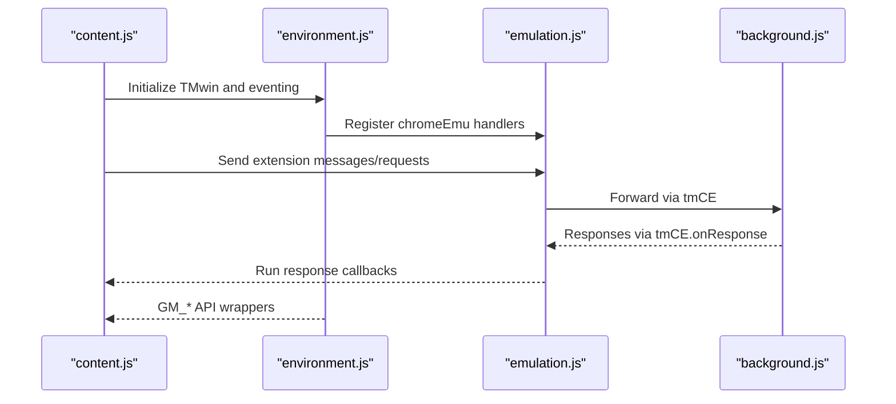
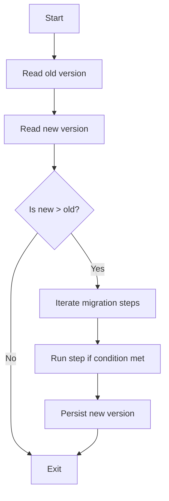
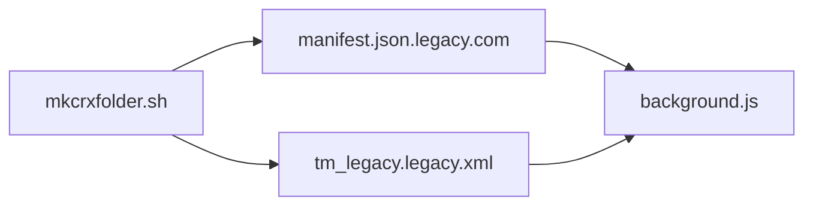
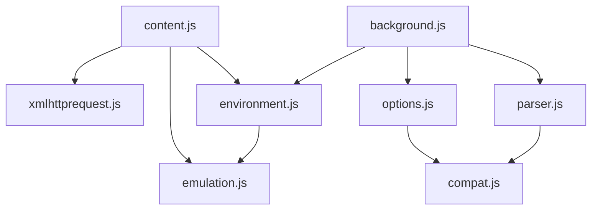

# Compatibility Modes

<cite>
**Referenced Files in This Document**
- [compat.js](file://src/compat.js)
- [environment.js](file://src/environment.js)
- [emulation.js](file://src/emulation.js)
- [parser.js](file://src/parser.js)
- [options.js](file://src/options.js)
- [background.js](file://src/background.js)
- [xmlhttprequest.js](file://src/xmlhttprequest.js)
- [content.js](file://src/content.js)
- [manifest.json.legacy.com](file://build_sys/manifest.json.legacy.com)
- [tm_legacy.legacy.xml](file://build_sys/tm_legacy.legacy.xml)
- [mkcrxfolder.sh](file://build_sys/mkcrxfolder.sh)
- [README.md](file://README.md)
</cite>

## Table of Contents
1. [Introduction](#introduction)
2. [Project Structure](#project-structure)
3. [Core Components](#core-components)
4. [Architecture Overview](#architecture-overview)
5. [Detailed Component Analysis](#detailed-component-analysis)
6. [Dependency Analysis](#dependency-analysis)
7. [Performance Considerations](#performance-considerations)
8. [Troubleshooting Guide](#troubleshooting-guide)
9. [Conclusion](#conclusion)
10. [Appendices](#appendices)

## Introduction
This document explains how Tampermonkey maintains compatibility across different userscript managers and versions, focusing on:
- Compatibility modes for legacy JavaScript features and APIs
- Version detection and migration strategies
- Automatic fallback behaviors for environment differences
- Migration paths from older managers and deprecated APIs
- Backward compatibility strategies and testing approaches

It synthesizes the compatibility transformations, environment emulation, and version management logic present in the repository to help users and developers understand how scripts are adapted and executed consistently across environments.

## Project Structure
The compatibility system spans several modules:
- Parser and options expose compatibility flags and auto-detection
- Compatibility transformer applies source-level fixes
- Environment and emulation layers emulate Chrome APIs and events
- Background orchestrates version detection and migration
- Build artifacts define legacy manifest and update channel

**Diagram sources**
- [parser.js:29-67](file://src/parser.js#L29-L67)
- [options.js:1124-1143](file://src/options.js#L1124-L1143)
- [compat.js:13-27](file://src/compat.js#L13-L27)
- [environment.js:1053-1131](file://src/environment.js#L1053-L1131)
- [emulation.js:40-329](file://src/emulation.js#L40-L329)
- [xmlhttprequest.js:17-160](file://src/xmlhttprequest.js#L17-L160)
- [content.js:108-453](file://src/content.js#L108-L453)
- [background.js:83-106](file://src/background.js#L83-L106)
- [manifest.json.legacy.com:1-38](file://build_sys/manifest.json.legacy.com#L1-L38)
- [tm_legacy.legacy.xml:1-7](file://build_sys/tm_legacy.legacy.xml#L1-L7)
- [mkcrxfolder.sh:83-93](file://build_sys/mkcrxfolder.sh#L83-L93)

**Section sources**
- [parser.js:29-67](file://src/parser.js#L29-L67)
- [options.js:1124-1143](file://src/options.js#L1124-L1143)
- [compat.js:13-27](file://src/compat.js#L13-L27)
- [environment.js:1053-1131](file://src/environment.js#L1053-L1131)
- [emulation.js:40-329](file://src/emulation.js#L40-L329)
- [xmlhttprequest.js:17-160](file://src/xmlhttprequest.js#L17-L160)
- [content.js:108-453](file://src/content.js#L108-L453)
- [background.js:83-106](file://src/background.js#L83-L106)
- [manifest.json.legacy.com:1-38](file://build_sys/manifest.json.legacy.com#L1-L38)
- [tm_legacy.legacy.xml:1-7](file://build_sys/tm_legacy.legacy.xml#L1-L7)
- [mkcrxfolder.sh:83-93](file://build_sys/mkcrxfolder.sh#L83-L93)

## Core Components
- Compatibility transformer: Applies per-script compatibility fixes for legacy constructs and metadata blocks.
- Environment and emulation: Emulates Chrome extension APIs and events, and adapts DOM/XHR behaviors.
- Parser and options: Detects and exposes compatibility flags; persists user preferences.
- Version detection and migration: Compares old/new versions and runs migration steps.
- Legacy build pipeline: Produces a manifest version 1 package for older Chromium.

**Section sources**
- [compat.js:13-27](file://src/compat.js#L13-L27)
- [environment.js:1053-1131](file://src/environment.js#L1053-L1131)
- [emulation.js:40-329](file://src/emulation.js#L40-L329)
- [parser.js:29-67](file://src/parser.js#L29-L67)
- [options.js:1124-1143](file://src/options.js#L1124-L1143)
- [background.js:83-106](file://src/background.js#L83-L106)
- [manifest.json.legacy.com:1-38](file://build_sys/manifest.json.legacy.com#L1-L38)

## Architecture Overview
The compatibility pipeline integrates parsing, transformation, environment emulation, and runtime execution:

**Diagram sources**
- [parser.js:251-281](file://src/parser.js#L251-L281)
- [options.js:1124-1143](file://src/options.js#L1124-L1143)
- [compat.js:14-26](file://src/compat.js#L14-L26)
- [content.js:108-182](file://src/content.js#L108-L182)
- [environment.js:1053-1131](file://src/environment.js#L1053-L1131)
- [emulation.js:40-329](file://src/emulation.js#L40-L329)
- [xmlhttprequest.js:17-160](file://src/xmlhttprequest.js#L17-L160)

## Detailed Component Analysis

### Compatibility Transformer (compat.js)
Purpose:
- Normalize legacy JavaScript constructs and metadata blocks to be compatible with the current engine.

Key capabilities:
- Metadata block normalization (CDATA-like blocks)
- for each loop replacement
- for ... in scoping fix
- Left-hand side array destructuring conversion
- Disable strict mode by escaping the directive

Processing logic:
- Applies selected transforms based on script options and auto-detected needs.
- Escapes “use strict” to prevent strict mode failures.

**Diagram sources**
- [compat.js:14-26](file://src/compat.js#L14-L26)
- [compat.js:28-38](file://src/compat.js#L28-L38)
- [compat.js:41-97](file://src/compat.js#L41-L97)
- [compat.js:114-151](file://src/compat.js#L114-L151)
- [compat.js:167-213](file://src/compat.js#L167-L213)
- [compat.js:238-270](file://src/compat.js#L238-L270)

**Section sources**
- [compat.js:14-26](file://src/compat.js#L14-L26)
- [compat.js:28-38](file://src/compat.js#L28-L38)
- [compat.js:41-97](file://src/compat.js#L41-L97)
- [compat.js:114-151](file://src/compat.js#L114-L151)
- [compat.js:167-213](file://src/compat.js#L167-L213)
- [compat.js:238-270](file://src/compat.js#L238-L270)

### Parser and Options (parser.js, options.js)
Purpose:
- Parse user script headers and detect compatibility needs.
- Expose user-configurable compatibility flags and defaults.

Highlights:
- Auto-detects compatibility needs (metadata, foreach, array left-hand side, prototypes).
- Flags include: compat_metadata, compat_foreach, compat_forvarin, compat_arrayleft, compat_prototypes, compat_uW_gmonkey.
- Options UI exposes toggles for these flags and a checkbox to apply to required scripts.

**Diagram sources**
- [parser.js:29-67](file://src/parser.js#L29-L67)
- [parser.js:251-281](file://src/parser.js#L251-L281)
- [options.js:1124-1143](file://src/options.js#L1124-L1143)

**Section sources**
- [parser.js:29-67](file://src/parser.js#L29-L67)
- [parser.js:251-281](file://src/parser.js#L251-L281)
- [options.js:1124-1143](file://src/options.js#L1124-L1143)

### Environment and GM API Emulation (environment.js, emulation.js)
Purpose:
- Provide a sandboxed execution environment and emulate GM_* APIs.
- Bridge content script execution to background via chromeEmu.

Highlights:
- GM_EMU class exposes GM_* functions mapped to TM_* equivalents.
- chromeEmu bridges extension messaging, ports, tabs, i18n, and XML HTTP requests.
- Eventing layer simulates DOM events and manages load timing.

**Diagram sources**
- [environment.js:1053-1131](file://src/environment.js#L1053-L1131)
- [emulation.js:40-329](file://src/emulation.js#L40-L329)
- [content.js:217-453](file://src/content.js#L217-L453)

**Section sources**
- [environment.js:1053-1131](file://src/environment.js#L1053-L1131)
- [emulation.js:40-329](file://src/emulation.js#L40-L329)
- [content.js:217-453](file://src/content.js#L217-L453)

### Version Detection and Migration (background.js)
Purpose:
- Determine current vs. stored version and run migration steps.
- Maintain backward compatibility across major releases.

Highlights:
- versionCmp compares semantic versions.
- convertData runs a series of migrations when upgrading.
- Persists new version after successful migration.

**Diagram sources**
- [background.js:83-106](file://src/background.js#L83-L106)
- [background.js:145-391](file://src/background.js#L145-L391)

**Section sources**
- [background.js:83-106](file://src/background.js#L83-L106)
- [background.js:145-391](file://src/background.js#L145-L391)

### Legacy Build and Update Channel (manifest.json.legacy.com, tm_legacy.legacy.xml, mkcrxfolder.sh)
Purpose:
- Produce a manifest version 1 build for older Chromium versions.
- Provide an update URL for legacy distribution.

Highlights:
- manifest.json.legacy.com defines permissions and background page for legacy builds.
- tm_legacy.legacy.xml provides update metadata for legacy channel.
- mkcrxfolder.sh selects legacy manifest and updates version in XML.

**Diagram sources**
- [manifest.json.legacy.com:1-38](file://build_sys/manifest.json.legacy.com#L1-L38)
- [tm_legacy.legacy.xml:1-7](file://build_sys/tm_legacy.legacy.xml#L1-L7)
- [mkcrxfolder.sh:83-93](file://build_sys/mkcrxfolder.sh#L83-L93)

**Section sources**
- [manifest.json.legacy.com:1-38](file://build_sys/manifest.json.legacy.com#L1-L38)
- [tm_legacy.legacy.xml:1-7](file://build_sys/tm_legacy.legacy.xml#L1-L7)
- [mkcrxfolder.sh:83-93](file://build_sys/mkcrxfolder.sh#L83-L93)

## Dependency Analysis
- Parser depends on Helper and Compat to compute defaults and transformations.
- Options reads and writes Script options that drive Compat.
- Environment depends on Emulation and XML HTTP helpers.
- Content layer depends on Emulation and Environment to bootstrap execution.
- Background orchestrates Parser, Options, and Environment during upgrades.

**Diagram sources**
- [parser.js:9-15](file://src/parser.js#L9-L15)
- [options.js:1124-1143](file://src/options.js#L1124-L1143)
- [compat.js:9](file://src/compat.js#L9)
- [environment.js:1053-1131](file://src/environment.js#L1053-L1131)
- [emulation.js:40-329](file://src/emulation.js#L40-L329)
- [xmlhttprequest.js:17-160](file://src/xmlhttprequest.js#L17-L160)
- [content.js:108-182](file://src/content.js#L108-L182)
- [background.js:28-34](file://src/background.js#L28-L34)

**Section sources**
- [parser.js:9-15](file://src/parser.js#L9-L15)
- [options.js:1124-1143](file://src/options.js#L1124-L1143)
- [compat.js:9](file://src/compat.js#L9)
- [environment.js:1053-1131](file://src/environment.js#L1053-L1131)
- [emulation.js:40-329](file://src/emulation.js#L40-L329)
- [xmlhttprequest.js:17-160](file://src/xmlhttprequest.js#L17-L160)
- [content.js:108-182](file://src/content.js#L108-L182)
- [background.js:28-34](file://src/background.js#L28-L34)

## Performance Considerations
- Compatibility transformations are applied per script; keep transform sets minimal to reduce overhead.
- Eventing and chromeEmu message routing add latency; batching and avoiding redundant registrations helps.
- Version migration steps run once per upgrade; ensure migrations short-circuit early when conditions are not met.
- Legacy manifest targets older Chromium; expect reduced performance compared to modern builds.

## Troubleshooting Guide
Common compatibility issues and remedies:
- Strict mode errors: Enable “Escape strict mode” in compatibility options; the transformer escapes the directive.
- for each loops: Enable “Replace for each statements”; the transformer converts to standard for-in loops.
- for ... in scoping: Enable “Fix for var in statements”; adds hasOwnProperty guards.
- Array left-hand side assignments: Enable “Convert Array Assignments”; expands destructuring to indexed assignments.
- UnsafeWindow access blocked: The content layer attempts to initialize unsafeWindow; if blocked by a script blocker, a detection alert is sent to background.
- GM_* API differences: Use GM_EMU wrappers; ensure chromeEmu is registered and reachable in the environment.
- XHR behavior: Use xmlhttpRequest helper; it normalizes headers and retries on failure.

**Section sources**
- [compat.js:14-26](file://src/compat.js#L14-L26)
- [compat.js:167-213](file://src/compat.js#L167-L213)
- [compat.js:238-270](file://src/compat.js#L238-L270)
- [content.js:455-608](file://src/content.js#L455-L608)
- [environment.js:1053-1131](file://src/environment.js#L1053-L1131)
- [xmlhttprequest.js:17-160](file://src/xmlhttprequest.js#L17-L160)

## Conclusion
Tampermonkey’s compatibility system combines source-level transformations, environment emulation, and robust version management to maintain broad compatibility across userscript managers and versions. By exposing granular compatibility flags, auto-detecting problematic constructs, and providing a bridge to Chrome APIs, it ensures scripts run reliably in diverse environments. The legacy build pipeline further extends reach to older Chromium versions.

## Appendices

### Compatibility Flags Reference
- compatopts_for_requires: Apply compatibility options to required scripts too.
- compat_metadata: Convert CDATA sections into a Chrome-compatible format.
- compat_foreach: Replace for each statements with standard loops.
- compat_forvarin: Fix for ... in statements with proper scoping.
- compat_arrayleft: Convert array left-hand side assignments to indexed assignments.
- compat_prototypes: Add toSource function to Object prototype (auto-detected).
- compat_uW_gmonkey: Treat unsafeWindow.gmonkey as a compatibility issue.

**Section sources**
- [options.js:1124-1143](file://src/options.js#L1124-L1143)
- [parser.js:265-278](file://src/parser.js#L265-L278)

### Version Management Notes
- Version comparison uses numeric segments; missing segments treated as zero.
- Migration steps run only when the new version exceeds the stored version.
- After migration, the new version is persisted.

**Section sources**
- [background.js:83-106](file://src/background.js#L83-L106)
- [background.js:145-391](file://src/background.js#L145-L391)

### Legacy Distribution Notes
- Manifest version 1 is produced for older Chromium.
- Update URL points to legacy update XML.
- Build script substitutes version into the legacy XML.

**Section sources**
- [manifest.json.legacy.com:1-38](file://build_sys/manifest.json.legacy.com#L1-L38)
- [tm_legacy.legacy.xml:1-7](file://build_sys/tm_legacy.legacy.xml#L1-L7)
- [mkcrxfolder.sh:83-93](file://build_sys/mkcrxfolder.sh#L83-L93)
- [README.md:36-40](file://README.md#L36-L40)