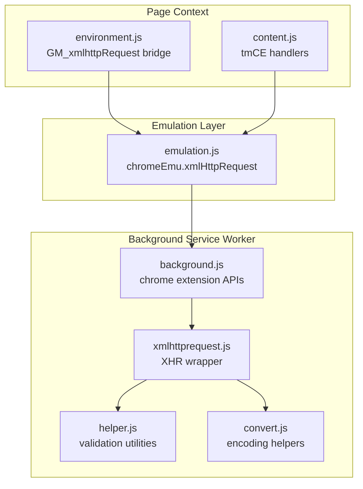
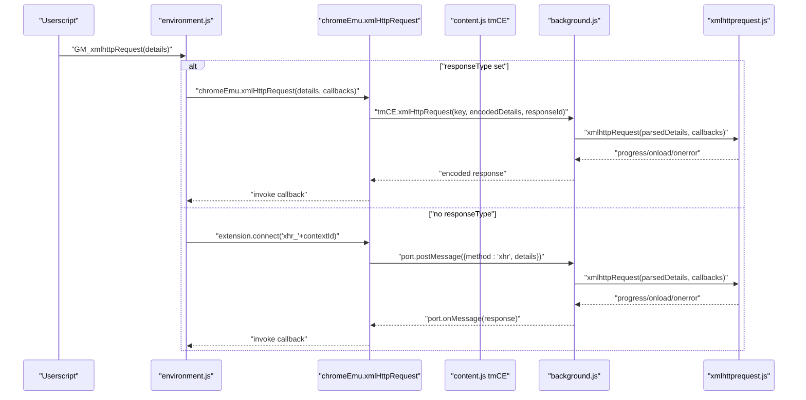
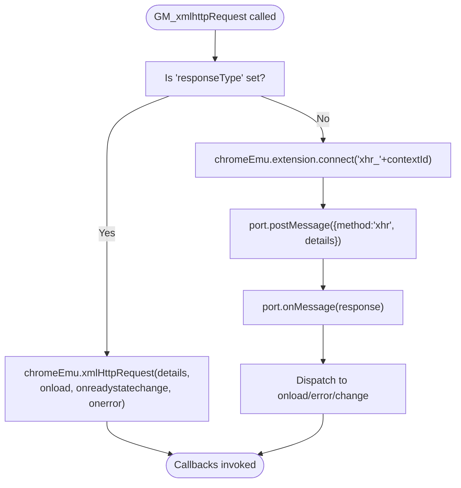
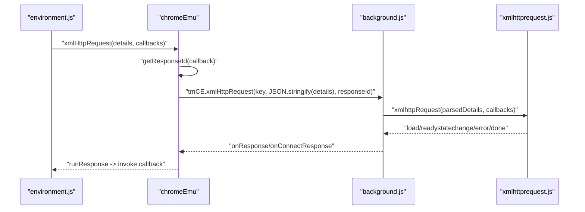
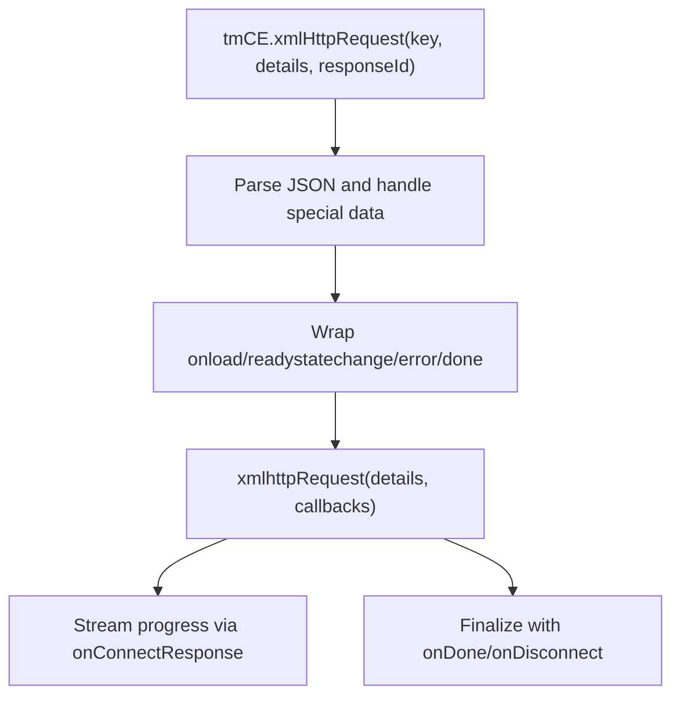
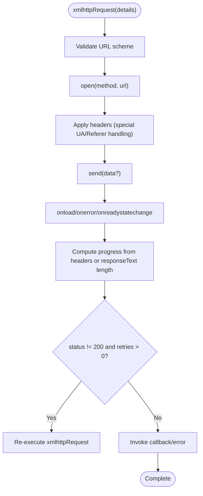
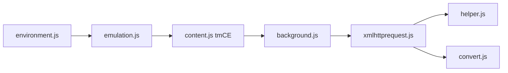

# Cross-Origin Request Handling

<cite>
**Referenced Files in This Document**
- [xmlhttprequest.js](file://src/xmlhttprequest.js)
- [emulation.js](file://src/emulation.js)
- [content.js](file://src/content.js)
- [background.js](file://src/background.js)
- [environment.js](file://src/environment.js)
- [helper.js](file://src/helper.js)
- [convert.js](file://src/convert.js)
</cite>

## Table of Contents
1. [Introduction](#introduction)
2. [Project Structure](#project-structure)
3. [Core Components](#core-components)
4. [Architecture Overview](#architecture-overview)
5. [Detailed Component Analysis](#detailed-component-analysis)
6. [Dependency Analysis](#dependency-analysis)
7. [Performance Considerations](#performance-considerations)
8. [Troubleshooting Guide](#troubleshooting-guide)
9. [Conclusion](#conclusion)

## Introduction
This document explains how Tampermonkey handles cross-origin requests originating from userscripts. It covers the request lifecycle, CORS and security constraints, request/response processing, retry logic, and error handling. It also documents the chromeEmu.xmlHttpRequest implementation, request queuing via message passing, and response transformation. Practical examples and best practices are included to guide secure and efficient cross-origin communication.

## Project Structure
The cross-origin request pipeline spans three layers:
- Userscript environment layer (page context) that exposes GM_xmlhttpRequest and routes requests to the emulation layer.
- Emulation layer that bridges page requests to the extension’s background service worker.
- Background service worker that executes the actual network requests and returns results back to the page.

**Diagram sources**
- [environment.js:700-747](file://src/environment.js#L700-L747)
- [content.js:217-453](file://src/content.js#L217-L453)
- [emulation.js:40-82](file://src/emulation.js#L40-L82)
- [background.js:28-34](file://src/background.js#L28-L34)
- [xmlhttprequest.js:1-161](file://src/xmlhttprequest.js#L1-L161)
- [helper.js:82-87](file://src/helper.js#L82-L87)
- [convert.js:7-38](file://src/convert.js#L7-L38)

**Section sources**
- [environment.js:700-747](file://src/environment.js#L700-L747)
- [content.js:217-453](file://src/content.js#L217-L453)
- [emulation.js:40-82](file://src/emulation.js#L40-L82)
- [background.js:28-34](file://src/background.js#L28-L34)
- [xmlhttprequest.js:1-161](file://src/xmlhttprequest.js#L1-L161)
- [helper.js:82-87](file://src/helper.js#L82-L87)
- [convert.js:7-38](file://src/convert.js#L7-L38)

## Core Components
- GM_xmlhttpRequest bridge: Translates userscript calls into emulation-layer requests and wires callbacks for onload, onreadystatechange, and onerror.
- chromeEmu.xmlHttpRequest: Emulates the Chrome extension API for XMLHttpRequests, routing details to the background and managing response callbacks.
- tmCE handlers: Receive page requests in the background, parse details, and execute the underlying XHR wrapper.
- XHR wrapper: Validates URLs, sets headers, handles response types, progress reporting, retries, and error propagation.
- Helper utilities: Provide URL validation and string parsing for response headers.
- Convert utilities: Provide encoding/decoding helpers used during message transport.

**Section sources**
- [environment.js:700-747](file://src/environment.js#L700-L747)
- [emulation.js:52-82](file://src/emulation.js#L52-L82)
- [content.js:309-342](file://src/content.js#L309-L342)
- [xmlhttprequest.js:17-153](file://src/xmlhttprequest.js#L17-L153)
- [helper.js:82-87](file://src/helper.js#L82-L87)
- [convert.js:7-38](file://src/convert.js#L7-L38)

## Architecture Overview
The request flow depends on whether the userscript specifies a responseType. If present, the emulation layer directly invokes chromeEmu.xmlHttpRequest. Otherwise, a persistent port is established for streaming updates and finalization.

**Diagram sources**
- [environment.js:700-747](file://src/environment.js#L700-L747)
- [emulation.js:52-82](file://src/emulation.js#L52-L82)
- [content.js:309-342](file://src/content.js#L309-L342)
- [background.js:309-342](file://src/background.js#L309-L342)
- [xmlhttprequest.js:17-153](file://src/xmlhttprequest.js#L17-L153)

## Detailed Component Analysis

### GM_xmlhttpRequest Bridge (environment.js)
- Determines whether to use emulation path with responseType or port-based streaming.
- For responseType set, invokes chromeEmu.xmlHttpRequest directly.
- For no responseType, connects to a named port and streams progress until completion.

**Diagram sources**
- [environment.js:700-747](file://src/environment.js#L700-L747)

**Section sources**
- [environment.js:700-747](file://src/environment.js#L700-L747)

### Emulation Layer (emulation.js)
- Provides chromeEmu.xmlHttpRequest to route details to background.
- Manages responseId registration and callback dispatch.
- Encodes details and data payloads for transport.

**Diagram sources**
- [emulation.js:52-82](file://src/emulation.js#L52-L82)
- [content.js:309-342](file://src/content.js#L309-L342)
- [xmlhttprequest.js:17-153](file://src/xmlhttprequest.js#L17-L153)

**Section sources**
- [emulation.js:52-82](file://src/emulation.js#L52-L82)
- [content.js:309-342](file://src/content.js#L309-L342)

### Background tmCE Handlers (content.js)
- Receives page requests via tmCE.xmlHttpRequest and tmCE.onMessage.
- Parses details, handles special data objects, and executes xmlhttpRequest.
- Streams progress and finalizes with onDone and optional onDisconnect.

**Diagram sources**
- [content.js:309-342](file://src/content.js#L309-L342)
- [xmlhttprequest.js:17-153](file://src/xmlhttprequest.js#L17-L153)

**Section sources**
- [content.js:309-342](file://src/content.js#L309-L342)
- [xmlhttprequest.js:17-153](file://src/xmlhttprequest.js#L17-L153)

### XHR Wrapper (xmlhttprequest.js)
- Validates URL scheme and throws on invalid scheme.
- Opens XHR, applies headers (with special handling for User-Agent and Referer when webRequest is configured).
- Supports overrideMimeType and responseType.
- Computes progress from Content-Length when available.
- Implements retry logic on onload/onerror for non-200 statuses.
- Normalizes response headers and finalUrl, strips injected TM-finalURL.

**Diagram sources**
- [xmlhttprequest.js:17-153](file://src/xmlhttprequest.js#L17-L153)

**Section sources**
- [xmlhttprequest.js:17-153](file://src/xmlhttprequest.js#L17-L153)

### Helper Utilities (helper.js)
- Provides isLocalImage to allow local image URLs.
- Supplies getStringBetweenTags for extracting header values.

**Section sources**
- [helper.js:82-87](file://src/helper.js#L82-L87)
- [helper.js:29-43](file://src/helper.js#L29-L43)

### Encoding Utilities (convert.js)
- Provides Base64 and UTF-8 helpers used for message transport.

**Section sources**
- [convert.js:7-38](file://src/convert.js#L7-L38)

## Dependency Analysis
- environment.js depends on chromeEmu for request routing and on background ports for streaming.
- emulation.js depends on content.js tmCE for transport and on background for execution.
- background.js depends on xmlhttprequest.js for request execution and on helper/convert for utilities.
- xmlhttprequest.js depends on helper for URL validation and on convert for encoding.

**Diagram sources**
- [environment.js:700-747](file://src/environment.js#L700-L747)
- [emulation.js:40-82](file://src/emulation.js#L40-L82)
- [content.js:217-453](file://src/content.js#L217-L453)
- [background.js:28-34](file://src/background.js#L28-L34)
- [xmlhttprequest.js:1-161](file://src/xmlhttprequest.js#L1-L161)
- [helper.js:82-87](file://src/helper.js#L82-L87)
- [convert.js:7-38](file://src/convert.js#L7-L38)

**Section sources**
- [environment.js:700-747](file://src/environment.js#L700-L747)
- [emulation.js:40-82](file://src/emulation.js#L40-L82)
- [content.js:217-453](file://src/content.js#L217-L453)
- [background.js:28-34](file://src/background.js#L28-L34)
- [xmlhttprequest.js:1-161](file://src/xmlhttprequest.js#L1-L161)
- [helper.js:82-87](file://src/helper.js#L82-L87)
- [convert.js:7-38](file://src/convert.js#L7-L38)

## Performance Considerations
- Progress computation: Uses Content-Length when available; otherwise estimates from responseText length. This avoids heavy parsing and reduces overhead.
- Retries: Implemented only for onload/onerror on non-200 statuses. Configure retries globally in the background to balance resilience and latency.
- Streaming vs. direct: When responseType is set, emulation bypasses port streaming for lower overhead. Without responseType, port-based streaming provides granular progress updates.
- Header handling: Special-case User-Agent and Referer when webRequest is enabled to avoid conflicts with browser defaults.

[No sources needed since this section provides general guidance]

## Troubleshooting Guide
Common failure modes and diagnostics:
- Invalid scheme errors: Requests with disallowed schemes are rejected early. Ensure URLs use http/https or local images.
- Non-200 responses: The wrapper retries on onload/onerror for non-200 statuses if retries remain. Verify server responses and network conditions.
- Progress reporting: If Content-Length is missing, progress is computed from responseText length. Large responses may show imprecise progress.
- Port-based streaming: Ensure the port remains connected; onDone triggers onDisconnect to clean up listeners.
- Debugging tips:
  - Enable logging in environment and background layers to trace request flow.
  - Inspect finalUrl normalization and stripped TM-finalURL headers.
  - Validate header transformations for User-Agent and Referer when webRequest is enabled.

**Section sources**
- [xmlhttprequest.js:115-152](file://src/xmlhttprequest.js#L115-L152)
- [xmlhttprequest.js:62-92](file://src/xmlhttprequest.js#L62-L92)
- [xmlhttprequest.js:94-110](file://src/xmlhttprequest.js#L94-L110)
- [content.js:326-335](file://src/content.js#L326-L335)
- [environment.js:700-747](file://src/environment.js#L700-L747)

## Security Considerations
- URL scheme validation: Only http/https and local images are accepted. Attempts to use other schemes are blocked.
- Header overrides: User-Agent and Referer are prefixed when webRequest is enabled to avoid conflicts. Respect site policies and avoid spoofing.
- Transport encoding: Details are encoded/decoded using Base64 and UTF-8 helpers during message passing to prevent injection issues.
- CORS: The extension relies on browser-native CORS handling. Ensure servers set appropriate Access-Control-Allow-* headers for cross-origin requests.

**Section sources**
- [xmlhttprequest.js:12-15](file://src/xmlhttprequest.js#L12-L15)
- [xmlhttprequest.js:118-127](file://src/xmlhttprequest.js#L118-L127)
- [convert.js:7-38](file://src/convert.js#L7-L38)

## Best Practices
- Prefer explicit responseType when you do not need incremental progress; it reduces overhead.
- Set retries judiciously to handle transient network errors without masking persistent failures.
- Use Content-Length headers on server responses to improve progress accuracy.
- Avoid overriding User-Agent and Referer unless necessary; respect site policies.
- For large cross-origin responses, consider chunked processing and handle ArrayBuffer/dataView appropriately.

[No sources needed since this section provides general guidance]

## Practical Examples

### Example 1: GET request with JSON response
- Use responseType: "json" to receive structured data.
- Attach onload to process the parsed response.
- Use onerror to capture failures.

**Section sources**
- [environment.js:700-747](file://src/environment.js#L700-L747)

### Example 2: POST form submission
- Provide method: "POST" and data payload.
- Set appropriate Content-Type header.
- Use onreadystatechange to monitor progress.

**Section sources**
- [xmlhttprequest.js:118-138](file://src/xmlhttprequest.js#L118-L138)
- [xmlhttprequest.js:94-110](file://src/xmlhttprequest.js#L94-L110)

### Example 3: Handling redirects and final URL
- The wrapper normalizes finalUrl from TM-finalURL header and strips injected headers from responseHeaders.
- Use finalUrl to track the effective URL after redirects.

**Section sources**
- [xmlhttprequest.js:30-44](file://src/xmlhttprequest.js#L30-L44)
- [background.js:5917-5917](file://src/background.js#L5917-L5917)

### Example 4: Authentication headers
- Add Authorization or custom headers in details.headers.
- For User-Agent/Referer, the wrapper may prefix them when webRequest is enabled.

**Section sources**
- [xmlhttprequest.js:118-127](file://src/xmlhttprequest.js#L118-L127)

### Example 5: Debugging request failures
- Enable logging in environment and background layers.
- Inspect status/statusText and responseHeaders.
- Verify retries and finalUrl.

**Section sources**
- [xmlhttprequest.js:62-92](file://src/xmlhttprequest.js#L62-L92)
- [xmlhttprequest.js:139-152](file://src/xmlhttprequest.js#L139-L152)

## Conclusion
Tampermonkey’s cross-origin request handling combines a userscript-friendly GM_xmlhttpRequest interface with a robust emulation and background execution pipeline. The system validates URLs, supports flexible headers and response types, streams progress, and retries transient failures. By understanding the flow and applying the best practices outlined above, users can reliably perform cross-origin requests while adhering to security and performance guidelines.