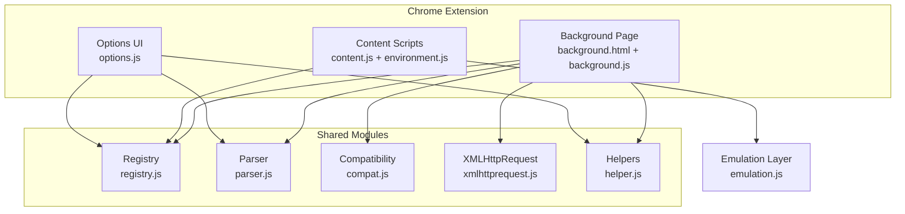
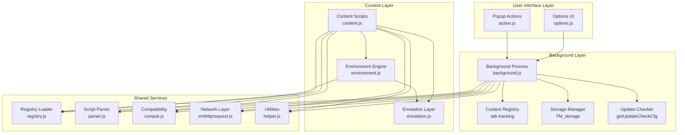
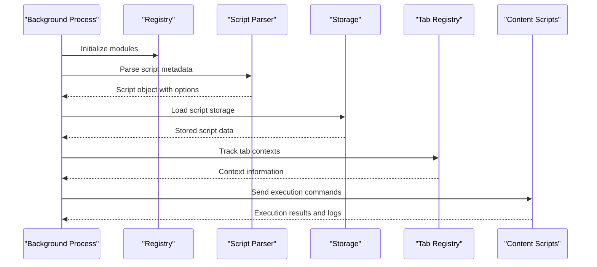
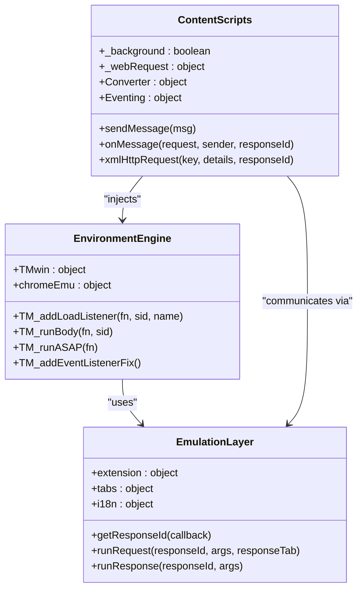
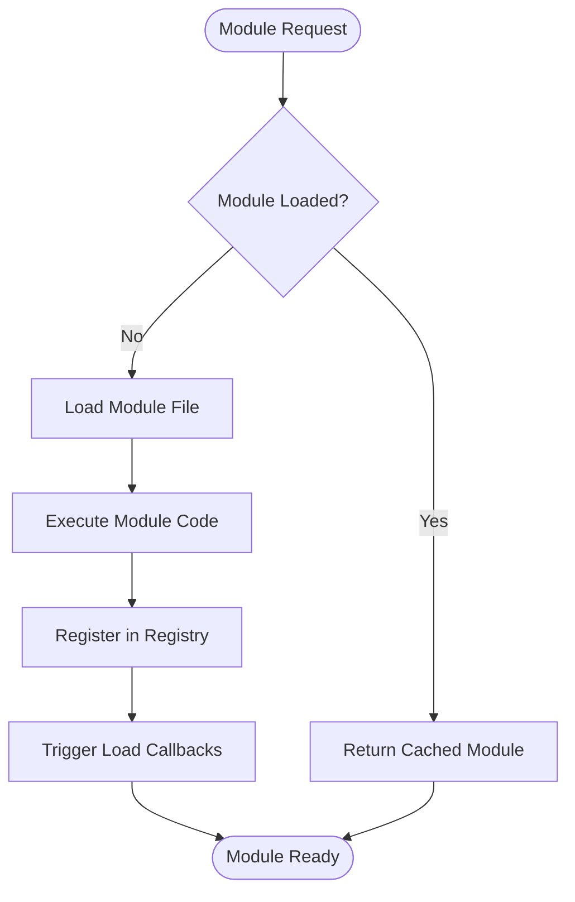
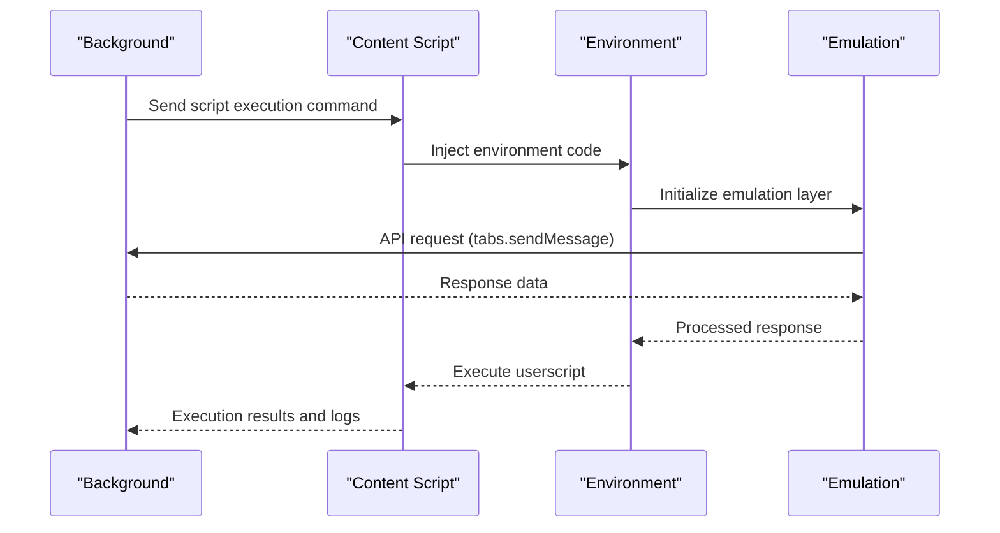
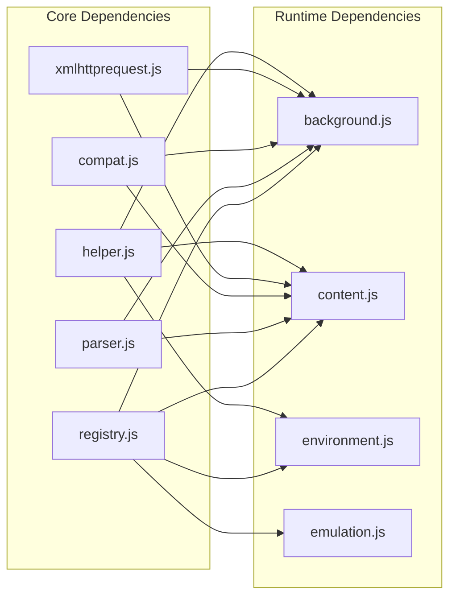

# Architecture Overview

<cite>
**Referenced Files in This Document**
- [background.js](file://src/background.js)
- [content.js](file://src/content.js)
- [environment.js](file://src/environment.js)
- [registry.js](file://src/registry.js)
- [emulation.js](file://src/emulation.js)
- [xmlhttprequest.js](file://src/xmlhttprequest.js)
- [parser.js](file://src/parser.js)
- [helper.js](file://src/helper.js)
- [compat.js](file://src/compat.js)
- [background.html](file://src/background.html)
- [options.js](file://src/options.js)
- [README.md](file://README.md)
</cite>

## Table of Contents
1. [Introduction](#introduction)
2. [Project Structure](#project-structure)
3. [Core Components](#core-components)
4. [Architecture Overview](#architecture-overview)
5. [Detailed Component Analysis](#detailed-component-analysis)
6. [Dependency Analysis](#dependency-analysis)
7. [Performance Considerations](#performance-considerations)
8. [Troubleshooting Guide](#troubleshooting-guide)
9. [Conclusion](#conclusion)

## Introduction
This document presents the architectural design of Tampermonkey, a popular userscript manager for Google Chrome. The system is built around a plugin-like architecture that separates concerns among three primary components: the background process, content scripts, and the environment engine. It leverages Chrome extension architecture patterns, including message passing, storage, and cross-frame isolation, to provide a robust platform for userscript execution with extensive compatibility and extensibility.

## Project Structure
The project follows a modular JavaScript architecture with a registry-based loader system. Key modules include:
- Background process: orchestrates script lifecycle, storage, updates, and cross-tab coordination
- Content scripts: inject and execute userscripts in target pages with isolated environments
- Environment engine: provides a sandboxed execution context and emulates Chrome APIs
- Utility modules: parsing, compatibility, networking, and helpers

**Diagram sources**
- [background.html:1-19](file://src/background.html#L1-L19)
- [background.js:1-120](file://src/background.js#L1-L120)
- [content.js:1-120](file://src/content.js#L1-L120)
- [environment.js:1-60](file://src/environment.js#L1-L60)
- [registry.js:1-107](file://src/registry.js#L1-L107)
- [parser.js:1-60](file://src/parser.js#L1-L60)
- [compat.js:1-60](file://src/compat.js#L1-L60)
- [xmlhttprequest.js:1-60](file://src/xmlhttprequest.js#L1-L60)
- [helper.js:1-60](file://src/helper.js#L1-L60)
- [options.js:1-60](file://src/options.js#L1-L60)

**Section sources**
- [README.md:1-112](file://README.md#L1-L112)
- [background.html:1-19](file://src/background.html#L1-L19)

## Core Components
The system is composed of three major components that collaborate to deliver userscript execution:

- Background Process
  - Manages script storage, metadata parsing, update checks, and cross-tab coordination
  - Implements a context registry to track per-tab execution contexts
  - Provides storage listeners and update mechanisms
  - Handles script installation, synchronization, and migration logic

- Content Scripts
  - Inject userscripts into target pages with isolated execution contexts
  - Manage eventing, logging, and response routing between content and background
  - Provide unsafeWindow access and DOM manipulation capabilities
  - Coordinate with the environment engine for API emulation

- Environment Engine
  - Creates sandboxed execution contexts for userscripts
  - Emulates Chrome extension APIs (tabs, storage, i18n) for userscripts
  - Provides event handling, DOM mutation simulation, and compatibility fixes
  - Manages script lifecycle including document-ready events and cleanup

**Section sources**
- [background.js:435-580](file://src/background.js#L435-L580)
- [content.js:108-215](file://src/content.js#L108-L215)
- [environment.js:1-120](file://src/environment.js#L1-L120)

## Architecture Overview
The architecture employs a layered design with clear separation of concerns:

**Diagram sources**
- [background.js:560-640](file://src/background.js#L560-L640)
- [content.js:1-120](file://src/content.js#L1-L120)
- [environment.js:1-120](file://src/environment.js#L1-L120)
- [registry.js:1-107](file://src/registry.js#L1-L107)
- [parser.js:1-60](file://src/parser.js#L1-L60)
- [compat.js:1-60](file://src/compat.js#L1-L60)
- [xmlhttprequest.js:1-60](file://src/xmlhttprequest.js#L1-L60)
- [helper.js:1-60](file://src/helper.js#L1-L60)

## Detailed Component Analysis

### Background Process Architecture
The background process serves as the central coordinator for all userscript operations:

**Diagram sources**
- [background.js:28-35](file://src/background.js#L28-L35)
- [parser.js:72-120](file://src/parser.js#L72-L120)
- [background.js:560-640](file://src/background.js#L560-L640)

Key responsibilities include:
- Module initialization and dependency loading via registry
- Script metadata parsing and validation
- Storage management for scripts and configurations
- Tab context tracking and script execution coordination
- Update checking and synchronization mechanisms

**Section sources**
- [background.js:28-80](file://src/background.js#L28-L80)
- [parser.js:29-67](file://src/parser.js#L29-L67)
- [background.js:560-640](file://src/background.js#L560-L640)

### Content Scripts and Environment Engine
The content layer provides isolated execution contexts for userscripts:

**Diagram sources**
- [content.js:108-215](file://src/content.js#L108-L215)
- [environment.js:40-120](file://src/environment.js#L40-L120)
- [emulation.js:40-120](file://src/emulation.js#L40-L120)

The content scripts coordinate with the environment engine to provide:
- Safe execution contexts with DOM isolation
- Event-driven script lifecycle management
- API emulation for Chrome extension functionality
- Communication bridges between userscripts and background processes

**Section sources**
- [content.js:108-215](file://src/content.js#L108-L215)
- [environment.js:195-380](file://src/environment.js#L195-L380)
- [emulation.js:40-120](file://src/emulation.js#L40-L120)

### Registry System and Plugin Architecture
The registry system enables a plugin-like architecture for modular loading:

**Diagram sources**
- [registry.js:48-104](file://src/registry.js#L48-L104)

The registry provides:
- Dynamic module loading and caching
- Dependency resolution and ordering
- Cross-module communication through shared objects
- Asynchronous module initialization

**Section sources**
- [registry.js:11-107](file://src/registry.js#L11-L107)

### Message Passing and Data Flow
Communication between components follows Chrome extension patterns:

**Diagram sources**
- [content.js:273-307](file://src/content.js#L273-L307)
- [emulation.js:260-273](file://src/emulation.js#L260-L273)
- [environment.js:693-747](file://src/environment.js#L693-L747)

Message flow characteristics:
- Bidirectional communication channels
- Response ID tracking for request-response correlation
- Port-based connections for persistent communication
- Encoded data transfer for cross-context safety

**Section sources**
- [content.js:273-307](file://src/content.js#L273-L307)
- [emulation.js:197-207](file://src/emulation.js#L197-L207)
- [environment.js:693-747](file://src/environment.js#L693-L747)

## Dependency Analysis
The system exhibits low coupling and high cohesion through its modular design:

**Diagram sources**
- [background.js:28-35](file://src/background.js#L28-L35)
- [content.js:80-83](file://src/content.js#L80-L83)
- [environment.js:7-35](file://src/environment.js#L7-L35)

Dependency characteristics:
- Shared utilities accessed through registry
- Runtime components depend on common infrastructure
- Loose coupling through message passing and eventing
- Clear separation between presentation and logic layers

**Section sources**
- [background.js:28-35](file://src/background.js#L28-L35)
- [content.js:80-83](file://src/content.js#L80-L83)
- [environment.js:7-35](file://src/environment.js#L7-L35)

## Performance Considerations
The architecture incorporates several performance optimizations:

- Lazy loading through the registry system reduces initial startup time
- Context registry minimizes redundant script execution across tabs
- Request-response correlation avoids callback overhead
- Caching mechanisms for script content and parsed metadata
- Efficient event handling with selective listener registration

## Troubleshooting Guide
Common issues and their resolution:

- Script execution failures: Check environment engine initialization and compatibility mode settings
- Communication timeouts: Verify message passing channels and response ID tracking
- Storage corruption: Review storage migration logic and backup mechanisms
- Memory leaks: Monitor cleanup procedures in environment engine and content scripts

**Section sources**
- [environment.js:309-323](file://src/environment.js#L309-L323)
- [content.js:1121-1156](file://src/content.js#L1121-L1156)
- [background.js:5361-5411](file://src/background.js#L5361-L5411)

## Conclusion
Tampermonkey's architecture demonstrates a sophisticated approach to userscript management through a well-separated three-tier design. The background process handles orchestration and persistence, content scripts provide isolated execution contexts, and the environment engine manages API emulation and compatibility. The registry-based plugin architecture enables extensibility while maintaining clear boundaries between components. This design successfully balances performance, reliability, and extensibility for userscript execution across diverse web environments.