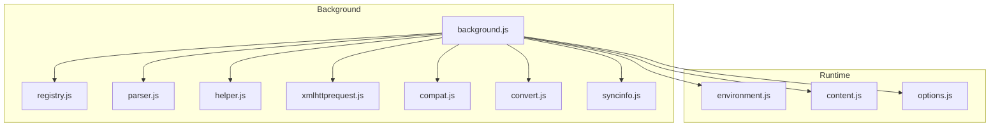
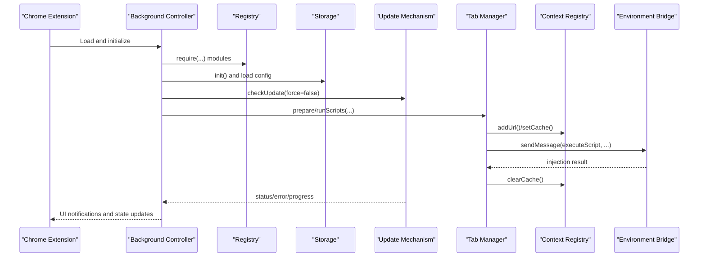
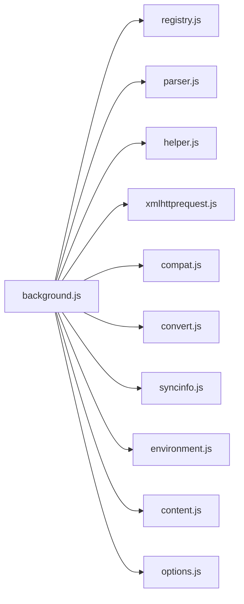

# Background Process

<cite>
**Referenced Files in This Document**
- [background.js](file://src/background.js)
- [registry.js](file://src/registry.js)
- [environment.js](file://src/environment.js)
- [syncinfo.js](file://src/syncinfo.js)
- [parser.js](file://src/parser.js)
- [helper.js](file://src/helper.js)
- [xmlhttprequest.js](file://src/xmlhttprequest.js)
- [compat.js](file://src/compat.js)
- [convert.js](file://src/convert.js)
- [content.js](file://src/content.js)
- [options.js](file://src/options.js)
</cite>

## Table of Contents
1. [Introduction](#introduction)
2. [Project Structure](#project-structure)
3. [Core Components](#core-components)
4. [Architecture Overview](#architecture-overview)
5. [Detailed Component Analysis](#detailed-component-analysis)
6. [Dependency Analysis](#dependency-analysis)
7. [Performance Considerations](#performance-considerations)
8. [Troubleshooting Guide](#troubleshooting-guide)
9. [Conclusion](#conclusion)

## Introduction
This document explains the background process component of Tampermonkey’s architecture. It focuses on the background script as the central coordinator for extension activities, including script lifecycle management, storage operations, update checking, inter-component communication, and tab management. It also documents the initialization sequence, module loading via the registry system, the main event loop, storage abstraction and persistence, configuration management, update mechanisms (including version comparison, migrations, and data conversion), and the context registry for tracking script execution contexts. Practical examples, error handling strategies, and performance optimization techniques are included to guide both developers and advanced users.

## Project Structure
The background process orchestrates multiple subsystems:
- Central background controller: initializes modules, manages storage, handles updates, and coordinates tabs and scripts.
- Module loader (registry): dynamic loading and registration of modules.
- Parser and helpers: metadata parsing, URL pattern normalization, and compatibility transformations.
- Storage layer: local database-backed cache and persistence.
- Synchronization client: Chrome sync and external sync providers.
- Environment and content bridge: safe execution context and messaging with content scripts.
- Options UI: configuration management and script administration.

**Diagram sources**
- [background.js](file://src/background.js)
- [registry.js](file://src/registry.js)
- [parser.js](file://src/parser.js)
- [helper.js](file://src/helper.js)
- [xmlhttprequest.js](file://src/xmlhttprequest.js)
- [compat.js](file://src/compat.js)
- [convert.js](file://src/convert.js)
- [syncinfo.js](file://src/syncinfo.js)
- [environment.js](file://src/environment.js)
- [content.js](file://src/content.js)
- [options.js](file://src/options.js)

**Section sources**
- [background.js](file://src/background.js)
- [registry.js](file://src/registry.js)

## Core Components
- Background controller: initializes configuration, storage, and update systems; manages tab and context registries; coordinates script installation, updates, and execution; integrates with Chrome extension APIs.
- Registry system: lazy-loading modules, registration hooks, and raw content retrieval.
- Parser and helpers: script metadata extraction, URL-to-regex conversion, and compatibility shims.
- Storage abstraction: SQLite-backed cache and persistence with type-aware serialization.
- Synchronization client: Chrome sync integration and external provider support.
- Environment and content bridge: safe execution context, event emulation, and cross-process messaging.
- Options UI: configuration management and script administration.

**Section sources**
- [background.js](file://src/background.js)
- [registry.js](file://src/registry.js)
- [parser.js](file://src/parser.js)
- [helper.js](file://src/helper.js)
- [xmlhttprequest.js](file://src/xmlhttprequest.js)
- [compat.js](file://src/compat.js)
- [convert.js](file://src/convert.js)
- [syncinfo.js](file://src/syncinfo.js)
- [environment.js](file://src/environment.js)
- [content.js](file://src/content.js)
- [options.js](file://src/options.js)

## Architecture Overview
The background process acts as the central hub:
- Initialization: loads configuration, sets logging levels, initializes storage, and starts update checks.
- Module loading: uses the registry to dynamically require and register modules.
- Script lifecycle: parses metadata, validates, installs/upgrades/downgrades, merges user overrides, and injects into tabs.
- Storage: persists configuration and script data, with a local SQLite cache.
- Updates: checks TamperFire DB, downloads and imports script catalogs, and notifies UI.
- Tabs and contexts: tracks per-tab execution state, caches run decisions, and coordinates injection.
- Synchronization: exports/import/removes scripts to/from external or Chrome sync stores.
- Inter-component communication: bridges to content scripts and options UI via Chrome messaging and ports.

**Diagram sources**
- [background.js](file://src/background.js)
- [registry.js](file://src/registry.js)
- [environment.js](file://src/environment.js)

## Detailed Component Analysis

### Background Controller
Responsibilities:
- Initialize logging, configuration, storage, and update systems.
- Manage script lifecycle: parse, validate, install, upgrade, downgrade, and factory reset.
- Coordinate tab preparation and script injection.
- Maintain context registry for per-tab execution state.
- Integrate with Chrome extension APIs for icons, notifications, and storage.

Key flows:
- Initialization sequence: adjust log level, load configuration, initialize storage, convert data, and schedule update checks.
- Script installation: parse source, compute hashes, prompt user if needed, persist script and storage, and notify options UI.
- Update mechanism: fetch remote DB version, compare with local, download and import JSON, and update counts and status.
- Tab management: prepare run info, cache decisions, and clear cache after injection.

Practical examples:
- Version comparison and migrations: [background.js](file://src/background.js)
- Require cache and resource fetching: [background.js](file://src/background.js)
- TamperFire DB operations: [background.js](file://src/background.js)
- Local file retrieval and caching: [background.js](file://src/background.js)

**Section sources**
- [background.js](file://src/background.js)

### Registry System
Responsibilities:
- Dynamic module loading via require/get/register.
- Raw content retrieval for embedded resources.
- Load handlers and asynchronous module initialization.

Patterns:
- Lazy loading: require triggers loadFile for missing modules.
- Registration: register and registerRaw store objects and raw content.
- Callback-driven initialization: onLoad and addLoadHandler coordinate module readiness.

**Section sources**
- [registry.js](file://src/registry.js)

### Parser and Helpers
Responsibilities:
- Parse script metadata and headers.
- Normalize includes/excludes/matches to regular expressions.
- Compatibility transformations for legacy scripts.

Key components:
- Script model and metadata extraction: [parser.js](file://src/parser.js)
- URL-to-regex conversion and safety fixes: [helper.js](file://src/helper.js)
- Compatibility shims: [compat.js](file://src/compat.js)
- Encoding/decoding utilities: [convert.js](file://src/convert.js)

**Section sources**
- [parser.js](file://src/parser.js)
- [helper.js](file://src/helper.js)
- [compat.js](file://src/compat.js)
- [convert.js](file://src/convert.js)

### Storage Abstraction Layer
Responsibilities:
- Provide a unified interface for configuration and script storage.
- Persist typed values with automatic serialization/deserialization.
- Maintain a local SQLite cache for fast reads.

Implementation highlights:
- Local DB creation and table initialization: [background.js](file://src/background.js)
- Type-aware setValue/getValue: [background.js](file://src/background.js)
- Cache invalidation and deletion: [background.js](file://src/background.js)

**Section sources**
- [background.js](file://src/background.js)

### Update Mechanism
Responsibilities:
- Periodic and forced update checks for TamperFire DB.
- Download and import script catalogs.
- Track update status and progress.

Flow:
- Version check against remote DB.
- Conditional download and JSON parsing.
- Bulk insert into SQLite tables with progress reporting.
- UI notifications and status updates.

**Section sources**
- [background.js](file://src/background.js)

### Tab Management and Context Registry
Responsibilities:
- Determine which scripts to run for a given URL/frame.
- Cache run decisions to avoid repeated computation.
- Track per-tab execution state and UI indicators.

Components:
- Tab manager: prepare/run scripts and reset state: [background.js](file://src/background.js)
- Context registry: per-tab URL tracking, user agent propagation, and cache: [background.js](file://src/background.js)

**Section sources**
- [background.js](file://src/background.js)

### Synchronization Client
Responsibilities:
- Enable/disable sync based on configuration.
- Export/import/remove scripts to/from external or Chrome sync stores.
- Schedule periodic sync and react to remote changes.

Integration:
- SyncInfo provider abstraction: [syncinfo.js](file://src/syncinfo.js)
- Chrome storage onChanged listener and time synchronization: [syncinfo.js](file://src/syncinfo.js)
- Background sync orchestration: [background.js](file://src/background.js)

**Section sources**
- [syncinfo.js](file://src/syncinfo.js)
- [background.js](file://src/background.js)

### Environment and Content Bridge
Responsibilities:
- Provide a safe execution context for injected scripts.
- Emulate Chrome APIs and events for user scripts.
- Bridge messaging between background and content scripts.

Highlights:
- Safe context initialization and unsafeWindow handling: [environment.js](file://src/environment.js)
- Event emulation and DOM event replay: [environment.js](file://src/environment.js)
- Message routing and port management: [content.js](file://src/content.js)

**Section sources**
- [environment.js](file://src/environment.js)
- [content.js](file://src/content.js)

### Options UI Integration
Responsibilities:
- Present configuration and script management UI.
- React to storage changes and update UI accordingly.
- Trigger background actions (e.g., reordering scripts, notifying options tab).

**Section sources**
- [options.js](file://src/options.js)

## Dependency Analysis
The background controller depends on:
- Registry for module loading.
- Parser and helpers for metadata and URL handling.
- Storage for persistence.
- Synchronization client for external and Chrome sync.
- Environment and content bridge for script execution and messaging.
- Options UI for configuration and script administration.

**Diagram sources**
- [background.js](file://src/background.js)
- [registry.js](file://src/registry.js)
- [parser.js](file://src/parser.js)
- [helper.js](file://src/helper.js)
- [xmlhttprequest.js](file://src/xmlhttprequest.js)
- [compat.js](file://src/compat.js)
- [convert.js](file://src/convert.js)
- [syncinfo.js](file://src/syncinfo.js)
- [environment.js](file://src/environment.js)
- [content.js](file://src/content.js)
- [options.js](file://src/options.js)

**Section sources**
- [background.js](file://src/background.js)
- [registry.js](file://src/registry.js)
- [parser.js](file://src/parser.js)
- [helper.js](file://src/helper.js)
- [xmlhttprequest.js](file://src/xmlhttprequest.js)
- [compat.js](file://src/compat.js)
- [convert.js](file://src/convert.js)
- [syncinfo.js](file://src/syncinfo.js)
- [environment.js](file://src/environment.js)
- [content.js](file://src/content.js)
- [options.js](file://src/options.js)

## Performance Considerations
- Require cache: reduce network overhead by caching fetched resources and headers with periodic cleanup.
- Bulk writes: batch inserts into SQLite to minimize transaction overhead during update imports.
- Local DB cache: maintain an in-memory cache of configuration values for fast reads.
- Debounced sync scheduling: coalesce sync requests and defer until storage permissions are granted.
- Efficient URL matching: precompute and reuse regular expressions for includes/excludes/matches.
- Asynchronous initialization: use callbacks and load handlers to avoid blocking startup.

[No sources needed since this section provides general guidance]

## Troubleshooting Guide
Common issues and strategies:
- Update failures: verify network connectivity, check TamperFire endpoint availability, and inspect download progress and parse errors.
- Storage corruption: clear local DB cache and reinitialize; fall back to localStorage when needed.
- Script injection problems: ensure safe context is enabled, verify user agent and frame conditions, and check blacklist for @require URLs.
- Sync conflicts: rely on Chrome’s conflict resolution; monitor onChanged events and schedule re-syncs when needed.
- Logging and diagnostics: adjust log level via configuration and use verbose logs to trace initialization, update, and injection steps.

**Section sources**
- [background.js](file://src/background.js)
- [environment.js](file://src/environment.js)
- [syncinfo.js](file://src/syncinfo.js)

## Conclusion
The background process is the backbone of Tampermonkey, coordinating module loading, script lifecycle, storage, updates, and tab management. Its registry-driven architecture enables modular and extensible behavior, while the storage abstraction and SQLite cache provide robust persistence. The update mechanism and synchronization client keep user scripts current and portable across devices. Together with the environment and content bridge, it ensures a secure and efficient execution environment for user scripts.

[No sources needed since this section summarizes without analyzing specific files]