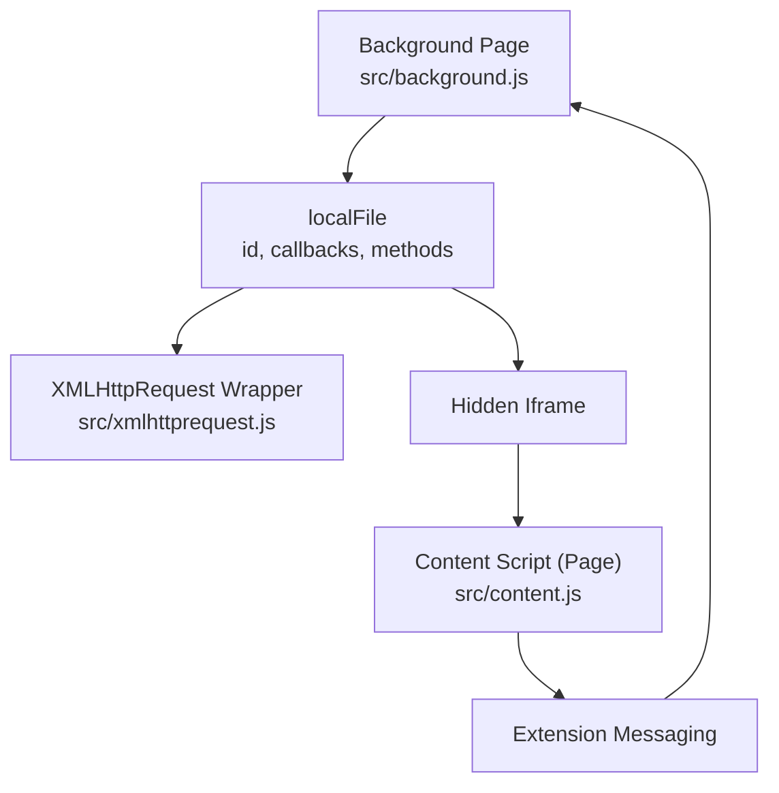
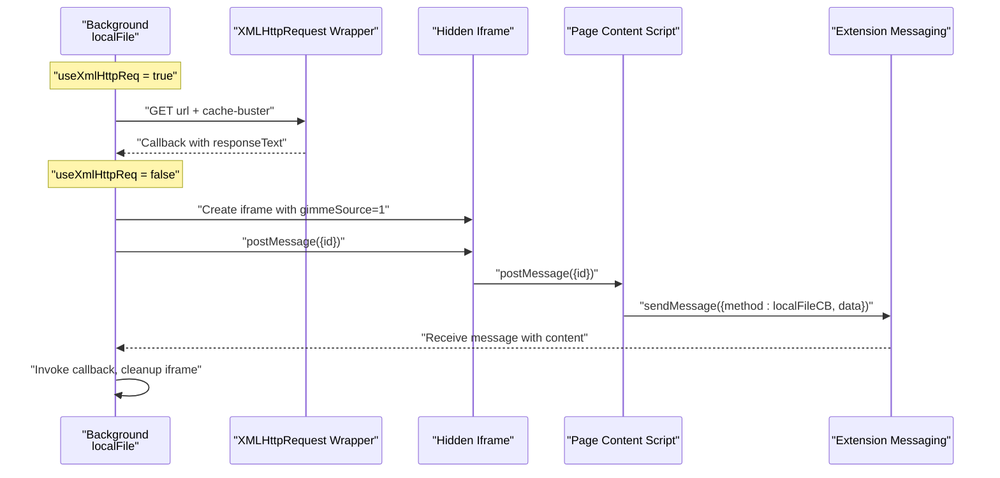
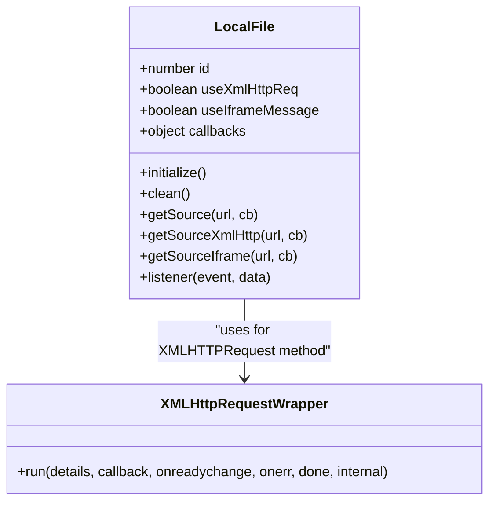
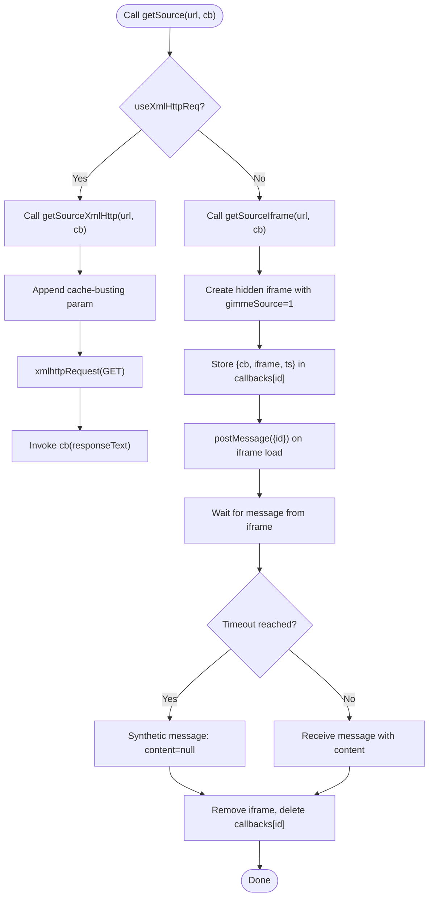
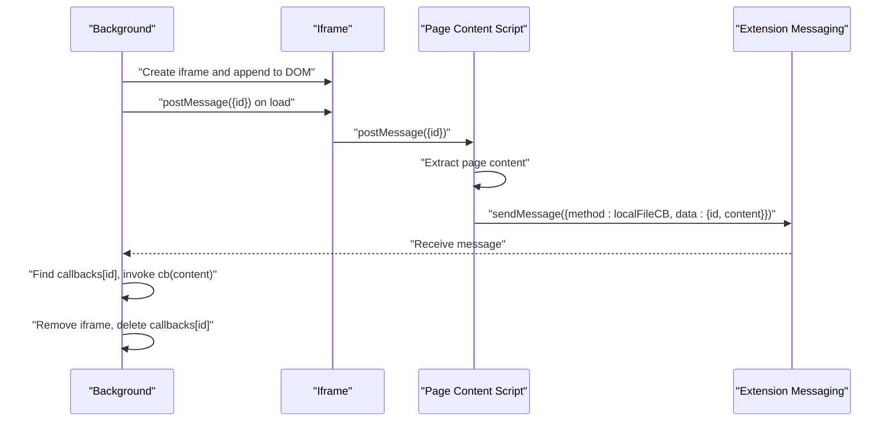
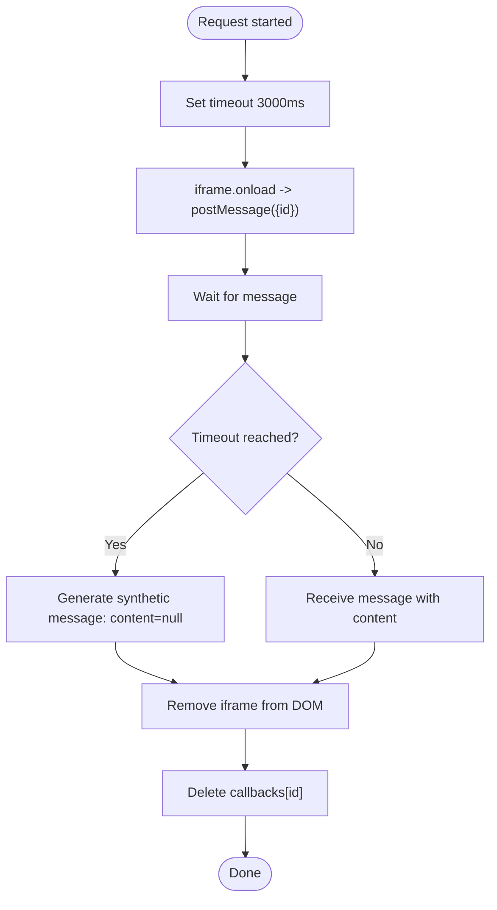
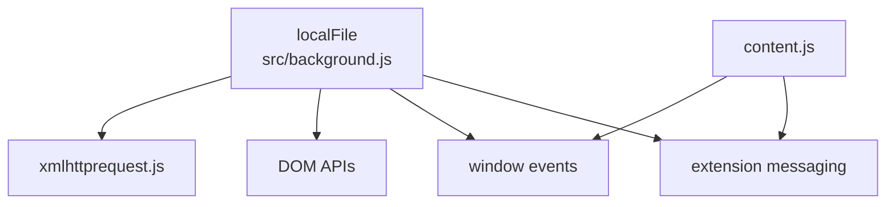

# Local File Access

<cite>
**Referenced Files in This Document**
- [background.js](file://src/background.js)
- [content.js](file://src/content.js)
- [xmlhttprequest.js](file://src/xmlhttprequest.js)
- [manifest.json.google.com](file://build_sys/manifest.json.google.com)
- [manifest.json.legacy.com](file://build_sys/manifest.json.legacy.com)
</cite>

## Table of Contents
1. [Introduction](#introduction)
2. [Project Structure](#project-structure)
3. [Core Components](#core-components)
4. [Architecture Overview](#architecture-overview)
5. [Detailed Component Analysis](#detailed-component-analysis)
6. [Dependency Analysis](#dependency-analysis)
7. [Performance Considerations](#performance-considerations)
8. [Troubleshooting Guide](#troubleshooting-guide)
9. [Conclusion](#conclusion)

## Introduction
This document explains the local file access system used by the extension to load local resources referenced via file:// URLs. It focuses on the localFile object, its ID management, callback handling, and the two access methods: XMLHTTPRequest and iframe-based message passing. It also documents the getSource function and its variants, fallback mechanisms, timeout and cleanup procedures, and security considerations. Practical examples demonstrate loading local userscripts and resources, and guidance is provided for debugging local file access issues.

## Project Structure
The local file access logic spans three key files:
- src/background.js: Implements the localFile object, including ID management, callback registry, XMLHTTPRequest and iframe-based retrieval, message listener, initialization, and cleanup.
- src/content.js: Runs in page context to receive postMessage requests from background, extract the page content, and send the result back to background via extension messaging.
- src/xmlhttprequest.js: Provides a cross-platform XHR wrapper used by localFile when the XMLHTTPRequest method is selected.

**Diagram sources**
- [background.js:661-765](file://src/background.js#L661-L765)
- [xmlhttprequest.js:17-161](file://src/xmlhttprequest.js#L17-L161)
- [content.js:19-39](file://src/content.js#L19-L39)

**Section sources**
- [background.js:661-765](file://src/background.js#L661-L765)
- [xmlhttprequest.js:17-161](file://src/xmlhttprequest.js#L17-L161)
- [content.js:19-39](file://src/content.js#L19-L39)

## Core Components
- localFile object
  - Purpose: Provide a unified interface to fetch local file contents for file:// URLs.
  - Key fields:
    - id: Monotonically increasing numeric identifier for each request.
    - useXmlHttpReq: Boolean flag selecting the preferred access method.
    - useIframeMessage: Boolean flag enabling iframe/message-based access.
    - callbacks: Map of active requests keyed by id, storing callback, iframe reference, and creation timestamp.
  - Methods:
    - getSource(url, cb): Chooses XMLHTTPRequest or iframe method based on flags.
    - getSourceXmlHttp(url, cb): Uses xmlhttpRequest to fetch content.
    - getSourceIframe(url, cb): Creates a hidden iframe, posts a message to it, and waits for a response.
    - listener(event, data): Processes incoming messages from the iframe, invokes the callback, cleans up the iframe, and removes the callback entry.
    - initialize(): Registers message and unload listeners when iframe mode is enabled.
    - clean(): Removes listeners and clears callback registry.
- xmlhttpRequest wrapper
  - Purpose: Cross-browser XHR abstraction used by localFile for XMLHTTPRequest method.
  - Behavior: Handles onload/onerror, retries, response state construction, and scheme validation.
- Content script (page context)
  - Purpose: Responds to postMessage from the iframe, extracts page content, and sends the result back to background via extension messaging.

**Section sources**
- [background.js:661-765](file://src/background.js#L661-L765)
- [xmlhttprequest.js:17-161](file://src/xmlhttprequest.js#L17-L161)
- [content.js:19-39](file://src/content.js#L19-L39)

## Architecture Overview
The system supports two complementary access paths for file:// URLs:

- XMLHTTPRequest path
  - Background constructs a GET request with a cache-busting parameter and delegates to xmlhttpRequest.
  - The response is delivered directly to the caller’s callback.

- Iframe/message path
  - Background creates a hidden iframe pointing to the target file:// URL with a special query parameter.
  - Background registers a message listener and sets a timeout to handle missing responses.
  - The iframe (running in page context) listens for a postMessage, extracts the page content, and posts it back to background via extension messaging.
  - Background receives the message, invokes the callback, removes the iframe, and clears the callback entry.

**Diagram sources**
- [background.js:698-725](file://src/background.js#L698-L725)
- [background.js:726-765](file://src/background.js#L726-L765)
- [content.js:19-39](file://src/content.js#L19-L39)
- [xmlhttprequest.js:17-161](file://src/xmlhttprequest.js#L17-L161)

## Detailed Component Analysis

### localFile object
The localFile object encapsulates all logic for local file access. It manages:
- ID assignment and incrementation for correlating requests and responses.
- Callback registration and cleanup.
- Two access methods: XMLHTTPRequest and iframe/message.
- Message listener and event cleanup.

Key behaviors:
- ID management: Each request increments a monotonically increasing id used to correlate messages.
- Callback handling: Each request stores a callback, iframe reference, and timestamp in the callbacks map.
- Fallback mechanism: The XMLHTTPRequest method appends a cache-busting parameter to avoid browser caching of file:// resources.
- Timeout and cleanup: A timeout handler triggers a synthetic message to resolve missing responses, and the iframe is removed after delivery.

**Diagram sources**
- [background.js:661-765](file://src/background.js#L661-L765)
- [xmlhttprequest.js:17-161](file://src/xmlhttprequest.js#L17-L161)

**Section sources**
- [background.js:661-765](file://src/background.js#L661-L765)

### getSource and variants
- getSource(url, cb)
  - Chooses XMLHTTPRequest or iframe method based on useXmlHttpReq flag.
- getSourceXmlHttp(url, cb)
  - Appends a cache-busting parameter to the URL.
  - Invokes xmlhttpRequest with a GET request and forwards the response text to the callback.
- getSourceIframe(url, cb)
  - Ensures listeners are registered if iframe mode is enabled.
  - Creates a hidden iframe with a special query parameter.
  - Stores the callback and iframe reference in the callbacks map.
  - Sets a timeout to handle missing responses.
  - Posts the request id to the iframe upon load.

**Diagram sources**
- [background.js:698-725](file://src/background.js#L698-L725)
- [background.js:726-765](file://src/background.js#L726-L765)

**Section sources**
- [background.js:698-725](file://src/background.js#L698-L725)
- [background.js:726-765](file://src/background.js#L726-L765)

### Message-based communication (iframe + extension messaging)
The iframe-based path relies on a two-way communication channel:
- Background-to-iframe: postMessage({id}) sent when the iframe loads.
- Iframe-to-background: The page content script listens for the message, extracts the page content, and sends it back to background via extension messaging. Background receives the message and invokes the stored callback.

**Diagram sources**
- [background.js:726-765](file://src/background.js#L726-L765)
- [content.js:19-39](file://src/content.js#L19-L39)

**Section sources**
- [background.js:726-765](file://src/background.js#L726-L765)
- [content.js:19-39](file://src/content.js#L19-L39)

### Timeout and cleanup procedures
- Timeout: A 3-second timeout is set per request. If the iframe does not respond within this period, a synthetic message is generated to resolve the callback with null content.
- Cleanup: On successful delivery, the iframe is removed from the DOM and the callback entry is deleted. On initialization, message and unload listeners are registered; on cleanup, they are removed and the callbacks map is cleared.

**Diagram sources**
- [background.js:738-765](file://src/background.js#L738-L765)

**Section sources**
- [background.js:738-765](file://src/background.js#L738-L765)

### Security considerations
- Scheme validation: The XHR wrapper validates the URL scheme before opening the request, rejecting non-http schemes unless explicitly allowed (e.g., external images).
- Restricted access: The iframe-based approach runs within the page context of the target file:// URL, limiting exposure to the extension’s own pages.
- Message origin: The iframe posts messages to the iframe’s own origin, reducing cross-origin risks.
- Extension permissions: The extension manifest includes file:// matching to enable local resource access.

**Section sources**
- [xmlhttprequest.js:12-15](file://src/xmlhttprequest.js#L12-L15)
- [manifest.json.google.com:13](file://build_sys/manifest.json.google.com#L13)
- [manifest.json.legacy.com:9](file://build_sys/manifest.json.legacy.com#L9)

## Dependency Analysis
- localFile depends on:
  - xmlhttpRequest wrapper for the XMLHTTPRequest path.
  - DOM manipulation for iframe creation and removal.
  - window message and unload events for iframe/message path.
- Content script depends on:
  - window message events to receive requests from the iframe.
  - extension messaging to send results back to background.

**Diagram sources**
- [background.js:661-765](file://src/background.js#L661-L765)
- [xmlhttprequest.js:17-161](file://src/xmlhttprequest.js#L17-L161)
- [content.js:19-39](file://src/content.js#L19-L39)

**Section sources**
- [background.js:661-765](file://src/background.js#L661-L765)
- [xmlhttprequest.js:17-161](file://src/xmlhttprequest.js#L17-L161)
- [content.js:19-39](file://src/content.js#L19-L39)

## Performance Considerations
- Cache-busting: The XMLHTTPRequest method appends a timestamp parameter to avoid caching of file:// resources.
- Timeout tuning: The 3-second timeout balances responsiveness with sufficient time for local file access.
- Callback cleanup: Prompt removal of iframe nodes and callback entries prevents memory leaks.

[No sources needed since this section provides general guidance]

## Troubleshooting Guide
Common issues and resolutions:
- No response from iframe
  - Cause: The iframe did not load or the page did not respond.
  - Resolution: Verify the file:// URL is accessible and the page context is correct. Check the timeout path and synthetic message handling.
- Missing callback
  - Cause: The iframe responded after the timeout or the id was not found.
  - Resolution: Ensure the iframe posts the message to the correct origin and that the background listener is registered.
- Permission errors
  - Cause: The browser restricts file:// access.
  - Resolution: Confirm the extension manifest includes file:// matching and that the URL is reachable by the browser.
- Debug logging
  - Enable debug flags in background and content scripts to inspect logs for message handling and timeouts.

Practical examples:
- Loading a local userscript from file://
  - The background detects a file:// URL, selects the appropriate method, and retrieves the script content. If iframe mode is used, the content script extracts the page content and posts it back to background.
- Handling @require resources with file://
  - The background checks each resource; if the URL starts with file://, it uses localFile.getSource to fetch the content and stores it for injection.

**Section sources**
- [background.js:2609-2613](file://src/background.js#L2609-L2613)
- [background.js:2691-2695](file://src/background.js#L2691-L2695)
- [content.js:19-39](file://src/content.js#L19-L39)

## Conclusion
The local file access system provides robust mechanisms to load file:// URLs either via XMLHTTPRequest or iframe/message passing. It manages IDs and callbacks, implements timeouts and cleanup, and integrates with extension messaging for secure communication. Understanding these components helps diagnose issues and configure reliable local resource loading for userscripts and resources.