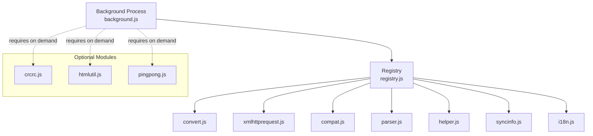
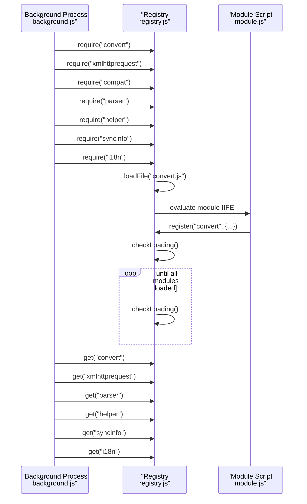
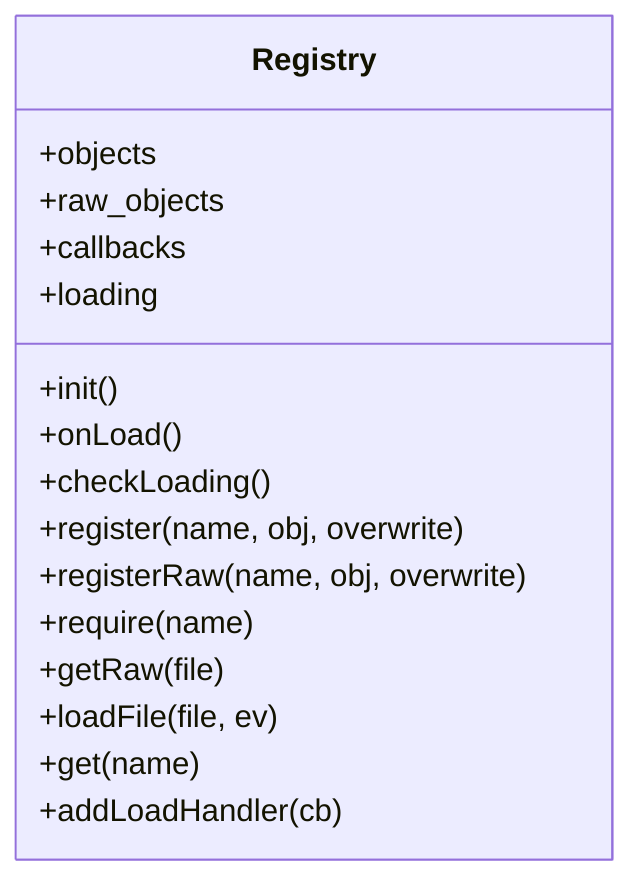
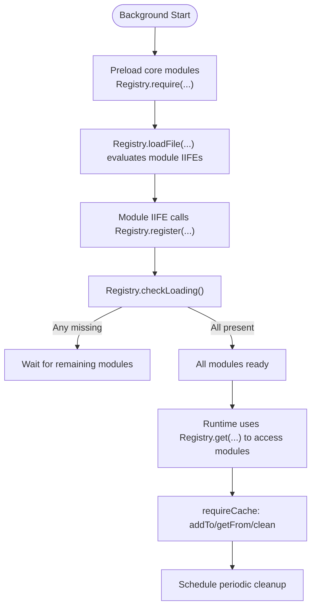
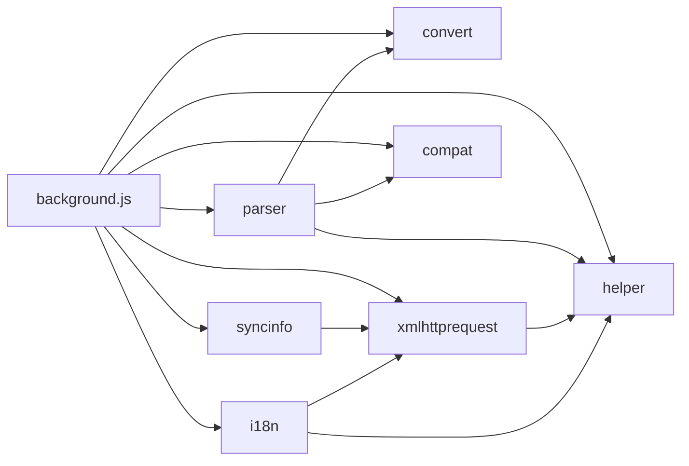

# Module Loading System

<cite>
**Referenced Files in This Document**
- [registry.js](file://src/registry.js)
- [background.js](file://src/background.js)
- [convert.js](file://src/convert.js)
- [xmlhttprequest.js](file://src/xmlhttprequest.js)
- [compat.js](file://src/compat.js)
- [parser.js](file://src/parser.js)
- [helper.js](file://src/helper.js)
- [syncinfo.js](file://src/syncinfo.js)
- [i18n.js](file://src/i18n.js)
- [crcrc.js](file://src/crcrc.js)
- [htmlutil.js](file://src/htmlutil.js)
- [pingpong.js](file://src/pingpong.js)
</cite>

## Table of Contents
1. [Introduction](#introduction)
2. [Project Structure](#project-structure)
3. [Core Components](#core-components)
4. [Architecture Overview](#architecture-overview)
5. [Detailed Component Analysis](#detailed-component-analysis)
6. [Dependency Analysis](#dependency-analysis)
7. [Performance Considerations](#performance-considerations)
8. [Troubleshooting Guide](#troubleshooting-guide)
9. [Conclusion](#conclusion)

## Introduction
This document explains the module loading and dependency management system used by the background process. It focuses on the Registry.require() pattern for loading essential modules, the requireCache mechanism for caching module content, and the initialization sequence that ensures modules are resolved and available before use. It also covers how the background process orchestrates module loading and initialization, and provides practical guidance for adding new modules, managing dependencies, and debugging loading issues.

## Project Structure
The module system centers around a lightweight registry that loads and exposes modules by name. The background process triggers loading of core modules early in startup, and additional modules are required on demand. Supporting modules provide shared utilities and services used across the system.

**Diagram sources**
- [background.js:28-34](file://src/background.js#L28-L34)
- [registry.js:48-55](file://src/registry.js#L48-L55)
- [convert.js:31-37](file://src/convert.js#L31-L37)
- [xmlhttprequest.js:159](file://src/xmlhttprequest.js#L159)
- [compat.js:273](file://src/compat.js#L273)
- [parser.js:284](file://src/parser.js#L284)
- [helper.js:184-206](file://src/helper.js#L184-L206)
- [syncinfo.js:384-392](file://src/syncinfo.js#L384-L392)
- [i18n.js:132-138](file://src/i18n.js#L132-L138)

**Section sources**
- [background.js:28-34](file://src/background.js#L28-L34)
- [registry.js:11-104](file://src/registry.js#L11-L104)

## Core Components
- Registry: Central module loader and registry. Provides require(), get(), register(), registerRaw(), getRaw(), and loadFile().
- Background Process: Initializes the system, preloads core modules, and manages caching and runtime execution.
- Core Modules: convert, xmlhttprequest, compat, parser, helper, syncinfo, i18n.
- Optional Modules: crcrc, htmlutil, pingpong (loaded on demand).

Key behaviors:
- Lazy loading via Registry.require(name) triggers fetching and evaluating the module script.
- Module availability is tracked; Registry.checkLoading() signals completion when all required modules are registered.
- requireCache stores fetched external resources (e.g., @require content) with timestamps and periodic cleanup.

**Section sources**
- [registry.js:11-104](file://src/registry.js#L11-L104)
- [background.js:77](file://src/background.js#L77)
- [background.js:395-433](file://src/background.js#L395-L433)

## Architecture Overview
The background process defines the module loading lifecycle:
1. Preload essential modules using Registry.require().
2. Register modules via Registry.register() inside each module’s IIFE.
3. Use Registry.get() to retrieve modules after they are loaded.
4. Optionally use Registry.getRaw() to fetch raw content for locales or assets.
5. Manage caching of external resources via requireCache with configurable validity and periodic cleanup.

**Diagram sources**
- [background.js:28-34](file://src/background.js#L28-L34)
- [registry.js:48-55](file://src/registry.js#L48-L55)
- [registry.js:76-92](file://src/registry.js#L76-L92)
- [registry.js:35-41](file://src/registry.js#L35-L41)
- [registry.js:22-34](file://src/registry.js#L22-L34)
- [registry.js:93-100](file://src/registry.js#L93-L100)

## Detailed Component Analysis

### Registry System
The Registry provides:
- require(name): Loads a module script if not present, sets a placeholder to prevent loops, and triggers loadFile().
- loadFile(file): Creates a script element and appends it to the document to evaluate the module.
- register(name, obj): Registers a module object under a name.
- get(name): Retrieves a registered module.
- getRaw(file): Fetches raw content for a file via XHR.
- checkLoading(): Checks if any module placeholders remain; fires onLoad() when all are registered.
- addLoadHandler(cb): Adds a callback to be invoked when loading completes.

**Diagram sources**
- [registry.js:11-104](file://src/registry.js#L11-L104)

**Section sources**
- [registry.js:11-104](file://src/registry.js#L11-L104)

### Background Process and Module Initialization
The background process:
- Preloads core modules early to bootstrap the system.
- Defines requireCache with addToRequireCache(), getFromRequireCache(), and cleanRequireCache().
- Schedules periodic cache cleanup and integrates caching into resource fetching.

**Diagram sources**
- [background.js:28-34](file://src/background.js#L28-L34)
- [registry.js:48-55](file://src/registry.js#L48-L55)
- [registry.js:76-92](file://src/registry.js#L76-L92)
- [registry.js:35-41](file://src/registry.js#L35-L41)
- [registry.js:22-34](file://src/registry.js#L22-L34)
- [background.js:395-433](file://src/background.js#L395-L433)

**Section sources**
- [background.js:28-34](file://src/background.js#L28-L34)
- [background.js:77](file://src/background.js#L77)
- [background.js:395-433](file://src/background.js#L395-L433)

### Core Modules and Their Dependencies

#### convert
- Purpose: Encoding/decoding utilities.
- Registration: Registers an object containing encoding helpers.
- Dependencies: None.

**Section sources**
- [convert.js:31-37](file://src/convert.js#L31-L37)

#### helper
- Purpose: Shared helpers (regex, URL matching, DOM utilities).
- Registration: Registers a helper object with various utility functions.
- Dependencies: None.

**Section sources**
- [helper.js:184-206](file://src/helper.js#L184-L206)

#### xmlhttprequest
- Purpose: Cross-platform XHR wrapper with retries and progress reporting.
- Registration: Exposes run() and setWebRequest().
- Dependencies: Requires and uses helper.

**Section sources**
- [xmlhttprequest.js:8](file://src/xmlhttprequest.js#L8)
- [xmlhttprequest.js:159](file://src/xmlhttprequest.js#L159)

#### compat
- Purpose: Compatibility transformations for user script source.
- Registration: Registers a compatibility object.
- Dependencies: Requires helper.

**Section sources**
- [compat.js:9](file://src/compat.js#L9)
- [compat.js:273](file://src/compat.js#L273)

#### parser
- Purpose: Parses user script metadata and constructs script objects.
- Registration: Registers scriptParser.
- Dependencies: Requires helper, convert, compat; uses them via Registry.get().

**Section sources**
- [parser.js:9-15](file://src/parser.js#L9-L15)
- [parser.js:284](file://src/parser.js#L284)

#### syncinfo
- Purpose: Synchronizes script lists via external URLs or Chrome sync.
- Registration: Registers syncinfo object.
- Dependencies: Requires xmlhttprequest; uses helper internally.

**Section sources**
- [syncinfo.js:8](file://src/syncinfo.js#L8)
- [syncinfo.js:384-392](file://src/syncinfo.js#L384-L392)

#### i18n
- Purpose: Message lookup and locale management.
- Registration: Registers i18n object.
- Dependencies: Requires helper and xmlhttprequest.

**Section sources**
- [i18n.js:8](file://src/i18n.js#L8)
- [i18n.js:132-138](file://src/i18n.js#L132-L138)

### Optional Modules Demonstrating On-Demand Loading
- crcrc: Provides DOM creation helpers; required by htmlutil.
- htmlutil: Uses crcrc and helper; demonstrates runtime require() patterns.
- pingpong: Lightweight messaging helper.

**Section sources**
- [crcrc.js:9](file://src/crcrc.js#L9)
- [htmlutil.js:8](file://src/htmlutil.js#L8)
- [pingpong.js:51](file://src/pingpong.js#L51)

## Dependency Analysis
The background process preloads seven core modules. Parser depends on helper, convert, and compat. xmlhttprequest depends on helper. syncinfo depends on xmlhttprequest. i18n depends on helper and xmlhttprequest. Optional modules demonstrate on-demand loading patterns.

**Diagram sources**
- [background.js:28-34](file://src/background.js#L28-L34)
- [parser.js:9-15](file://src/parser.js#L9-L15)
- [xmlhttprequest.js:8](file://src/xmlhttprequest.js#L8)
- [syncinfo.js:8](file://src/syncinfo.js#L8)
- [i18n.js:8](file://src/i18n.js#L8)

**Section sources**
- [background.js:28-34](file://src/background.js#L28-L34)
- [parser.js:9-15](file://src/parser.js#L9-L15)
- [xmlhttprequest.js:8](file://src/xmlhttprequest.js#L8)
- [syncinfo.js:8](file://src/syncinfo.js#L8)
- [i18n.js:8](file://src/i18n.js#L8)

## Performance Considerations
- requireCache validity and cleanup:
  - Valid period: 30 minutes.
  - Cleanup interval: 3 minutes.
  - Timestamp updates on cache hits.
- Memory management:
  - Periodic cleanup removes expired entries.
  - Avoid caching file:// URIs to prevent stale local content.
- Network efficiency:
  - Cache hits bypass network requests for @require resources.
  - Retries are applied for transient failures in xmlhttprequest.

Recommendations:
- Monitor cache hit rate and adjust cacheValidPeriod if needed.
- Ensure cleanup intervals balance memory pressure vs. cache reuse.
- Avoid heavy synchronous operations in module IIFEs to keep startup responsive.

**Section sources**
- [background.js:395-433](file://src/background.js#L395-L433)
- [background.js:2664-2668](file://src/background.js#L2664-L2668)
- [background.js:2678-2684](file://src/background.js#L2678-L2684)

## Troubleshooting Guide
Common issues and remedies:
- Module not found:
  - Symptom: Error logs indicating a required module was not found.
  - Action: Verify Registry.require(name) is called for the module and that the module registers itself via Registry.register(name, ...).
- Circular dependencies:
  - Symptom: require loops causing placeholders to remain unresolved.
  - Action: Restructure dependencies to avoid cycles; ensure modules only depend on already-registered modules.
- Missing raw content:
  - Symptom: getRaw returns null or warnings logged.
  - Action: Confirm file path and that chrome.extension.getURL resolves correctly; ensure the file exists in the extension package.
- Cache-related problems:
  - Symptom: Stale or missing cached content.
  - Action: Check addToRequireCache/getFromRequireCache usage; verify cacheValidPeriod and cleanup scheduling; force-refresh by clearing cache entries.
- Debug logging:
  - Enable verbose flags (e.g., V, RV, CV) to trace require/load/register/get operations.

Practical steps:
- Add explicit Registry.require() calls for new modules in the background process.
- Use Registry.get(name) only after modules are guaranteed to be loaded.
- For optional modules, call Registry.require(name) locally before Registry.get(name).

**Section sources**
- [registry.js:48-55](file://src/registry.js#L48-L55)
- [registry.js:93-100](file://src/registry.js#L93-L100)
- [registry.js:56-75](file://src/registry.js#L56-L75)
- [background.js:395-433](file://src/background.js#L395-L433)

## Conclusion
The module loading system combines a simple registry with lazy loading and caching to bootstrap the background process efficiently. Core modules are preloaded and registered early, while optional modules are loaded on demand. The requireCache reduces network overhead and improves responsiveness. Following the documented patterns for dependency declaration, registration, and retrieval ensures reliable module availability and maintainable code.