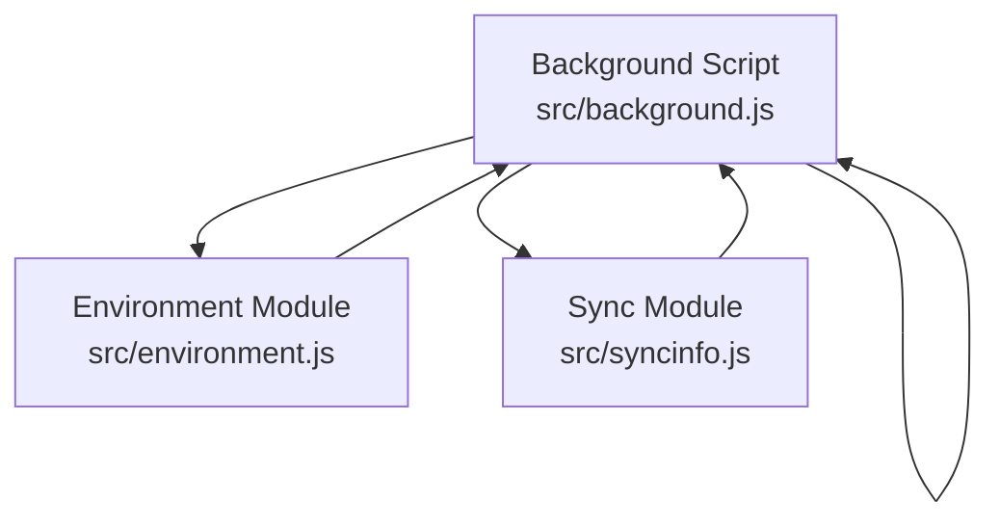
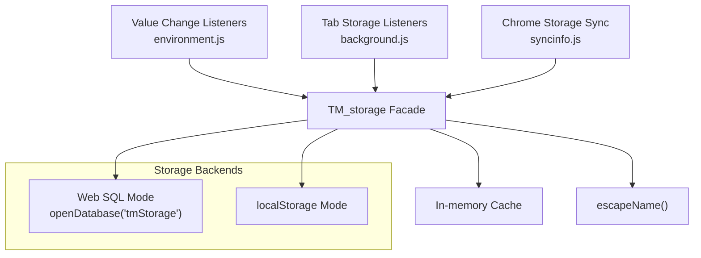
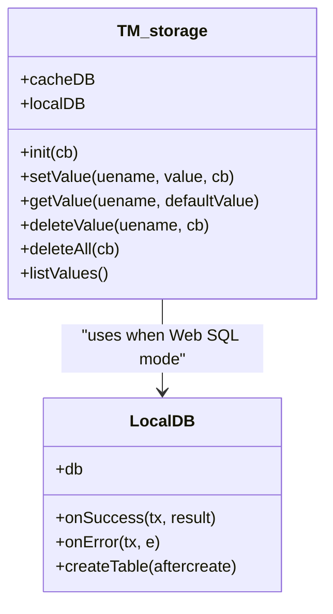
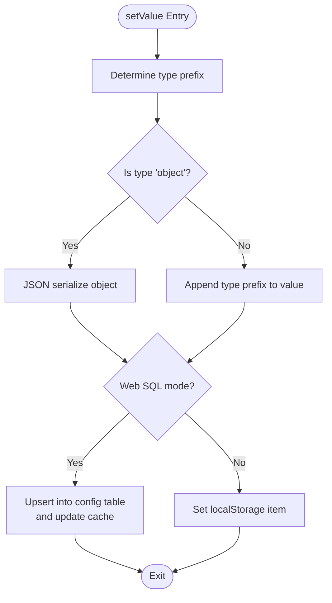
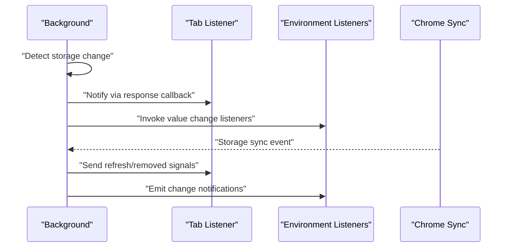
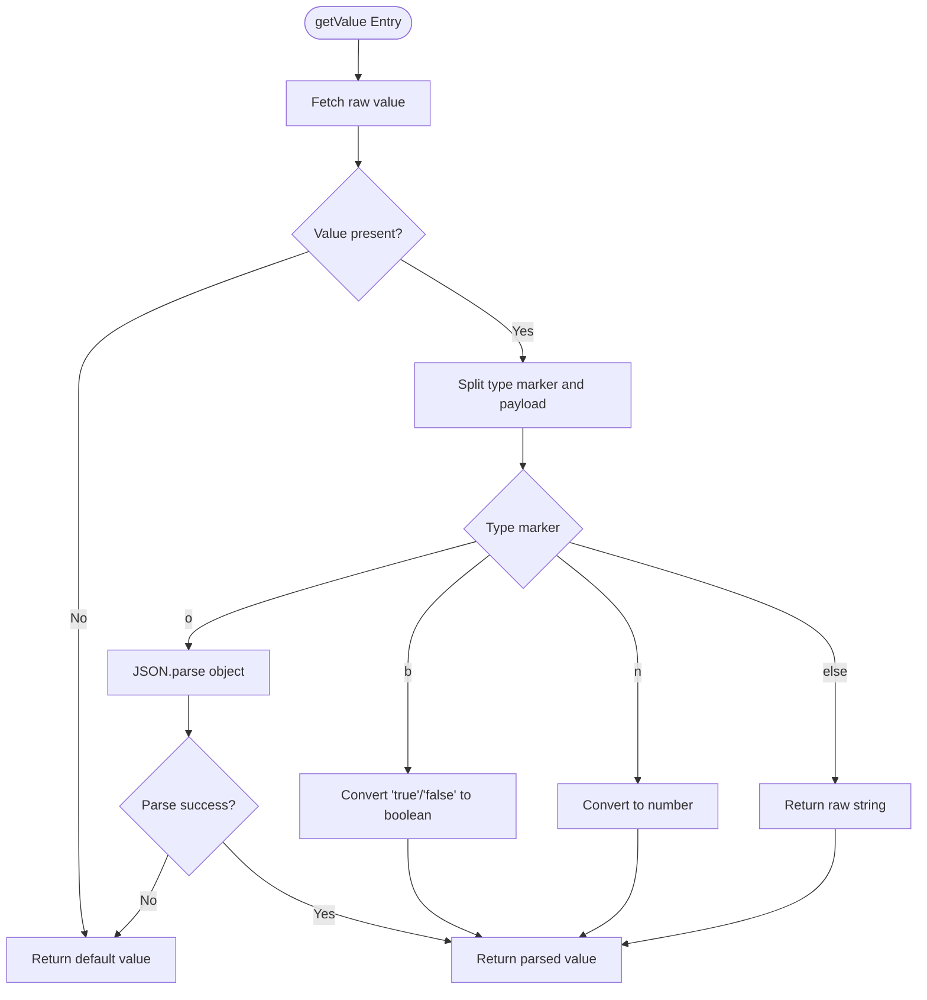
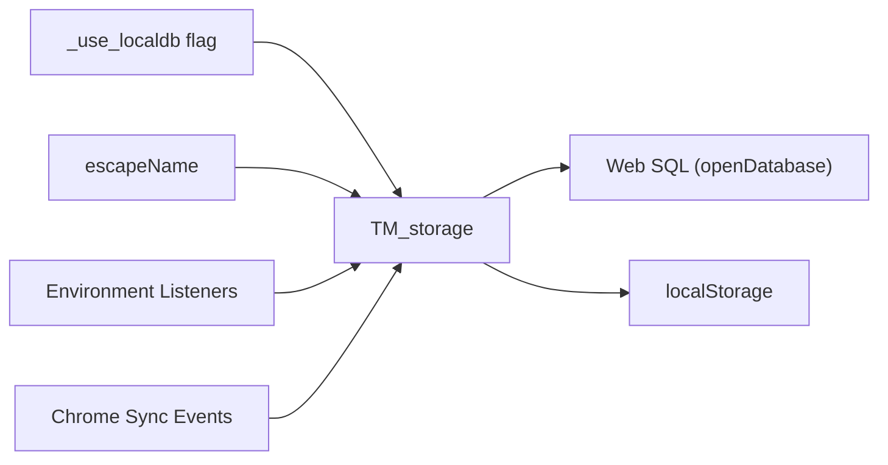

# Data Persistence Layer

<cite>
**Referenced Files in This Document**
- [background.js](file://src/background.js)
- [environment.js](file://src/environment.js)
- [syncinfo.js](file://src/syncinfo.js)
</cite>

## Table of Contents
1. [Introduction](#introduction)
2. [Project Structure](#project-structure)
3. [Core Components](#core-components)
4. [Architecture Overview](#architecture-overview)
5. [Detailed Component Analysis](#detailed-component-analysis)
6. [Dependency Analysis](#dependency-analysis)
7. [Performance Considerations](#performance-considerations)
8. [Troubleshooting Guide](#troubleshooting-guide)
9. [Conclusion](#conclusion)
10. [Appendices](#appendices)

## Introduction
This document describes the data persistence layer within the storage management system. It explains the TM_storage abstraction that provides unified access to both localStorage and IndexedDB (via Web SQL) through a single interface. The document covers the dual-storage architecture decision, performance characteristics of each backend, seamless switching between localStorage and Web SQL-backed storage, the storage configuration schema, key-value pair management patterns, and the escapeName function for safe storage key generation. It also documents the storage listener pattern for real-time updates across tabs, data serialization/deserialization processes, and error handling strategies for storage failures. Practical examples demonstrate storing user preferences, script metadata, and configuration settings with proper error handling and fallback mechanisms.

## Project Structure
The persistence layer is implemented in the background script module and integrates with environment and sync modules for cross-tab notifications and synchronization.

**Diagram sources**
- [background.js](file://src/background.js)
- [environment.js](file://src/environment.js)
- [syncinfo.js](file://src/syncinfo.js)

**Section sources**
- [background.js](file://src/background.js)
- [environment.js](file://src/environment.js)
- [syncinfo.js](file://src/syncinfo.js)

## Core Components
- TM_storage: Unified storage facade supporting initialization, set/get/delete operations, listing keys, and schema/table creation. It supports two modes:
  - IndexedDB via Web SQL (openDatabase): Uses an internal cache and executes SQL transactions for CRUD operations.
  - localStorage: Direct key-value persistence with no schema.
- escapeName: Utility to normalize or escape storage keys before use.
- Value change listeners: Environment-level listeners for reacting to value changes.
- Storage listeners: Background listeners for notifying connected tabs about storage changes.
- Sync integration: Chrome storage sync events for cross-tab and cross-device updates.

Key responsibilities:
- Provide a single API surface for storage regardless of backend mode.
- Serialize/deserialize values with type prefixes to preserve types across reads/writes.
- Maintain a cache layer for Web SQL mode to reduce round-trips.
- Emit notifications to listeners upon changes.

**Section sources**
- [background.js](file://src/background.js)
- [environment.js](file://src/environment.js)
- [syncinfo.js](file://src/syncinfo.js)

## Architecture Overview
The storage system switches between two backends controlled by a runtime flag. The Web SQL mode initializes a table, caches rows in memory, and performs SQL operations. The localStorage mode persists values directly. Listeners are notified on changes, and sync events propagate updates across tabs/devices.

**Diagram sources**
- [background.js](file://src/background.js)
- [environment.js](file://src/environment.js)
- [syncinfo.js](file://src/syncinfo.js)

## Detailed Component Analysis

### TM_storage Abstraction
TM_storage encapsulates:
- Initialization: Creates the Web SQL table and preloads cache if enabled.
- Value lifecycle: setValue serializes values with type prefixes; getValue deserializes values; deleteValue removes entries; deleteAll clears storage; listValues enumerates keys.
- Backend selection: Reads/writes route to either Web SQL cache/localDB or localStorage depending on the runtime flag.

Serialization/deserialization:
- Type prefixes indicate stored types. On read, the leading character determines parsing behavior (boolean, number, object via JSON, or raw string).
- Objects are serialized using JSON; on read, JSON.parse is attempted with error logging and fallback to default value.

Dual-storage switching:
- The runtime flag controls whether Web SQL mode is active. When disabled, operations fall back to localStorage.

**Diagram sources**
- [background.js](file://src/background.js)

**Section sources**
- [background.js](file://src/background.js)

### Storage Configuration Schema
- Web SQL mode:
  - Database: openDatabase('tmStorage', ...)
  - Table: config(ID INTEGER PRIMARY KEY ASC, name TEXT, value TEXT)
  - Capacity: ~30 MB
- localStorage mode:
  - No schema; flat key-value pairs.

Initialization flow:
- If Web SQL mode is enabled, create the config table and populate cache from persisted rows.
- Otherwise, mark storage as initialized immediately.

**Section sources**
- [background.js](file://src/background.js)

### Key-Value Pair Management Patterns
- setValue:
  - Determine type prefix from typeof value.
  - Serialize objects via JSON; otherwise append type prefix to stringified value.
  - Write to Web SQL cache and database or localStorage depending on mode.
- getValue:
  - Retrieve value from cache or localStorage.
  - Strip type prefix and reconstruct original type; parse JSON for objects; on parse errors, return default value.
- deleteValue:
  - Remove from cache/database or localStorage.
- deleteAll:
  - Drop Web SQL table and clear cache; iterate and remove all localStorage keys.
- listValues:
  - Enumerate cache keys or localStorage keys.

**Diagram sources**
- [background.js](file://src/background.js)

**Section sources**
- [background.js](file://src/background.js)

### EscapeName Function
- Purpose: Normalize or escape storage keys to ensure compatibility and safety across backends.
- Current implementation: Identity function that returns the input unchanged.
- Recommendation: Extend to sanitize special characters, enforce length limits, and avoid reserved prefixes to prevent collisions.

**Section sources**
- [background.js](file://src/background.js)

### Storage Listener Pattern for Real-Time Updates
- Tab-level listeners:
  - Maintained as an array of listener descriptors containing tab ID, listener ID, script name, and response callback.
  - On storage changes, the background iterates listeners and sends updated script storage snapshots or targeted key updates.
- Environment-level listeners:
  - Value change listeners registered per key; invoked when a value changes, enabling reactive UI or logic updates.
- Sync integration:
  - Chrome storage sync events are handled to detect external changes and trigger appropriate callbacks.

**Diagram sources**
- [background.js](file://src/background.js)
- [environment.js](file://src/environment.js)
- [syncinfo.js](file://src/syncinfo.js)

**Section sources**
- [background.js](file://src/background.js)
- [environment.js](file://src/environment.js)
- [syncinfo.js](file://src/syncinfo.js)

### Data Serialization and Deserialization
- Writing:
  - Prefix values with a single-character type marker: 'b' for booleans, 'n' for numbers, 'o' for objects, others for raw strings.
  - Objects are JSON-serialized; on failure, the write is aborted with an error log.
- Reading:
  - If value exists, strip the type marker and reconstruct the original type.
  - For objects, JSON.parse is attempted; on failure, return the default value and log an error.

**Diagram sources**
- [background.js](file://src/background.js)

**Section sources**
- [background.js](file://src/background.js)

### Error Handling Strategies
- Web SQL:
  - Transaction-level onError logs errors; operations are logged for visibility.
  - JSON serialization errors during writes and JSON parsing errors during reads are caught and logged; defaults are returned.
- localStorage:
  - Direct operations are used; errors are not explicitly wrapped in this code segment.
- Fallback mechanisms:
  - When Web SQL mode is disabled, operations automatically fall back to localStorage.
  - On JSON parse errors, default values are returned to prevent crashes.

**Section sources**
- [background.js](file://src/background.js)

### Practical Examples and Usage Patterns
Note: The following examples describe typical usage patterns without reproducing code. Replace placeholders with actual keys and values as needed.

- Storing user preferences:
  - Use setValue with a preference key and a primitive or object value. The system will serialize and persist it according to the current backend.
  - Retrieve with getValue and supply a sensible default if the key does not exist.
  - Example snippet path: [background.js](file://src/background.js)
- Storing script metadata:
  - Persist structured data (e.g., script settings, timestamps) as objects. The system will JSON-serialize and deserialize safely.
  - Example snippet path: [background.js](file://src/background.js)
- Configuration settings:
  - Store configuration toggles and numeric thresholds. The type markers ensure correct reconstruction on reads.
  - Example snippet path: [background.js](file://src/background.js)
- Cross-tab notifications:
  - Register value change listeners in the environment module to react to updates from other tabs.
  - Example snippet path: [environment.js](file://src/environment.js)
- Sync-aware updates:
  - React to Chrome storage sync events to keep state consistent across devices.
  - Example snippet path: [syncinfo.js](file://src/syncinfo.js)

**Section sources**
- [background.js](file://src/background.js)
- [environment.js](file://src/environment.js)
- [syncinfo.js](file://src/syncinfo.js)

## Dependency Analysis
- TM_storage depends on:
  - Runtime flag controlling Web SQL vs localStorage.
  - openDatabase for Web SQL operations.
  - localStorage for flat key-value persistence.
  - escapeName for key normalization.
- Listeners depend on TM_storage for change propagation and on environment/sync modules for cross-tab/cross-device updates.

**Diagram sources**
- [background.js](file://src/background.js)
- [environment.js](file://src/environment.js)
- [syncinfo.js](file://src/syncinfo.js)

**Section sources**
- [background.js](file://src/background.js)
- [environment.js](file://src/environment.js)
- [syncinfo.js](file://src/syncinfo.js)

## Performance Considerations
- Web SQL mode:
  - Uses an in-memory cache to minimize round-trips; still requires transaction overhead for writes.
  - Table creation and initial cache population occur during initialization.
- localStorage mode:
  - Faster for small-scale key-value operations; no schema or transaction overhead.
- Serialization cost:
  - Object serialization/deserialization adds CPU overhead; avoid frequent writes of large objects.
- Listener overhead:
  - Notifications to multiple listeners increase latency; batch updates when possible.

[No sources needed since this section provides general guidance]

## Troubleshooting Guide
- Symptom: Values not persisting after reload.
  - Verify the active backend mode and confirm table creation in Web SQL mode or localStorage presence in localStorage mode.
  - Check for JSON serialization errors during writes.
- Symptom: Incorrect types after retrieval.
  - Ensure type prefixes are intact; inspect getValue logic for type marker handling.
- Symptom: No cross-tab updates.
  - Confirm listener registration and response callbacks; verify sync events are handled.
- Symptom: Errors logged for storage operations.
  - Review onError handlers and logs; ensure capacity and permissions are sufficient for Web SQL mode.

**Section sources**
- [background.js](file://src/background.js)
- [environment.js](file://src/environment.js)
- [syncinfo.js](file://src/syncinfo.js)

## Conclusion
The TM_storage abstraction provides a robust, unified interface for persistence across localStorage and Web SQL modes. Its serialization strategy preserves types, while caching improves performance in Web SQL mode. The listener and sync integrations enable real-time updates across tabs and devices. By understanding the backend switching mechanism, serialization rules, and error handling, developers can reliably store user preferences, script metadata, and configuration settings with predictable behavior and graceful fallbacks.

[No sources needed since this section summarizes without analyzing specific files]

## Appendices
- Backend switching:
  - Controlled by a runtime flag; when disabled, operations automatically use localStorage.
- Key normalization:
  - escapeName currently acts as identity; extend to sanitize keys for production hardening.

**Section sources**
- [background.js](file://src/background.js)