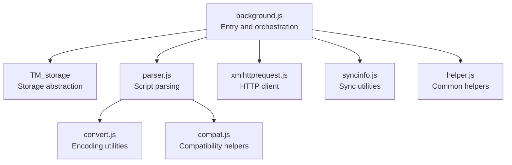
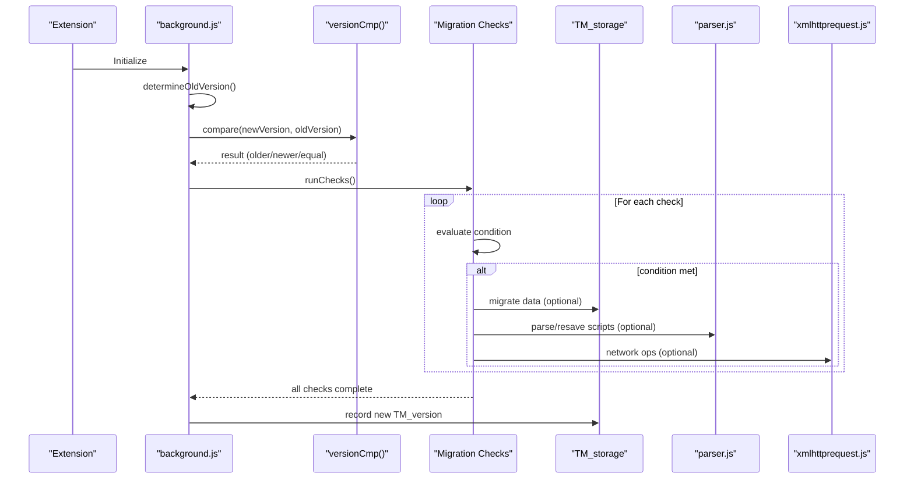
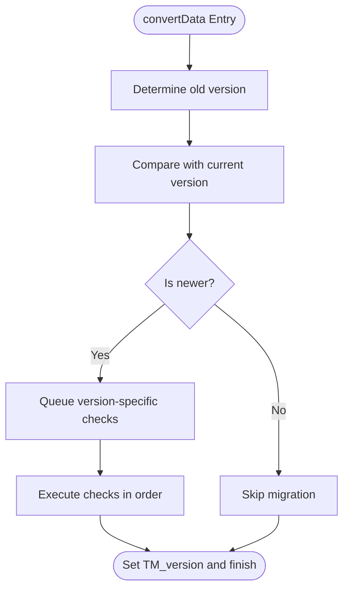
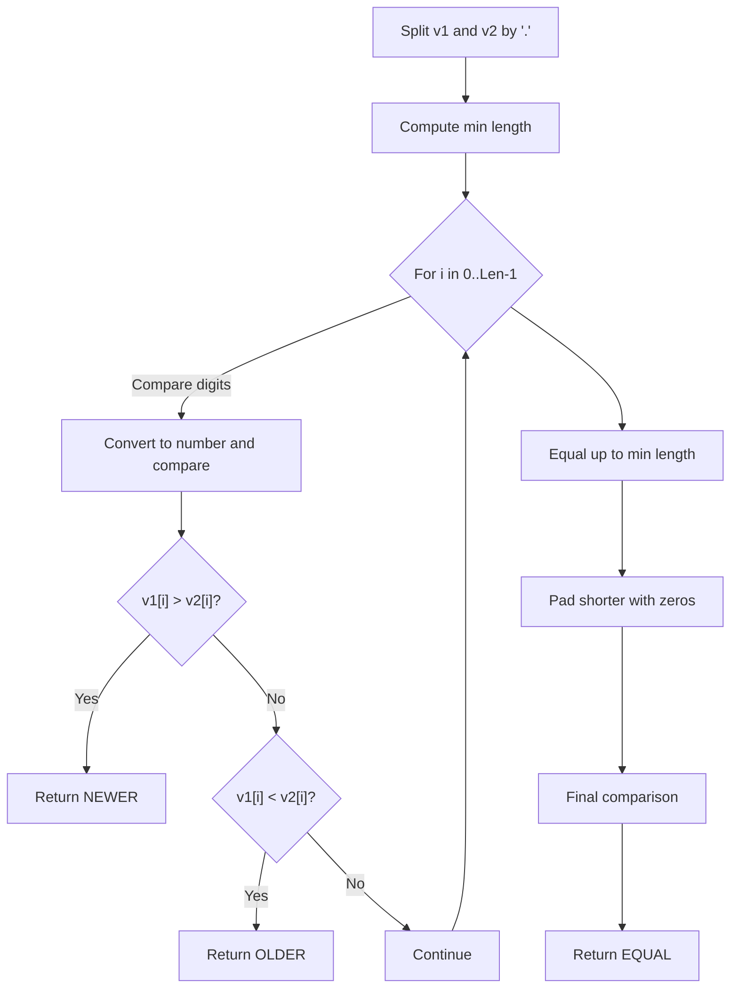
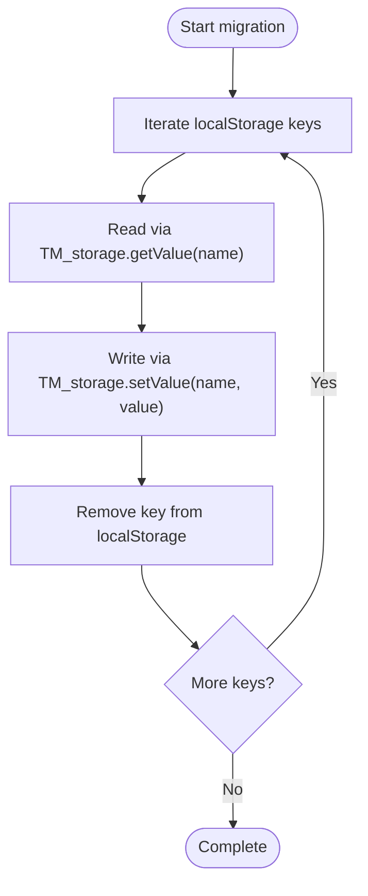
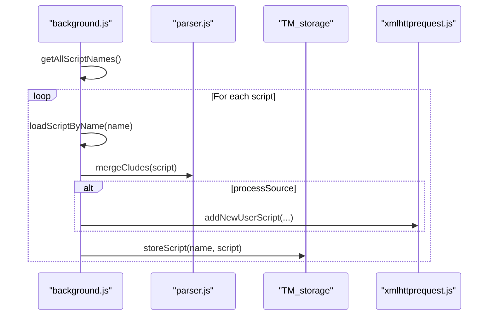
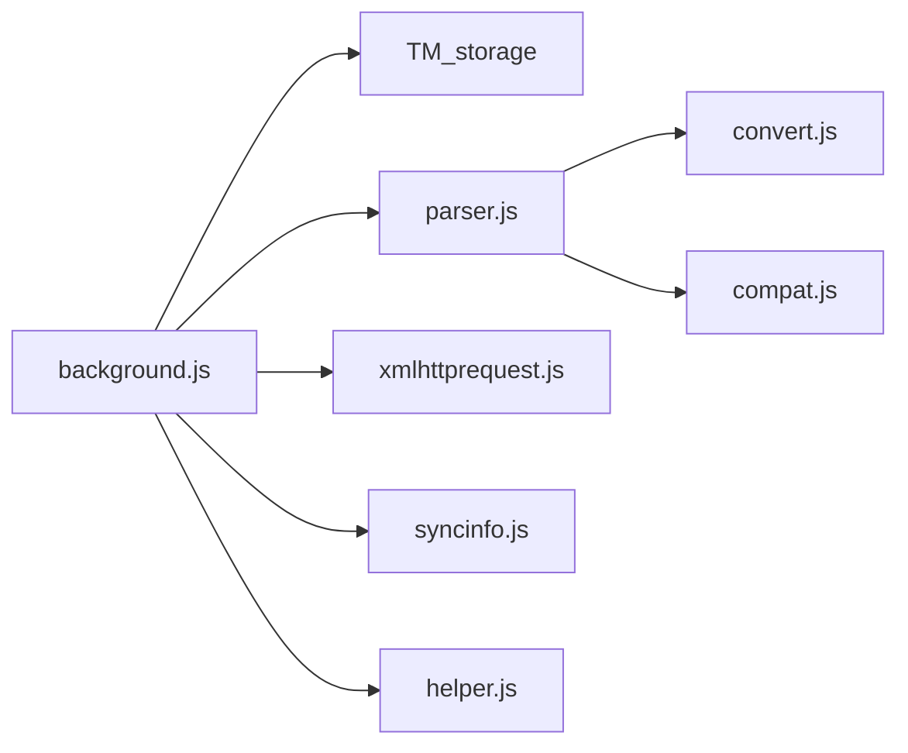

# Migration and Versioning

<cite>
**Referenced Files in This Document**
- [background.js](file://src/background.js)
- [convert.js](file://src/convert.js)
- [parser.js](file://src/parser.js)
- [xmlhttprequest.js](file://src/xmlhttprequest.js)
- [syncinfo.js](file://src/syncinfo.js)
- [compat.js](file://src/compat.js)
- [helper.js](file://src/helper.js)
- [tamperfireDB.tamper.js](file://src/system/tamperfireDB.tamper.js)
</cite>

## Table of Contents
1. [Introduction](#introduction)
2. [Project Structure](#project-structure)
3. [Core Components](#core-components)
4. [Architecture Overview](#architecture-overview)
5. [Detailed Component Analysis](#detailed-component-analysis)
6. [Dependency Analysis](#dependency-analysis)
7. [Performance Considerations](#performance-considerations)
8. [Troubleshooting Guide](#troubleshooting-guide)
9. [Conclusion](#conclusion)

## Introduction
This document explains the data migration and versioning system within the storage management of the extension. It focuses on the convertData function that orchestrates seamless upgrades across versions, the version comparison algorithm, migration triggers, and the step-by-step migration from localStorage to IndexedDB-compatible storage. It also covers version history tracking, migration checkpoints, rollback mechanisms, and practical workflows for script restoration, configuration updates, and schema changes. Guidance on error handling, retry mechanisms, and performance considerations during large-scale migrations is included.

## Project Structure
The migration and versioning logic is primarily implemented in the background controller, with supporting modules for parsing, conversion, compatibility, and storage. The system maintains a version history and applies targeted migration steps depending on the detected old version versus the current extension version.

**Diagram sources**
- [background.js](file://src/background.js)
- [parser.js](file://src/parser.js)
- [convert.js](file://src/convert.js)
- [xmlhttprequest.js](file://src/xmlhttprequest.js)
- [syncinfo.js](file://src/syncinfo.js)
- [compat.js](file://src/compat.js)
- [helper.js](file://src/helper.js)

**Section sources**
- [background.js](file://src/background.js)
- [parser.js](file://src/parser.js)
- [convert.js](file://src/convert.js)
- [xmlhttprequest.js](file://src/xmlhttprequest.js)
- [syncinfo.js](file://src/syncinfo.js)
- [compat.js](file://src/compat.js)
- [helper.js](file://src/helper.js)

## Core Components
- convertData: Orchestrates version-aware migrations, determines old version, and executes migration checkpoints in order.
- versionCmp: Implements semantic version comparison for numeric dot-separated identifiers.
- TM_storage: Unified storage abstraction that supports localStorage fallback and SQL-backed caching.
- Parser and Compat: Provide script metadata parsing and compatibility transformations used during migration.
- xmlhttprequest: Provides robust HTTP transport with retry logic used by migration routines and sync.

Key responsibilities:
- Detect old version and decide whether migration is needed.
- Apply ordered migration steps scoped to specific version thresholds.
- Migrate data from localStorage to the configured storage backend.
- Restore and resave scripts to align with evolving schema expectations.
- Track version history and maintain backward compatibility.

**Section sources**
- [background.js](file://src/background.js)
- [convert.js](file://src/convert.js)
- [parser.js](file://src/parser.js)
- [xmlhttprequest.js](file://src/xmlhttprequest.js)
- [syncinfo.js](file://src/syncinfo.js)
- [compat.js](file://src/compat.js)
- [helper.js](file://src/helper.js)

## Architecture Overview
The migration pipeline runs at startup. It detects the previously stored version, compares it to the current extension version, and executes a series of migration checkpoints. Each checkpoint conditionally migrates data or updates configuration based on version thresholds. Storage operations are routed through TM_storage, which transparently uses either localStorage or an SQL-backed cache depending on configuration.

**Diagram sources**
- [background.js](file://src/background.js)
- [xmlhttprequest.js](file://src/xmlhttprequest.js)
- [parser.js](file://src/parser.js)

## Detailed Component Analysis

### convertData: Version-aware migration orchestrator
convertData performs:
- Determination of the old version from storage, with fallback to localStorage when needed.
- Comparison against the current extension version via versionCmp.
- Execution of ordered migration checkpoints gated by version thresholds.
- Finalization by writing the new version to storage.

Migration checkpoints include:
- Reordering scripts for older versions.
- Copying data from localStorage to the configured storage backend and clearing migrated keys.
- Restoring and resaving scripts to align with schema expectations.
- Adjusting configuration fields and defaults.
- Resetting update-check counters for specific versions.
- Removing obsolete entries.

**Diagram sources**
- [background.js](file://src/background.js)

**Section sources**
- [background.js](file://src/background.js)

### versionCmp: Semantic version comparison
The algorithm splits version strings by "." and compares numeric segments left-to-right. Shorter sequences are padded with zeros. Returns constants indicating greater-than, equal, or less-than comparisons.

**Diagram sources**
- [background.js](file://src/background.js)

**Section sources**
- [background.js](file://src/background.js)

### Storage migration: localStorage to SQL-backed cache
The system migrates from localStorage to an SQL-backed cache using TM_storage. The process:
- Iterates localStorage keys.
- Reads each value via TM_storage.getValue (which reads from localStorage when backend is disabled).
- Writes the value to TM_storage.setValue (which writes to SQL cache when enabled).
- Removes the migrated key from localStorage.

**Diagram sources**
- [background.js](file://src/background.js)

**Section sources**
- [background.js](file://src/background.js)

### Script restoration and resave workflows
Two workflows are used to reconcile script metadata and content with evolving schema expectations:
- restoreAllScriptsEx: Loads each script, merges includes/matches/excludes, optionally re-adds via addNewUserScript, and persists via storeScript.
- resaveAllScriptsEx: Similar to restore, but forces re-save of script content and metadata.

These workflows ensure:
- Options defaults are applied consistently.
- Legacy fields are mapped to new option keys.
- Content hashes and IDs are recalculated and stored.

**Diagram sources**
- [background.js](file://src/background.js)
- [parser.js](file://src/parser.js)
- [xmlhttprequest.js](file://src/xmlhttprequest.js)

**Section sources**
- [background.js](file://src/background.js)
- [parser.js](file://src/parser.js)

### Configuration updates and schema changes
Examples of version-specific migrations include:
- Reordering scripts for very old versions.
- Updating legacy sync options and URLs.
- Introducing new option keys and removing deprecated ones.
- Resetting update-check counters to force reinitialization.

These changes are applied only when the old version is below a given threshold, ensuring minimal overhead for recent users.

**Section sources**
- [background.js](file://src/background.js)

### Version history tracking and checkpoints
- Version history is tracked by storing the last known extension version in TM_storage under a dedicated key.
- Checkpoints are ordered and short-circuit when conditions are satisfied, ensuring idempotent execution.
- After all applicable migrations run, the new version is recorded.

**Section sources**
- [background.js](file://src/background.js)

### Rollback mechanisms
Rollback is not explicitly implemented in the analyzed code. The system focuses on forward-only migrations with no explicit downgrade handling. Users can reset configuration or perform a factory reset if needed.

**Section sources**
- [background.js](file://src/background.js)

## Dependency Analysis
The migration system relies on several modules:

- background.js depends on TM_storage for persistence, parser.js for script metadata handling, xmlhttprequest.js for network operations, and helper.js for shared utilities.
- parser.js depends on convert.js and compat.js to normalize and transform script content.
- syncinfo.js provides synchronization utilities used by higher-level components.

**Diagram sources**
- [background.js](file://src/background.js)
- [parser.js](file://src/parser.js)
- [convert.js](file://src/convert.js)
- [xmlhttprequest.js](file://src/xmlhttprequest.js)
- [syncinfo.js](file://src/syncinfo.js)
- [compat.js](file://src/compat.js)
- [helper.js](file://src/helper.js)

**Section sources**
- [background.js](file://src/background.js)
- [parser.js](file://src/parser.js)
- [convert.js](file://src/convert.js)
- [xmlhttprequest.js](file://src/xmlhttprequest.js)
- [syncinfo.js](file://src/syncinfo.js)
- [compat.js](file://src/compat.js)
- [helper.js](file://src/helper.js)

## Performance Considerations
- Batched iteration: The migration iterates localStorage keys sequentially; for large datasets, this can block the UI thread. The system mitigates this by deferring operations and using small timeouts between batches.
- Retry logic: xmlhttprequest.js implements retry-on-error semantics for network operations, reducing transient failure impact.
- SQL-backed caching: TM_storage caches values in memory when using SQL backend, minimizing repeated database queries.
- Threading-like concurrency: The system uses setTimeout to interleave operations, preventing long synchronous blocks.

Recommendations:
- Prefer incremental migrations for very large datasets.
- Monitor storage operations and consider chunking when migrating thousands of entries.
- Use retry limits and exponential backoff for external network calls.

**Section sources**
- [background.js](file://src/background.js)
- [xmlhttprequest.js](file://src/xmlhttprequest.js)
- [tamperfireDB.tamper.js](file://src/system/tamperfireDB.tamper.js)

## Troubleshooting Guide
Common issues and resolutions:
- Migration not triggered: Ensure the old version is lower than the current version; otherwise, no migration steps will run.
- Storage errors: TM_storage logs errors during setValue/getValue; verify backend availability and quota limits.
- Network failures: xmlhttprequest.js retries on non-200 responses; verify connectivity and retry counts.
- Script restoration failures: Confirm script metadata is parsable and includes required fields; re-run resave workflow if necessary.
- Factory reset: Use the reset facility to clear storage and permissions if migration state becomes inconsistent.

Operational tips:
- Enable verbose logging to trace migration checkpoints and storage operations.
- Verify version history is updated after migration completes.
- For large-scale migrations, monitor progress and consider breaking tasks into smaller chunks.

**Section sources**
- [background.js](file://src/background.js)
- [xmlhttprequest.js](file://src/xmlhttprequest.js)
- [syncinfo.js](file://src/syncinfo.js)

## Conclusion
The migration and versioning system provides a robust, version-aware upgrade mechanism that safely moves data from localStorage to an SQL-backed cache, restores and resaves scripts to align with evolving schemas, and applies targeted configuration updates. Ordered checkpoints, semantic version comparison, and retry-capable network operations ensure reliability. While explicit rollback is not implemented, the system’s idempotent design and checkpoint ordering minimize risk and support straightforward recovery via reset operations.