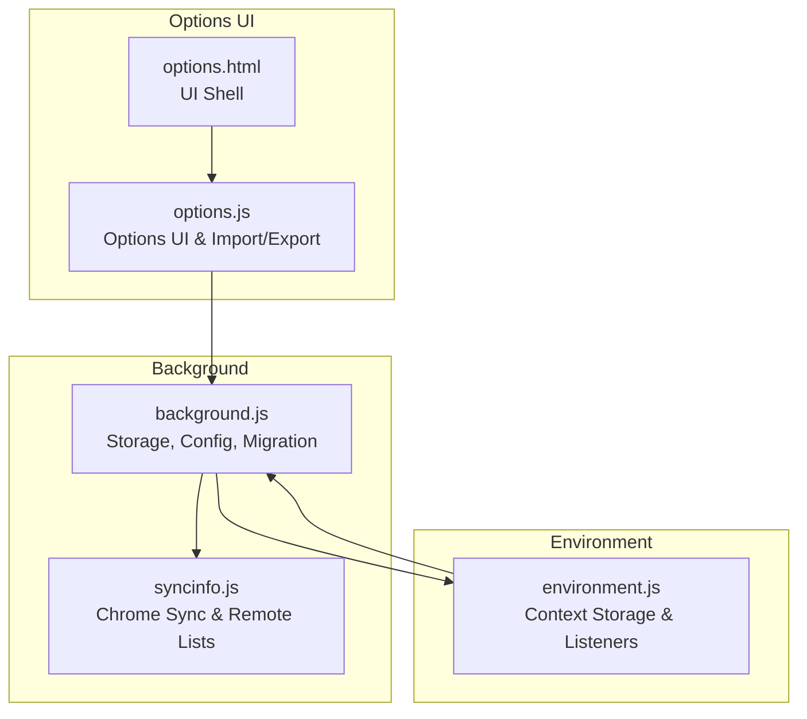
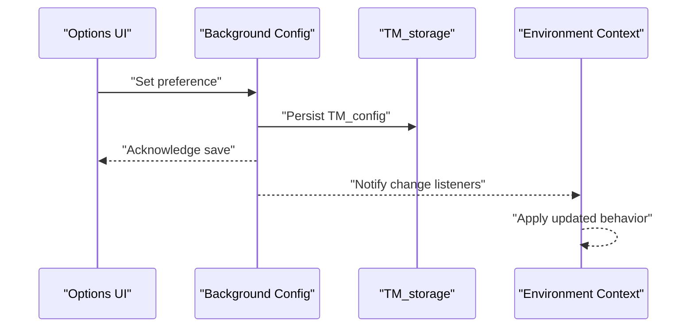
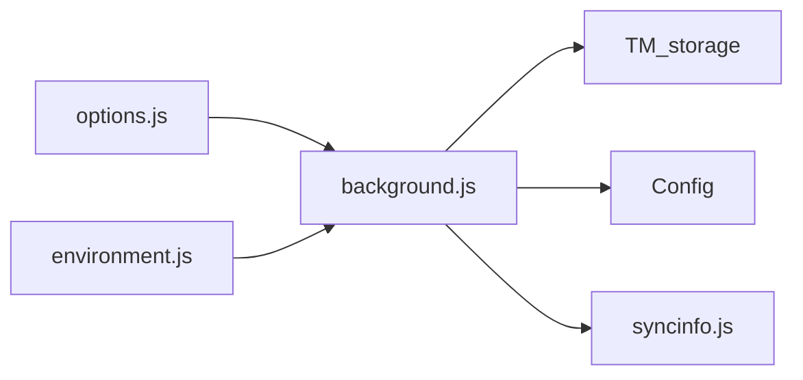

# Storage Configuration

<cite>
**Referenced Files in This Document**
- [background.js](file://src/background.js)
- [environment.js](file://src/environment.js)
- [options.js](file://src/options.js)
- [options.html](file://src/options.html)
- [syncinfo.js](file://src/syncinfo.js)
</cite>

## Table of Contents
1. [Introduction](#introduction)
2. [Project Structure](#project-structure)
3. [Core Components](#core-components)
4. [Architecture Overview](#architecture-overview)
5. [Detailed Component Analysis](#detailed-component-analysis)
6. [Dependency Analysis](#dependency-analysis)
7. [Performance Considerations](#performance-considerations)
8. [Troubleshooting Guide](#troubleshooting-guide)
9. [Conclusion](#conclusion)
10. [Appendices](#appendices)

## Introduction
This document explains the storage configuration management system used by the extension. It focuses on how user preferences and extension settings are persisted, validated, and synchronized across environments. It also documents the configuration schema, default values, update and migration logic, and the mechanisms for reading/writing configuration data, including script-specific storage and system-wide settings. Practical examples are provided via code-path references, and guidance is included for backup/restore, cross-browser synchronization, and troubleshooting configuration corruption.

## Project Structure
The storage configuration system spans several modules:
- Background storage and persistence: central database-backed storage and configuration loading/saving
- Environment-side storage: per-context key-value storage with change notifications
- Options UI: user interface for editing preferences and exporting/importing configuration
- Synchronization: Chrome Sync and external services for cross-device configuration sharing

**Diagram sources**
- [background.js](file://src/background.js)
- [environment.js](file://src/environment.js)
- [options.js](file://src/options.js)
- [options.html](file://src/options.html)
- [syncinfo.js](file://src/syncinfo.js)

**Section sources**
- [background.js](file://src/background.js)
- [environment.js](file://src/environment.js)
- [options.js](file://src/options.js)
- [options.html](file://src/options.html)
- [syncinfo.js](file://src/syncinfo.js)

## Core Components
- TM_storage: a database-backed key-value store with a fallback to localStorage. It serializes values by prefixing type markers and supports caching for performance.
- Config: a centralized configuration manager that loads defaults, merges persisted values, exposes getters/setters, and persists changes.
- getUpdateCheckCfg/setUpdateCheckCfg: functions that manage timestamps and counters for update checks across subsystems.
- Script storage: separate storage for script metadata, conditions, and content, enabling per-script configuration and lifecycle management.
- Environment storage: per-tab/script context storage with change listeners and propagation to background.

**Section sources**
- [background.js](file://src/background.js)
- [environment.js](file://src/environment.js)

## Architecture Overview
The configuration system integrates background persistence, environment-side context storage, and UI-driven configuration management. Updates propagate from the UI to background storage, and environment contexts subscribe to changes to keep runtime behavior aligned.

**Diagram sources**
- [background.js](file://src/background.js)
- [environment.js](file://src/environment.js)

## Detailed Component Analysis

### TM_storage: Database-backed Configuration Store
TM_storage provides:
- Initialization with optional SQLite-backed storage and in-memory cache
- Value serialization with type prefixes for robust deserialization
- getValue/getValue with default fallback and error-safe parsing
- setValue/deleteValue operations with transactional writes
- Bulk deletion and table creation

Key behaviors:
- Type-aware serialization: values are prefixed with a single-character type marker before being stored as text
- Caching: when using localDB, a cache object mirrors the config table for fast reads
- Fallback: when localDB is disabled, values fall back to localStorage

Practical usage patterns:
- Reading a value with a default: see [background.js](file://src/background.js)
- Writing a value: see [background.js](file://src/background.js)
- Deleting a value: see [background.js](file://src/background.js)

**Section sources**
- [background.js](file://src/background.js)

### Config: Centralized Preferences Manager
Config manages:
- Defaults: a comprehensive set of default preferences and behaviors
- Load: merges persisted values with defaults and exposes getters/setters
- Save: persists the current configuration under a single key
- Change listeners: triggers callbacks when a preference changes

Defaults include:
- Script update behavior, editor settings, logging, notifications, sync configuration, and lists of blocked URLs and require blacklists

Persistence:
- Loads from TM_storage under a single key
- Saves back to TM_storage on changes

Validation:
- Values are validated and applied via setters; invalid values may be ignored or coerced by consumers

Practical usage patterns:
- Accessing a preference: see [background.js](file://src/background.js)
- Saving preferences: see [background.js](file://src/background.js)

**Section sources**
- [background.js](file://src/background.js)

### Update Check Configuration: getUpdateCheckCfg and setUpdateCheckCfg
Purpose:
- Track last update check timestamps and counts for subsystems (e.g., script updates, fire feed)

Schema:
- Top-level keys include identifiers for different update sources
- Each source has a nested object containing last-checked timestamp, database version, and entry count

Behavior:
- getUpdateCheckCfg returns a default structure if missing and ensures nested fields exist
- setUpdateCheckCfg persists the structure back to storage

Usage:
- Periodic checks compare last timestamp against configured intervals
- On successful updates, timestamps and counters are refreshed

**Section sources**
- [background.js](file://src/background.js)

### Script-Specific Configuration and Storage
Scripts are stored with multiple keys:
- Script metadata: stored under the script name
- Conditions: includes/excludes/matches stored under a dedicated key suffix
- Content: stored under a content-specific key suffix

Operations:
- storeScript writes metadata, conditions, and content; triggers synchronization events
- Deleting a script removes all associated keys and triggers removal events

This separation allows:
- Efficient retrieval of metadata and conditions
- Isolation of content for performance and safety
- Atomic updates and deletions

**Section sources**
- [background.js](file://src/background.js)

### Environment Storage and Change Propagation
Environment-side storage:
- Per-context key-value store with type-aware deserialization
- Change listeners registered by content/runtime contexts
- Notifications sent to background on value changes

Propagation:
- Changes are propagated to background via message ports
- Background notifies registered listeners to apply updated behavior

**Section sources**
- [environment.js](file://src/environment.js)

### Options UI: Editing, Exporting, and Importing Configuration
The Options UI:
- Presents configurable preferences and script lists
- Supports exporting/importing configuration and scripts
- Uses background messaging to persist changes

Export/Import:
- Exports a structured representation of scripts and preferences
- Imports scripts and applies options, enabling cross-device backups

**Section sources**
- [options.js](file://src/options.js)
- [options.html](file://src/options.html)

## Dependency Analysis
The storage configuration system exhibits layered dependencies:
- Background depends on TM_storage for persistence and on Config for preferences
- Environment depends on background for storage and listens to changes
- Options UI depends on background for saving/loading and on storage for export/import
- Synchronization depends on background for script lists and on Chrome Sync for cross-device sync

**Diagram sources**
- [background.js](file://src/background.js)
- [environment.js](file://src/environment.js)
- [options.js](file://src/options.js)
- [syncinfo.js](file://src/syncinfo.js)

**Section sources**
- [background.js](file://src/background.js)
- [environment.js](file://src/environment.js)
- [options.js](file://src/options.js)
- [syncinfo.js](file://src/syncinfo.js)

## Performance Considerations
- LocalDB caching: TM_storage caches the config table in memory for fast reads; ensure cache is invalidated on writes
- Serialization overhead: type-prefixed values add minimal overhead; avoid storing very large objects
- Batch operations: group writes to minimize transactions and reduce I/O
- Change listener throttling: limit frequent updates to prevent excessive notifications

## Troubleshooting Guide
Common issues and resolutions:
- Corrupted configuration
  - Symptoms: unexpected defaults, missing preferences, or errors during deserialization
  - Actions: reset configuration via background migration or delete the configuration key and restart
  - References: [background.js](file://src/background.js)

- Update check inconsistencies
  - Symptoms: repeated or stale update prompts
  - Actions: refresh update timestamps using the update check functions and verify intervals
  - References: [background.js](file://src/background.js)

- Synchronization delays
  - Symptoms: delayed script updates across devices
  - Actions: verify sync type and ID, check for lock timeouts, and retry sync
  - References: [syncinfo.js](file://src/syncinfo.js)

- Environment storage not reflecting changes
  - Symptoms: runtime behavior not updating after preference changes
  - Actions: ensure change listeners are registered and notifications are sent to background
  - References: [environment.js](file://src/environment.js)

**Section sources**
- [background.js](file://src/background.js)
- [environment.js](file://src/environment.js)
- [syncinfo.js](file://src/syncinfo.js)

## Conclusion
The storage configuration system combines a robust, type-aware persistence layer with a centralized configuration manager and environment-side change propagation. It supports user preferences, script-specific data, and cross-device synchronization. By following the documented patterns and troubleshooting steps, developers and users can maintain reliable and consistent configuration behavior across environments.

## Appendices

### Configuration Schema and Defaults
- Central configuration key: a single persisted object containing all preferences
- Defaults include editor settings, logging, notifications, update intervals, sync configuration, and security lists
- References: [background.js](file://src/background.js)

### Practical Examples (by code path)
- Reading a preference with a default: [background.js](file://src/background.js)
- Writing a preference: [background.js](file://src/background.js)
- Persisting configuration: [background.js](file://src/background.js)
- Managing update check timestamps: [background.js](file://src/background.js)
- Storing a script: [background.js](file://src/background.js)
- Exporting configuration: [options.js](file://src/options.js)
- Importing configuration: [options.js](file://src/options.js)

### Backup and Restore Procedures
- Export configuration and scripts from the Options UI
- Import configuration and scripts to restore on another device or profile
- References: [options.js](file://src/options.js), [options.html](file://src/options.html)

### Synchronization Across Browsers
- Configure sync type and ID
- Use Chrome Sync or external services to synchronize script lists and preferences
- Monitor for lock timeouts and retry failed writes
- References: [syncinfo.js](file://src/syncinfo.js)

### Relationship Between Storage and Script Execution Behavior
- Preferences influence runtime behavior (e.g., update checks, notifications, editor settings)
- Script storage affects which scripts run, under which conditions, and with which options
- Environment storage propagates changes to runtime contexts for immediate effect
- References: [background.js](file://src/background.js), [environment.js](file://src/environment.js)