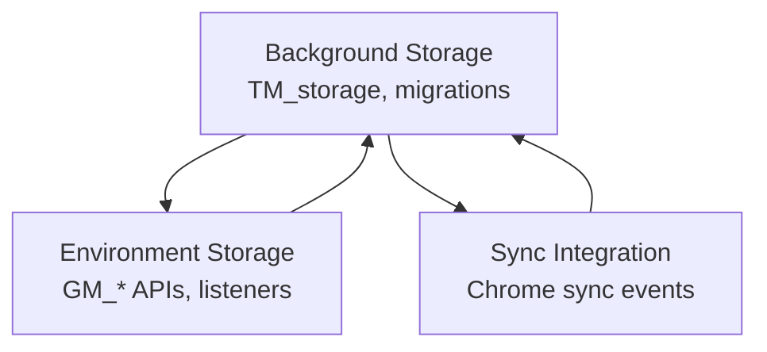
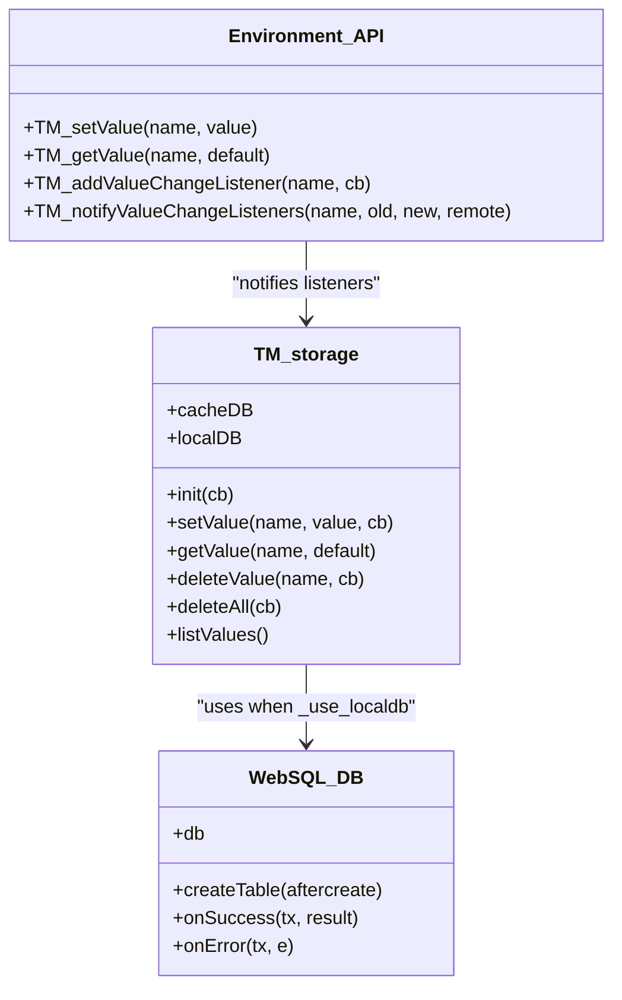
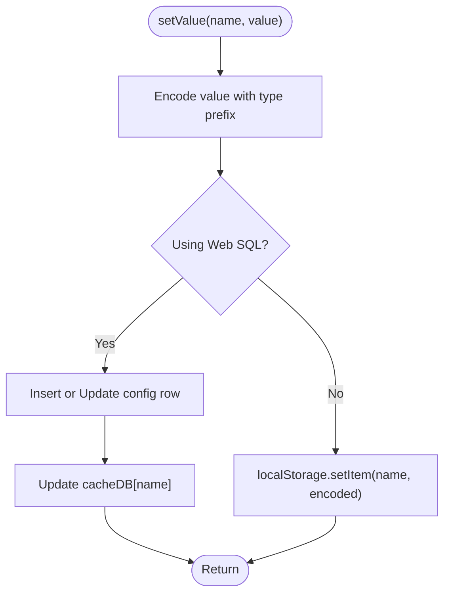
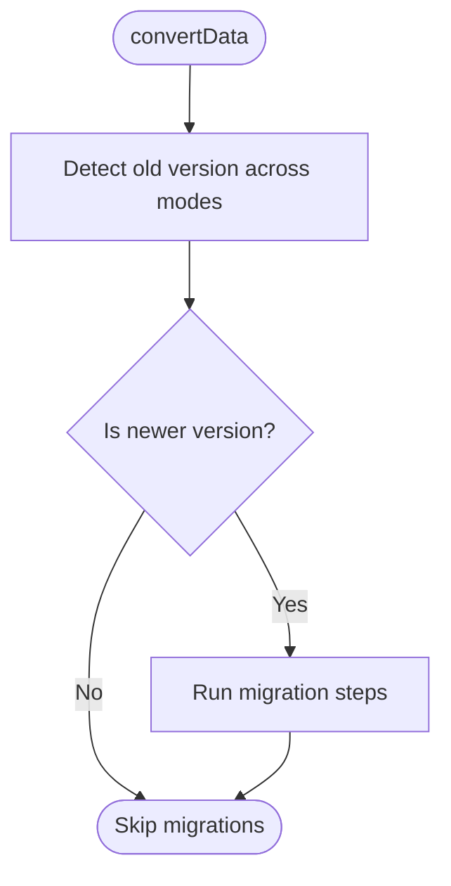
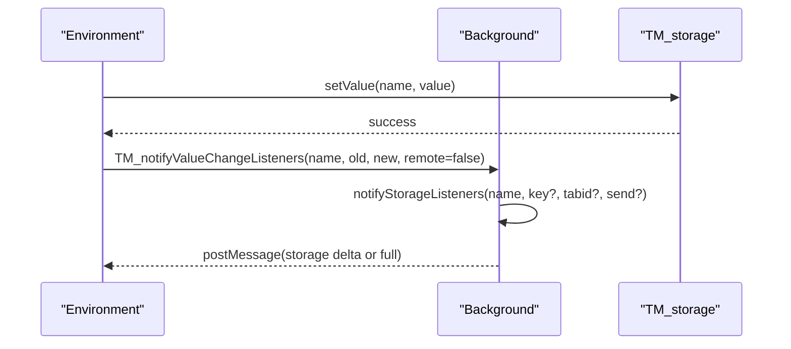
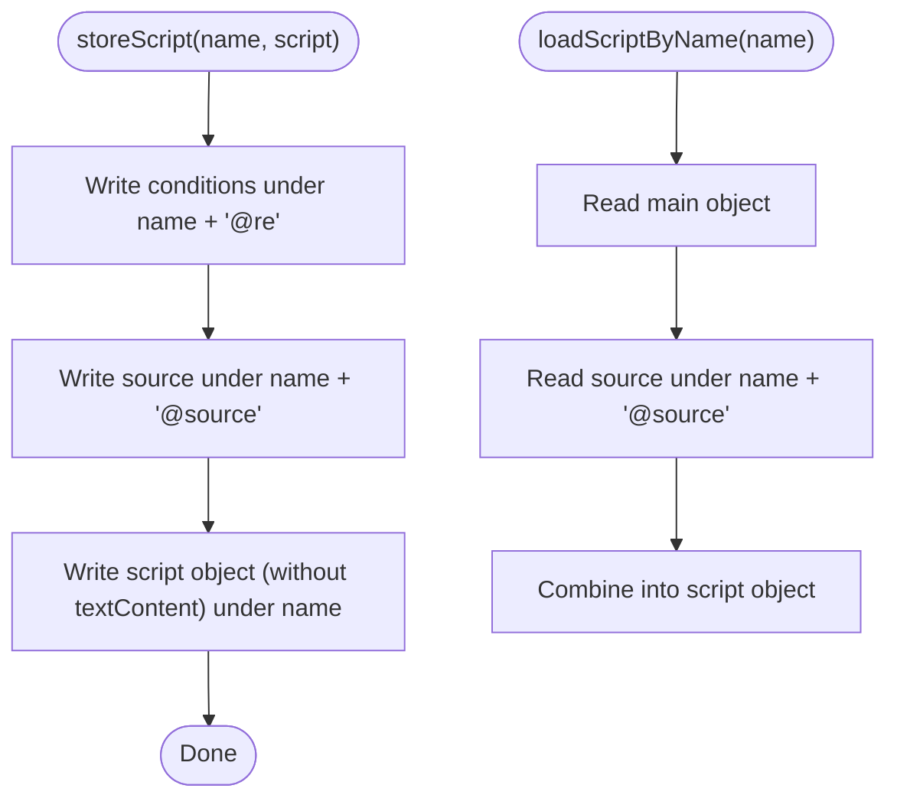
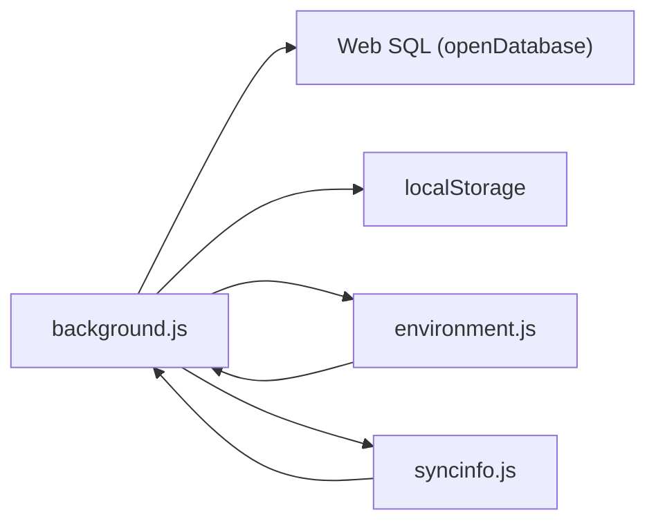

# Storage Management

<cite>
**Referenced Files in This Document**
- [background.js](file://src/background.js)
- [environment.js](file://src/environment.js)
- [syncinfo.js](file://src/syncinfo.js)
</cite>

## Table of Contents
1. [Introduction](#introduction)
2. [Project Structure](#project-structure)
3. [Core Components](#core-components)
4. [Architecture Overview](#architecture-overview)
5. [Detailed Component Analysis](#detailed-component-analysis)
6. [Dependency Analysis](#dependency-analysis)
7. [Performance Considerations](#performance-considerations)
8. [Troubleshooting Guide](#troubleshooting-guide)
9. [Conclusion](#conclusion)
10. [Appendices](#appendices)

## Introduction
This document describes the storage management subsystem in the background process, focusing on the TM_storage abstraction that provides a dual-storage architecture using localStorage and an IndexedDB-like Web SQL database. It explains how data is stored and retrieved, how version upgrades migrate data, and how the system supports real-time updates via listeners and synchronization. Practical examples show how to persist user preferences, script metadata, and configuration settings. Guidance is included for performance optimization, cleanup, and error handling.

## Project Structure
The storage subsystem spans several modules:
- Background storage engine and migration logic
- Environment-side helpers for script-scoped storage and listeners
- Synchronization integration for cross-device updates

**Diagram sources**
- [background.js:58-257](file://src/background.js#L58-L257)
- [background.js:1705-1904](file://src/background.js#L1705-L1904)
- [environment.js:868-978](file://src/environment.js#L868-L978)
- [syncinfo.js:149-184](file://src/syncinfo.js#L149-L184)

**Section sources**
- [background.js:58-257](file://src/background.js#L58-L257)
- [background.js:1705-1904](file://src/background.js#L1705-L1904)
- [environment.js:868-978](file://src/environment.js#L868-L978)
- [syncinfo.js:149-184](file://src/syncinfo.js#L149-L184)

## Core Components
- TM_storage: Dual-storage abstraction with localStorage fallback and Web SQL backend. Provides setValue, getValue, deleteValue, deleteAll, and listValues. Maintains an in-memory cache for Web SQL mode.
- Version upgrade pipeline: Determines current storage backend, runs migration steps, and switches storage modes when necessary.
- EscapeName: Placeholder for key normalization; currently identity.
- Listener pattern: Real-time notifications for storage changes across environments and tabs.
- Script storage: Specialized helpers to persist script metadata and content under derived keys.

**Section sources**
- [background.js:58-257](file://src/background.js#L58-L257)
- [background.js:789-792](file://src/background.js#L789-L792)
- [background.js:1705-1904](file://src/background.js#L1705-L1904)
- [background.js:3712-3770](file://src/background.js#L3712-L3770)
- [environment.js:868-978](file://src/environment.js#L868-L978)

## Architecture Overview
The storage architecture supports two modes:
- Web SQL mode: Uses an HTML5 Web SQL database named tmStorage with a config table. An in-memory cache mirrors rows for fast reads.
- Legacy mode: Uses browser localStorage.

A version upgrade routine inspects the stored version to decide whether to read legacy keys or Web SQL keys, enabling seamless migration.

**Diagram sources**
- [background.js:1705-1904](file://src/background.js#L1705-L1904)
- [background.js:1731-1744](file://src/background.js#L1731-L1744)
- [environment.js:868-978](file://src/environment.js#L868-L978)

## Detailed Component Analysis

### TM_storage Abstraction Layer
- Initialization: Creates the Web SQL database and config table if missing, then preloads cache from the database.
- Data encoding: Prefixes stored values with a single-character type marker to support booleans, numbers, and objects. Objects are serialized with JSON.
- Reads: In Web SQL mode, reads from an in-memory cache; in localStorage mode, reads from localStorage.
- Writes: Updates either the database (insert or update) and cache or localStorage depending on mode.
- Deletions: Removes entries from cache/database or localStorage accordingly.
- Listing: Iterates over cache keys or localStorage keys.

**Diagram sources**
- [background.js:1753-1790](file://src/background.js#L1753-L1790)

**Section sources**
- [background.js:1705-1904](file://src/background.js#L1705-L1904)

### Version Upgrade and Migration
- Determines old version by probing TM_version under both storage modes to detect legacy vs. Web SQL.
- Executes a series of migration steps based on version comparisons.
- Switches storage mode when necessary and continues with subsequent steps.

**Diagram sources**
- [background.js:145-257](file://src/background.js#L145-L257)

**Section sources**
- [background.js:145-257](file://src/background.js#L145-L257)

### EscapeName and Key Normalization
- escapeName is a placeholder function that currently returns the input unchanged. It is intended to normalize storage keys safely across modes and versions.

**Section sources**
- [background.js:789-792](file://src/background.js#L789-L792)
- [background.js:1755-1756](file://src/background.js#L1755-L1756)
- [background.js:1793-1794](file://src/background.js#L1793-L1794)
- [background.js:1856-1857](file://src/background.js#L1856-L1857)

### Listener Pattern for Real-Time Updates
- Environment-side listeners: Scripts can subscribe to value changes via TM_addValueChangeListener. On change, TM_notifyValueChangeListeners invokes callbacks.
- Background listeners: Background maintains a list of storage listeners for script-scoped storage and notifies them via ports. Notifications include the full storage snapshot or a single-key delta.

**Diagram sources**
- [environment.js:868-978](file://src/environment.js#L868-L978)
- [background.js:3772-3809](file://src/background.js#L3772-L3809)

**Section sources**
- [environment.js:868-978](file://src/environment.js#L868-L978)
- [background.js:3772-3809](file://src/background.js#L3772-L3809)

### Script Metadata and Configuration Persistence
- Script metadata: Stored under the base name; includes includes/matches/excludes conditions stored under a derived key.
- Script content: Stored separately under a dedicated key to avoid duplicating large text content in the main script object.
- Script storage: Per-script key-value storage with timestamps for synchronization.

**Diagram sources**
- [background.js:3729-3750](file://src/background.js#L3729-L3750)

**Section sources**
- [background.js:3712-3770](file://src/background.js#L3712-L3770)

### Storage Configuration Schema and Keys
- Base keys:
  - Name: primary key for a script
  - Name + "@re": conditions (includes, matches, excludes)
  - Name + "@source": raw script text
  - Name + "@st": per-script storage (data + ts)
- Global keys:
  - TM_version: version marker used during migration
- Notes:
  - Keys are normalized via escapeName (placeholder).
  - Values are encoded with a leading type character.

**Section sources**
- [background.js:72-76](file://src/background.js#L72-L76)
- [background.js:1755-1756](file://src/background.js#L1755-L1756)
- [background.js:1793-1794](file://src/background.js#L1793-L1794)
- [background.js:3712-3770](file://src/background.js#L3712-L3770)

### Practical Examples
- User preferences:
  - Use setValue/getValue to persist simple settings. The type prefix ensures booleans, numbers, and objects are restored correctly.
- Script metadata:
  - Persist includes/matches/excludes using the "@re" suffix and the main script object under the base name.
- Configuration settings:
  - Store per-script configuration under "@st" with a timestamp to coordinate sync.

**Section sources**
- [background.js:1753-1835](file://src/background.js#L1753-L1835)
- [background.js:3729-3750](file://src/background.js#L3729-L3750)
- [background.js:3714-3727](file://src/background.js#L3714-L3727)

## Dependency Analysis
- TM_storage depends on:
  - Web SQL database for persistence in Web SQL mode
  - localStorage for legacy mode
  - Environment listeners for real-time notifications
- Version upgrade logic depends on:
  - Deterministic version comparison
  - Migration step registry
- Script storage depends on:
  - Derived keys for conditions and source
  - Background listener mechanism for live updates

**Diagram sources**
- [background.js:1705-1904](file://src/background.js#L1705-L1904)
- [environment.js:868-978](file://src/environment.js#L868-L978)
- [syncinfo.js:149-184](file://src/syncinfo.js#L149-L184)

**Section sources**
- [background.js:1705-1904](file://src/background.js#L1705-L1904)
- [environment.js:868-978](file://src/environment.js#L868-L978)
- [syncinfo.js:149-184](file://src/syncinfo.js#L149-L184)

## Performance Considerations
- Prefer Web SQL mode for structured, indexed data and reduced serialization overhead compared to large localStorage entries.
- Use the in-memory cache in Web SQL mode to minimize round-trips for reads.
- Batch updates when possible to reduce transaction overhead.
- Avoid storing excessively large values in localStorage; prefer separate keys for content.
- Limit listener churn by consolidating frequent updates and using targeted key notifications.

## Troubleshooting Guide
- Storage initialization failures:
  - Check Web SQL creation and table creation callbacks for errors.
  - Verify that the database is accessible and not blocked by browser policies.
- Type decoding errors:
  - Malformed type prefixes or invalid JSON can cause decode failures; logs indicate errors during getValue.
- Listener notification failures:
  - Environment listeners wrap callbacks in try/catch; failures are logged but do not crash the system.
- Migration issues:
  - If version detection fails, the system probes both modes; ensure TM_version is present in the expected location.

**Section sources**
- [background.js:1731-1744](file://src/background.js#L1731-L1744)
- [background.js:1792-1835](file://src/background.js#L1792-L1835)
- [environment.js:872-886](file://src/environment.js#L872-L886)

## Conclusion
The storage subsystem provides a robust, backward-compatible abstraction that supports both localStorage and Web SQL-backed persistence. It encodes typed values, offers real-time listeners, and coordinates migrations across versions. By leveraging derived keys for scripts and per-script storage, it cleanly separates metadata, content, and runtime state, enabling efficient persistence and synchronization.

## Appendices

### Data Conversion and Encoding Details
- Values are prefixed with a single-character type indicator:
  - b: boolean
  - n: number
  - o: object (serialized with JSON)
  - Other: string representation
- Decoding reverses the process, restoring native types.

**Section sources**
- [background.js:1755-1768](file://src/background.js#L1755-L1768)
- [background.js:1795-1816](file://src/background.js#L1795-L1816)
- [environment.js:932-954](file://src/environment.js#L932-L954)

### Cleanup Procedures
- deleteAll clears either the Web SQL table or all localStorage entries.
- deleteValue removes a single key from the selected backend.
- listValues enumerates keys for maintenance tasks.

**Section sources**
- [background.js:1837-1903](file://src/background.js#L1837-L1903)