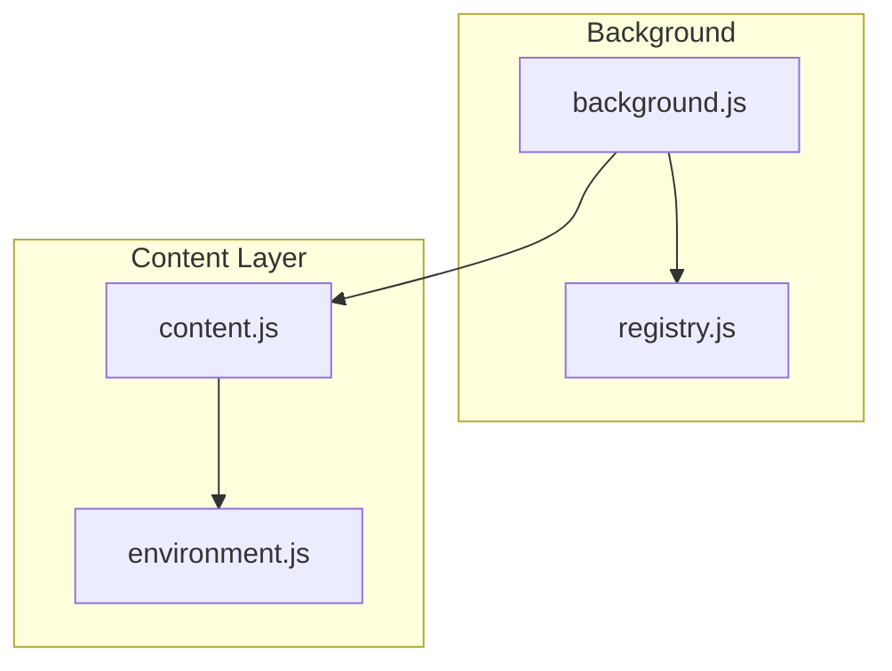
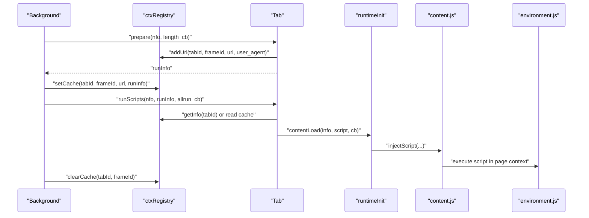
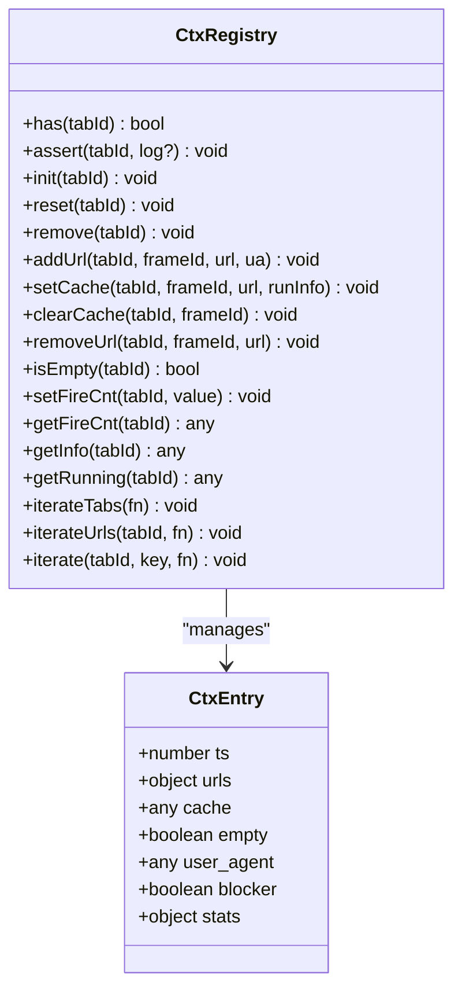
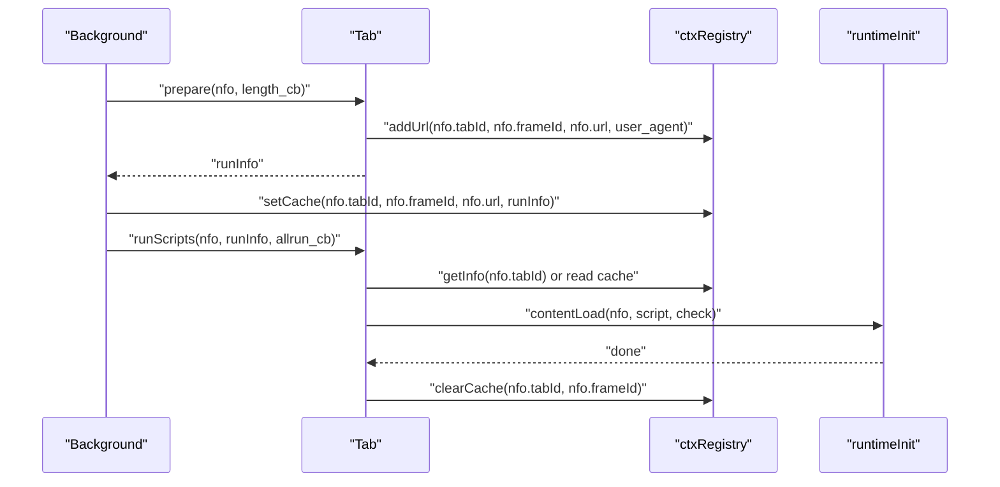
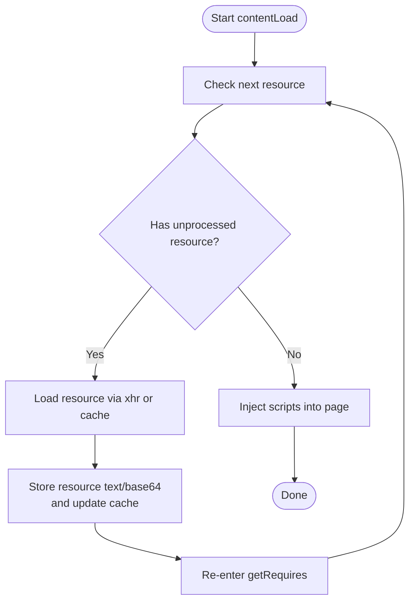
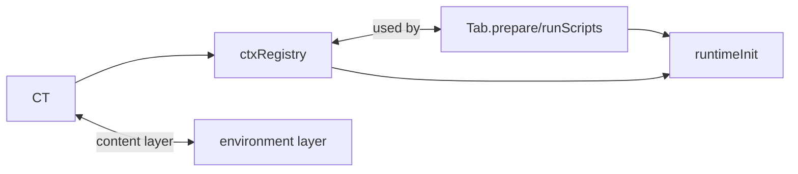

# Context Registry

<cite>
**Referenced Files in This Document**
- [registry.js](file://src/registry.js)
- [background.js](file://src/background.js)
- [content.js](file://src/content.js)
- [environment.js](file://src/environment.js)
- [parser.js](file://src/parser.js)
</cite>

## Table of Contents
1. [Introduction](#introduction)
2. [Project Structure](#project-structure)
3. [Core Components](#core-components)
4. [Architecture Overview](#architecture-overview)
5. [Detailed Component Analysis](#detailed-component-analysis)
6. [Dependency Analysis](#dependency-analysis)
7. [Performance Considerations](#performance-considerations)
8. [Troubleshooting Guide](#troubleshooting-guide)
9. [Conclusion](#conclusion)

## Introduction
This document explains the context registry system that manages script execution contexts across browser tabs. It focuses on the ctxRegistry object, which tracks per-tab execution state, URL mappings, user agent preferences, and execution statistics. It also documents the core registry operations (addUrl, removeUrl, setCache, clearCache, reset/remove), the context data structure, and traversal helpers (iterateTabs, iterateUrls). Practical examples show initialization, URL registration, cache management, and cleanup. Finally, it covers memory management and performance implications.

## Project Structure
The context registry lives in the background script and is used by the content and environment layers during script discovery, preparation, and injection.

**Diagram sources**
- [background.js](file://src/background.js)
- [registry.js](file://src/registry.js)
- [content.js](file://src/content.js)
- [environment.js](file://src/environment.js)

**Section sources**
- [background.js](file://src/background.js)
- [registry.js](file://src/registry.js)
- [content.js](file://src/content.js)
- [environment.js](file://src/environment.js)

## Core Components
- ctxRegistry: Per-tab execution context manager with URL tracking, user agent storage, cache, and statistics.
- Tab.prepare and Tab.runScripts: Prepare and execute scripts for a tab, using ctxRegistry to track URLs and optionally cache run info.
- runtimeInit: Loads script requires/resources and injects scripts into content contexts.

Key responsibilities:
- Track URLs visited per tab and maintain counts.
- Store user agent overrides per URL/frame context.
- Cache run information to avoid recomputation.
- Maintain execution statistics (running, disabled, per-script execution records).
- Provide iteration helpers for diagnostics and integration.

**Section sources**
- [background.js](file://src/background.js)

## Architecture Overview
The context registry integrates with the script discovery pipeline and runtime injection.

**Diagram sources**
- [background.js](file://src/background.js)
- [content.js](file://src/content.js)
- [environment.js](file://src/environment.js)

## Detailed Component Analysis

### ctxRegistry: Per-tab context manager
The ctxRegistry maintains a dictionary keyed by tabId. Each entry holds:
- ts: Timestamp of creation.
- urls: Map of URL to visit count.
- user_agent: Optional per-URL user agent overrides.
- cache: Optional cached run info for reuse.
- empty: Boolean indicating whether the registry entry is empty.
- fire_cnt: Optional counter for external integration.
- blocker: Boolean flag (possibly for script blockers).
- stats: Execution statistics:
  - running: number of currently running scripts.
  - disabled: number of disabled scripts considered.
  - executed: per-script execution record.

Core operations:
- has(tabId): existence check.
- assert(tabId, log?): ensure context exists.
- init(tabId): create a new context entry.
- reset(tabId): recreate context entry.
- remove(tabId): delete context entry.
- addUrl(tabId, frameId, url, ua): increment URL count and store UA overrides.
- setCache(tabId, frameId, url, runInfo): cache run info.
- clearCache(tabId, frameId): drop cached run info.
- removeUrl(tabId, frameId, url): decrement URL count and cleanup when zero.
- isEmpty(tabId): check emptiness.
- setFireCnt/getFireCnt: set/get optional counter.
- getInfo(tabId): return full context snapshot.
- getRunning(tabId): return running count.
- iterateTabs(fn): iterate all tab entries.
- iterateUrls(tabId, fn): iterate URL entries for a tab.
- iterate(tabId, key, fn): generic iterator over a nested map.

**Diagram sources**
- [background.js](file://src/background.js)

**Section sources**
- [background.js](file://src/background.js)

### Tab.prepare and Tab.runScripts
- Tab.prepare(nfo, length_cb):
  - Determines scripts to run for the given URL and frame.
  - Calls ctxRegistry.addUrl to register the URL and store user agent overrides.
  - Invokes length_cb with counts of enabled/disabled scripts.
  - Returns runInfo for downstream use.
- Tab.runScripts(nfo, runInfo, allrun_cb):
  - Attempts to fetch runInfo from cache via ctxRegistry if not provided.
  - Iterates enabled scripts and runs them via runtimeInit.contentLoad.
  - Clears cache after successful reuse.

**Diagram sources**
- [background.js](file://src/background.js)

**Section sources**
- [background.js](file://src/background.js)

### runtimeInit: Resource loading and script injection
- runtimeInit.getRequires/script.resources:
  - Loads @require dependencies and caches them using addToRequireCache/getFromRequireCache.
- runtimeInit.contentLoad:
  - Ensures resources are ready, then injects scripts into the page via content.js/environment.js.

**Diagram sources**
- [background.js](file://src/background.js)

**Section sources**
- [background.js](file://src/background.js)

### Context data structure
- ts: Creation timestamp.
- urls: Map of URL to integer visit count.
- user_agent: Optional map of URL to user agent string.
- cache: Optional runInfo object reused by Tab.runScripts.
- empty: Boolean indicating if the context is empty.
- fire_cnt: Optional numeric counter.
- blocker: Boolean flag.
- stats.running: Number of currently running scripts.
- stats.disabled: Number of disabled scripts considered.
- stats.executed: Map of script id to execution record { disabled, running }.

**Section sources**
- [background.js](file://src/background.js)

### Registry traversal helpers
- iterateTabs(fn): Iterate all tab entries; fn receives (tabId, ctxEntry).
- iterateUrls(tabId, fn): Iterate URL entries for a tab; fn receives (url, count).
- iterate(tabId, key, fn): Generic iterator over ctxRegistry.n[tabId][key].

**Section sources**
- [background.js](file://src/background.js)

### Practical examples

- Context initialization and URL registration
  - Call ctxRegistry.assert(tabId) to ensure a context exists.
  - Call ctxRegistry.addUrl(tabId, frameId, url, user_agent_map) to register a URL and store UA overrides.
  - Example snippet path: [background.js](file://src/background.js)

- Cache management
  - After preparing runInfo, call ctxRegistry.setCache(tabId, frameId, url, runInfo) to cache it.
  - When runInfo is consumed by Tab.runScripts, clear the cache via ctxRegistry.clearCache(tabId, frameId).
  - Example snippet path: [background.js](file://src/background.js)

- Cleanup
  - On tab reset or removal, call ctxRegistry.reset(tabId) or ctxRegistry.remove(tabId) to free memory.
  - Example snippet path: [background.js](file://src/background.js)

- Statistics and inspection
  - Use ctxRegistry.getInfo(tabId) to inspect the full context.
  - Use ctxRegistry.getRunning(tabId) to check current running scripts.
  - Use ctxRegistry.iterateUrls(tabId, fn) to enumerate URLs and counts.
  - Example snippet path: [background.js](file://src/background.js)

**Section sources**
- [background.js](file://src/background.js)

## Dependency Analysis
- ctxRegistry depends on:
  - Tab.prepare/Tab.runScripts for URL registration and run info caching.
  - runtimeInit for resource loading and script injection.
  - Registry.get('xmlhttprequest') and Registry.get('helper') for network and utilities in content layer.
- Content and environment layers depend on ctxRegistry indirectly via background orchestration.

**Diagram sources**
- [background.js](file://src/background.js)
- [content.js](file://src/content.js)
- [environment.js](file://src/environment.js)

**Section sources**
- [background.js](file://src/background.js)
- [content.js](file://src/content.js)
- [environment.js](file://src/environment.js)

## Performance Considerations
- URL counting avoids repeated computation of eligible scripts per URL.
- Caching runInfo reduces repeated script discovery and UA resolution.
- Require/resource caching minimizes network overhead and improves startup time.
- Periodic cache cleanup prevents memory bloat; tune cacheValidPeriod/cacheCheckPeriod as needed.
- Using ctxRegistry.iterate* helpers enables efficient diagnostics and maintenance without scanning entire state.

[No sources needed since this section provides general guidance]

## Troubleshooting Guide
- Symptom: Scripts not executing on a URL
  - Verify ctxRegistry.urls contains the URL and count is positive.
  - Confirm ctxRegistry.user_agent overrides are set if needed.
  - Check ctxRegistry.cache for stale runInfo.
  - Example snippet path: [background.js](file://src/background.js)

- Symptom: Memory growth over time
  - Ensure ctxRegistry.remove(tabId) or ctxRegistry.reset(tabId) is called on tab close/unload.
  - Confirm ctxRegistry.clearCache(tabId, frameId) is invoked after consumption.
  - Example snippet path: [background.js](file://src/background.js)

- Symptom: Incorrect user agent applied
  - Inspect ctxRegistry.user_agent[url] for the expected value.
  - Example snippet path: [background.js](file://src/background.js)

- Symptom: Excessive network requests
  - Review require/resource cache hit rate and adjust cacheValidPeriod/cacheCheckPeriod.
  - Example snippet path: [background.js](file://src/background.js)

**Section sources**
- [background.js](file://src/background.js)

## Conclusion
The context registry centralizes per-tab script execution state, enabling efficient URL tracking, user agent management, and caching. Together with Tab.prepare/runScripts and runtimeInit, it provides a robust foundation for discovering, preparing, and injecting user scripts across browser tabs. Proper lifecycle management (reset/remove) and cache hygiene are essential for performance and memory stability.