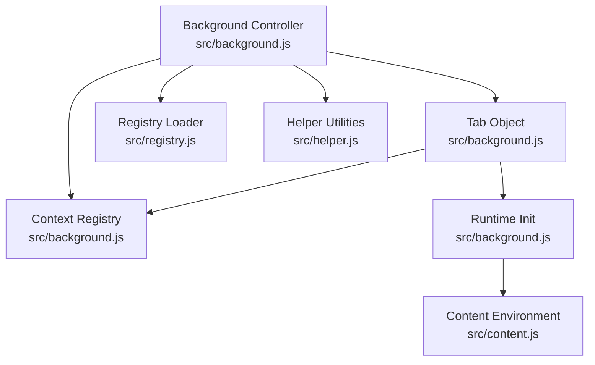
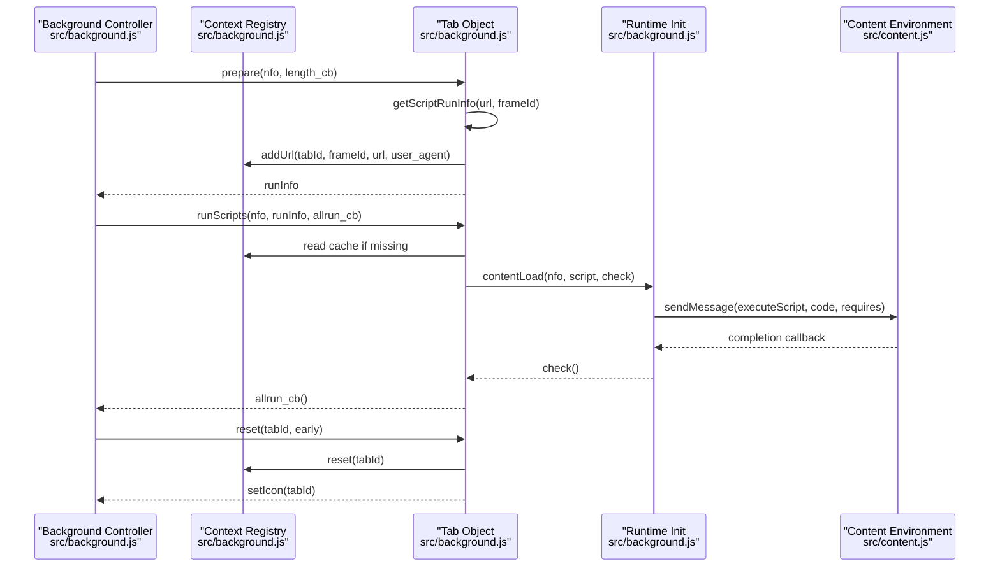
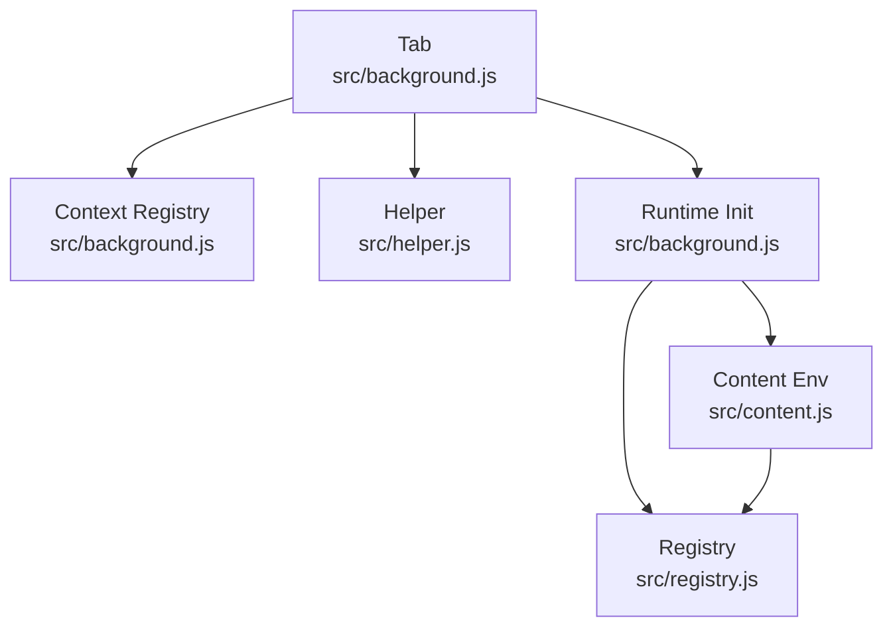

# Tab Lifecycle Management

<cite>
**Referenced Files in This Document**
- [background.js](file://src/background.js)
- [content.js](file://src/content.js)
- [registry.js](file://src/registry.js)
- [tabview.js](file://src/tabview.js)
- [helper.js](file://src/helper.js)
</cite>

## Table of Contents
1. [Introduction](#introduction)
2. [Project Structure](#project-structure)
3. [Core Components](#core-components)
4. [Architecture Overview](#architecture-overview)
5. [Detailed Component Analysis](#detailed-component-analysis)
6. [Dependency Analysis](#dependency-analysis)
7. [Performance Considerations](#performance-considerations)
8. [Troubleshooting Guide](#troubleshooting-guide)
9. [Conclusion](#conclusion)

## Introduction
This document explains the tab lifecycle management system in the extension, focusing on how tabs are created, prepared, scripts are determined and executed, and how cleanup is performed. It covers:
- Tab object methods: getScriptRunInfo, prepare, runScripts, and reset
- Context registry integration for URL tracking and user agent management
- Frame handling for nested frames via frameId
- Caching mechanisms and context reuse strategies
- Practical examples of initialization, script determination, execution coordination, and cleanup

## Project Structure
The tab lifecycle spans several modules:
- Background controller orchestrating tab lifecycle and script execution
- Content script environment for injecting and running user scripts
- Registry for module loading and cross-file communication
- Helper utilities for URL matching and regular expressions
- Tab view for UI tab management (not directly involved in script execution)

**Diagram sources**
- [background.js:435-640](file://src/background.js#L435-L640)
- [content.js:1-120](file://src/content.js#L1-L120)
- [registry.js:1-107](file://src/registry.js#L1-L107)
- [helper.js:1-80](file://src/helper.js#L1-L80)

**Section sources**
- [background.js:435-640](file://src/background.js#L435-L640)
- [content.js:1-120](file://src/content.js#L1-L120)
- [registry.js:1-107](file://src/registry.js#L1-L107)
- [helper.js:1-80](file://src/helper.js#L1-L80)

## Core Components
- Tab object: central orchestrator for script selection, preparation, and execution coordination
- Context registry: per-tab state tracking, URL registration, user agent storage, and caching
- Runtime initializer: prepares and injects scripts into the content environment
- Content environment: executes injected scripts and manages cleanup

Key responsibilities:
- Determine which scripts apply to a given URL and frame
- Prepare tab context and register URLs
- Execute scripts with caching and resource reuse
- Reset tab state and update UI icons

**Section sources**
- [background.js:560-640](file://src/background.js#L560-L640)
- [background.js:435-558](file://src/background.js#L435-L558)
- [background.js:2538-2796](file://src/background.js#L2538-L2796)

## Architecture Overview
The tab lifecycle integrates background orchestration with content execution and registry state management.

**Diagram sources**
- [background.js:560-640](file://src/background.js#L560-L640)
- [background.js:435-558](file://src/background.js#L435-L558)
- [background.js:2538-2796](file://src/background.js#L2538-L2796)
- [content.js:2784-2794](file://src/content.js#L2784-L2794)

## Detailed Component Analysis

### Tab Object Methods
- getScriptRunInfo(url, frameId)
  - Determines applicable scripts for a URL
  - Filters disabled scripts and respects frame scope (noframes)
  - Collects per-frame user agents
  - Returns runners, disabled count, script map, and user_agent mapping

- prepare(nfo, length_cb)
  - Calls getScriptRunInfo
  - Registers URL in context registry with associated user agent
  - Invokes length_cb with runner and disabled counts
  - Returns runInfo

- runScripts(nfo, runInfo, allrun_cb)
  - Uses cached runInfo if not provided
  - Iterates runners and initializes runtime for each
  - Clears cache after execution if previously cached
  - Ensures completion callback is invoked when all scripts finish

- reset(tabId, early)
  - Resets context registry for the tab
  - Clears menu commands for the tab
  - Notifies storage listeners
  - Updates icon unless early flag indicates tab not fully initialized

Practical example paths:
- [Tab.getScriptRunInfo:562-587](file://src/background.js#L562-L587)
- [Tab.prepare:590-596](file://src/background.js#L590-L596)
- [Tab.runScripts:599-626](file://src/background.js#L599-L626)
- [Tab.reset:629-639](file://src/background.js#L629-L639)

**Section sources**
- [background.js:560-640](file://src/background.js#L560-L640)

### Context Registry
- Tracks per-tab state: timestamps, URLs, user agent, stats, and cache
- Adds/removes URLs and maintains emptiness flag
- Stores and clears per-tab cache for runInfo
- Provides helpers to iterate tabs and URLs

Integration points:
- Tab.prepare registers URL and UA
- Tab.runScripts reads/writes cache
- Tab.reset clears registry state

Practical example paths:
- [Context registry init/assert/addUrl/setCache/clearCache/removeUrl:437-558](file://src/background.js#L437-L558)

**Section sources**
- [background.js:435-558](file://src/background.js#L435-L558)

### Script Determination and URL Matching
- determineScriptsToRun(href) enumerates stored scripts and filters by URL conditions
- validUrl(href, cond, name) applies include/match/exclude rules using Helper.getRegExpFromUrl
- matchUrl supports wildcard and anchored matching

Practical example paths:
- [determineScriptsToRun:3681-3710](file://src/background.js#L3681-L3710)
- [validUrl and matchUrl:3605-3640](file://src/background.js#L3605-L3640)
- [Helper.getRegExpFromUrl:56-80](file://src/helper.js#L56-L80)

**Section sources**
- [background.js:3605-3710](file://src/background.js#L3605-L3710)
- [helper.js:56-80](file://src/helper.js#L56-L80)

### Script Execution Coordination
- runtimeInit.contentLoad(info, main, cb) coordinates resource fetching and injection
- runtimeInit.injectScript(scripts, cb) sends executeScript message to content with code and requires
- Content environment receives message and executes injected code

Practical example paths:
- [runtimeInit.contentLoad:2717-2735](file://src/background.js#L2717-L2735)
- [runtimeInit.injectScript:2758-2795](file://src/background.js#L2758-L2795)
- [Content message handling:273-307](file://src/content.js#L273-L307)

**Section sources**
- [background.js:2717-2795](file://src/background.js#L2717-L2795)
- [content.js:273-307](file://src/content.js#L273-L307)

### Frame Handling and Nested Frames
- frameId distinguishes main_frame vs sub_frame
- getScriptRunInfo skips scripts with noframes when frameId != 0
- Context registry tracks URLs per frameId and stores per-frame user agents

Practical example paths:
- [getScriptRunInfo frameId filtering:578-582](file://src/background.js#L578-L582)
- [Context registry addUrl with frameId:466-480](file://src/background.js#L466-L480)

**Section sources**
- [background.js:578-582](file://src/background.js#L578-L582)
- [background.js:466-480](file://src/background.js#L466-L480)

### Caching Mechanisms and Context Reuse
- Require cache: caches @require resources with periodic cleanup
- RunInfo cache: per-tab cache in context registry for runInfo
- Context reuse: Tab.prepare sets cache; Tab.runScripts clears cache after use

Practical example paths:
- [Require cache:395-433](file://src/background.js#L395-L433)
- [Context registry cache:482-494](file://src/background.js#L482-L494)
- [Tab.prepare cache usage:593-596](file://src/background.js#L593-L596)
- [Tab.runScripts cache clearing:622-622](file://src/background.js#L622-L622)

**Section sources**
- [background.js:395-433](file://src/background.js#L395-L433)
- [background.js:482-494](file://src/background.js#L482-L494)
- [background.js:593-596](file://src/background.js#L593-L596)
- [background.js:622-622](file://src/background.js#L622-L622)

### Cleanup Procedures
- Tab.reset clears registry, menu commands, notifies storage listeners, and updates icon
- Content environment cleans up on unload and removes temporary artifacts

Practical example paths:
- [Tab.reset:629-639](file://src/background.js#L629-L639)
- [Content cleanup:146-157](file://src/content.js#L146-L157)

**Section sources**
- [background.js:629-639](file://src/background.js#L629-L639)
- [content.js:146-157](file://src/content.js#L146-L157)

## Dependency Analysis
- Tab depends on:
  - Context registry for URL and cache management
  - Helper for URL matching
  - Runtime initializer for script injection
- Runtime initializer depends on:
  - Content environment for execution
  - Registry for module loading
- Content environment depends on:
  - Registry for module loading
  - Helper for serialization and utilities

**Diagram sources**
- [background.js:560-640](file://src/background.js#L560-L640)
- [background.js:435-558](file://src/background.js#L435-L558)
- [helper.js:56-80](file://src/helper.js#L56-L80)
- [content.js:1-120](file://src/content.js#L1-L120)
- [registry.js:1-107](file://src/registry.js#L1-L107)

**Section sources**
- [background.js:560-640](file://src/background.js#L560-L640)
- [background.js:435-558](file://src/background.js#L435-L558)
- [helper.js:56-80](file://src/helper.js#L56-L80)
- [content.js:1-120](file://src/content.js#L1-L120)
- [registry.js:1-107](file://src/registry.js#L1-L107)

## Performance Considerations
- Caching
  - Require cache reduces repeated network fetches for @require resources
  - RunInfo cache avoids recomputation of applicable scripts per navigation
- Context reuse
  - Per-tab context minimizes redundant state initialization
- Asynchronous execution
  - Parallel script execution via counters and callbacks
- URL matching
  - Efficient regular expression generation and reuse

[No sources needed since this section provides general guidance]

## Troubleshooting Guide
Common issues and diagnostics:
- Scripts not running on specific URLs
  - Verify include/match/exclude conditions and URL normalization
  - Check validUrl and matchUrl logic
  - References: [validUrl:3605-3640](file://src/background.js#L3605-L3640), [matchUrl:3583-3603](file://src/background.js#L3583-L3603), [Helper.getRegExpFromUrl:56-80](file://src/helper.js#L56-L80)
- Scripts not executing in nested frames
  - Ensure noframes option is not preventing sub-frame execution
  - References: [getScriptRunInfo frameId filtering:578-582](file://src/background.js#L578-L582)
- Stale or missing cache
  - Confirm cache validity and cleanup intervals
  - References: [Require cache:395-433](file://src/background.js#L395-L433), [Context registry cache:482-494](file://src/background.js#L482-L494)
- Tab state not resetting
  - Confirm Tab.reset clears registry and updates icon
  - References: [Tab.reset:629-639](file://src/background.js#L629-L639)
- Content execution errors
  - Inspect content message handling and cleanup routines
  - References: [Content message handling:273-307](file://src/content.js#L273-L307), [Content cleanup:146-157](file://src/content.js#L146-L157)

**Section sources**
- [background.js:3583-3640](file://src/background.js#L3583-L3640)
- [background.js:395-433](file://src/background.js#L395-L433)
- [background.js:482-494](file://src/background.js#L482-L494)
- [background.js:629-639](file://src/background.js#L629-L639)
- [content.js:146-157](file://src/content.js#L146-L157)
- [content.js:273-307](file://src/content.js#L273-L307)

## Conclusion
The tab lifecycle management system coordinates script discovery, preparation, execution, and cleanup through a clear separation of concerns:
- Tab orchestrates script selection and execution coordination
- Context registry maintains per-tab state and caching
- Runtime initializer handles resource fetching and injection
- Content environment executes scripts and manages cleanup
- Helper utilities provide robust URL matching and serialization

This design enables efficient, scalable script execution across tabs and frames while supporting caching and context reuse for optimal performance.