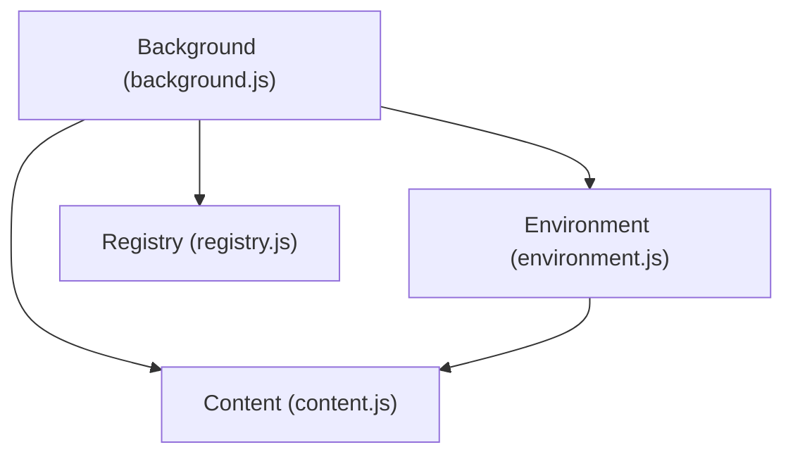
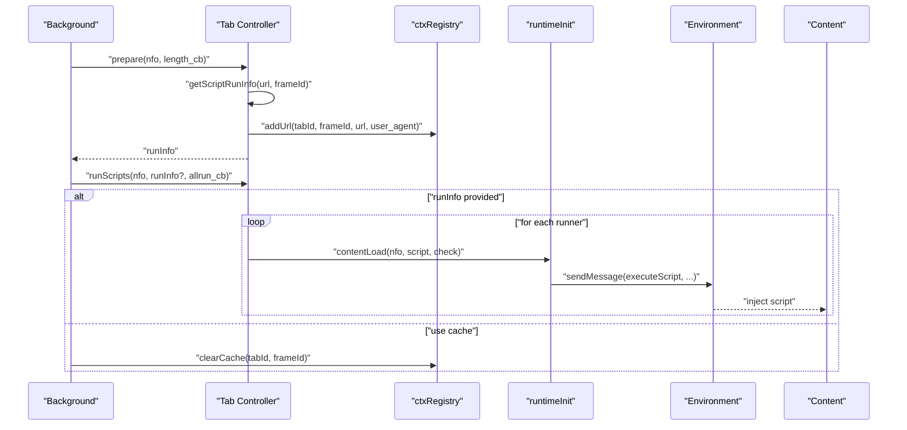
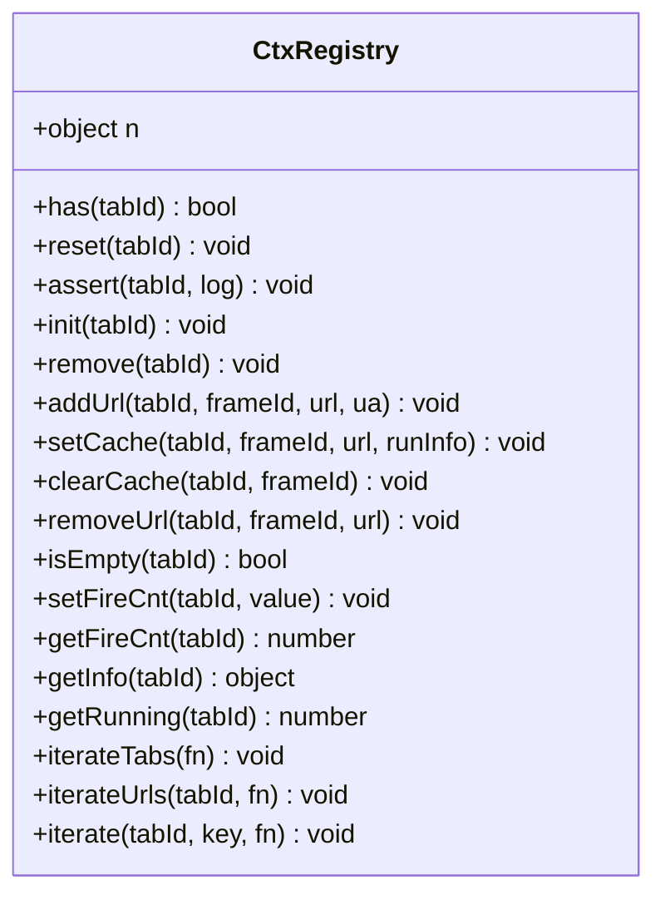
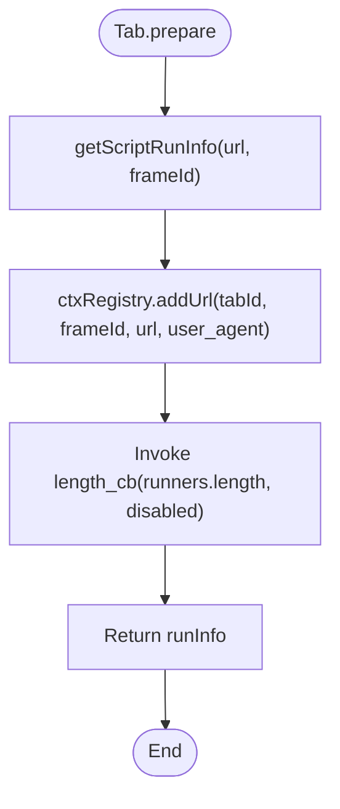
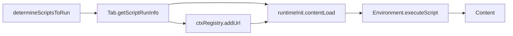

# Tab and Context Management

<cite>
**Referenced Files in This Document**
- [background.js](file://src/background.js)
- [environment.js](file://src/environment.js)
- [content.js](file://src/content.js)
- [registry.js](file://src/registry.js)
</cite>

## Table of Contents
1. [Introduction](#introduction)
2. [Project Structure](#project-structure)
3. [Core Components](#core-components)
4. [Architecture Overview](#architecture-overview)
5. [Detailed Component Analysis](#detailed-component-analysis)
6. [Dependency Analysis](#dependency-analysis)
7. [Performance Considerations](#performance-considerations)
8. [Troubleshooting Guide](#troubleshooting-guide)
9. [Conclusion](#conclusion)

## Introduction
This document explains the tab and context registry system that tracks script execution contexts across browser tabs in the extension. It focuses on the ctxRegistry object structure, tab tracking, URL mapping, user agent management, and execution statistics. It also documents the Tab object methods used to determine which scripts to run on specific URLs, prepare contexts, and execute scripts. Finally, it covers context registry operations such as addUrl, removeUrl, setCache, and clearCache, and clarifies the relationship between tabs, frames, and script execution contexts, including frameId handling for nested frames.

## Project Structure
The tab and context management logic spans several files:
- background.js: Contains the context registry (ctxRegistry), the Tab controller, script selection logic, and runtime execution orchestration.
- environment.js: Handles content-side script execution scheduling and message handling for script runs.
- content.js: Manages content-side cleanup and lifecycle events for frames.
- registry.js: Provides a generic module registry used by the extension.

**Diagram sources**
- [background.js:437-558](file://src/background.js#L437-L558)
- [environment.js:1261-1286](file://src/environment.js#L1261-L1286)
- [content.js:1030-1075](file://src/content.js#L1030-L1075)
- [registry.js:11-104](file://src/registry.js#L11-L104)

**Section sources**
- [background.js:437-558](file://src/background.js#L437-L558)
- [environment.js:1261-1286](file://src/environment.js#L1261-L1286)
- [content.js:1030-1075](file://src/content.js#L1030-L1075)
- [registry.js:11-104](file://src/registry.js#L11-L104)

## Core Components
- ctxRegistry: Central registry per tab storing URL counts, user agent overrides, cache, and execution statistics.
- Tab: Controller that computes which scripts to run for a given URL and frameId, prepares contexts, and executes scripts.
- runtimeInit: Background-side runtime that loads resources, injects scripts into content, and manages execution.
- determineScriptsToRun: Determines applicable scripts for a given URL based on stored conditions.
- TM_tabs: Per-tab content-side storage container used during script execution.

Key responsibilities:
- Track tab contexts and URL mappings with reference counting.
- Manage user agent overrides per URL/frame.
- Cache run decisions to optimize repeated navigations.
- Coordinate script execution timing via environment scheduling.

**Section sources**
- [background.js:437-558](file://src/background.js#L437-L558)
- [background.js:561-640](file://src/background.js#L561-L640)
- [background.js:2539-2737](file://src/background.js#L2539-L2737)
- [background.js:3681-3710](file://src/background.js#L3681-L3710)
- [background.js:2724](file://src/background.js#L2724)

## Architecture Overview
The system orchestrates script execution across tabs and frames:
- Background determines applicable scripts for a URL and frameId.
- Background updates ctxRegistry with URL counts and user agent overrides.
- Background optionally caches runInfo to avoid recomputation.
- Content-side environment receives execution requests and schedules script injection according to run-at timing.
- Content-side cleanup ensures proper teardown on navigation/unload.

**Diagram sources**
- [background.js:561-640](file://src/background.js#L561-L640)
- [background.js:437-558](file://src/background.js#L437-L558)
- [background.js:2539-2737](file://src/background.js#L2539-L2737)
- [environment.js:1261-1286](file://src/environment.js#L1261-L1286)
- [content.js:1030-1075](file://src/content.js#L1030-L1075)

## Detailed Component Analysis

### ctxRegistry: Tab Context and Execution Statistics
The ctxRegistry maintains per-tab state:
- ts: Timestamp of initialization.
- urls: URL-to-count map for reference counting.
- fire_cnt: Optional counter for scheduled triggers.
- empty: Boolean indicating whether the registry entry is empty.
- user_agent: Optional per-URL user agent overrides.
- blocker: Flag for blocking behavior (usage context-dependent).
- stats: Execution counters and per-request execution records.
- cache: Optional cached runInfo for reuse.

Operations:
- has, reset, assert, init, remove: Lifecycle and existence checks.
- addUrl: Increments URL count and stores user agent overrides keyed by URL.
- setCache/clearCache: Store and clear cached runInfo.
- removeUrl: Decrements URL count; deletes URL and associated user agent; marks empty if none remain.
- isEmpty, setFireCnt/getFireCnt, getInfo, getRunning, iterateTabs/iterateUrls/iterate: Utility getters and iterators.

**Diagram sources**
- [background.js:437-558](file://src/background.js#L437-L558)

**Section sources**
- [background.js:437-558](file://src/background.js#L437-L558)

### Tab Controller: Script Selection and Execution
The Tab controller encapsulates tab-level logic:
- getScriptRunInfo(url, frameId): Filters enabled scripts for the URL, applies frame-level constraints (noframes), collects user agent overrides keyed by frameId, and returns runners, disabled count, script_map, and user_agent.
- prepare(nfo, length_cb): Computes runInfo via getScriptRunInfo, updates ctxRegistry with URL and user agents, invokes optional length callback with counts, and returns runInfo.
- runScripts(nfo, runInfo?, allrun_cb): Executes scripts either from provided runInfo or cached runInfo; increments a counter to track completion; clears cache after consumption; logs errors if no runInfo is available.
- reset(tabId, early): Resets ctxRegistry for the tab, clears menu commands, notifies storage listeners, and updates icon.

**Diagram sources**
- [background.js:561-597](file://src/background.js#L561-L597)
- [background.js:466-480](file://src/background.js#L466-L480)

**Section sources**
- [background.js:561-640](file://src/background.js#L561-L640)
- [background.js:466-480](file://src/background.js#L466-L480)

### determineScriptsToRun: Script Selection Logic
The background determines which scripts apply to a given URL by:
- Loading all script names and conditions from persistent storage.
- Filtering scripts whose conditions match the current URL.
- Sorting scripts by position and returning the list of applicable scripts.

This list is used by Tab.getScriptRunInfo to compute runners and disabled counts.

**Section sources**
- [background.js:3681-3710](file://src/background.js#L3681-L3710)

### runtimeInit: Background Runtime for Script Injection
The runtimeInit object performs resource loading and script injection:
- getNextResource/script resource loading with caching and MIME detection.
- getRequires/require resource loading with caching and blacklist handling.
- contentLoad: Prepares execution by ensuring resources are loaded, then injects the script into the content tab.
- injectScript: Sends a message to the content environment to execute the script with headers, requires, and storage.

It also initializes per-tab storage in TM_tabs when needed.

**Section sources**
- [background.js:2539-2737](file://src/background.js#L2539-L2737)
- [background.js:2724](file://src/background.js#L2724)

### Environment and Content Lifecycle
- environment.js: Receives executeScript requests and schedules script execution based on run_at timing (document-start, document-body, document-end). It also handles onLoad to mark DOM readiness and supports navigation/reload commands.
- content.js: Registers cleanup handlers for unload, DOMContentLoaded, and DOMNodeInserted, and sends unLoad messages to background on teardown.

**Section sources**
- [environment.js:1261-1286](file://src/environment.js#L1261-L1286)
- [content.js:1030-1075](file://src/content.js#L1030-L1075)

## Dependency Analysis
- ctxRegistry depends on:
  - Tab.getScriptRunInfo for runInfo composition.
  - runtimeInit for script execution.
  - determineScriptsToRun for initial script filtering.
- Tab depends on:
  - ctxRegistry for URL tracking and caching.
  - runtimeInit for injecting scripts into content.
- runtimeInit depends on:
  - Environment messaging to execute scripts.
  - Content for lifecycle events.
- determineScriptsToRun depends on:
  - Persistent storage of scripts and conditions.

**Diagram sources**
- [background.js:3681-3710](file://src/background.js#L3681-L3710)
- [background.js:561-640](file://src/background.js#L561-L640)
- [background.js:437-558](file://src/background.js#L437-L558)
- [background.js:2539-2737](file://src/background.js#L2539-L2737)
- [environment.js:1261-1286](file://src/environment.js#L1261-L1286)
- [content.js:1030-1075](file://src/content.js#L1030-L1075)

**Section sources**
- [background.js:3681-3710](file://src/background.js#L3681-L3710)
- [background.js:561-640](file://src/background.js#L561-L640)
- [background.js:437-558](file://src/background.js#L437-L558)
- [background.js:2539-2737](file://src/background.js#L2539-L2737)
- [environment.js:1261-1286](file://src/environment.js#L1261-L1286)
- [content.js:1030-1075](file://src/content.js#L1030-L1075)

## Performance Considerations
- Caching runInfo: ctxRegistry.setCache stores computed runInfo per tab. Tab.runScripts reuses cached runInfo when available, reducing repeated computation and enabling immediate execution on subsequent navigations.
- Reference counting URLs: ctxRegistry.addUrl/removeUrl maintain counts per URL, allowing efficient cleanup and avoiding redundant work when URLs are revisited.
- Resource caching: runtimeInit caches requires and resources to minimize network overhead and improve startup performance.
- Conditional filtering: determineScriptsToRun filters scripts by URL conditions once per navigation, minimizing downstream processing.

Practical tips:
- Prefer passing runInfo to Tab.runScripts when available to bypass recomputation.
- Clear caches after execution to prevent stale data accumulation.
- Use frameId-aware user agent overrides judiciously to avoid unnecessary UA changes.

**Section sources**
- [background.js:482-494](file://src/background.js#L482-L494)
- [background.js:606-626](file://src/background.js#L606-L626)
- [background.js:466-480](file://src/background.js#L466-L480)
- [background.js:2539-2737](file://src/background.js#L2539-L2737)

## Troubleshooting Guide
Common issues and diagnostics:
- No scripts run on a page:
  - Verify that determineScriptsToRun returns applicable scripts for the URL.
  - Ensure Tab.getScriptRunInfo includes enabled scripts and that frameId constraints are satisfied.
  - Confirm ctxRegistry.addUrl was called and URLs are tracked.
- Scripts not executing in nested frames:
  - Check that frameId is passed correctly and that noframes conditions exclude child frames when intended.
- Stale execution results:
  - Ensure ctxRegistry.clearCache is invoked after consuming cached runInfo.
- Resource loading failures:
  - Review runtimeInit resource loading logs and cache entries; confirm blacklist and MIME detection behavior.
- Cleanup and lifecycle:
  - On navigation or unload, content.js sends unLoad messages; ensure background resets or updates ctxRegistry accordingly.

Operational hooks:
- ctxRegistry.setFireCnt/getFireCnt for trigger-based scheduling.
- ctxRegistry.getRunning and ctxRegistry.getInfo for monitoring active executions and stats.
- Tab.reset for explicit tab context reset.

**Section sources**
- [background.js:521-529](file://src/background.js#L521-L529)
- [background.js:535-538](file://src/background.js#L535-L538)
- [background.js:531-533](file://src/background.js#L531-L533)
- [background.js:629-639](file://src/background.js#L629-L639)
- [content.js:1030-1075](file://src/content.js#L1030-L1075)

## Conclusion
The tab and context registry system provides robust tracking of script execution contexts across tabs and frames. It combines URL-based script selection, frame-aware constraints, user agent overrides, and caching to optimize performance and reliability. The Tab controller coordinates preparation and execution, while ctxRegistry maintains per-tab state and statistics. Together with environment-driven scheduling and content lifecycle management, the system delivers predictable and efficient script execution across complex browsing scenarios.