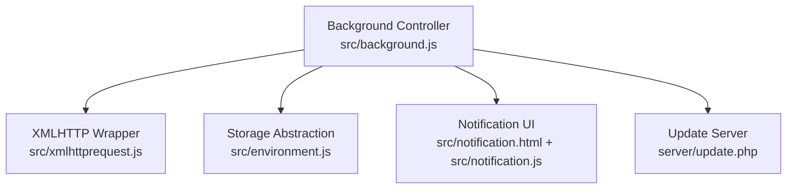
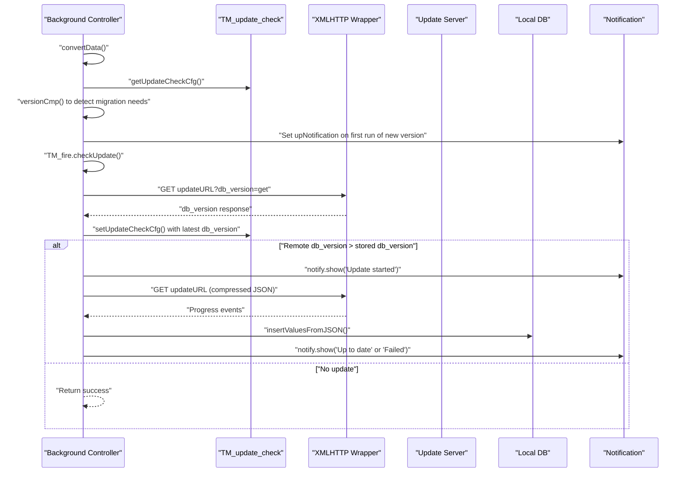
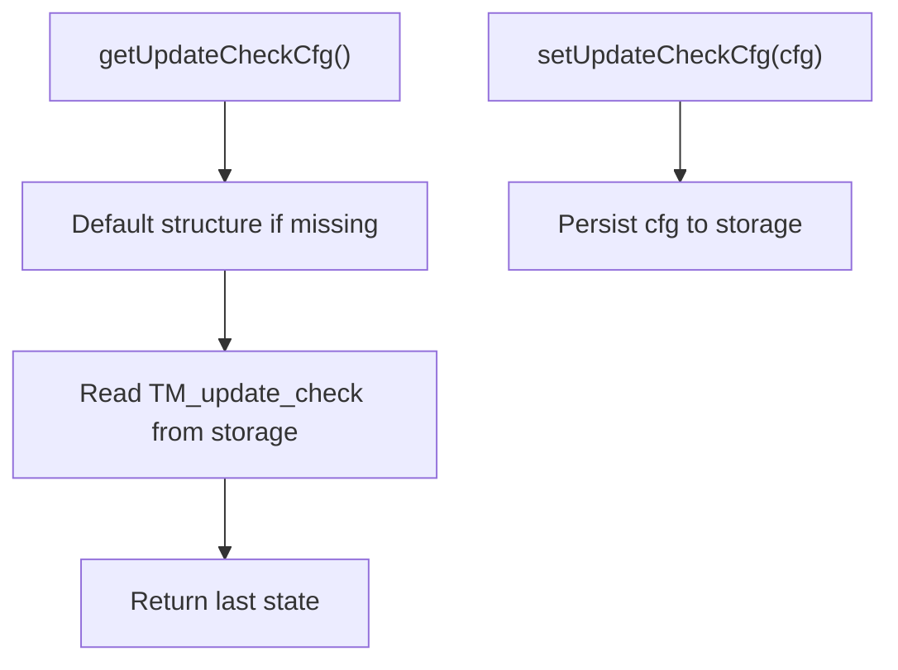
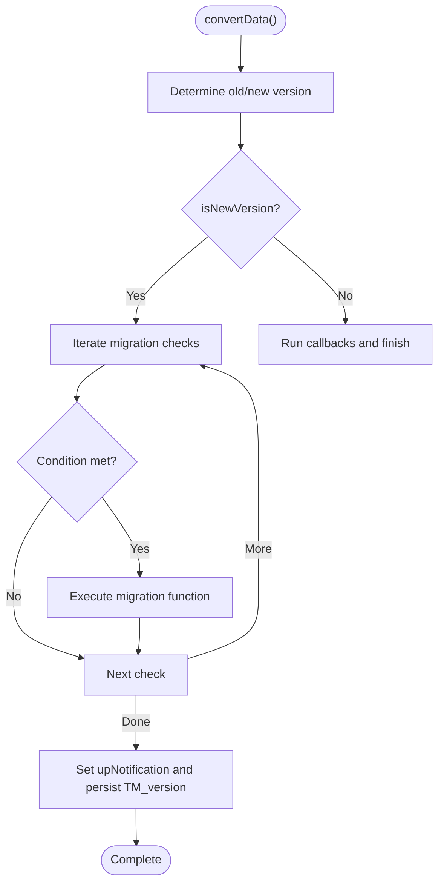
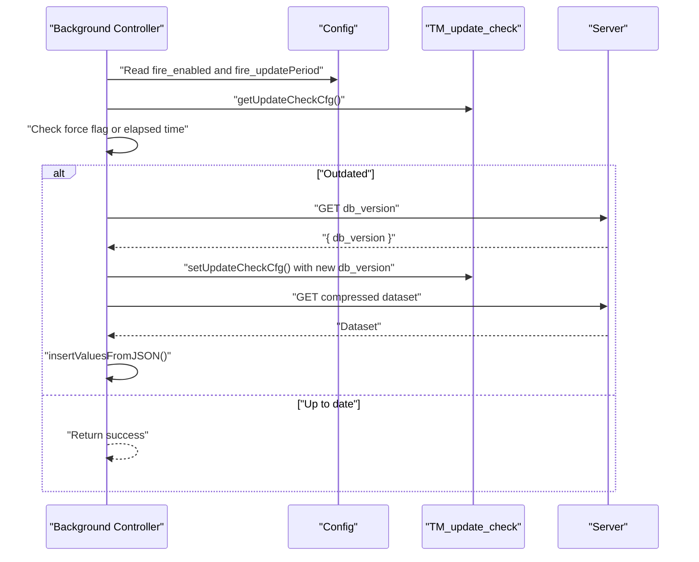
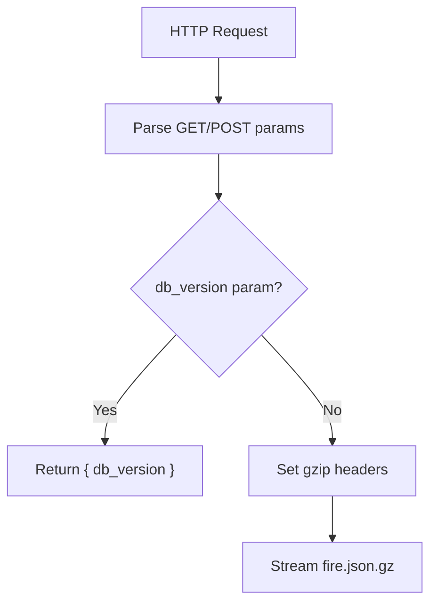
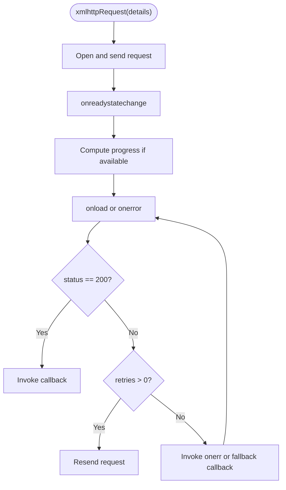
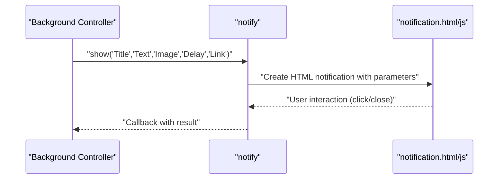
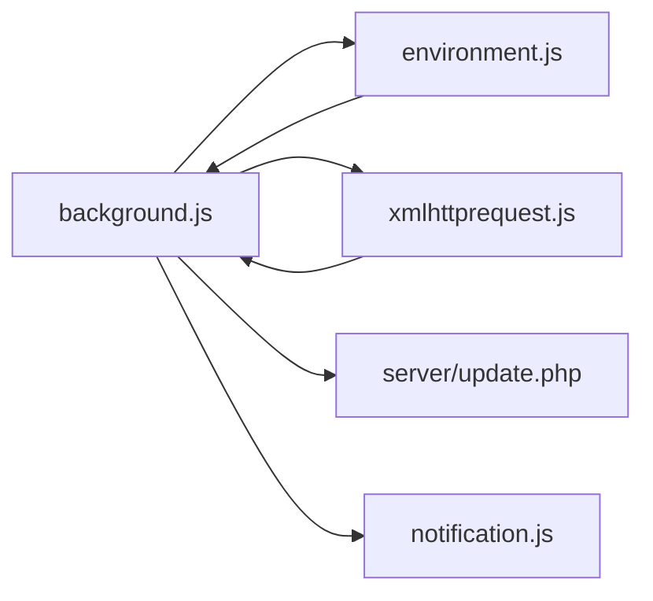

# Update Mechanism

<cite>
**Referenced Files in This Document**
- [background.js](file://src/background.js)
- [xmlhttprequest.js](file://src/xmlhttprequest.js)
- [update.php](file://server/update.php)
- [notification.js](file://src/notification.js)
- [notification.html](file://src/notification.html)
- [environment.js](file://src/environment.js)
</cite>

## Table of Contents
1. [Introduction](#introduction)
2. [Project Structure](#project-structure)
3. [Core Components](#core-components)
4. [Architecture Overview](#architecture-overview)
5. [Detailed Component Analysis](#detailed-component-analysis)
6. [Dependency Analysis](#dependency-analysis)
7. [Performance Considerations](#performance-considerations)
8. [Troubleshooting Guide](#troubleshooting-guide)
9. [Conclusion](#conclusion)

## Introduction
This document explains the update checking and version management system in the project. It covers:
- Version comparison algorithm via versionCmp
- Update check configuration stored in TM_update_check
- Automated migration procedures across versions
- Update notification system using upNotification and user-facing prompts
- Update server integration via update.php
- Update scheduling, retry mechanisms, and error handling
- Practical examples of version detection, update triggers, and the relationship between local storage and remote update sources

## Project Structure
The update mechanism spans several modules:
- Background controller orchestrating update checks and migrations
- XMLHTTPRequest wrapper enabling retries and progress reporting
- Update server endpoint serving compressed script database
- Notification subsystem for user-visible update prompts
- Local storage abstraction for persisting configuration and state



**Diagram sources**
- [background.js](file://src/background.js)
- [xmlhttprequest.js](file://src/xmlhttprequest.js)
- [environment.js](file://src/environment.js)
- [update.php](file://server/update.php)
- [notification.js](file://src/notification.js)
- [notification.html](file://src/notification.html)

**Section sources**
- [background.js](file://src/background.js)
- [xmlhttprequest.js](file://src/xmlhttprequest.js)
- [environment.js](file://src/environment.js)
- [update.php](file://server/update.php)
- [notification.js](file://src/notification.js)
- [notification.html](file://src/notification.html)

## Core Components
- Version comparison: versionCmp compares semantic version strings and returns ordering indicators.
- Update check configuration: TM_update_check persists last update check metadata (timestamps, db_version, entry counts).
- Migration pipeline: convertData runs version-specific migrations using versionCmp gates.
- Update scheduler: TM_fire.checkUpdate schedules periodic checks and triggers updates.
- Retry and progress: xmlhttpRequest supports retries and progress events.
- Notifications: notify module displays update-related notifications to users.

**Section sources**
- [background.js:83-106](file://src/background.js#L83-L106)
- [background.js:770-786](file://src/background.js#L770-L786)
- [background.js:230-387](file://src/background.js#L230-L387)
- [background.js:814-886](file://src/background.js#L814-L886)
- [xmlhttprequest.js:17-153](file://src/xmlhttprequest.js#L17-L153)
- [notification.js:15-41](file://src/notification.js#L15-L41)

## Architecture Overview
The update lifecycle:
1. On startup, versionCmp determines whether a migration is needed.
2. convertData executes version-specific migrations and sets up upNotification.
3. TM_fire.checkUpdate periodically queries the server for a newer db_version.
4. If newer, TM_fire.update downloads and imports the compressed dataset.
5. Progress and errors are surfaced via notify and TM_fire.status.



**Diagram sources**
- [background.js:83-106](file://src/background.js#L83-L106)
- [background.js:770-786](file://src/background.js#L770-L786)
- [background.js:814-886](file://src/background.js#L814-L886)
- [background.js:893-1020](file://src/background.js#L893-L1020)
- [xmlhttprequest.js:17-153](file://src/xmlhttprequest.js#L17-L153)
- [notification.js:15-41](file://src/notification.js#L15-L41)

## Detailed Component Analysis

### Version Comparison Algorithm (versionCmp)
- Purpose: Compare two semantic version strings and return ordering indicator.
- Behavior: Splits version strings by "." and compares numeric segments. Returns eNEWER, eEQUAL, or eOLDER.
- Usage: Drives migration conditions and update triggers.

```mermaid
flowchart TD
Start(["versionCmp(v1, v2)"]) --> Split["Split by '.'"]
Split --> Len["Compare lengths"]
Len --> Loop["Iterate segments"]
Loop --> |v1[i] > v2[i]| Newer["Return eNEWER"]
Loop --> |v1[i] < v2[i]| Older["Return eOLDER"]
Loop --> EqualStep["Segments equal so far"]
EqualStep --> Done{"End of min length?"}
Done --> |Yes| Equal["Return eEQUAL"]
Done --> |No| Next["Next segment"]
Next --> Loop
```

**Diagram sources**
- [background.js:83-106](file://src/background.js#L83-L106)

**Section sources**
- [background.js:83-106](file://src/background.js#L83-L106)

### Update Check Configuration (TM_update_check)
- Stores last update check metadata: last timestamp, db_version, and entry count.
- Persisted via TM_storage.getValue/setValue.
- Used to decide whether to trigger an update check based on elapsed time and user settings.



**Diagram sources**
- [background.js:770-786](file://src/background.js#L770-L786)
- [environment.js:1792-1870](file://src/environment.js#L1792-L1870)

**Section sources**
- [background.js:770-786](file://src/background.js#L770-L786)
- [environment.js:1792-1870](file://src/environment.js#L1792-L1870)

### Automated Migration Procedures
- convertData orchestrates version-specific migrations using versionCmp gates.
- Examples include:
  - Reordering scripts for older versions
  - Migrating from localStorage to TM_storage
  - Restoring and resaving scripts
  - Adjusting configuration keys and defaults
- After successful migrations, upNotification is set to the new extension version and persisted.



**Diagram sources**
- [background.js:230-387](file://src/background.js#L230-L387)

**Section sources**
- [background.js:230-387](file://src/background.js#L230-L387)

### Update Scheduler and Trigger Logic
- TM_fire.checkUpdate evaluates:
  - Force flags
  - Config values for enabling updates and scheduling period
  - Last check timestamp vs. current time
- If outdated, retrieves remote db_version and compares to stored db_version.
- Triggers TM_fire.update to download and import the dataset.



**Diagram sources**
- [background.js:814-886](file://src/background.js#L814-L886)
- [background.js:770-786](file://src/background.js#L770-L786)

**Section sources**
- [background.js:814-886](file://src/background.js#L814-L886)

### Update Server Integration (update.php)
- Endpoint serves either:
  - JSON containing db_version when db_version parameter is present
  - Compressed dataset (fire.json.gz) otherwise
- Sets appropriate headers for gzip encoding and cache control.



**Diagram sources**
- [update.php:1-31](file://server/update.php#L1-L31)

**Section sources**
- [update.php:1-31](file://server/update.php#L1-L31)

### Retry Mechanisms and Error Handling
- xmlhttpRequest supports retries on network errors and exposes progress events.
- TM_fire.update sets a watchdog timer and retries once on failure, displaying user notifications on errors.
- Errors are recorded in TM_fire.status.error and surfaced via notify.show.



**Diagram sources**
- [xmlhttprequest.js:17-153](file://src/xmlhttprequest.js#L17-L153)
- [background.js:915-923](file://src/background.js#L915-L923)

**Section sources**
- [xmlhttprequest.js:17-153](file://src/xmlhttprequest.js#L17-L153)
- [background.js:915-923](file://src/background.js#L915-L923)

### Update Notification System
- upNotification stores the new extension version after successful migration.
- notify.show displays persistent notifications with optional links and callbacks.
- Notification UI is rendered by notification.html and notification.js.



**Diagram sources**
- [background.js:3276-3338](file://src/background.js#L3276-L3338)
- [notification.js:15-41](file://src/notification.js#L15-L41)
- [notification.html:1-22](file://src/notification.html#L1-L22)

**Section sources**
- [background.js:3276-3338](file://src/background.js#L3276-L3338)
- [notification.js:15-41](file://src/notification.js#L15-L41)
- [notification.html:1-22](file://src/notification.html#L1-L22)

## Dependency Analysis
- Background controller depends on:
  - Storage abstraction for persistence
  - XMLHTTP wrapper for network operations
  - Notification subsystem for user feedback
  - Update server for remote dataset
- XMLHTTP wrapper encapsulates retry logic and progress reporting.
- Storage abstraction provides typed serialization and caching.



**Diagram sources**
- [background.js](file://src/background.js)
- [environment.js](file://src/environment.js)
- [xmlhttprequest.js](file://src/xmlhttprequest.js)
- [update.php](file://server/update.php)
- [notification.js](file://src/notification.js)

**Section sources**
- [background.js](file://src/background.js)
- [environment.js](file://src/environment.js)
- [xmlhttprequest.js](file://src/xmlhttprequest.js)
- [update.php](file://server/update.php)
- [notification.js](file://src/notification.js)

## Performance Considerations
- Batched writes: TM_fire.insertValuesFromJSON processes inserts in bulk to reduce transaction overhead.
- Progress reporting: Real-time progress updates improve perceived responsiveness during large imports.
- Caching: Local require cache reduces repeated fetches for script sources.
- Compression: Server delivers gzipped dataset to minimize bandwidth usage.

## Troubleshooting Guide
Common issues and remedies:
- Update fails silently:
  - Verify network connectivity and server availability.
  - Check xmlhttpRequest retry logs and status codes.
- Incorrect version comparison:
  - Ensure version strings are valid semantic versions.
  - Confirm versionCmp behavior aligns with expectations.
- Stale update checks:
  - Clear or refresh TM_update_check to force a new check.
  - Adjust fire_updatePeriod in configuration.
- Import errors:
  - Inspect TM_fire.status.error and logs for JSON parse failures.
  - Validate dataset integrity on the server.

**Section sources**
- [xmlhttprequest.js:62-93](file://src/xmlhttprequest.js#L62-L93)
- [background.js:915-923](file://src/background.js#L915-L923)
- [background.js:854-873](file://src/background.js#L854-L873)

## Conclusion
The update mechanism combines robust version comparison, configurable scheduling, resilient networking with retries, and user-centric notifications. It ensures reliable upgrades from local storage to remote datasets while maintaining backward compatibility through targeted migrations.