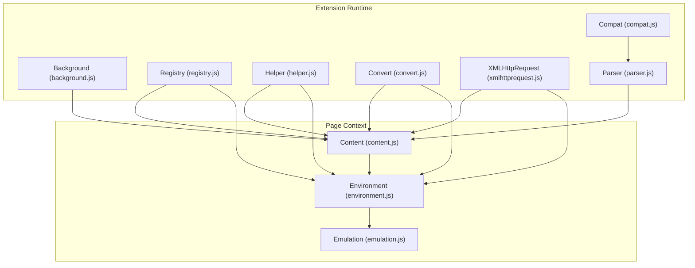
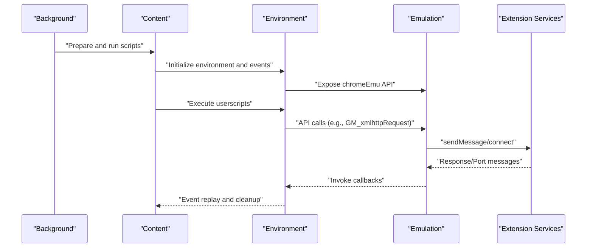
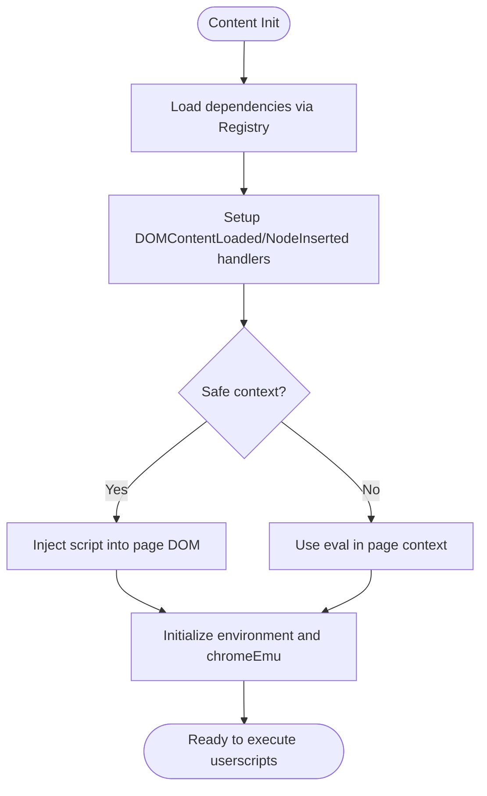
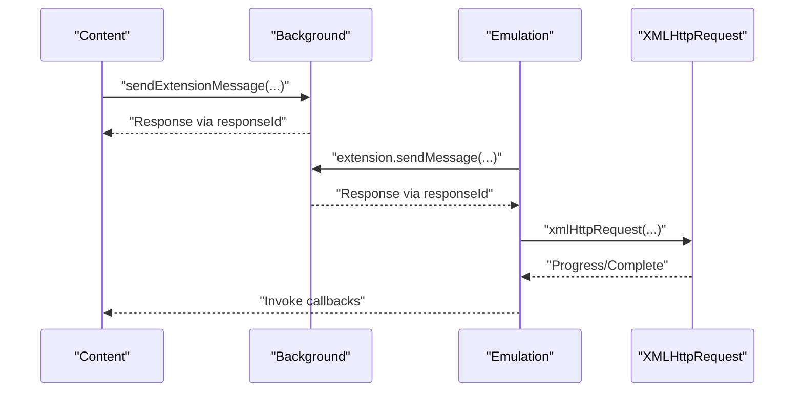
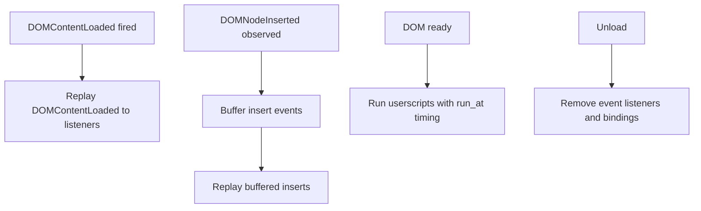
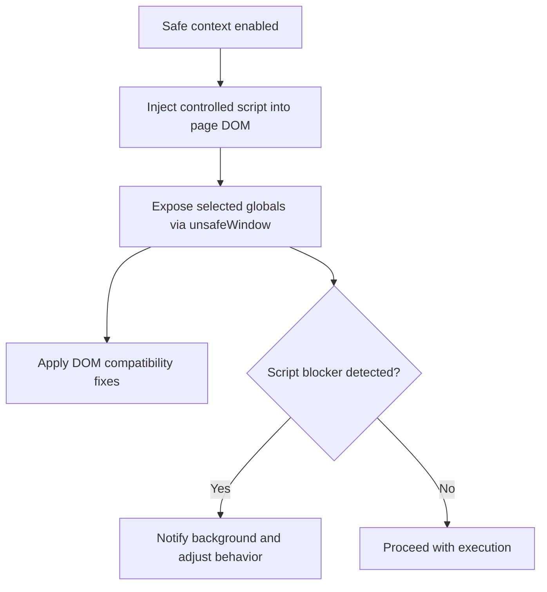
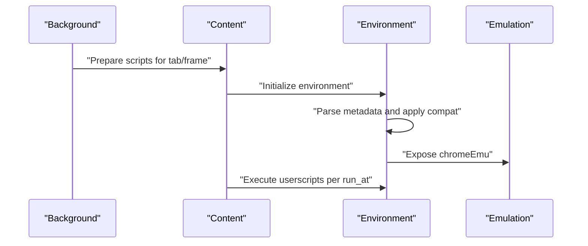
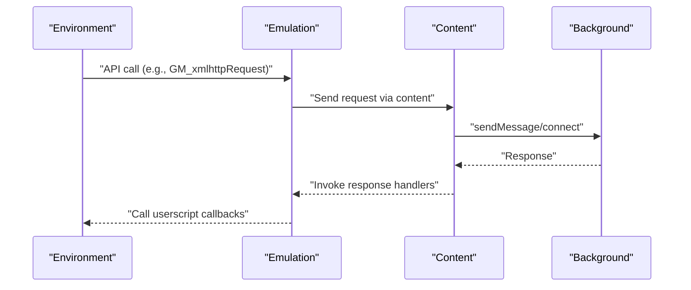
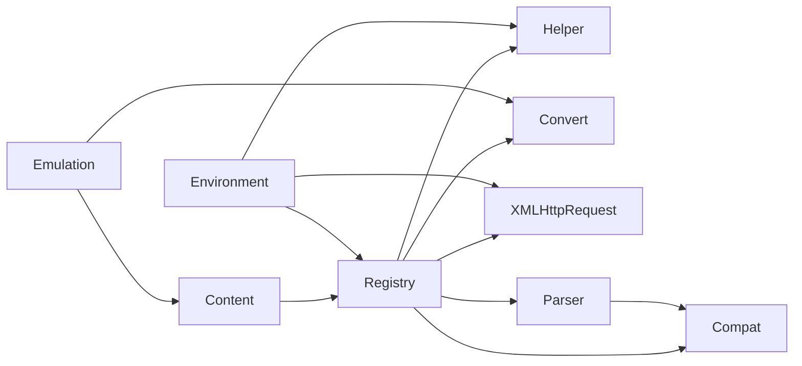

# Content Scripts

<cite>
**Referenced Files in This Document**
- [content.js](file://src/content.js)
- [background.js](file://src/background.js)
- [environment.js](file://src/environment.js)
- [emulation.js](file://src/emulation.js)
- [registry.js](file://src/registry.js)
- [helper.js](file://src/helper.js)
- [xmlhttprequest.js](file://src/xmlhttprequest.js)
- [convert.js](file://src/convert.js)
- [compat.js](file://src/compat.js)
- [parser.js](file://src/parser.js)
- [README.md](file://README.md)
</cite>

## Table of Contents
1. [Introduction](#introduction)
2. [Project Structure](#project-structure)
3. [Core Components](#core-components)
4. [Architecture Overview](#architecture-overview)
5. [Detailed Component Analysis](#detailed-component-analysis)
6. [Dependency Analysis](#dependency-analysis)
7. [Performance Considerations](#performance-considerations)
8. [Troubleshooting Guide](#troubleshooting-guide)
9. [Conclusion](#conclusion)

## Introduction
This document explains the content script architecture in Tampermonkey, focusing on how userscripts are injected into web pages, how the execution environment is established, and how content scripts communicate with the background process. It covers the injection mechanism, timing considerations, DOM interaction, message passing, event handling, runtime initialization, and security/sandboxing. Practical examples, debugging techniques, and performance optimization strategies are included to help developers understand and troubleshoot content script behavior.

## Project Structure
The content script architecture spans several modules:
- Content runtime and injection: content.js
- Background orchestration and userscript lifecycle: background.js
- Page-side execution environment and API emulation: environment.js and emulation.js
- Module loading and helpers: registry.js, helper.js, convert.js, xmlhttprequest.js, compat.js, parser.js
- Project overview: README.md

**Diagram sources**
- [content.js:1-1202](file://src/content.js#L1-L1202)
- [background.js:1-6327](file://src/background.js#L1-L6327)
- [environment.js:1-1337](file://src/environment.js#L1-L1337)
- [emulation.js:1-329](file://src/emulation.js#L1-L329)
- [registry.js:1-107](file://src/registry.js#L1-L107)
- [helper.js:1-209](file://src/helper.js#L1-L209)
- [xmlhttprequest.js:1-161](file://src/xmlhttprequest.js#L1-L161)
- [convert.js:1-39](file://src/convert.js#L1-L39)
- [compat.js:1-275](file://src/compat.js#L1-L275)
- [parser.js:1-286](file://src/parser.js#L1-L286)

**Section sources**
- [README.md:1-112](file://README.md#L1-L112)
- [content.js:1-1202](file://src/content.js#L1-L1202)
- [background.js:1-6327](file://src/background.js#L1-L6327)
- [environment.js:1-1337](file://src/environment.js#L1-L1337)
- [emulation.js:1-329](file://src/emulation.js#L1-L329)
- [registry.js:1-107](file://src/registry.js#L1-L107)
- [helper.js:1-209](file://src/helper.js#L1-L209)
- [xmlhttprequest.js:1-161](file://src/xmlhttprequest.js#L1-L161)
- [convert.js:1-39](file://src/convert.js#L1-L39)
- [compat.js:1-275](file://src/compat.js#L1-L275)
- [parser.js:1-286](file://src/parser.js#L1-L286)

## Core Components
- Content runtime (content.js): Initializes the environment, injects and manages userscript execution, handles message routing to/from background, and coordinates DOM readiness and event replay.
- Environment (environment.js): Provides the userscript execution context, event emulation, and API surface (e.g., GM_* functions) exposed to userscripts.
- Emulation (emulation.js): Bridges the userscript API to the extension’s background services (chrome.* APIs) and manages response routing and ports.
- Background (background.js): Determines which scripts to run per tab/frame, orchestrates runtime initialization, and maintains context registries.
- Registry (registry.js): Dynamic module loader and dependency management for runtime modules.
- Helper (helper.js): Utility functions for URL matching, serialization, and DOM helpers.
- Convert (convert.js): Encoding/decoding utilities for cross-context messaging.
- XMLHTTPRequest (xmlhttprequest.js): Cross-origin request handling with retries and progress reporting.
- Compat (compat.js): Compatibility transformations for legacy userscript syntax.
- Parser (parser.js): Parses userscript metadata and options.

**Section sources**
- [content.js:1-1202](file://src/content.js#L1-L1202)
- [environment.js:1-1337](file://src/environment.js#L1-L1337)
- [emulation.js:1-329](file://src/emulation.js#L1-L329)
- [background.js:1-6327](file://src/background.js#L1-L6327)
- [registry.js:1-107](file://src/registry.js#L1-L107)
- [helper.js:1-209](file://src/helper.js#L1-L209)
- [convert.js:1-39](file://src/convert.js#L1-L39)
- [xmlhttprequest.js:1-161](file://src/xmlhttprequest.js#L1-L161)
- [compat.js:1-275](file://src/compat.js#L1-L275)
- [parser.js:1-286](file://src/parser.js#L1-L286)

## Architecture Overview
The content script architecture separates concerns between the extension’s background and the page context:
- Background determines which userscripts to run and prepares runtime contexts.
- Content initializes the environment, sets up event emulation, and executes userscripts.
- Emulation translates userscript API calls into extension service calls and routes responses back to the page context.
- Registry loads modules dynamically; Helper and Convert provide shared utilities; XMLHTTPRequest encapsulates network behavior; Compat and Parser adapt userscripts to the environment.

**Diagram sources**
- [background.js:590-640](file://src/background.js#L590-L640)
- [content.js:108-215](file://src/content.js#L108-L215)
- [environment.js:693-747](file://src/environment.js#L693-L747)
- [emulation.js:52-82](file://src/emulation.js#L52-L82)

## Detailed Component Analysis

### Content Runtime Initialization and Injection
- Initialization flags and logging levels are configured early.
- Dependencies are loaded via Registry (XMLHttpRequest, Convert, Helper).
- Eventing tracks DOMContentLoaded and DOMNodeInserted to coordinate script execution timing.
- A message handler bridges content and background, sending and receiving responses.
- A “safe context” mode injects userscript code into the page via a script element or eval, depending on configuration.
- UnsafeWindow access is established by injecting a controlled script into the page DOM to expose selected globals safely.

**Diagram sources**
- [content.js:80-91](file://src/content.js#L80-L91)
- [content.js:94-106](file://src/content.js#L94-L106)
- [content.js:108-182](file://src/content.js#L108-L182)
- [content.js:183-215](file://src/content.js#L183-L215)
- [content.js:456-608](file://src/content.js#L456-L608)

**Section sources**
- [content.js:42-76](file://src/content.js#L42-L76)
- [content.js:80-91](file://src/content.js#L80-L91)
- [content.js:94-106](file://src/content.js#L94-L106)
- [content.js:108-182](file://src/content.js#L108-L182)
- [content.js:183-215](file://src/content.js#L183-L215)
- [content.js:456-608](file://src/content.js#L456-L608)

### Message Passing Protocol Between Content and Background
- Content exposes a message handler to send and receive responses from background.
- Emulation wraps chrome.* APIs and routes requests through content to background, then back to page context via response IDs.
- XMLHTTPRequest helper supports both synchronous-style callbacks and asynchronous port-based flows.

**Diagram sources**
- [content.js:352-366](file://src/content.js#L352-L366)
- [content.js:273-307](file://src/content.js#L273-L307)
- [emulation.js:260-266](file://src/emulation.js#L260-L266)
- [emulation.js:52-82](file://src/emulation.js#L52-L82)
- [xmlhttprequest.js:17-153](file://src/xmlhttprequest.js#L17-L153)

**Section sources**
- [content.js:273-307](file://src/content.js#L273-L307)
- [content.js:352-408](file://src/content.js#L352-L408)
- [emulation.js:52-82](file://src/emulation.js#L52-L82)
- [xmlhttprequest.js:17-153](file://src/xmlhttprequest.js#L17-L153)

### Userscript Execution Context and DOM Interaction
- Environment sets up event emulation for load, DOMContentLoaded, and DOMNodeInserted.
- It replays previously missed events to newly registered listeners and supports delayed execution until DOM is ready.
- It provides API wrappers (e.g., GM_xmlhttpRequest) that route to emulation and extension services.
- It cleans up environment bindings on unload.

**Diagram sources**
- [environment.js:288-308](file://src/environment.js#L288-L308)
- [environment.js:325-343](file://src/environment.js#L325-L343)
- [environment.js:367-378](file://src/environment.js#L367-L378)
- [environment.js:380-493](file://src/environment.js#L380-L493)
- [environment.js:309-323](file://src/environment.js#L309-L323)

**Section sources**
- [environment.js:195-343](file://src/environment.js#L195-L343)
- [environment.js:367-378](file://src/environment.js#L367-L378)
- [environment.js:380-493](file://src/environment.js#L380-L493)
- [environment.js:309-323](file://src/environment.js#L309-L323)

### Security and Sandboxing
- Safe context mode injects code into the page via a script element or eval, controlled by a mutation event mechanism.
- UnsafeWindow access is established by injecting a controlled script into the page DOM to expose selected globals safely, with fallbacks and detection for script blockers.
- WrappedJSObject and other DOM compatibility fixes are applied to ensure consistent behavior across environments.
- Compatibility transforms normalize legacy userscript syntax to work in the current environment.

**Diagram sources**
- [content.js:456-608](file://src/content.js#L456-L608)
- [content.js:612-628](file://src/content.js#L612-L628)
- [environment.js:573-589](file://src/environment.js#L573-L589)
- [environment.js:591-624](file://src/environment.js#L591-L624)
- [compat.js:14-26](file://src/compat.js#L14-L26)

**Section sources**
- [content.js:456-608](file://src/content.js#L456-L608)
- [content.js:612-628](file://src/content.js#L612-L628)
- [environment.js:573-589](file://src/environment.js#L573-L589)
- [environment.js:591-624](file://src/environment.js#L591-L624)
- [compat.js:14-26](file://src/compat.js#L14-L26)

### Runtime Initialization and Script Execution
- Background determines which scripts to run per tab/frame and caches run information.
- Content receives preparation signals and initializes environment and eventing.
- Environment applies compatibility transforms and parses userscript metadata to configure execution options.
- Emulation registers request handlers and provides API surfaces for userscripts.

**Diagram sources**
- [background.js:560-640](file://src/background.js#L560-L640)
- [content.js:108-182](file://src/content.js#L108-L182)
- [environment.js:782-800](file://src/environment.js#L782-L800)
- [emulation.js:209-273](file://src/emulation.js#L209-L273)

**Section sources**
- [background.js:560-640](file://src/background.js#L560-L640)
- [content.js:108-182](file://src/content.js#L108-L182)
- [environment.js:782-800](file://src/environment.js#L782-L800)
- [emulation.js:209-273](file://src/emulation.js#L209-L273)

### Communication Protocols and Event Handling
- Content-to-background messaging uses response IDs to correlate requests and responses.
- Emulation manages response routing and maintains a registry of response handlers.
- Port-based connections are used for long-lived communication (e.g., xhr ports).
- DOM event emulation ensures userscripts receive expected events even if the page’s original listeners were registered earlier.

**Diagram sources**
- [environment.js:693-747](file://src/environment.js#L693-L747)
- [emulation.js:126-146](file://src/emulation.js#L126-L146)
- [content.js:273-307](file://src/content.js#L273-L307)
- [content.js:352-408](file://src/content.js#L352-L408)

**Section sources**
- [environment.js:693-747](file://src/environment.js#L693-L747)
- [emulation.js:126-146](file://src/emulation.js#L126-L146)
- [content.js:273-307](file://src/content.js#L273-L307)
- [content.js:352-408](file://src/content.js#L352-L408)

## Dependency Analysis
- Registry drives dynamic loading of modules (helper, convert, xmlhttprequest, compat, parser).
- Helper provides URL matching, serialization, and DOM utilities used across content and environment.
- Convert encodes/decodes messages for cross-context transport.
- XMLHTTPRequest encapsulates network behavior and integrates with emulation.
- Parser extracts userscript metadata and options to guide runtime behavior.
- Emulation depends on Convert and Registry to route messages and manage response IDs.

**Diagram sources**
- [registry.js:35-104](file://src/registry.js#L35-L104)
- [helper.js:184-208](file://src/helper.js#L184-L208)
- [convert.js:31-38](file://src/convert.js#L31-L38)
- [xmlhttprequest.js:17-153](file://src/xmlhttprequest.js#L17-L153)
- [compat.js:14-26](file://src/compat.js#L14-L26)
- [parser.js:72-282](file://src/parser.js#L72-L282)
- [content.js:80-91](file://src/content.js#L80-L91)
- [environment.js:693-747](file://src/environment.js#L693-L747)
- [emulation.js:197-207](file://src/emulation.js#L197-L207)

**Section sources**
- [registry.js:35-104](file://src/registry.js#L35-L104)
- [helper.js:184-208](file://src/helper.js#L184-L208)
- [convert.js:31-38](file://src/convert.js#L31-L38)
- [xmlhttprequest.js:17-153](file://src/xmlhttprequest.js#L17-L153)
- [compat.js:14-26](file://src/compat.js#L14-L26)
- [parser.js:72-282](file://src/parser.js#L72-L282)
- [content.js:80-91](file://src/content.js#L80-L91)
- [environment.js:693-747](file://src/environment.js#L693-L747)
- [emulation.js:197-207](file://src/emulation.js#L197-L207)

## Performance Considerations
- Minimize DOM manipulation and event replay overhead by using appropriate run_at timing (@run-at).
- Avoid excessive use of eval or injected scripts when safe context is not required.
- Prefer port-based communication for long-running operations to reduce polling overhead.
- Use retries judiciously in XMLHTTPRequest to balance reliability and responsiveness.
- Cache parsed metadata and compatibility decisions to avoid repeated computation.

[No sources needed since this section provides general guidance]

## Troubleshooting Guide
Common issues and diagnostics:
- Script blocker interference: Content detects script blockers and notifies background; adjust permissions or disable conflicting extensions.
- Local file access: Use the local file retrieval mechanism to fetch file:// URLs when necessary.
- Event replay: If a userscript expects DOMContentLoaded or DOMNodeInserted, ensure listeners are registered after environment initialization.
- Message routing: Verify response IDs and that chromeEmu handlers are registered before invoking APIs.
- Debugging: Enable verbose logging flags and inspect console logs emitted by content and environment modules.

**Section sources**
- [content.js:487-499](file://src/content.js#L487-L499)
- [background.js:661-766](file://src/background.js#L661-L766)
- [environment.js:195-343](file://src/environment.js#L195-L343)
- [emulation.js:197-207](file://src/emulation.js#L197-L207)

## Conclusion
Tampermonkey’s content script architecture cleanly separates extension orchestration from page execution. The content runtime initializes the environment, manages DOM events, and coordinates with the background for API access. Emulation bridges userscript APIs to extension services, while Registry, Helper, Convert, XMLHTTPRequest, Compat, and Parser provide robust infrastructure. By understanding injection timing, message protocols, and security boundaries, developers can build reliable and performant userscripts.