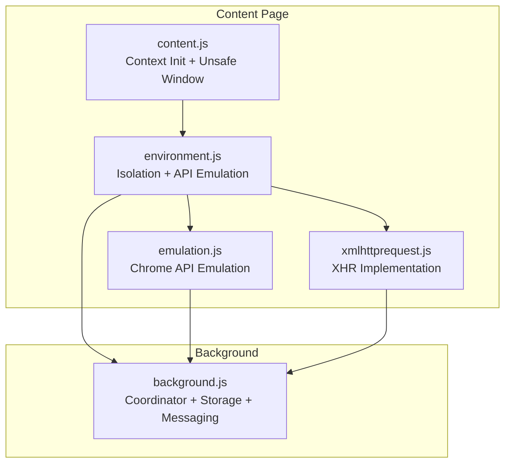
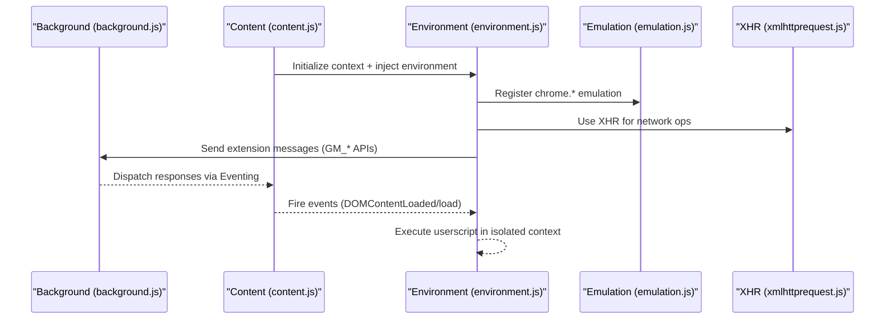
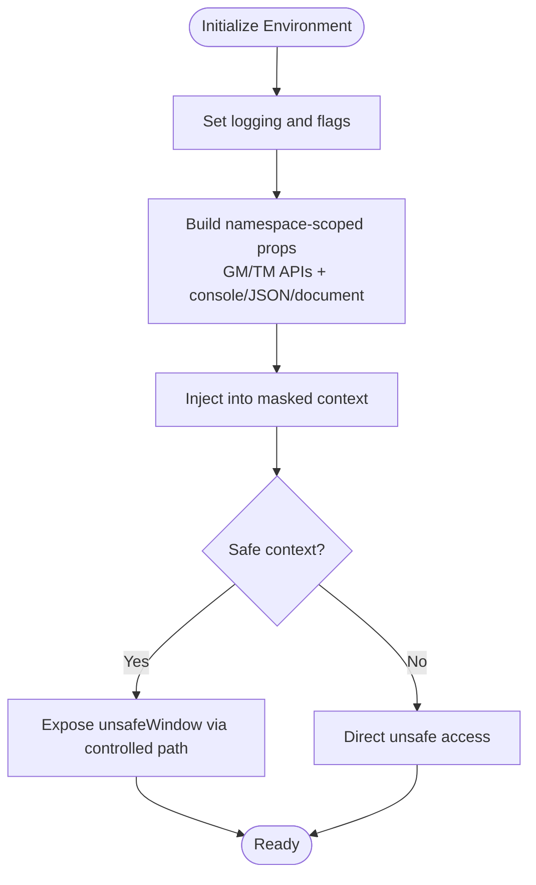
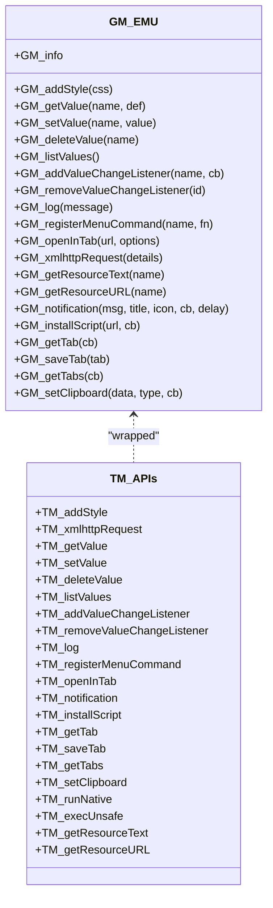
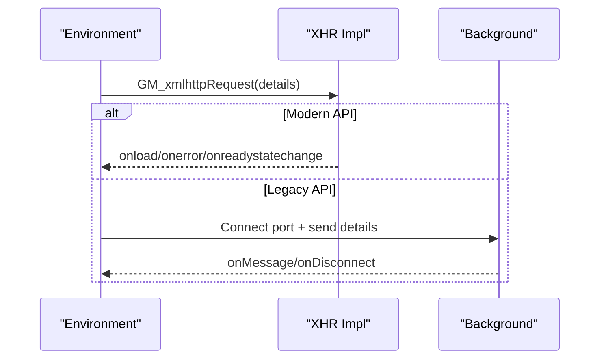
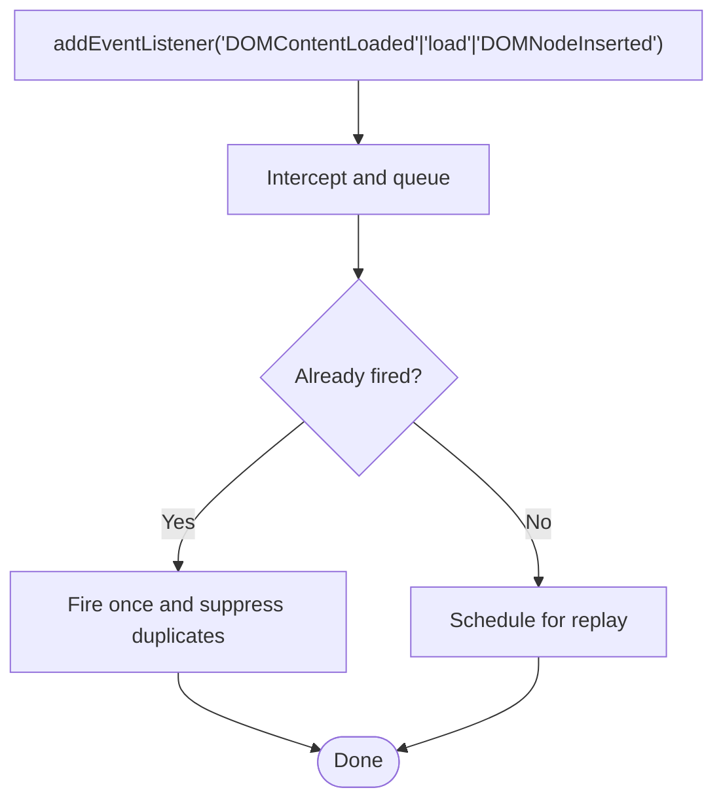
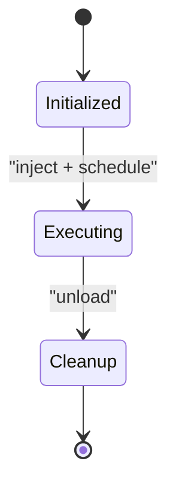
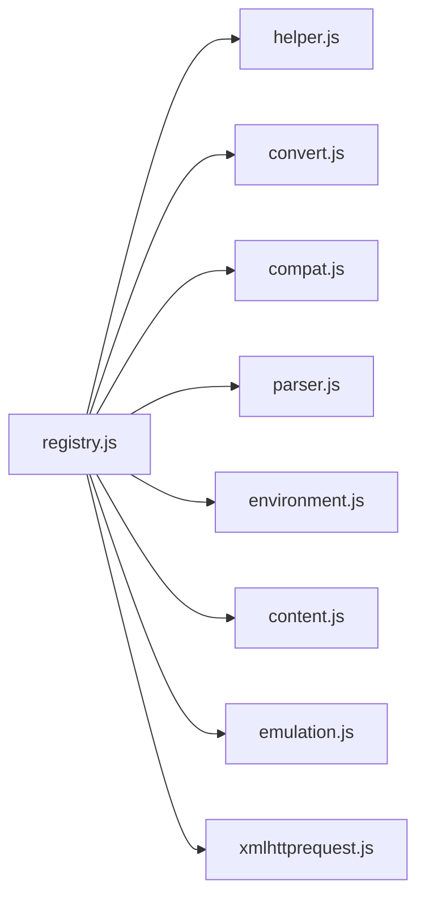
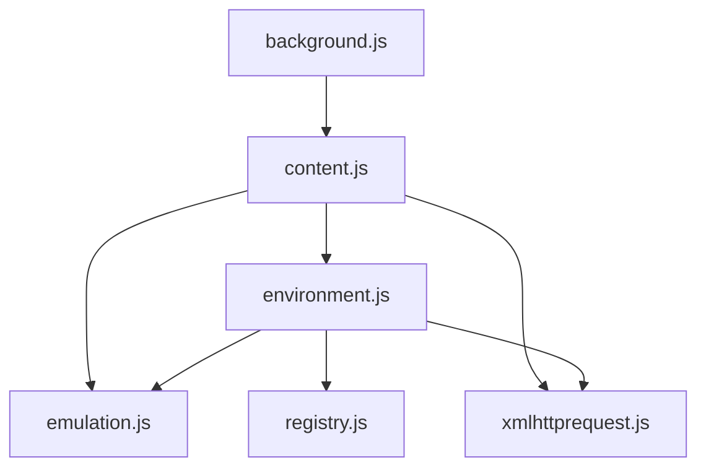

# Environment Engine

<cite>
**Referenced Files in This Document**
- [environment.js](file://src/environment.js)
- [emulation.js](file://src/emulation.js)
- [xmlhttprequest.js](file://src/xmlhttprequest.js)
- [content.js](file://src/content.js)
- [registry.js](file://src/registry.js)
- [helper.js](file://src/helper.js)
- [compat.js](file://src/compat.js)
- [parser.js](file://src/parser.js)
- [convert.js](file://src/convert.js)
- [background.js](file://src/background.js)
</cite>

## Table of Contents
1. [Introduction](#introduction)
2. [Project Structure](#project-structure)
3. [Core Components](#core-components)
4. [Architecture Overview](#architecture-overview)
5. [Detailed Component Analysis](#detailed-component-analysis)
6. [Dependency Analysis](#dependency-analysis)
7. [Performance Considerations](#performance-considerations)
8. [Troubleshooting Guide](#troubleshooting-guide)
9. [Conclusion](#conclusion)
10. [Appendices](#appendices)

## Introduction
This document explains the environment engine that powers userscript execution in the extension. It covers how isolated execution contexts are created, how Greasemonkey-compatible APIs are emulated, how XMLHttpRequest is handled, and how DOM-related capabilities are exposed. It also documents the security model, sandboxing, conflict prevention, module loading, dependency resolution, asynchronous operation handling, and practical examples and troubleshooting tips.

## Project Structure
The environment engine spans several modules:
- Environment runtime and API emulation: environment.js
- Emulation bridge to background: emulation.js
- XHR implementation and helpers: xmlhttprequest.js
- Content-side orchestration and unsafe window exposure: content.js
- Module loader and registry: registry.js
- Utilities and serialization: helper.js, convert.js
- Parser and compatibility helpers: parser.js, compat.js
- Background coordination: background.js

**Diagram sources**
- [environment.js:1-1337](file://src/environment.js#L1-L1337)
- [emulation.js:1-329](file://src/emulation.js#L1-L329)
- [xmlhttprequest.js:1-161](file://src/xmlhttprequest.js#L1-L161)
- [content.js:1-1202](file://src/content.js#L1-L1202)
- [background.js:1-6327](file://src/background.js#L1-L6327)

**Section sources**
- [environment.js:1-1337](file://src/environment.js#L1-L1337)
- [emulation.js:1-329](file://src/emulation.js#L1-L329)
- [xmlhttprequest.js:1-161](file://src/xmlhttprequest.js#L1-L161)
- [content.js:1-1202](file://src/content.js#L1-L1202)
- [background.js:1-6327](file://src/background.js#L1-L6327)

## Core Components
- Environment runtime (environment.js): Creates isolated execution contexts, injects Greasemonkey-compatible APIs, manages events, and executes userscripts with proper sandboxing.
- Emulation bridge (emulation.js): Bridges the content environment to background Chrome extension APIs, handling message routing, response IDs, and request handlers.
- XHR implementation (xmlhttprequest.js): Provides robust XMLHttpRequest handling with retries, progress reporting, and cross-origin safety checks.
- Content orchestration (content.js): Initializes the environment, exposes unsafeWindow safely, dispatches events, and coordinates with background.
- Module loader (registry.js): Loads and registers modules on demand, supports raw registration and dependency resolution.
- Utilities (helper.js, convert.js): Serialization, URL matching, encoding/decoding, and helper functions.
- Parser and compatibility (parser.js, compat.js): Parses user script metadata, normalizes legacy constructs, and applies compatibility transforms.
- Background coordinator (background.js): Manages script runs, messaging, storage, and update flows.

**Section sources**
- [environment.js:1-1337](file://src/environment.js#L1-L1337)
- [emulation.js:1-329](file://src/emulation.js#L1-L329)
- [xmlhttprequest.js:1-161](file://src/xmlhttprequest.js#L1-L161)
- [content.js:1-1202](file://src/content.js#L1-L1202)
- [registry.js:1-107](file://src/registry.js#L1-L107)
- [helper.js:1-209](file://src/helper.js#L1-L209)
- [convert.js:1-39](file://src/convert.js#L1-L39)
- [parser.js:1-286](file://src/parser.js#L1-L286)
- [compat.js:1-275](file://src/compat.js#L1-L275)
- [background.js:1-6327](file://src/background.js#L1-L6327)

## Architecture Overview
The environment engine establishes a secure, isolated execution context for userscripts and provides a Greasemonkey-compatible API surface. It routes privileged operations through the emulation layer to the background, ensuring isolation from the page’s JavaScript.

**Diagram sources**
- [content.js:108-215](file://src/content.js#L108-L215)
- [environment.js:1251-1319](file://src/environment.js#L1251-L1319)
- [emulation.js:40-313](file://src/emulation.js#L40-L313)
- [xmlhttprequest.js:17-153](file://src/xmlhttprequest.js#L17-L153)

## Detailed Component Analysis

### Isolated Execution Context and Sandbox
- Context initialization: The environment sets logging levels, defines safe execution flags, and prepares the property injection mechanism for API exposure.
- Property injection: The engine builds a namespace-scoped property bag containing GM/TM APIs, console, JSON, document, location, and unsafe variants. These are injected into a masked context to prevent page interference.
- Safe context mode: When enabled, the engine uses a MutationEvent-based dispatch to execute code in a controlled environment and exposes unsafeWindow via a controlled path to mitigate conflicts with page scripts.
- Cleanup: Extensive cleanup hooks restore original properties and remove event listeners on unload.

**Diagram sources**
- [environment.js:1133-1194](file://src/environment.js#L1133-L1194)
- [environment.js:1142-1165](file://src/environment.js#L1142-L1165)
- [content.js:456-608](file://src/content.js#L456-L608)

**Section sources**
- [environment.js:1133-1247](file://src/environment.js#L1133-L1247)
- [content.js:456-608](file://src/content.js#L456-L608)

### API Emulation Layer (GM_* and TM_* functions)
- GM_* functions: The engine wraps TM_* functions under GM_* names for compatibility. Supported functions include GM_addStyle, GM_getValue, GM_setValue, GM_deleteValue, GM_listValues, GM_addValueChangeListener, GM_removeValueChangeListener, GM_log, GM_registerMenuCommand, GM_openInTab, GM_xmlhttpRequest, GM_getResourceText, GM_getResourceURL, GM_notification, GM_installScript, GM_getTab, GM_saveTab, GM_getTabs, GM_setClipboard, and GM_info.
- TM_* functions: Includes TM_addStyle, TM_xmlhttpRequest, TM_getValue, TM_setValue, TM_deleteValue, TM_listValues, TM_addValueChangeListener, TM_removeValueChangeListener, TM_log, TM_registerMenuCommand, TM_openInTab, TM_notification, TM_installScript, TM_getTab, TM_saveTab, TM_getTabs, TM_setClipboard, TM_runNative, TM_execUnsafe, and resource getters.
- Event-driven execution: Scripts can be scheduled to run at document-start, document-body, or document-end using environment-provided scheduling helpers.

**Diagram sources**
- [environment.js:1053-1131](file://src/environment.js#L1053-L1131)
- [environment.js:1167-1188](file://src/environment.js#L1167-L1188)

**Section sources**
- [environment.js:1053-1188](file://src/environment.js#L1053-L1188)

### XMLHttpRequest Handling
- Modern XHR: Uses native XMLHttpRequest with response headers, final URL tracking, and progress reporting. Supports responseType and overrideMimeType.
- Legacy XHR: For older APIs, the environment bridges to background via a dedicated port to handle onload/onerror/onreadystatechange callbacks.
- Safety: Validates URLs and rejects invalid schemes; retries on transient errors when configured.

**Diagram sources**
- [environment.js:693-747](file://src/environment.js#L693-L747)
- [xmlhttprequest.js:17-153](file://src/xmlhttprequest.js#L17-L153)
- [emulation.js:52-82](file://src/emulation.js#L52-L82)

**Section sources**
- [environment.js:693-747](file://src/environment.js#L693-L747)
- [xmlhttprequest.js:17-153](file://src/xmlhttprequest.js#L17-L153)
- [emulation.js:52-82](file://src/emulation.js#L52-L82)

### DOM Manipulation and Events
- Event emulation: The environment intercepts addEventListener/removeEventListener for DOMContentLoaded, load, and DOMNodeInserted, and replays historical events to userscripts when appropriate.
- DOM traversal and evaluation: document.evaluate is wrapped to improve XPath behavior and ensure queries operate within the DOM context.
- Mutation observation: DOMAttrModified is simulated via MutationObserver and DOM parsing when unavailable.

**Diagram sources**
- [environment.js:380-493](file://src/environment.js#L380-L493)
- [environment.js:520-571](file://src/environment.js#L520-L571)
- [content.js:679-800](file://src/content.js#L679-L800)

**Section sources**
- [environment.js:380-493](file://src/environment.js#L380-L493)
- [environment.js:520-571](file://src/environment.js#L520-L571)
- [content.js:679-800](file://src/content.js#L679-L800)

### Security Model and Sandboxing
- Controlled execution: Code runs inside a masked context; sensitive globals are backed up and restored.
- Unsafe window exposure: In safe mode, unsafeWindow is exposed via a controlled dispatch mechanism to avoid conflicts with page scripts.
- Property protection: Original descriptors are preserved and cleaned up on unload; properties are redefined or defined as non-writable/configurable when necessary.
- Script blocker detection: Detects when page protections interfere and reports to background.

**Diagram sources**
- [content.js:456-608](file://src/content.js#L456-L608)
- [environment.js:1133-1194](file://src/environment.js#L1133-L1194)

**Section sources**
- [content.js:456-608](file://src/content.js#L456-L608)
- [environment.js:1133-1194](file://src/environment.js#L1133-L1194)

### Module Loading and Dependency Resolution
- Registry: On-demand loading of modules, raw registration, and dependency tracking. Requires trigger loading if a module is not present.
- Helpers: Serialization, URL matching, encoding/decoding, and utility functions.
- Parser and compat: Parse user script headers, normalize legacy constructs, and compute compatibility flags.

**Diagram sources**
- [registry.js:11-104](file://src/registry.js#L11-L104)
- [helper.js:184-208](file://src/helper.js#L184-L208)
- [convert.js:31-37](file://src/convert.js#L31-L37)
- [compat.js:13-274](file://src/compat.js#L13-L274)
- [parser.js:29-282](file://src/parser.js#L29-L282)

**Section sources**
- [registry.js:11-104](file://src/registry.js#L11-L104)
- [helper.js:184-208](file://src/helper.js#L184-L208)
- [convert.js:31-37](file://src/convert.js#L31-L37)
- [compat.js:13-274](file://src/compat.js#L13-L274)
- [parser.js:29-282](file://src/parser.js#L29-L282)

### Asynchronous Operations
- Scheduling: Scripts can run at document-start, document-body, or document-end. The environment schedules and replays events accordingly.
- Port-based messaging: For legacy APIs, the environment opens a named port to background for persistent communication.
- Retries and progress: XHR supports retries and progress reporting for long-running requests.

**Section sources**
- [environment.js:1261-1275](file://src/environment.js#L1261-L1275)
- [environment.js:717-744](file://src/environment.js#L717-L744)
- [xmlhttprequest.js:62-110](file://src/xmlhttprequest.js#L62-L110)

## Dependency Analysis
- environment.js depends on emulation.js for chrome.* APIs, xmlhttprequest.js for network operations, and registry.js for module loading.
- content.js orchestrates environment initialization and unsafe window exposure, communicating with background via tmCE.
- background.js coordinates messaging, storage, and script execution across tabs.

**Diagram sources**
- [environment.js:1-1337](file://src/environment.js#L1-L1337)
- [emulation.js:1-329](file://src/emulation.js#L1-L329)
- [xmlhttprequest.js:1-161](file://src/xmlhttprequest.js#L1-L161)
- [content.js:1-1202](file://src/content.js#L1-L1202)
- [background.js:1-6327](file://src/background.js#L1-L6327)

**Section sources**
- [environment.js:1-1337](file://src/environment.js#L1-L1337)
- [emulation.js:1-329](file://src/emulation.js#L1-L329)
- [xmlhttprequest.js:1-161](file://src/xmlhttprequest.js#L1-L161)
- [content.js:1-1202](file://src/content.js#L1-L1202)
- [background.js:1-6327](file://src/background.js#L1-L6327)

## Performance Considerations
- Minimize synchronous DOM operations in userscripts to avoid blocking page rendering.
- Prefer GM_xmlhttpRequest with responseType for binary data to reduce overhead.
- Use document.evaluate with precise selectors to limit DOM traversal cost.
- Avoid excessive use of MutationObserver-based workarounds; rely on native events when possible.
- Keep script dependencies small; leverage the registry’s lazy loading to defer non-critical modules.

## Troubleshooting Guide
Common issues and resolutions:
- Script blocked by page protections: The environment detects script blockers and reports to background. Consider disabling conflicting extensions or adjusting permissions.
- XHR failures: Verify URL scheme and CORS policy. Use GM_xmlhttpRequest with retries for transient errors.
- Event timing: Ensure scripts are scheduled for the correct run_at phase. Use document-start for early DOM access, document-body for DOM ready, and document-end for full load.
- API compatibility: Some legacy APIs require compatibility transforms. Enable appropriate compat options during parsing.
- Clipboard access: GM_setClipboard requires background permission; ensure the extension has the necessary permissions.

**Section sources**
- [content.js:487-499](file://src/content.js#L487-L499)
- [xmlhttprequest.js:115-152](file://src/xmlhttprequest.js#L115-L152)
- [environment.js:1261-1275](file://src/environment.js#L1261-L1275)
- [parser.js:265-278](file://src/parser.js#L265-L278)

## Conclusion
The environment engine provides a robust, secure, and compatible execution platform for userscripts. It isolates execution, emulates Greasemonkey APIs, manages network operations, and coordinates with the background for privileged tasks. By leveraging the registry, parser, and compatibility layers, it ensures broad userscript compatibility while preventing conflicts with page scripts.

## Appendices

### Example: Environment Setup and API Usage Patterns
- Environment setup: Initialize the environment, inject APIs, and schedule execution based on run_at.
- API usage: Use GM_xmlhttpRequest for network calls, GM_getValue/GM_setValue for storage, and GM_registerMenuCommand for UI integration.
- Asynchronous patterns: Use callbacks for onload/onerror/onreadystatechange; for persistent operations, open a port to background.

**Section sources**
- [environment.js:1261-1275](file://src/environment.js#L1261-L1275)
- [environment.js:693-747](file://src/environment.js#L693-L747)
- [environment.js:1053-1131](file://src/environment.js#L1053-L1131)