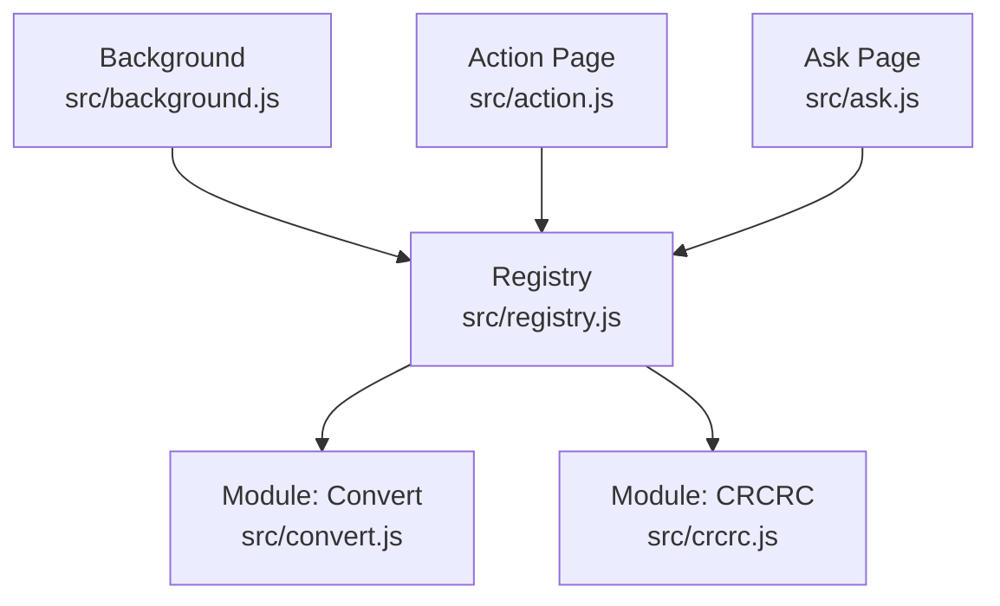
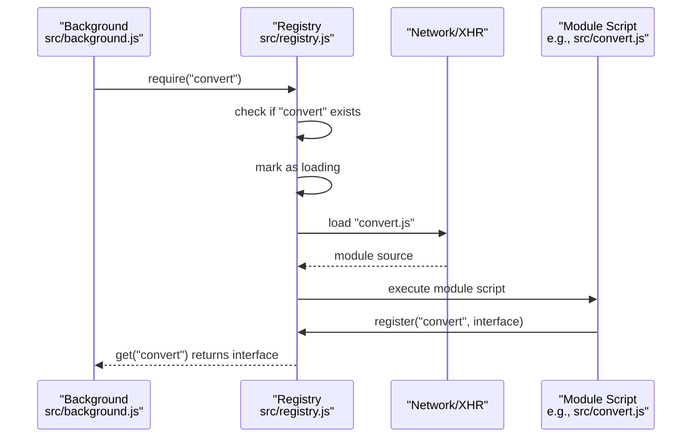
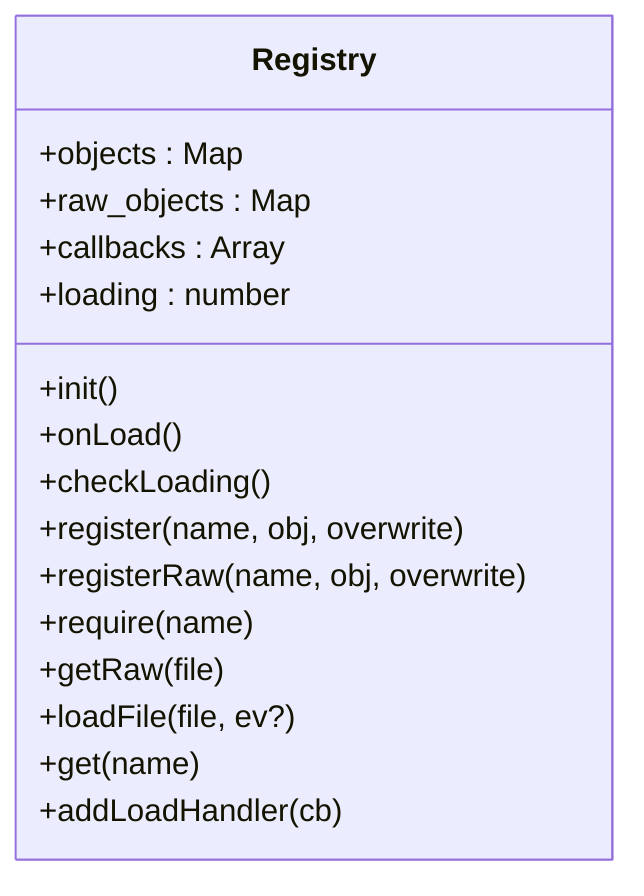
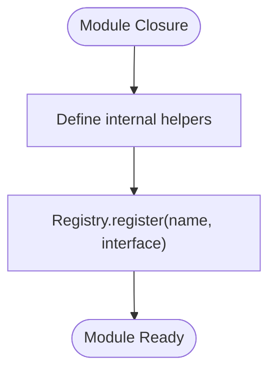
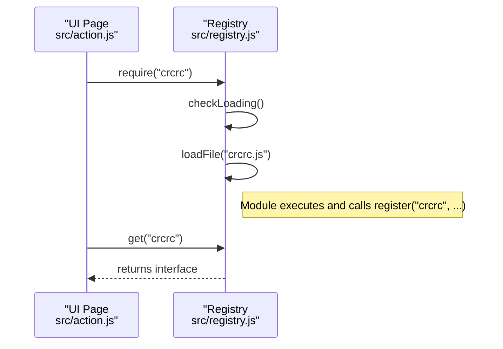
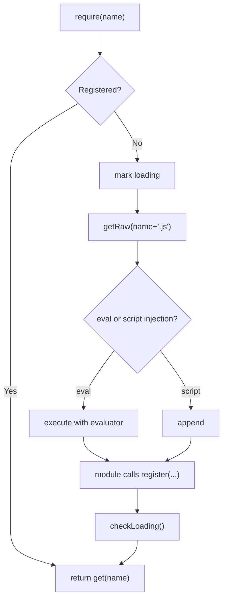
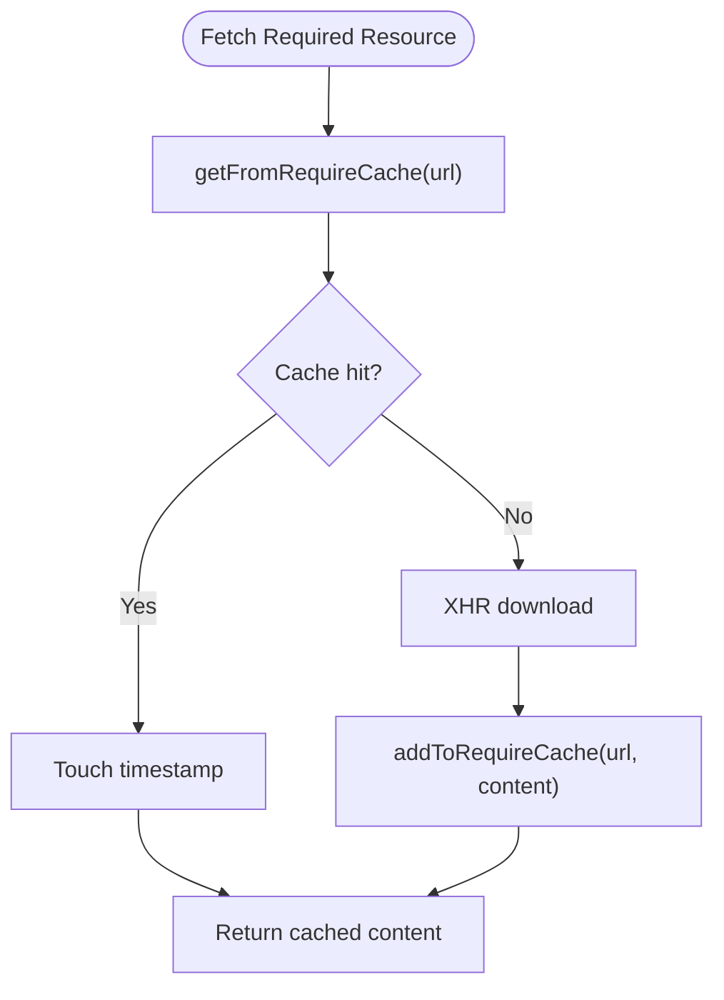
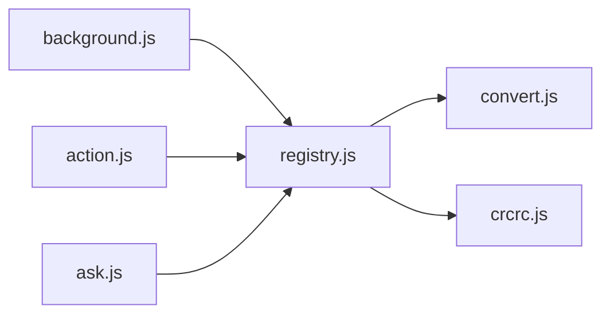

# Registry System

<cite>
**Referenced Files in This Document**
- [registry.js](file://src/registry.js)
- [background.js](file://src/background.js)
- [action.js](file://src/action.js)
- [ask.js](file://src/ask.js)
- [convert.js](file://src/convert.js)
- [crcrc.js](file://src/crcrc.js)
- [environment.js](file://src/environment.js)
- [README.md](file://README.md)
</cite>

## Table of Contents
1. [Introduction](#introduction)
2. [Project Structure](#project-structure)
3. [Core Components](#core-components)
4. [Architecture Overview](#architecture-overview)
5. [Detailed Component Analysis](#detailed-component-analysis)
6. [Dependency Analysis](#dependency-analysis)
7. [Performance Considerations](#performance-considerations)
8. [Troubleshooting Guide](#troubleshooting-guide)
9. [Conclusion](#conclusion)
10. [Appendices](#appendices)

## Introduction
This document explains the registry system that powers dynamic module loading and dependency management in Tampermonkey. It covers how the registry pattern is implemented, how modules register and are loaded lazily, how dependencies are resolved, and how caching improves performance. It also documents the module interface, initialization procedures, error handling, integration with the core system, security considerations for dynamic loading, and best practices for extending the system.

## Project Structure
The registry system spans a small set of core files:
- A central registry module that manages module registration, lazy loading, and retrieval.
- Background and UI entry points that declare dependencies and consume modules via the registry.
- Individual modules that register themselves into the registry with a stable interface.

**Diagram sources**
- [registry.js](file://src/registry.js)
- [background.js](file://src/background.js)
- [action.js](file://src/action.js)
- [ask.js](file://src/ask.js)
- [convert.js](file://src/convert.js)
- [crcrc.js](file://src/crcrc.js)

**Section sources**
- [README.md](file://README.md)
- [registry.js](file://src/registry.js)
- [background.js](file://src/background.js)
- [action.js](file://src/action.js)
- [ask.js](file://src/ask.js)
- [convert.js](file://src/convert.js)
- [crcrc.js](file://src/crcrc.js)

## Core Components
- Central Registry: Provides registration, lazy loading, raw content retrieval, and module retrieval APIs.
- Require Cache: Caches fetched remote resources to reduce network overhead.
- Module Modules: Register stable interfaces for other parts of the system to consume.

Key responsibilities:
- Registration: Modules register an identifier and an object interface.
- Lazy Loading: On first require, the system loads the module file and executes it.
- Retrieval: Consumers fetch registered modules by identifier.
- Caching: Remote requires are cached to improve performance and reduce repeated downloads.

**Section sources**
- [registry.js](file://src/registry.js)
- [background.js](file://src/background.js)
- [convert.js](file://src/convert.js)
- [crcrc.js](file://src/crcrc.js)

## Architecture Overview
The registry enables a plugin-like architecture:
- Entry points (background and UI pages) declare required modules.
- On demand, the registry loads missing modules via XHR or DOM script injection.
- Modules register their public interface with the registry.
- Consumers retrieve modules through a stable identifier.

**Diagram sources**
- [background.js](file://src/background.js)
- [registry.js](file://src/registry.js)
- [convert.js](file://src/convert.js)

## Detailed Component Analysis

### Registry Implementation
The registry exposes:
- Registration: register(name, obj, overwrite?)
- Raw registration: registerRaw(name, rawContent, overwrite?)
- Lazy loading: require(name)
- Retrieval: get(name)
- Raw content: getRaw(file)
- File loading: loadFile(file, optionalEvaluator?)
- Load completion: addLoadHandler(cb), onLoad()

Internals:
- Maintains an objects map for registered modules and a raw_objects map for preloaded raw content.
- Uses a simple loading flag mechanism to detect when all pending modules are ready.
- Supports synchronous XHR for raw content retrieval and DOM script injection for module execution.

**Diagram sources**
- [registry.js](file://src/registry.js)

**Section sources**
- [registry.js](file://src/registry.js)

### Module Registration Pattern
Modules define a self-contained closure and register a stable interface under a unique name. Examples:
- Convert module registers encoding/decoding helpers.
- CRCRC module registers DOM creation helpers.

**Diagram sources**
- [convert.js](file://src/convert.js)
- [crcrc.js](file://src/crcrc.js)
- [registry.js](file://src/registry.js)

**Section sources**
- [convert.js](file://src/convert.js)
- [crcrc.js](file://src/crcrc.js)
- [registry.js](file://src/registry.js)

### Dependency Declaration and Resolution
Entry points declare dependencies early:
- Background page requires several modules before use.
- Action and Ask pages require UI and utility modules.

Resolution algorithm:
- require(name) checks if the module is registered.
- If absent, marks as loading, triggers loadFile(name + ".js"), and expects the module to call register during execution.
- get(name) returns the registered interface or logs an error if not found.

**Diagram sources**
- [action.js](file://src/action.js)
- [registry.js](file://src/registry.js)
- [crcrc.js](file://src/crcrc.js)

**Section sources**
- [background.js](file://src/background.js)
- [action.js](file://src/action.js)
- [ask.js](file://src/ask.js)
- [registry.js](file://src/registry.js)

### Lazy Loading and Execution
- Raw content retrieval uses synchronous XHR to fetch module source.
- Module execution is performed either via an optional evaluator or by injecting a script element into the DOM.
- The registry sets a temporary loading marker to prevent re-entry and loops.

**Diagram sources**
- [registry.js](file://src/registry.js)

**Section sources**
- [registry.js](file://src/registry.js)

### Caching Strategy
The background process maintains a require cache:
- Adds entries with timestamps and headers.
- Retrieves entries and refreshes timestamps on access.
- Periodically cleans expired entries based on a configured validity period.

**Diagram sources**
- [background.js](file://src/background.js)

**Section sources**
- [background.js](file://src/background.js)

### Module Interface and Initialization
Modules expose a stable interface object that consumers retrieve via get(name). Initialization occurs automatically when the module script executes and calls register.

Example interfaces:
- Convert: encoding/decoding utilities.
- CRCRC: DOM creation helpers.

Consumers:
- Retrieve the module interface and call methods directly.
- UI pages often alias returned objects to local variables for convenience.

**Section sources**
- [convert.js](file://src/convert.js)
- [crcrc.js](file://src/crcrc.js)
- [action.js](file://src/action.js)
- [ask.js](file://src/ask.js)

### Error Handling
- Logging: Debug flags enable verbose logging for require/register/get/load operations.
- Safety markers: require marks missing modules as loading to avoid infinite loops.
- Failures: loadFile catches exceptions and logs errors; get warns if a requested module was not found.

**Section sources**
- [registry.js](file://src/registry.js)

### Security Considerations for Dynamic Loading
- Unsafe evaluation: The registry supports an optional evaluator for module execution. In environments where inline evaluation is restricted, script injection is used instead.
- Content access: getRaw uses extension URLs to fetch bundled resources; remote requires are handled by the background process with caching and blacklist checks.
- Environment isolation: The content execution environment initializes a controlled scope and backs up key properties, ensuring predictable behavior for injected scripts.

**Section sources**
- [registry.js](file://src/registry.js)
- [background.js](file://src/background.js)
- [environment.js](file://src/environment.js)

### Extending the System Through the Registry
Guidelines for adding a new module:
- Wrap logic in a self-executing closure.
- Define a clear interface object with intended public methods/properties.
- Call Registry.register("your-module-name", interface) at the end of the module.
- In consuming pages, call Registry.require("your-module-name") early and then Registry.get("your-module-name") to retrieve the interface.
- For remote resources, leverage the background’s require cache and blacklist logic to ensure safe and efficient fetching.

Best practices:
- Keep module interfaces minimal and stable.
- Avoid global pollution; expose only what is necessary.
- Use the cache-friendly patterns already present in the background process for remote dependencies.
- Add debug flags temporarily to troubleshoot loading issues.

**Section sources**
- [registry.js](file://src/registry.js)
- [background.js](file://src/background.js)
- [convert.js](file://src/convert.js)
- [crcrc.js](file://src/crcrc.js)

## Dependency Analysis
The registry creates a decoupled dependency graph:
- Consumers depend on module identifiers, not on implementation details.
- Modules depend on the registry API for registration.
- Background orchestrates initial requires and caches remote dependencies.

**Diagram sources**
- [background.js](file://src/background.js)
- [action.js](file://src/action.js)
- [ask.js](file://src/ask.js)
- [registry.js](file://src/registry.js)
- [convert.js](file://src/convert.js)
- [crcrc.js](file://src/crcrc.js)

**Section sources**
- [background.js](file://src/background.js)
- [action.js](file://src/action.js)
- [ask.js](file://src/ask.js)
- [registry.js](file://src/registry.js)

## Performance Considerations
- Lazy loading reduces initial startup cost by deferring module execution until needed.
- Synchronous XHR in getRaw ensures deterministic execution order but blocks the thread; consider asynchronous patterns if refactoring is feasible.
- Require cache in the background reduces repeated network requests for the same resource.
- Script injection avoids forced synchronous evaluation in some contexts, improving responsiveness.

Recommendations:
- Prefer script injection for module execution when an evaluator is not required.
- Use the background cache for remote requires to minimize network overhead.
- Minimize the number of cross-file requires by grouping related functionality into cohesive modules.

**Section sources**
- [registry.js](file://src/registry.js)
- [background.js](file://src/background.js)

## Troubleshooting Guide
Common issues and resolutions:
- Module not found: Ensure the module calls register with the same identifier used in require/get.
- Infinite loop risk: The registry marks missing modules as loading to prevent re-entry; verify no circular require chains.
- Network failures: loadFile logs errors; confirm the module file exists and is accessible via extension URLs.
- Cache problems: Verify cache validity and periodic cleanup; clear expired entries if stale content is suspected.

Debugging tips:
- Enable debug flags to observe require/register/get/load logs.
- Temporarily add minimal logging in module registration to confirm execution order.

**Section sources**
- [registry.js](file://src/registry.js)

## Conclusion
The registry system provides a lightweight, flexible foundation for dynamic module loading and dependency management in Tampermonkey. By separating concerns between module registration, lazy loading, and retrieval, it enables a plugin-like architecture that is easy to extend. Combined with background-side caching and careful error handling, it delivers a robust platform for building modular features while maintaining performance and safety.

## Appendices

### Example Workflows

- Module registration
  - Define module interface in a closure.
  - Call Registry.register("module-name", interface) at module end.
  - Reference: [convert.js](file://src/convert.js), [crcrc.js](file://src/crcrc.js), [registry.js](file://src/registry.js)

- Dependency declaration and consumption
  - In an entry point, call Registry.require("module-name") early.
  - Retrieve the interface with Registry.get("module-name").
  - Reference: [background.js](file://src/background.js), [action.js](file://src/action.js), [ask.js](file://src/ask.js)

- Remote require with caching
  - Background process fetches and caches remote resources.
  - Subsequent requires reuse cached content.
  - Reference: [background.js](file://src/background.js)