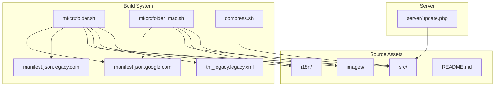
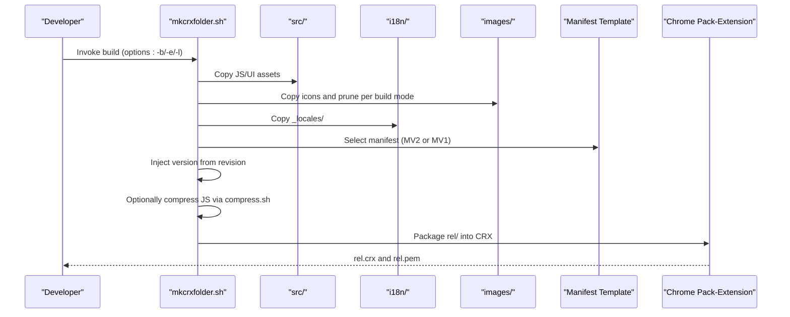
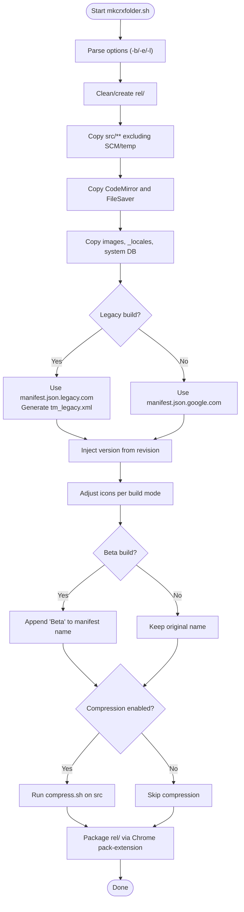
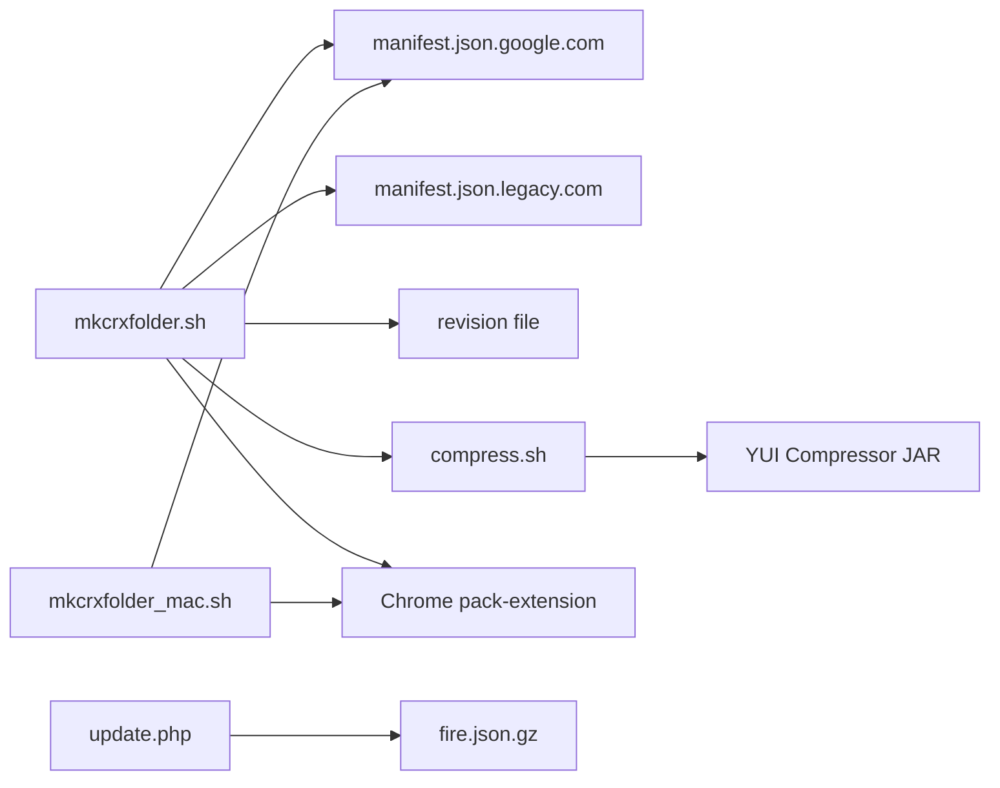

# Build System and Deployment

<cite>
**Referenced Files in This Document**
- [README.md](file://README.md)
- [mkcrxfolder.sh](file://build_sys/mkcrxfolder.sh)
- [mkcrxfolder_mac.sh](file://build_sys/mkcrxfolder_mac.sh)
- [compress.sh](file://build_sys/compress.sh)
- [manifest.json.google.com](file://build_sys/manifest.json.google.com)
- [manifest.json.legacy.com](file://build_sys/manifest.json.legacy.com)
- [tm_legacy.legacy.xml](file://build_sys/tm_legacy.legacy.xml)
- [update.php](file://server/update.php)
- [background.js](file://src/background.js)
- [content.js](file://src/content.js)
- [options.js](file://src/options.js)
- [messages.json](file://i18n/en/messages.json)
</cite>

## Table of Contents
1. [Introduction](#introduction)
2. [Project Structure](#project-structure)
3. [Core Components](#core-components)
4. [Architecture Overview](#architecture-overview)
5. [Detailed Component Analysis](#detailed-component-analysis)
6. [Dependency Analysis](#dependency-analysis)
7. [Performance Considerations](#performance-considerations)
8. [Troubleshooting Guide](#troubleshooting-guide)
9. [Conclusion](#conclusion)
10. [Appendices](#appendices)

## Introduction
This document explains Tampermonkey’s build system and deployment process for producing Chrome extensions across modern and legacy manifest versions. It covers the build scripts, manifest configuration, packaging procedures, differences between manifest versions, platform-specific build considerations, automated build flows, release/version management, distribution channels, and CI considerations. Practical examples and troubleshooting guidance are included to help you build custom versions and maintain a reliable pipeline.

## Project Structure
The build system centers around shell scripts and manifest templates in the build_sys directory, with source assets under src, internationalization under i18n, and a server-side update endpoint under server. The top-level README provides basic build instructions and distribution links.

**Diagram sources**
- [mkcrxfolder.sh:1-137](file://build_sys/mkcrxfolder.sh#L1-L137)
- [mkcrxfolder_mac.sh:1-18](file://build_sys/mkcrxfolder_mac.sh#L1-L18)
- [compress.sh:1-84](file://build_sys/compress.sh#L1-L84)
- [manifest.json.google.com:1-43](file://build_sys/manifest.json.google.com#L1-L43)
- [manifest.json.legacy.com:1-38](file://build_sys/manifest.json.legacy.com#L1-L38)
- [tm_legacy.legacy.xml:1-7](file://build_sys/tm_legacy.legacy.xml#L1-L7)
- [README.md:70-104](file://README.md#L70-L104)

**Section sources**
- [README.md:70-104](file://README.md#L70-L104)
- [mkcrxfolder.sh:1-137](file://build_sys/mkcrxfolder.sh#L1-L137)
- [mkcrxfolder_mac.sh:1-18](file://build_sys/mkcrxfolder_mac.sh#L1-L18)
- [compress.sh:1-84](file://build_sys/compress.sh#L1-L84)

## Core Components
- Build orchestration scripts:
  - mkcrxfolder.sh: Cross-platform build orchestrator that prepares the rel/ folder, copies assets, selects manifests, injects version from revision, and prunes debug files.
  - mkcrxfolder_mac.sh: macOS-specific packaging using Chrome’s native pack-extension CLI.
  - compress.sh: Optional JS minification using YUI Compressor with safeguards against eval-based inputs.
- Manifest templates:
  - manifest.json.google.com: Modern manifest version 2 with CSP, background page, and permissions for Chrome 20+.
  - manifest.json.legacy.com: Legacy manifest version 1 with background_page and update_url for older Chromium builds.
  - tm_legacy.legacy.xml: Legacy update channel metadata for the legacy build.
- Server-side update endpoint:
  - update.php: Provides database version metadata and serves compressed data to clients.
- Source and localization:
  - src/: JavaScript modules and UI assets packaged into the extension.
  - i18n/: Internationalization resources copied into _locales/.
- Distribution and documentation:
  - README.md: Basic build steps and download links for stable, beta, and legacy distributions.

**Section sources**
- [mkcrxfolder.sh:1-137](file://build_sys/mkcrxfolder.sh#L1-L137)
- [mkcrxfolder_mac.sh:1-18](file://build_sys/mkcrxfolder_mac.sh#L1-L18)
- [compress.sh:1-84](file://build_sys/compress.sh#L1-L84)
- [manifest.json.google.com:1-43](file://build_sys/manifest.json.google.com#L1-L43)
- [manifest.json.legacy.com:1-38](file://build_sys/manifest.json.legacy.com#L1-L38)
- [tm_legacy.legacy.xml:1-7](file://build_sys/tm_legacy.legacy.xml#L1-L7)
- [update.php:1-31](file://server/update.php#L1-L31)
- [README.md:28-41](file://README.md#L28-L41)

## Architecture Overview
The build pipeline transforms source assets into a distributable Chrome extension package. It selects the appropriate manifest, injects the current version, copies localized resources, optionally compresses scripts, and finally packages the extension via Chrome’s pack-extension tool.

**Diagram sources**
- [mkcrxfolder.sh:29-136](file://build_sys/mkcrxfolder.sh#L29-L136)
- [compress.sh:1-84](file://build_sys/compress.sh#L1-L84)
- [manifest.json.google.com:1-43](file://build_sys/manifest.json.google.com#L1-L43)
- [manifest.json.legacy.com:1-38](file://build_sys/manifest.json.legacy.com#L1-L38)
- [mkcrxfolder_mac.sh:10-17](file://build_sys/mkcrxfolder_mac.sh#L10-L17)

## Detailed Component Analysis

### Build Orchestration: mkcrxfolder.sh
Responsibilities:
- Parses options for beta (-b), compression (-e), and legacy (-l).
- Updates working copy, creates rel/, and copies src assets excluding SCM and temp files.
- Copies third-party libraries (CodeMirror, FileSaver).
- Copies images, locales, and system DB.
- Selects manifest template (MV2 or MV1), injects version from revision, and adjusts name for beta builds.
- Prunes backup and debug files.
- On legacy builds, generates tm_legacy.xml with injected version.

Key behaviors:
- Version injection uses a revision file to replace version placeholders in manifest and legacy XML.
- Icon selection differs between legacy and modern builds.
- Compression is optional and controlled by -e flag.

**Diagram sources**
- [mkcrxfolder.sh:10-136](file://build_sys/mkcrxfolder.sh#L10-L136)
- [compress.sh:1-84](file://build_sys/compress.sh#L1-L84)

**Section sources**
- [mkcrxfolder.sh:1-137](file://build_sys/mkcrxfolder.sh#L1-L137)

### macOS Packaging: mkcrxfolder_mac.sh
Responsibilities:
- Copies src, i18n, and images into rel/.
- Uses manifest.json.google.com for MV2.
- Invokes Chrome’s pack-extension CLI to produce rel.crx and rel.pem.

Notes:
- Requires Chrome to be installed at a specific path.
- Assumes a PEM key exists or is generated by the pack process.

**Section sources**
- [mkcrxfolder_mac.sh:1-18](file://build_sys/mkcrxfolder_mac.sh#L1-L18)

### JavaScript Compression: compress.sh
Responsibilities:
- Validates presence of YUI Compressor JAR via YUIPATH or local discovery.
- Processes single files or entire src tree depending on mode.
- Skips compression for files containing eval to avoid runtime issues.
- Logs errors and exits on compression failures.

Operational flow:
- If YUIPATH/JAR missing, prints usage and exits.
- For single-file mode, reads input and conditionally compresses.
- For batch mode (-a), iterates *.js, compresses with line break limit, merges headers, and writes to destination.

**Section sources**
- [compress.sh:1-84](file://build_sys/compress.sh#L1-L84)

### Manifest Templates and Version Injection
Modern manifest (MV2):
- Defines content_security_policy, minimum_chrome_version, content_scripts, browser_action, icons, background page, permissions, and optional_permissions.
- Version placeholder is replaced during build.

Legacy manifest (MV1):
- Uses background_page and update_url for legacy update mechanism.
- Name is set to “Tampermonkey Legacy”.
- Legacy XML is generated with version substitution.

Version management:
- Version is extracted from a revision file and substituted into both manifest.json and legacy XML.
- Beta builds append “Beta” to the manifest name.

**Section sources**
- [manifest.json.google.com:1-43](file://build_sys/manifest.json.google.com#L1-L43)
- [manifest.json.legacy.com:1-38](file://build_sys/manifest.json.legacy.com#L1-L38)
- [tm_legacy.legacy.xml:1-7](file://build_sys/tm_legacy.legacy.xml#L1-L7)
- [mkcrxfolder.sh:83-130](file://build_sys/mkcrxfolder.sh#L83-L130)

### Server-Side Update Endpoint: update.php
Responsibilities:
- Returns db_version metadata when requested.
- Serves compressed database payload with gzip encoding and proper headers.
- Disables zlib output compression to ensure raw delivery.

Integration:
- Clients can query db_version to detect updates.
- The served file is referenced by the update endpoint path.

**Section sources**
- [update.php:1-31](file://server/update.php#L1-L31)

### Source Modules and Localization
- src/: Contains core modules (background, content, options, helpers, parsers, UI components) packaged into the extension.
- i18n/: Messages and optional about texts per locale; copied into _locales/ during build.

Practical impact:
- Build scripts copy i18n resources into _locales/ for runtime localization.
- Ensure locale files remain valid JSON to avoid packaging errors.

**Section sources**
- [messages.json:1-200](file://i18n/en/messages.json#L1-L200)
- [mkcrxfolder.sh:66-73](file://build_sys/mkcrxfolder.sh#L66-L73)

## Dependency Analysis
Build-time dependencies and relationships:
- mkcrxfolder.sh depends on:
  - Manifest templates (MV2/MV1)
  - Revision file for version injection
  - Optional compress.sh for JS minification
  - Chrome pack-extension CLI for final packaging
- mkcrxfolder_mac.sh depends on:
  - Chrome pack-extension CLI and manifest.json.google.com
- compress.sh depends on:
  - YUI Compressor JAR (via YUIPATH or local file)
- update.php depends on:
  - Presence of compressed database file and PHP environment

**Diagram sources**
- [mkcrxfolder.sh:1-137](file://build_sys/mkcrxfolder.sh#L1-L137)
- [mkcrxfolder_mac.sh:1-18](file://build_sys/mkcrxfolder_mac.sh#L1-L18)
- [compress.sh:1-84](file://build_sys/compress.sh#L1-L84)
- [update.php:1-31](file://server/update.php#L1-L31)

**Section sources**
- [mkcrxfolder.sh:1-137](file://build_sys/mkcrxfolder.sh#L1-L137)
- [mkcrxfolder_mac.sh:1-18](file://build_sys/mkcrxfolder_mac.sh#L1-L18)
- [compress.sh:1-84](file://build_sys/compress.sh#L1-L84)
- [update.php:1-31](file://server/update.php#L1-L31)

## Performance Considerations
- Minification:
  - Use compress.sh in batch mode (-a) to reduce payload size when distributing.
  - Avoid compressing files containing eval to prevent runtime issues.
- Packaging:
  - Prefer MV2 manifests for modern Chrome versions to leverage CSP and background service worker improvements.
  - Legacy MV1 builds increase bundle size and reduce security posture; use only for legacy environments.
- Asset pruning:
  - Build scripts remove debug files and backup files to minimize package size.

[No sources needed since this section provides general guidance]

## Troubleshooting Guide
Common build issues and resolutions:
- Missing YUI Compressor JAR:
  - Ensure YUIPATH points to a valid JAR or place the JAR in the working directory.
  - The script checks for JAR existence and prints usage if absent.
- Compression errors:
  - Review compress.log for errors; fix invalid JS or eval-based constructs.
  - Re-run with eval-containing files excluded from compression.
- macOS packaging failures:
  - Verify Chrome is installed at the expected path.
  - Confirm rel/ exists and contains required assets before packaging.
- Version mismatch:
  - Ensure revision file is present and readable; version injection relies on it.
  - For legacy builds, confirm tm_legacy.xml generation occurs and version is injected.
- Legacy update channel:
  - Validate update_url in legacy manifest and tm_legacy.xml align with distribution URLs.

**Section sources**
- [compress.sh:7-20](file://build_sys/compress.sh#L7-L20)
- [compress.sh:62-77](file://build_sys/compress.sh#L62-L77)
- [mkcrxfolder_mac.sh:13-17](file://build_sys/mkcrxfolder_mac.sh#L13-L17)
- [mkcrxfolder.sh:38-41](file://build_sys/mkcrxfolder.sh#L38-L41)
- [mkcrxfolder.sh:87-89](file://build_sys/mkcrxfolder.sh#L87-L89)

## Conclusion
Tampermonkey’s build system provides a robust, cross-platform workflow to produce both modern MV2 and legacy MV1 Chrome extensions. By selecting the appropriate manifest template, injecting version metadata, optionally compressing scripts, and packaging via Chrome’s CLI, teams can reliably distribute stable and beta builds. Server-side update endpoints complement the build artifacts to deliver incremental updates. Following the documented practices ensures consistent releases and smooth maintenance across platforms.

[No sources needed since this section summarizes without analyzing specific files]

## Appendices

### Practical Examples

- Build a modern MV2 release:
  - Prepare working directory and run the build script with desired options.
  - Package using Chrome’s pack-extension CLI.
  - Publish to the Chrome Web Store.

- Build a legacy MV1 release:
  - Use the legacy manifest template and generate tm_legacy.xml with version injection.
  - Distribute via the legacy update URL.

- Modify build configurations:
  - Adjust manifest templates to change permissions or icons.
  - Toggle compression via the -e flag to balance size vs. safety.
  - Switch between beta and stable naming using the -b flag.

- Localize assets:
  - Add or update messages in i18n/*/messages.json.
  - Ensure build scripts copy _locales/ into the package.

**Section sources**
- [mkcrxfolder.sh:1-137](file://build_sys/mkcrxfolder.sh#L1-L137)
- [manifest.json.google.com:1-43](file://build_sys/manifest.json.google.com#L1-L43)
- [manifest.json.legacy.com:1-38](file://build_sys/manifest.json.legacy.com#L1-L38)
- [tm_legacy.legacy.xml:1-7](file://build_sys/tm_legacy.legacy.xml#L1-L7)
- [messages.json:1-200](file://i18n/en/messages.json#L1-L200)

### Continuous Integration Considerations
- Environment setup:
  - Install Chrome and required CLI tools.
  - Configure YUI Compressor JAR availability (YUIPATH).
- Pipeline stages:
  - Checkout sources and run mkcrxfolder.sh with appropriate flags.
  - Optionally run compress.sh for release builds.
  - Package CRX using Chrome pack-extension.
  - Upload artifacts and publish to distribution channels.
- Quality gates:
  - Validate revision file presence and version injection.
  - Verify manifest correctness and asset completeness.
  - Test packaging on multiple platforms if applicable.

**Section sources**
- [mkcrxfolder.sh:1-137](file://build_sys/mkcrxfolder.sh#L1-L137)
- [mkcrxfolder_mac.sh:1-18](file://build_sys/mkcrxfolder_mac.sh#L1-L18)
- [compress.sh:1-84](file://build_sys/compress.sh#L1-L84)
- [README.md:70-104](file://README.md#L70-L104)