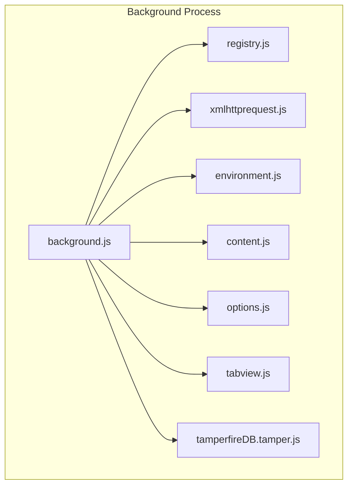
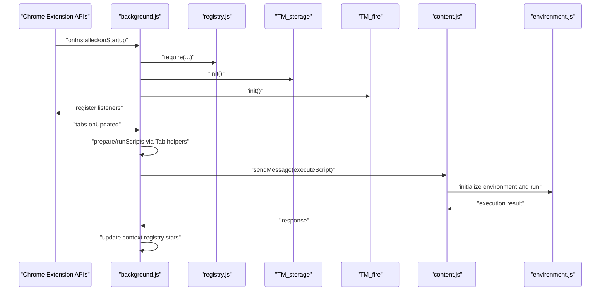
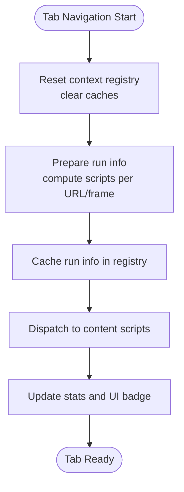
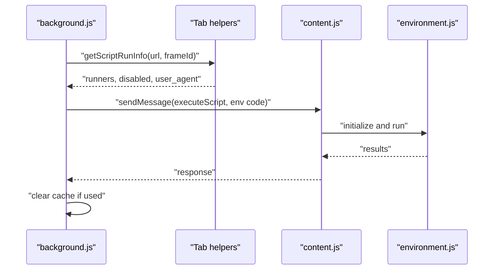
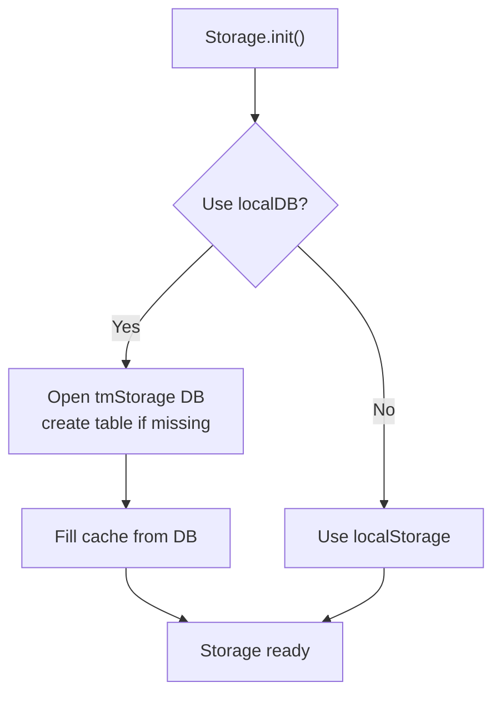
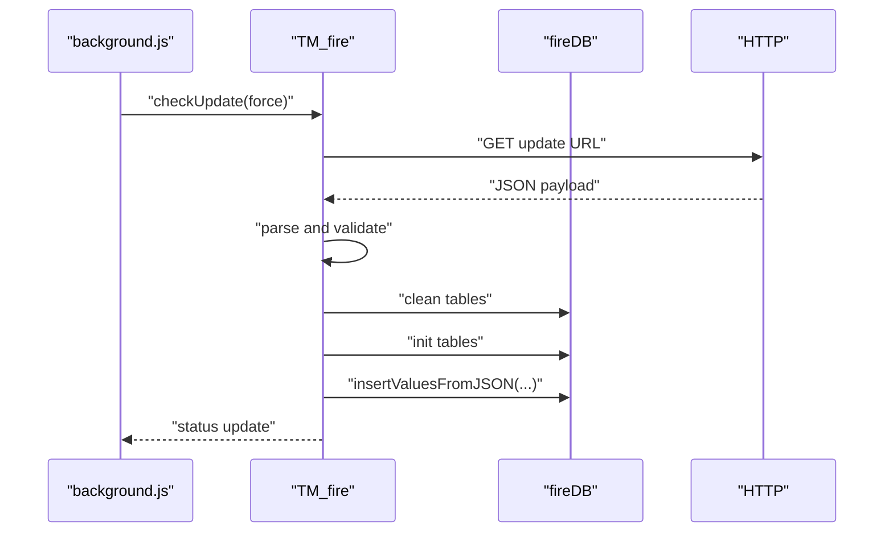
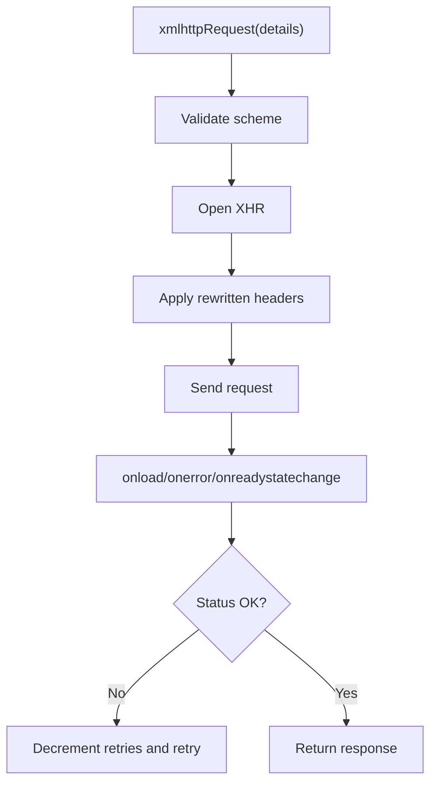
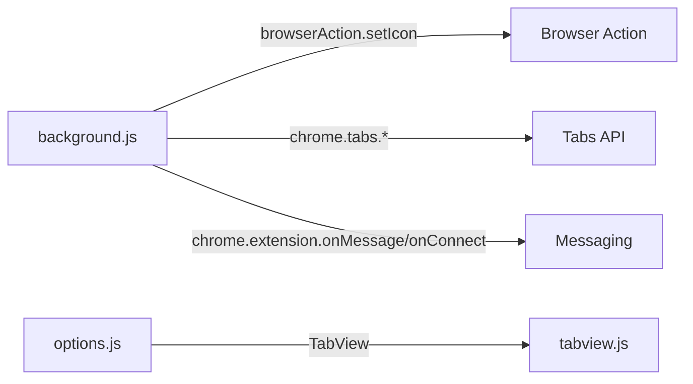
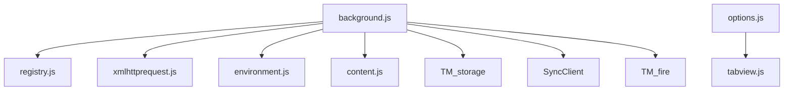

# Background Process

<cite>
**Referenced Files in This Document**
- [background.js](file://src/background.js)
- [registry.js](file://src/registry.js)
- [environment.js](file://src/environment.js)
- [xmlhttprequest.js](file://src/xmlhttprequest.js)
- [content.js](file://src/content.js)
- [options.js](file://src/options.js)
- [tabview.js](file://src/tabview.js)
- [tamperfireDB.tamper.js](file://src/system/tamperfireDB.tamper.js)
</cite>

## Table of Contents
1. [Introduction](#introduction)
2. [Project Structure](#project-structure)
3. [Core Components](#core-components)
4. [Architecture Overview](#architecture-overview)
5. [Detailed Component Analysis](#detailed-component-analysis)
6. [Dependency Analysis](#dependency-analysis)
7. [Performance Considerations](#performance-considerations)
8. [Troubleshooting Guide](#troubleshooting-guide)
9. [Conclusion](#conclusion)

## Introduction
This document explains Tampermonkey’s background process component: the central system-level controller that orchestrates extension lifecycle, script execution coordination, storage operations, and inter-tab communication. It covers the initialization sequence, main event loops, context registry for tab state tracking, script run information caching, database-backed storage, update mechanisms, cross-origin request handling, and integration with Chrome Extension APIs. It also describes how the background process coordinates with content scripts and UI components, along with practical examples, error handling strategies, and performance optimization techniques.

## Project Structure
The background process is implemented primarily in a single large module that wires together registry-driven subsystems, storage, synchronization, and UI integration. Supporting modules provide modularized helpers for XML HTTP requests, environment emulation, and UI tabbing.

**Diagram sources**
- [background.js](file://src/background.js)
- [registry.js](file://src/registry.js)
- [environment.js](file://src/environment.js)
- [xmlhttprequest.js](file://src/xmlhttprequest.js)
- [content.js](file://src/content.js)
- [options.js](file://src/options.js)
- [tabview.js](file://src/tabview.js)
- [tamperfireDB.tamper.js](file://src/system/tamperfireDB.tamper.js)

**Section sources**
- [background.js](file://src/background.js)
- [registry.js](file://src/registry.js)
- [environment.js](file://src/environment.js)
- [xmlhttprequest.js](file://src/xmlhttprequest.js)
- [content.js](file://src/content.js)
- [options.js](file://src/options.js)
- [tabview.js](file://src/tabview.js)
- [tamperfireDB.tamper.js](file://src/system/tamperfireDB.tamper.js)

## Core Components
- Central orchestration and lifecycle management
- Context registry for tab state and script run info caching
- Storage abstraction with local SQL-backed cache and fallback to localStorage
- Synchronization client for cloud sync and periodic updates
- TamperFire database for curated script discovery and filtering
- Cross-origin request handling with webRequest interception and header rewriting
- UI integration for browser action badges and notifications

Key implementation anchors:
- Initialization and listener registration
- Context registry and tab lifecycle
- Storage layer and update conversion
- Sync client and periodic scheduling
- TamperFire DB and update pipeline
- Cross-origin request handling and caching
- Environment emulation and content script coordination

**Section sources**
- [background.js](file://src/background.js)
- [registry.js](file://src/registry.js)
- [xmlhttprequest.js](file://src/xmlhttprequest.js)
- [environment.js](file://src/environment.js)
- [content.js](file://src/content.js)
- [options.js](file://src/options.js)
- [tabview.js](file://src/tabview.js)
- [tamperfireDB.tamper.js](file://src/system/tamperfireDB.tamper.js)

## Architecture Overview
The background process initializes subsystems, registers Chrome Extension API listeners, and maintains a context registry per tab. It coordinates script execution by preparing run info, optionally caching it, and dispatching execution to content scripts. Storage is abstracted behind a cache layer backed by an HTML5 database with a fallback to localStorage. Synchronization and update mechanisms integrate with external services and local databases.

**Diagram sources**
- [background.js](file://src/background.js)
- [registry.js](file://src/registry.js)
- [xmlhttprequest.js](file://src/xmlhttprequest.js)
- [environment.js](file://src/environment.js)
- [content.js](file://src/content.js)

## Detailed Component Analysis

### Initialization Sequence and Main Event Loops
- Loads required modules via the registry, sets logging levels, and initializes storage and TamperFire DB.
- Registers listeners for tab updates, removals, selection changes, extension message/connect, and navigation readiness.
- Initializes webRequest interception for header manipulation and CSP handling.
- Schedules periodic tasks for script update checks and sync operations.

Common operations:
- On tab updates: prepares and runs scripts for eligible frames, caches run info, and updates UI badge.
- On extension messages: handles content-initiated requests, XHR forwarding, and storage operations.
- On connect: establishes message channels for asynchronous operations.

**Section sources**
- [background.js](file://src/background.js)

### Context Registry and Tab Lifecycle Management
The context registry tracks per-tab state including:
- Last observed URLs and user agents
- Script run counts and statistics
- Cache of prepared run info for reuse
- Blocker state and emptiness markers

Tab lifecycle:
- Reset on navigation start, clearing caches and resetting UI.
- Prepare phase computes scripts to run per URL/frame and caches results.
- Run phase dispatches execution to content scripts and updates counters.

**Diagram sources**
- [background.js](file://src/background.js)

**Section sources**
- [background.js](file://src/background.js)

### Script Execution Coordination
- Determines which scripts match the current URL and frame conditions.
- Builds environment code and required resources, then sends an execute message to the content script.
- Handles asynchronous responses and cleans up temporary state.

**Diagram sources**
- [background.js](file://src/background.js)
- [content.js](file://src/content.js)
- [environment.js](file://src/environment.js)

**Section sources**
- [background.js](file://src/background.js)
- [content.js](file://src/content.js)
- [environment.js](file://src/environment.js)

### Storage Abstraction Layer and Update Mechanisms
- Local cache backed by an HTML5 database with a fallback to localStorage.
- Values are typed-stored and cached in memory for fast reads.
- Migration and version conversion logic ensures backward compatibility during updates.

**Diagram sources**
- [background.js](file://src/background.js)

**Section sources**
- [background.js](file://src/background.js)

### TamperFire Integration and Update Pipeline
- Maintains a local SQLite-like database of curated scripts and include/exclude patterns.
- Periodically downloads and imports updates, validates content, and writes in batches.
- Provides queries to count and fetch matching scripts for a URL or IDs.

**Diagram sources**
- [background.js](file://src/background.js)
- [tamperfireDB.tamper.js](file://src/system/tamperfireDB.tamper.js)

**Section sources**
- [background.js](file://src/background.js)
- [tamperfireDB.tamper.js](file://src/system/tamperfireDB.tamper.js)

### Cross-Origin Request Handling
- Uses a helper module to wrap XMLHttpRequest with retries, progress reporting, and header normalization.
- Applies optional webRequest interception to rewrite headers (e.g., User-Agent, Referer) with a prefix to avoid conflicts.
- Supports internal and external requests with consistent response shaping.

**Diagram sources**
- [xmlhttprequest.js](file://src/xmlhttprequest.js)
- [background.js](file://src/background.js)

**Section sources**
- [xmlhttprequest.js](file://src/xmlhttprequest.js)
- [background.js](file://src/background.js)

### Relationship with Chrome Extension APIs and UI Components
- Listeners for tabs, messaging, and connections are registered during initialization.
- Browser action icons reflect script blocker state and number of running scripts.
- Options UI integrates with tab views and utilities for import/export and script management.

**Diagram sources**
- [background.js](file://src/background.js)
- [options.js](file://src/options.js)
- [tabview.js](file://src/tabview.js)

**Section sources**
- [background.js](file://src/background.js)
- [options.js](file://src/options.js)
- [tabview.js](file://src/tabview.js)

## Dependency Analysis
- Registry-driven modularization: background loads helpers lazily and registers them for reuse.
- Environment and content script coordination: content script acts as a bridge to the environment emulator.
- Storage and sync: storage is a thin abstraction over DB/cache/localStorage; sync uses a separate client with scheduling and change listeners.

**Diagram sources**
- [background.js](file://src/background.js)
- [registry.js](file://src/registry.js)
- [xmlhttprequest.js](file://src/xmlhttprequest.js)
- [environment.js](file://src/environment.js)
- [content.js](file://src/content.js)
- [options.js](file://src/options.js)
- [tabview.js](file://src/tabview.js)

**Section sources**
- [background.js](file://src/background.js)
- [registry.js](file://src/registry.js)
- [xmlhttprequest.js](file://src/xmlhttprequest.js)
- [environment.js](file://src/environment.js)
- [content.js](file://src/content.js)
- [options.js](file://src/options.js)
- [tabview.js](file://src/tabview.js)

## Performance Considerations
- Caching
  - Require cache: in-memory cache for fetched resources with periodic cleanup.
  - Context registry cache: reuse prepared run info per tab until navigation resets.
  - Storage cache: in-memory cache of DB-backed config for fast reads.
- Batched writes
  - TamperFire bulk inserts and batched transaction processing reduce DB overhead.
- Asynchronous scheduling
  - Periodic sync and update checks use timeouts and intervals to avoid blocking.
- Minimal DOM and UI updates
  - Badge updates and notifications are triggered only when state changes.

[No sources needed since this section provides general guidance]

## Troubleshooting Guide
- Logging and verbosity
  - Adjust log level via configuration to enable verbose diagnostics for environment, events, and storage.
- Storage migration errors
  - If version conversion fails, inspect migration steps and ensure DB/table creation succeeds.
- TamperFire update failures
  - Verify network connectivity, update URL validity, and DB initialization; watch for parse errors and download timeouts.
- Cross-origin request failures
  - Confirm webRequest interception is initialized and headers are rewritten; check retry logic and scheme validation.
- Content script execution issues
  - Validate environment initialization, event firing, and response handling; ensure proper messaging channels.

**Section sources**
- [background.js](file://src/background.js)
- [xmlhttprequest.js](file://src/xmlhttprequest.js)
- [environment.js](file://src/environment.js)
- [content.js](file://src/content.js)

## Conclusion
The background process is a robust, modular orchestrator that coordinates script execution, storage, synchronization, and UI integration. Its registry-based design, context-aware caching, and layered abstractions enable reliable operation across diverse environments and use cases. By leveraging Chrome Extension APIs and maintaining clear separation of concerns, it provides a scalable foundation for Tampermonkey’s runtime behavior.