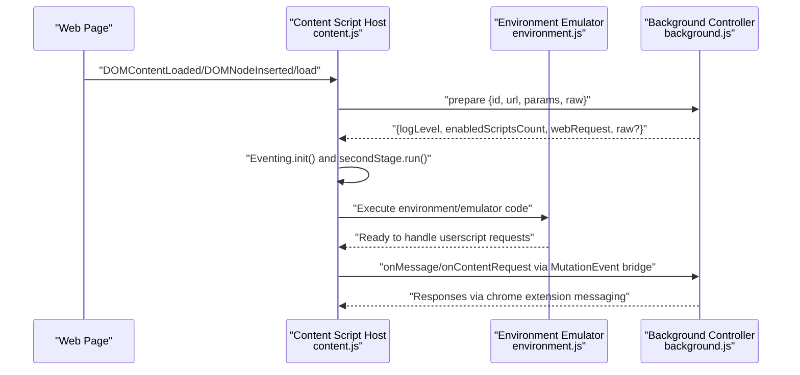
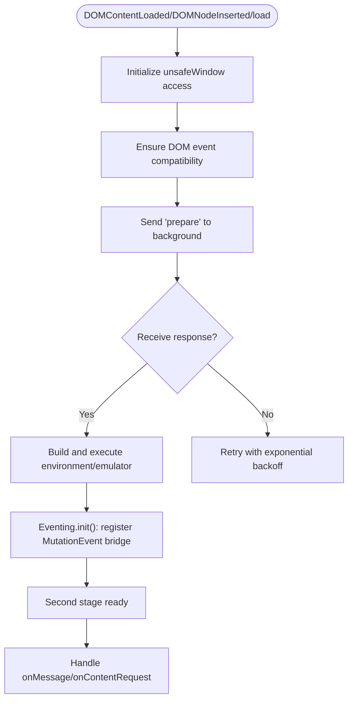
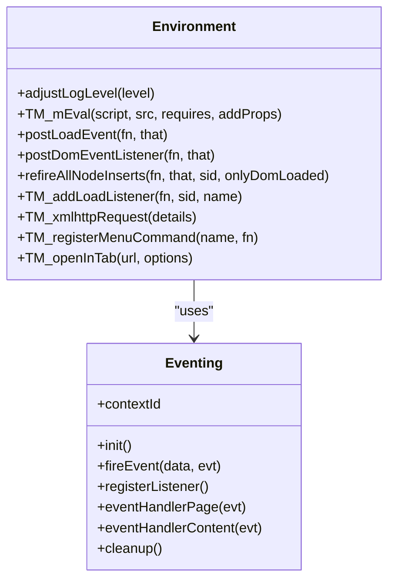
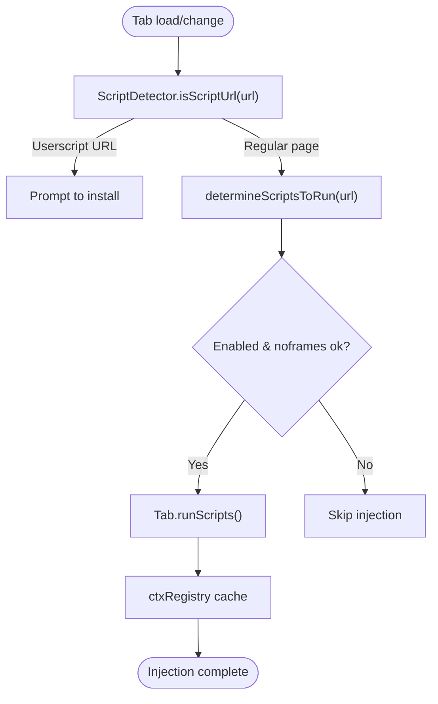
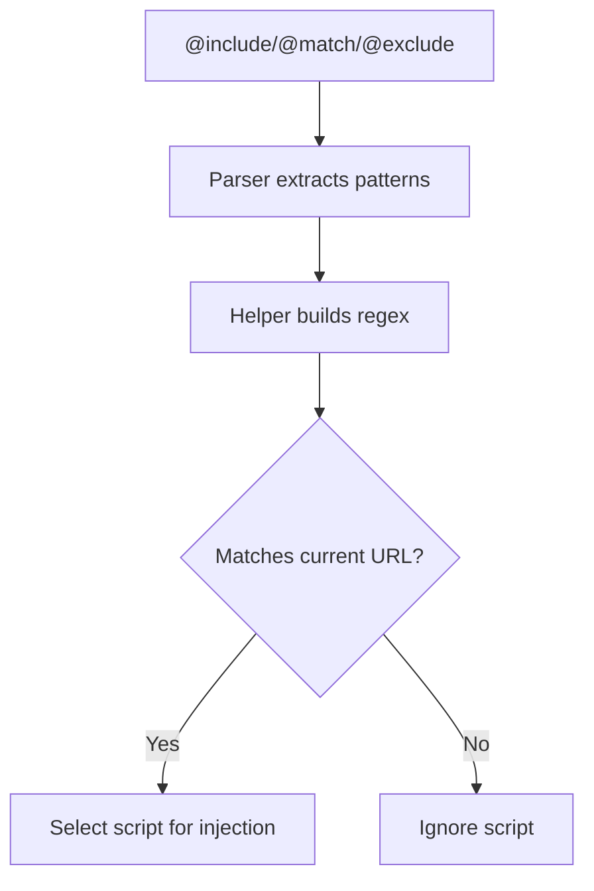

# Content Scripts

<cite>
**Referenced Files in This Document**
- [content.js](file://src/content.js)
- [background.js](file://src/background.js)
- [environment.js](file://src/environment.js)
- [registry.js](file://src/registry.js)
- [helper.js](file://src/helper.js)
- [parser.js](file://src/parser.js)
- [README.md](file://README.md)
</cite>

## Table of Contents
1. [Introduction](#introduction)
2. [Project Structure](#project-structure)
3. [Core Components](#core-components)
4. [Architecture Overview](#architecture-overview)
5. [Detailed Component Analysis](#detailed-component-analysis)
6. [Dependency Analysis](#dependency-analysis)
7. [Performance Considerations](#performance-considerations)
8. [Troubleshooting Guide](#troubleshooting-guide)
9. [Conclusion](#conclusion)

## Introduction
This document explains Tampermonkey’s content script system: how content scripts are injected into web pages, how they execute in a controlled environment, and how they communicate with the background process. It covers the script detection mechanism, URL matching and frame-based injection strategies, runtime initialization, DOM interaction capabilities, and security sandboxing. It also includes lifecycle examples, event handling, integration with the userscript execution environment, performance considerations, memory management, and debugging techniques.

## Project Structure
The content script system spans three primary modules:
- Content script host: initializes, injects, and manages the userscript execution environment inside the page.
- Background controller: determines which scripts run on a page, coordinates injection, and handles cross-process messaging.
- Environment emulator: provides a userscript-compatible API surface and DOM event simulation within the page context.

```mermaid
graph TB
subgraph "Browser Page"
CS["Content Script Host<br/>src/content.js"]
ENV["Environment Emulator<br/>src/environment.js"]
end
subgraph "Extension"
BG["Background Controller<br/>src/background.js"]
REG["Registry Loader<br/>src/registry.js"]
HLP["URL Matching Utils<br/>src/helper.js"]
end
CS --> ENV
CS <- --> BG
BG --> REG
BG --> HLP
```

**Diagram sources**
- [content.js:1064-1200](file://src/content.js#L1064-L1200)
- [environment.js:1-120](file://src/environment.js#L1-L120)
- [background.js:560-640](file://src/background.js#L560-L640)
- [registry.js:76-104](file://src/registry.js#L76-L104)
- [helper.js:56-80](file://src/helper.js#L56-L80)

**Section sources**
- [content.js:1064-1200](file://src/content.js#L1064-L1200)
- [background.js:560-640](file://src/background.js#L560-L640)
- [environment.js:1-120](file://src/environment.js#L1-L120)
- [registry.js:76-104](file://src/registry.js#L76-L104)
- [helper.js:56-80](file://src/helper.js#L56-L80)
- [README.md:1-112](file://README.md#L1-L112)

## Core Components
- Content Script Host (content.js)
  - Initializes unsafeWindow access, DOM event compatibility, and environment bootstrap.
  - Manages message routing between the page and background via a MutationEvent-based bridge.
  - Coordinates second-stage initialization of the environment emulator and userscript execution.
- Environment Emulator (environment.js)
  - Provides a userscript-compatible API surface (GM_* functions, DOM helpers, event simulation).
  - Executes userscripts in a controlled context with sandboxing and cleanup hooks.
- Background Controller (background.js)
  - Determines which scripts apply to a URL, caches per-tab/frame context, and triggers injection.
  - Handles messaging for XMLHttpRequest emulation, storage, tabs, and menu commands.
- Registry Loader (registry.js)
  - Dynamically loads required modules (environment, emulation) into the content script context.
- URL Matching Utilities (helper.js)
  - Converts @include/@match patterns into regular expressions for fast URL validation.
- Parser (parser.js)
  - Extracts metadata (@include/@match/@exclude, @require, etc.) from userscript headers.

**Section sources**
- [content.js:455-608](file://src/content.js#L455-L608)
- [environment.js:52-193](file://src/environment.js#L52-L193)
- [background.js:560-640](file://src/background.js#L560-L640)
- [registry.js:76-104](file://src/registry.js#L76-L104)
- [helper.js:56-80](file://src/helper.js#L56-L80)
- [parser.js:157-181](file://src/parser.js#L157-L181)

## Architecture Overview
The content script system uses a hybrid model:
- The content script host runs inside the page and sets up a MutationEvent-based channel to communicate with the background.
- The background prepares the environment and supplies the emulator and helper code to the content script.
- The environment emulator executes userscripts with a compatible API surface and simulates DOM events.



**Diagram sources**
- [content.js:1088-1198](file://src/content.js#L1088-L1198)
- [environment.js:195-343](file://src/environment.js#L195-L343)
- [background.js:4357-4368](file://src/background.js#L4357-L4368)

## Detailed Component Analysis

### Content Script Host (Injection and Messaging)
- Initialization and unsafeWindow access
  - Creates a controlled unsafeWindow proxy and writes selected properties into the page window for compatibility.
  - Registers a MutationEvent listener to evaluate code in the unsafeWindow context when needed.
- DOM event compatibility
  - Ensures DOMAttrModified and DOMNodeInserted events are available even on platforms where native support is missing.
  - Wraps setTimeout/setInterval to safely execute strings via the unsafeWindow bridge.
- Environment bootstrap
  - Requests preparation from the background, then constructs and executes the environment/emulator code in a controlled manner.
- Message routing
  - Uses a MutationEvent-based bridge to forward messages to/from the background, avoiding direct cross-frame access.
  - Maintains response handlers keyed by generated IDs to correlate asynchronous replies.



**Diagram sources**
- [content.js:455-608](file://src/content.js#L455-L608)
- [content.js:630-823](file://src/content.js#L630-L823)
- [content.js:825-962](file://src/content.js#L825-L962)
- [content.js:966-1028](file://src/content.js#L966-L1028)
- [content.js:1077-1090](file://src/content.js#L1077-L1090)

**Section sources**
- [content.js:455-608](file://src/content.js#L455-L608)
- [content.js:630-823](file://src/content.js#L630-L823)
- [content.js:825-962](file://src/content.js#L825-L962)
- [content.js:966-1028](file://src/content.js#L966-L1028)
- [content.js:1077-1090](file://src/content.js#L1077-L1090)

### Environment Emulator (Userscript Runtime)
- Userscript execution
  - Builds a controlled execution context with masked globals and a private window-like object.
  - Injects @require content and wraps execution in a try/catch to capture errors and stack traces.
- DOM and event simulation
  - Simulates DOMContentLoaded, load, and DOMNodeInserted events for userscripts.
  - Re-dispatches historical DOMNodeInserted events to scripts that register after page load.
- API surface
  - Exposes GM_* functions (menu commands, tabs, XMLHTTPRequest, storage proxies).
  - Provides helpers for XPath evaluation, window.open, and setTimeout/setInterval string execution.



**Diagram sources**
- [environment.js:52-193](file://src/environment.js#L52-L193)
- [environment.js:195-343](file://src/environment.js#L195-L343)
- [environment.js:380-493](file://src/environment.js#L380-L493)
- [environment.js:646-771](file://src/environment.js#L646-L771)
- [environment.js:825-962](file://src/environment.js#L825-L962)

**Section sources**
- [environment.js:52-193](file://src/environment.js#L52-L193)
- [environment.js:195-343](file://src/environment.js#L195-L343)
- [environment.js:380-493](file://src/environment.js#L380-L493)
- [environment.js:646-771](file://src/environment.js#L646-L771)
- [environment.js:825-962](file://src/environment.js#L825-L962)

### Background Controller (Detection, Matching, Injection)
- Script detection and selection
  - Scans stored scripts and filters by enabled state, frame restrictions, and URL conditions.
  - Uses @include/@match/@exclude patterns parsed by the parser and validated via helper utilities.
- Frame-aware injection
  - Tracks per-tab and per-frame contexts, caches run decisions, and respects noframes options.
- Cross-process messaging
  - Handles XMLHTTPRequest emulation, storage, tabs, and menu commands via chrome extension APIs.
  - Listens for tab updates and script installation prompts.



**Diagram sources**
- [background.js:644-658](file://src/background.js#L644-L658)
- [background.js:3681-3710](file://src/background.js#L3681-L3710)
- [background.js:560-640](file://src/background.js#L560-L640)
- [background.js:6130-6156](file://src/background.js#L6130-L6156)

**Section sources**
- [background.js:644-658](file://src/background.js#L644-L658)
- [background.js:3681-3710](file://src/background.js#L3681-L3710)
- [background.js:560-640](file://src/background.js#L560-L640)
- [background.js:6130-6156](file://src/background.js#L6130-L6156)

### URL Matching and Pattern Conversion
- Pattern parsing
  - @include/@match/@exclude are extracted from userscript metadata during parsing.
- Regular expression generation
  - Converts patterns to regular expressions, handling wildcards, optional subdomain prefixes, and TLD normalization.
- Validation
  - Scripts are matched against the current URL using compiled regular expressions before injection.



**Diagram sources**
- [parser.js:157-181](file://src/parser.js#L157-L181)
- [helper.js:56-80](file://src/helper.js#L56-L80)

**Section sources**
- [parser.js:157-181](file://src/parser.js#L157-L181)
- [helper.js:56-80](file://src/helper.js#L56-L80)

### Registry Loader (Dynamic Module Loading)
- Loads environment and emulation modules into the content script context.
- Supports both eval-based and script-tag-based loading depending on environment.

**Section sources**
- [registry.js:76-104](file://src/registry.js#L76-L104)

## Dependency Analysis
- Content script host depends on:
  - Environment/emulation modules supplied by the background.
  - Registry loader for dynamic module resolution.
  - Helper utilities for URL matching and serialization.
- Background controller depends on:
  - Storage and configuration for script metadata and conditions.
  - Helper utilities for pattern compilation.
  - Parser for metadata extraction.
- Communication channels:
  - MutationEvent bridge for lightweight, cross-context messaging.
  - Chrome extension messaging for heavy payloads and privileged operations.

```mermaid
graph LR
BG["background.js"] --> HLP["helper.js"]
BG --> PARSER["parser.js"]
BG --> REG["registry.js"]
CS["content.js"] --> REG
CS --> ENV["environment.js"]
CS --> HLP
CS <- --> BG
```

**Diagram sources**
- [background.js:28-35](file://src/background.js#L28-L35)
- [content.js:80-91](file://src/content.js#L80-L91)
- [registry.js:76-104](file://src/registry.js#L76-L104)
- [helper.js:56-80](file://src/helper.js#L56-L80)
- [parser.js:157-181](file://src/parser.js#L157-L181)

**Section sources**
- [background.js:28-35](file://src/background.js#L28-L35)
- [content.js:80-91](file://src/content.js#L80-L91)
- [registry.js:76-104](file://src/registry.js#L76-L104)
- [helper.js:56-80](file://src/helper.js#L56-L80)
- [parser.js:157-181](file://src/parser.js#L157-L181)

## Performance Considerations
- Event bridging overhead
  - MutationEvent-based messaging avoids cross-frame access but still incurs DOM dispatch costs; minimize payload sizes and frequency.
- Logging and verbosity
  - Elevated log levels increase CPU usage; adjust logLevel to balance diagnostics and performance.
- Require caching
  - Background maintains a require cache to reduce repeated network fetches for @require resources.
- DOM event replay
  - Re-dispatching historical DOMNodeInserted events ensures compatibility but can be expensive on pages with heavy DOM churn.

[No sources needed since this section provides general guidance]

## Troubleshooting Guide
- No scripts running on a page
  - Verify URL matching: ensure @include/@match patterns cover the current URL and that @exclude rules do not unintentionally block it.
  - Confirm the page is not flagged as a script URL requiring manual installation.
- Scripts appear but GM_* functions do not work
  - Check that the environment emulator is loaded and initialized; inspect logs around secondStage.run and Eventing.init.
- XMLHTTPRequest failures
  - Inspect webRequest info propagation and retry logic; ensure headers verification passes.
- Memory leaks or lingering listeners
  - Ensure cleanup routines are invoked on unload; verify that Eventing.cleanup and environment cleanup hooks are executed.

**Section sources**
- [content.js:1030-1061](file://src/content.js#L1030-L1061)
- [content.js:1121-1198](file://src/content.js#L1121-L1198)
- [background.js:4357-4368](file://src/background.js#L4357-L4368)
- [environment.js:309-323](file://src/environment.js#L309-L323)

## Conclusion
Tampermonkey’s content script system combines a robust content script host, a flexible background controller, and a comprehensive environment emulator to deliver a powerful userscript runtime. It achieves compatibility and safety through controlled unsafeWindow access, DOM event simulation, and a MutationEvent-based bridge. By understanding URL matching, frame-based injection, and lifecycle events, developers can build efficient, reliable userscripts and troubleshoot issues effectively.