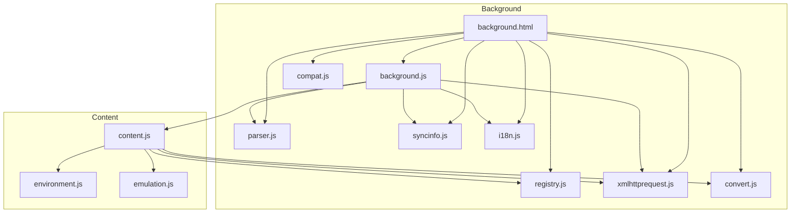
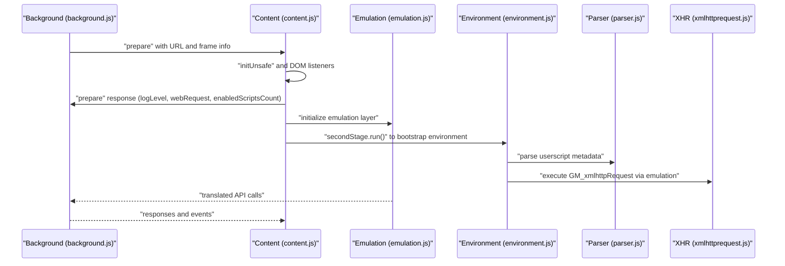
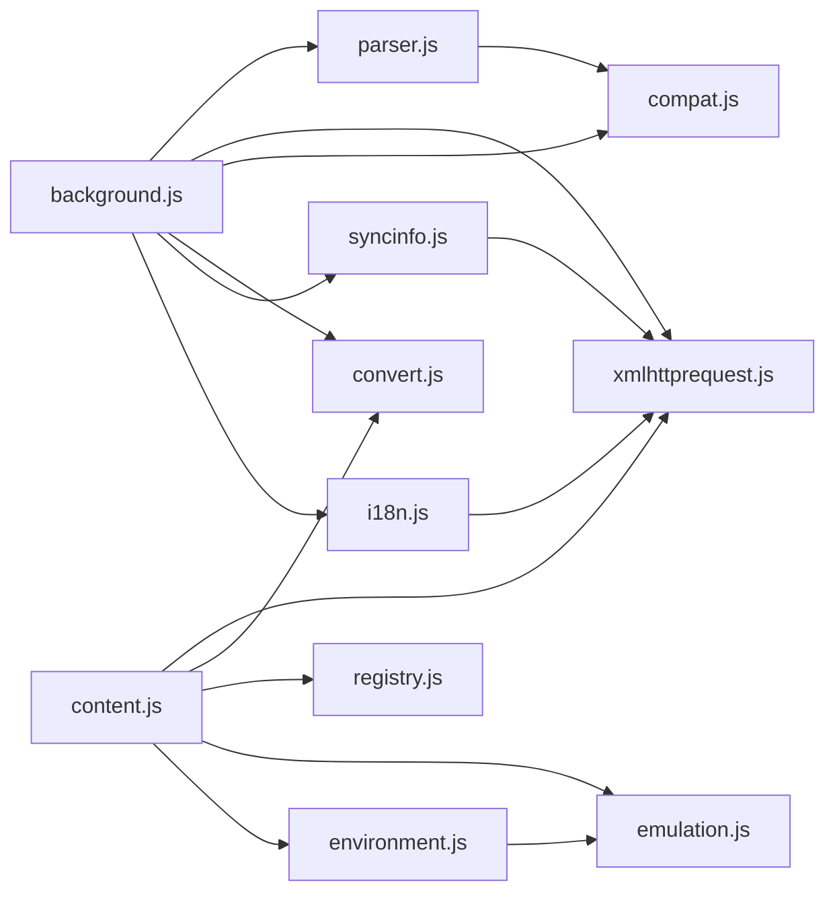

# Core Components

<cite>
**Referenced Files in This Document**
- [background.html](file://src/background.html)
- [background.js](file://src/background.js)
- [content.js](file://src/content.js)
- [environment.js](file://src/environment.js)
- [emulation.js](file://src/emulation.js)
- [registry.js](file://src/registry.js)
- [parser.js](file://src/parser.js)
- [xmlhttprequest.js](file://src/xmlhttprequest.js)
- [convert.js](file://src/convert.js)
- [compat.js](file://src/compat.js)
- [syncinfo.js](file://src/syncinfo.js)
- [i18n.js](file://src/i18n.js)
</cite>

## Table of Contents
1. [Introduction](#introduction)
2. [Project Structure](#project-structure)
3. [Core Components](#core-components)
4. [Architecture Overview](#architecture-overview)
5. [Detailed Component Analysis](#detailed-component-analysis)
6. [Dependency Analysis](#dependency-analysis)
7. [Performance Considerations](#performance-considerations)
8. [Troubleshooting Guide](#troubleshooting-guide)
9. [Conclusion](#conclusion)

## Introduction
This document explains Tampermonkey’s core components and how they collaborate to manage userscripts across browser tabs. It focuses on:
- Background process for system-level operations
- Content scripts for page-level interactions
- Environment engine for runtime execution
- Registry system for module loading
- Parser for userscript metadata processing

It also covers lifecycle management, initialization sequences, and inter-component communication patterns.

## Project Structure
The extension consists of:
- A background page that orchestrates storage, updates, and per-tab script execution
- Content scripts injected into web pages to bridge the page context and the extension
- An environment engine that executes userscripts safely within the page context
- A registry that lazily loads and caches modules
- Supporting utilities for parsing metadata, HTTP requests, encoding, compatibility, synchronization, and localization

**Diagram sources**
- [background.html:1-19](file://src/background.html#L1-L19)
- [background.js:28-34](file://src/background.js#L28-L34)
- [content.js:80-91](file://src/content.js#L80-L91)
- [environment.js:7-35](file://src/environment.js#L7-L35)
- [emulation.js:9-329](file://src/emulation.js#L9-L329)
- [registry.js:11-104](file://src/registry.js#L11-L104)
- [parser.js:7-285](file://src/parser.js#L7-L285)
- [xmlhttprequest.js:7-160](file://src/xmlhttprequest.js#L7-L160)
- [convert.js:7-38](file://src/convert.js#L7-L38)
- [compat.js:7-274](file://src/compat.js#L7-L274)
- [syncinfo.js:7-394](file://src/syncinfo.js#L7-L394)
- [i18n.js:7-139](file://src/i18n.js#L7-L139)

**Section sources**
- [background.html:1-19](file://src/background.html#L1-L19)
- [background.js:28-34](file://src/background.js#L28-L34)

## Core Components
- Background process (background.js): Initializes modules, manages per-tab contexts, runs scripts, handles storage and update checks, and coordinates messaging with content scripts.
- Content scripts (content.js): Injected into pages to bootstrap the environment, establish event channels, emulate selected Chrome APIs, and coordinate with the background.
- Environment engine (environment.js): Provides the userscript execution environment, event simulation, and API bindings inside the page context.
- Emulation layer (emulation.js): Bridges the page context to the background by translating API calls and responses.
- Registry (registry.js): Lazy loader and cache for modules, enabling modular initialization.
- Parser (parser.js): Extracts userscript metadata and constructs script descriptors.
- Utilities: xmlhttprequest.js, convert.js, compat.js, syncinfo.js, i18n.js.

Responsibilities and relationships:
- Registry loads modules on demand and exposes them via get/register/getRaw/loadFile.
- Parser builds script metadata and options from userscript headers.
- xmlhttprequest.js provides a cross-context HTTP client used by both content and background.
- convert.js and compat.js support encoding and compatibility transformations.
- syncinfo.js integrates with Chrome storage for syncing lists and change notifications.
- i18n.js supports localized message retrieval and locale switching.

**Section sources**
- [background.js:28-34](file://src/background.js#L28-L34)
- [content.js:80-91](file://src/content.js#L80-L91)
- [environment.js:7-35](file://src/environment.js#L7-L35)
- [emulation.js:9-329](file://src/emulation.js#L9-L329)
- [registry.js:11-104](file://src/registry.js#L11-L104)
- [parser.js:7-285](file://src/parser.js#L7-L285)
- [xmlhttprequest.js:7-160](file://src/xmlhttprequest.js#L7-L160)
- [convert.js:7-38](file://src/convert.js#L7-L38)
- [compat.js:7-274](file://src/compat.js#L7-L274)
- [syncinfo.js:7-394](file://src/syncinfo.js#L7-L394)
- [i18n.js:7-139](file://src/i18n.js#L7-L139)

## Architecture Overview
High-level flow:
- background.html loads registry and core modules, then background.js.
- On navigation, background.js determines which scripts to run per tab and prepares execution context.
- content.js is injected into pages and initializes Eventing and the emulation layer.
- environment.js sets up the userscript execution environment and event simulation.
- Emulation translates API calls (e.g., chrome.* and GM_* functions) into messages to background.
- Parser extracts metadata; xmlhttprequest.js handles network; convert/compat provide encoding and compatibility; syncinfo/i18n support storage and localization.

**Diagram sources**
- [background.js:561-640](file://src/background.js#L561-L640)
- [content.js:1064-1198](file://src/content.js#L1064-L1198)
- [emulation.js:40-329](file://src/emulation.js#L40-L329)
- [environment.js:782-800](file://src/environment.js#L782-L800)
- [parser.js:72-285](file://src/parser.js#L72-L285)
- [xmlhttprequest.js:17-153](file://src/xmlhttprequest.js#L17-L153)

## Detailed Component Analysis

### Background Process
- Loads core modules via registry and initializes logging, storage, and update routines.
- Maintains per-tab context registry, tracks URLs and user agents, and caches run info.
- Determines which scripts to run per URL/frame, creates runtime instances, and triggers environment bootstrapping.
- Handles local file access, update checks, and storage change notifications.

Lifecycle highlights:
- Module loading order in background.html ensures parser, xmlhttprequest, compat, convert, i18n, and syncinfo are available before background.js runs.
- Per-tab preparation and caching reduce repeated computation during navigation.

Communication patterns:
- Uses chrome.* APIs for storage and messaging.
- Coordinates with content scripts via message handlers and context IDs.

**Section sources**
- [background.html:1-19](file://src/background.html#L1-L19)
- [background.js:28-34](file://src/background.js#L28-L34)
- [background.js:435-558](file://src/background.js#L435-L558)
- [background.js:561-640](file://src/background.js#L561-L640)
- [background.js:642-786](file://src/background.js#L642-L786)

### Content Scripts
- Detects injection conditions and sets up unsafeWindow access when possible.
- Initializes Eventing and emulation, then waits for DOM readiness to bootstrap environment.
- Provides tmCE helpers for messaging, XMLHttpRequest emulation, and port-based communication.
- Manages cleanup on unload and registers DOM listeners for DOMContentLoaded/DOMNodeInserted.

Initialization sequence:
- initUnsafe establishes unsafeWindow and environment properties.
- Eventing.init wires mutation-event-based IPC.
- secondStage.runHlp waits for DOM readiness and then injects environment code.

**Section sources**
- [content.js:455-608](file://src/content.js#L455-L608)
- [content.js:825-962](file://src/content.js#L825-L962)
- [content.js:966-1028](file://src/content.js#L966-L1028)
- [content.js:1063-1198](file://src/content.js#L1063-L1198)

### Environment Engine
- Provides a sandboxed execution environment for userscripts.
- Implements event simulation (DOMContentLoaded, load, DOMNodeInserted) and fixes for compatibility.
- Exposes GM_* APIs and integrates with emulation for chrome.* calls.
- Manages cleanup and unloads on page unload.

Execution model:
- Uses Function constructor to execute scripts in a controlled mask.
- Applies compatibility transforms and error handling/reporting.
- Supports menu commands, tab operations, and storage listeners.

**Section sources**
- [environment.js:52-193](file://src/environment.js#L52-L193)
- [environment.js:195-493](file://src/environment.js#L195-L493)
- [environment.js:495-624](file://src/environment.js#L495-L624)
- [environment.js:626-747](file://src/environment.js#L626-L747)
- [environment.js:749-800](file://src/environment.js#L749-L800)

### Emulation Layer
- Translates chrome.* and GM_* calls from the page context into messages to background.
- Manages response IDs, request handlers, and port-based connections.
- Provides i18n, tabs, and extension APIs for the page context.

Key responsibilities:
- xmlHttpRequest routing to background.
- Message and connect handlers for request/response.
- Port lifecycle management and onDisconnect handling.

**Section sources**
- [emulation.js:40-329](file://src/emulation.js#L40-L329)

### Registry System
- Lazy-loading module loader with require/get/getRaw/loadFile.
- Tracks loading state and invokes onLoad callbacks when all required modules are ready.
- Supports raw module registration for immediate evaluation.

Patterns:
- Modules register themselves via Registry.register or registerRaw.
- Consumers call Registry.require to trigger loading and then Registry.get to obtain instances.

**Section sources**
- [registry.js:11-104](file://src/registry.js#L11-L104)

### Parser for Userscript Metadata
- Parses headers and extracts metadata (name, namespace, version, includes/matches/excludes, requires, resources, options).
- Produces a normalized script descriptor with options and identifiers.
- Detects compatibility flags and metadata transformations.

Processing pipeline:
- Extract header block from source.
- Tokenize and normalize tags.
- Build Script object with arrays/lists and nested options.

**Section sources**
- [parser.js:72-285](file://src/parser.js#L72-L285)

### Supporting Utilities
- xmlhttprequest.js: Cross-context HTTP client with retries, progress reporting, and header handling.
- convert.js: UTF-8/Base64 encoders/decoders and escape/unescape helpers.
- compat.js: Compatibility transformations for metadata, foreach, array destructuring, and prototype usage.
- syncinfo.js: Chrome storage integration for syncing lists and change notifications.
- i18n.js: Locale-aware message retrieval and fallback mechanisms.

**Section sources**
- [xmlhttprequest.js:17-153](file://src/xmlhttprequest.js#L17-L153)
- [convert.js:7-38](file://src/convert.js#L7-L38)
- [compat.js:13-274](file://src/compat.js#L13-L274)
- [syncinfo.js:68-394](file://src/syncinfo.js#L68-L394)
- [i18n.js:76-139](file://src/i18n.js#L76-L139)

## Dependency Analysis
Module-level dependencies:
- background.js depends on registry-loaded modules (parser, xmlhttprequest, compat, convert, i18n, syncinfo).
- content.js depends on emulation, environment, xmlhttprequest, convert, and registry for raw module access.
- environment.js depends on emulation and parser-derived metadata.
- emulation.js depends on tmCE and chromeEmu abstractions.
- xmlhttprequest.js depends on helper for image checks and is used by both content and background.
- compat.js depends on helper for regex escaping and string utilities.
- syncinfo.js depends on xmlhttprequest and Chrome storage APIs.
- i18n.js depends on helper and Chrome i18n APIs.

**Diagram sources**
- [background.js:28-34](file://src/background.js#L28-L34)
- [content.js:80-91](file://src/content.js#L80-L91)
- [environment.js:7-35](file://src/environment.js#L7-L35)
- [emulation.js:9-329](file://src/emulation.js#L9-L329)
- [registry.js:11-104](file://src/registry.js#L11-L104)
- [parser.js:7-285](file://src/parser.js#L7-L285)
- [xmlhttprequest.js:7-160](file://src/xmlhttprequest.js#L7-L160)
- [convert.js:7-38](file://src/convert.js#L7-L38)
- [compat.js:7-274](file://src/compat.js#L7-L274)
- [syncinfo.js:7-394](file://src/syncinfo.js#L7-L394)
- [i18n.js:7-139](file://src/i18n.js#L7-L139)

**Section sources**
- [background.js:28-34](file://src/background.js#L28-L34)
- [content.js:80-91](file://src/content.js#L80-L91)
- [environment.js:7-35](file://src/environment.js#L7-L35)
- [emulation.js:9-329](file://src/emulation.js#L9-L329)
- [registry.js:11-104](file://src/registry.js#L11-L104)
- [parser.js:7-285](file://src/parser.js#L7-L285)
- [xmlhttprequest.js:7-160](file://src/xmlhttprequest.js#L7-L160)
- [convert.js:7-38](file://src/convert.js#L7-L38)
- [compat.js:7-274](file://src/compat.js#L7-L274)
- [syncinfo.js:7-394](file://src/syncinfo.js#L7-L394)
- [i18n.js:7-139](file://src/i18n.js#L7-L139)

## Performance Considerations
- Require cache: background maintains a require cache keyed by URL with periodic cleanup to reduce network overhead.
- Eventing batching: environment defers and batches DOM event re-dispatching to maintain order and reduce overhead.
- Retry logic: xmlhttprequest includes retry-on-error semantics to improve robustness.
- Safe context: content.js uses MutationEvent-based IPC to avoid heavy DOM manipulation and minimize overhead.
- Compatibility transforms: compat.js avoids runtime overhead by pre-processing source when needed.

[No sources needed since this section provides general guidance]

## Troubleshooting Guide
Common issues and diagnostics:
- Script blocker interference: content.js detects script blockers and communicates via chrome extension messages; adjust settings or disable blocking extensions.
- Local file access: content.js supports iframe-based retrieval and XMLHttpRequest-based retrieval; ensure proper permissions and CORS handling.
- XHR retries: xmlhttprequest.js retries on non-200 statuses; verify network connectivity and headers.
- Update checks: background performs version comparisons and migration steps; ensure storage access and update URLs are reachable.
- Storage sync: syncinfo.js writes to Chrome storage with locking and retry; monitor for storage quota and change listener errors.

**Section sources**
- [content.js:455-500](file://src/content.js#L455-L500)
- [content.js:698-764](file://src/content.js#L698-L764)
- [xmlhttprequest.js:62-92](file://src/xmlhttprequest.js#L62-L92)
- [background.js:83-106](file://src/background.js#L83-L106)
- [syncinfo.js:333-361](file://src/syncinfo.js#L333-L361)

## Conclusion
Tampermonkey’s core is built around a clear separation of concerns:
- background.js orchestrates system-level tasks and per-tab execution
- content.js bridges page and extension contexts
- environment.js and emulation.js provide a safe, compatible execution environment
- registry.js enables modular, lazy-loading architecture
- parser.js and utilities ensure robust metadata processing and runtime support

Together, these components deliver a reliable, extensible foundation for userscript management across diverse web environments.