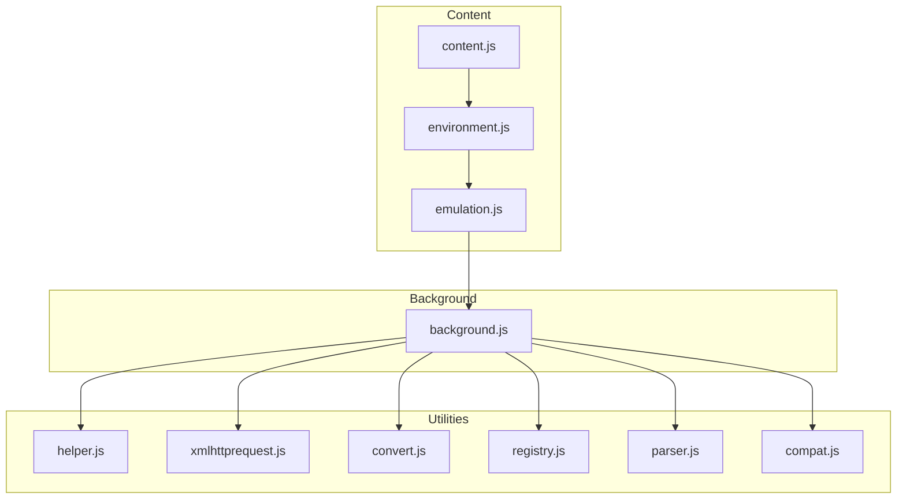
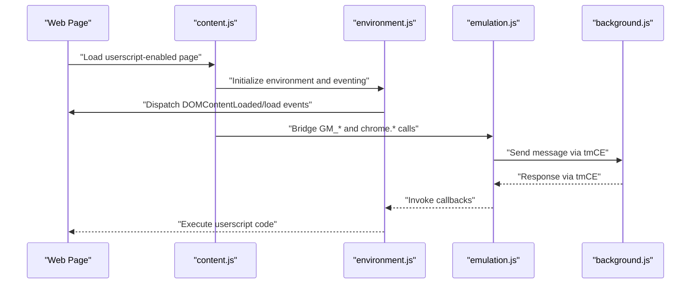
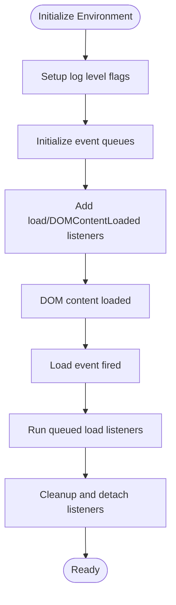
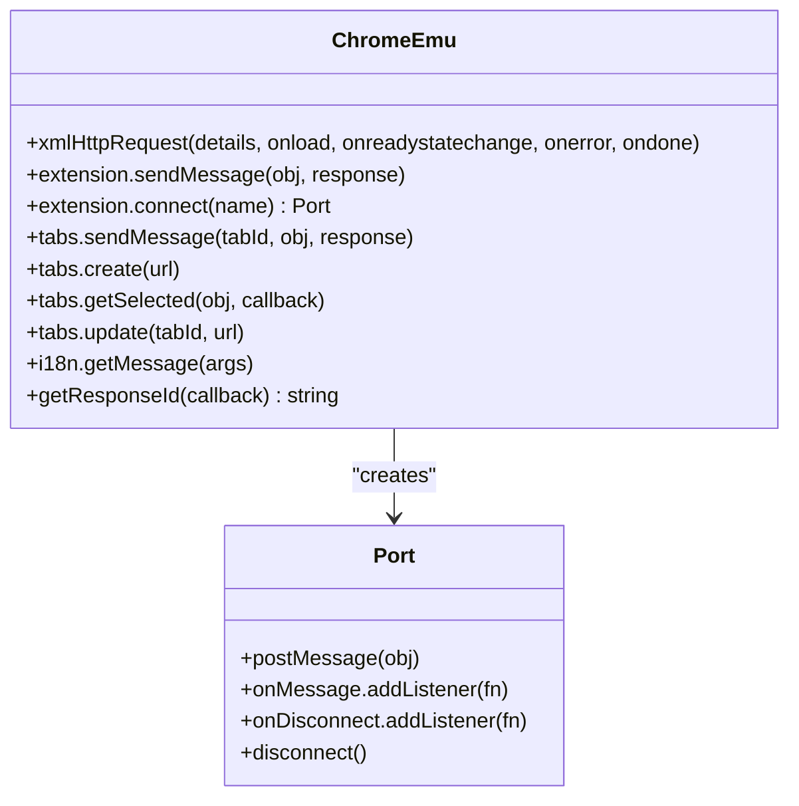
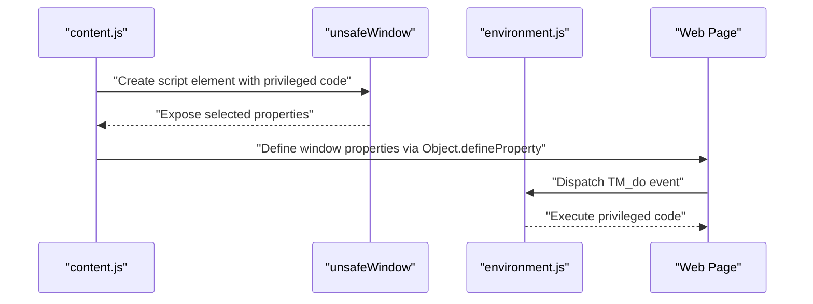
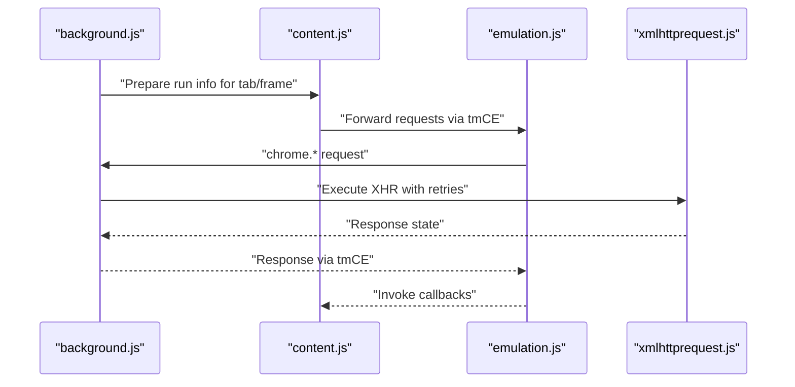
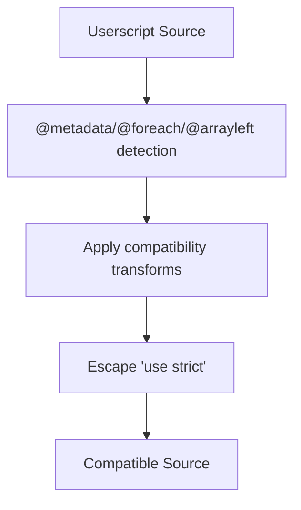
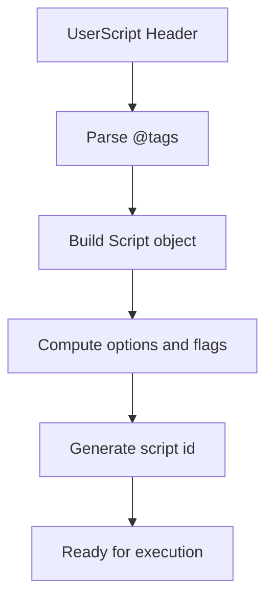
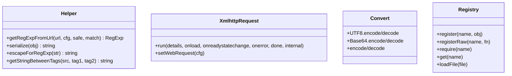
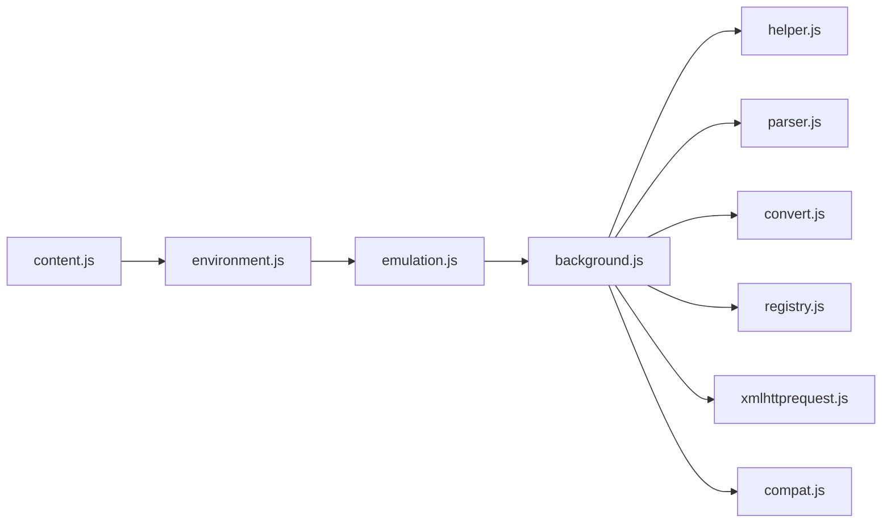

# Environment Engine

<cite>
**Referenced Files in This Document**
- [environment.js](file://src/environment.js)
- [emulation.js](file://src/emulation.js)
- [compat.js](file://src/compat.js)
- [content.js](file://src/content.js)
- [background.js](file://src/background.js)
- [helper.js](file://src/helper.js)
- [xmlhttprequest.js](file://src/xmlhttprequest.js)
- [registry.js](file://src/registry.js)
- [parser.js](file://src/parser.js)
- [convert.js](file://src/convert.js)
- [README.md](file://README.md)
</cite>

## Table of Contents
1. [Introduction](#introduction)
2. [Project Structure](#project-structure)
3. [Core Components](#core-components)
4. [Architecture Overview](#architecture-overview)
5. [Detailed Component Analysis](#detailed-component-analysis)
6. [Dependency Analysis](#dependency-analysis)
7. [Performance Considerations](#performance-considerations)
8. [Troubleshooting Guide](#troubleshooting-guide)
9. [Conclusion](#conclusion)
10. [Appendices](#appendices)

## Introduction
This document explains Tampermonkey’s environment engine that powers userscript execution in the browser. It covers the API emulation layer enabling Greasemonkey compatibility, sandboxing and isolation mechanisms, the virtual DOM integration, script execution lifecycle, variable scoping, and global namespace management. It also documents integration with Chrome Extension APIs, custom API implementations, compatibility mode configurations, and practical examples for setup and debugging.

## Project Structure
The environment engine spans several modules:
- Content-side initialization and environment bootstrap
- Background-side orchestration and cross-process messaging
- Emulation layer for Chrome Extension APIs and GM_* functions
- Compatibility helpers for Greasemonkey-style syntax and semantics
- Request pipeline and serialization utilities
- Parser and metadata extraction for userscripts

**Diagram sources**
- [content.js:108-215](file://src/content.js#L108-L215)
- [environment.js:1-1337](file://src/environment.js#L1-L1337)
- [emulation.js:1-329](file://src/emulation.js#L1-L329)
- [background.js:1-800](file://src/background.js#L1-L800)
- [helper.js:1-209](file://src/helper.js#L1-L209)
- [xmlhttprequest.js:1-161](file://src/xmlhttprequest.js#L1-L161)
- [convert.js:1-39](file://src/convert.js#L1-L39)
- [registry.js:1-107](file://src/registry.js#L1-L107)
- [parser.js:1-286](file://src/parser.js#L1-L286)
- [compat.js:1-275](file://src/compat.js#L1-L275)

**Section sources**
- [README.md:1-112](file://README.md#L1-L112)
- [content.js:1-800](file://src/content.js#L1-L800)
- [environment.js:1-800](file://src/environment.js#L1-L800)
- [emulation.js:1-329](file://src/emulation.js#L1-L329)
- [background.js:1-800](file://src/background.js#L1-L800)

## Core Components
- Environment bootstrap and eventing: initializes the runtime context, sets up event dispatch, and manages load timing.
- Emulation layer: bridges userscript calls to Chrome Extension APIs and GM_* functions.
- Content bridge: injects environment into the page, coordinates with background, and handles unsafeWindow exposure.
- Background orchestrator: manages script runs, caches, and cross-tab communication.
- Compatibility helpers: transforms userscript syntax to be compatible with Tampermonkey’s runtime.
- Utilities: helper functions, XHR wrapper, serialization, registry loader, and parser.

**Section sources**
- [environment.js:1-800](file://src/environment.js#L1-L800)
- [emulation.js:1-329](file://src/emulation.js#L1-L329)
- [content.js:1-800](file://src/content.js#L1-L800)
- [background.js:1-800](file://src/background.js#L1-L800)
- [compat.js:1-275](file://src/compat.js#L1-L275)
- [helper.js:1-209](file://src/helper.js#L1-L209)
- [xmlhttprequest.js:1-161](file://src/xmlhttprequest.js#L1-L161)
- [convert.js:1-39](file://src/convert.js#L1-L39)
- [registry.js:1-107](file://src/registry.js#L1-L107)
- [parser.js:1-286](file://src/parser.js#L1-L286)

## Architecture Overview
The environment engine is split between content and background contexts:
- Content context injects the environment into the page, sets up eventing, and exposes unsafeWindow when allowed.
- Background context manages script discovery, caching, and cross-tab coordination.
- The emulation layer translates GM_* and Chrome Extension API calls into background-executed operations.

**Diagram sources**
- [content.js:108-215](file://src/content.js#L108-L215)
- [environment.js:195-380](file://src/environment.js#L195-L380)
- [emulation.js:40-329](file://src/emulation.js#L40-L329)
- [background.js:28-35](file://src/background.js#L28-L35)

## Detailed Component Analysis

### Environment Bootstrap and Eventing
- Initializes logging levels, event queues, and DOM event forwarding.
- Provides load listeners, DOMContentLoaded and load event simulation, and mutation event replay.
- Manages function identity for event handlers and ensures correct execution context.

**Diagram sources**
- [environment.js:18-35](file://src/environment.js#L18-L35)
- [environment.js:195-380](file://src/environment.js#L195-L380)
- [environment.js:325-343](file://src/environment.js#L325-L343)

**Section sources**
- [environment.js:1-800](file://src/environment.js#L1-L800)

### Emulation Layer (GM_* and Chrome Extension APIs)
- Wraps chrome.* APIs (extension, tabs, i18n) and exposes them as GM_* functions to userscripts.
- Implements request/response routing, port-based messaging, and response ID management.
- Handles XMLHTTPRequest emulation with progress callbacks and special object handling.

**Diagram sources**
- [emulation.js:40-329](file://src/emulation.js#L40-L329)

**Section sources**
- [emulation.js:1-329](file://src/emulation.js#L1-L329)

### Content Bridge and UnsafeWindow Exposure
- Creates a safe injection mechanism to expose unsafeWindow when allowed by the environment.
- Defines properties and descriptors to safely expose top-level globals and frames.
- Uses MutationEvent-based dispatch to execute privileged code in the unsafe context.

**Diagram sources**
- [content.js:456-608](file://src/content.js#L456-L608)
- [environment.js:626-644](file://src/environment.js#L626-L644)

**Section sources**
- [content.js:456-608](file://src/content.js#L456-L608)
- [environment.js:626-644](file://src/environment.js#L626-L644)

### Background Orchestration and Cross-Tab Coordination
- Manages script run lists per tab/frame, caches run info, and coordinates with content.
- Implements request/response routing and port-based messaging to emulate chrome.* APIs.
- Provides XMLHTTPRequest wrapper and retry logic.

**Diagram sources**
- [background.js:560-640](file://src/background.js#L560-L640)
- [content.js:217-453](file://src/content.js#L217-L453)
- [emulation.js:52-82](file://src/emulation.js#L52-L82)
- [xmlhttprequest.js:17-153](file://src/xmlhttprequest.js#L17-L153)

**Section sources**
- [background.js:560-640](file://src/background.js#L560-L640)
- [content.js:217-453](file://src/content.js#L217-L453)
- [xmlhttprequest.js:1-161](file://src/xmlhttprequest.js#L1-L161)

### Compatibility Mode and Syntax Transformation
- Applies transformations to userscript source to improve Greasemonkey compatibility:
  - Metadata blocks to JavaScript strings
  - for each loops to standard for-in
  - Array destructuring on left-hand side
  - Prototype usage detection
- Disables strict mode by escaping the directive to ensure function identity works.

**Diagram sources**
- [compat.js:14-26](file://src/compat.js#L14-L26)
- [compat.js:238-270](file://src/compat.js#L238-L270)
- [compat.js:167-213](file://src/compat.js#L167-L213)
- [compat.js:114-151](file://src/compat.js#L114-L151)
- [parser.js:265-281](file://src/parser.js#L265-L281)

**Section sources**
- [compat.js:1-275](file://src/compat.js#L1-L275)
- [parser.js:265-281](file://src/parser.js#L265-L281)

### Userscript Parsing and Options
- Extracts metadata from the userscript header and populates script options.
- Supports include/match/exclude patterns, resource declarations, and run-at/user-agent options.
- Computes script identifiers and detects compatibility flags.

**Diagram sources**
- [parser.js:72-222](file://src/parser.js#L72-L222)
- [parser.js:251-281](file://src/parser.js#L251-L281)

**Section sources**
- [parser.js:1-286](file://src/parser.js#L1-L286)

### Utilities and Serialization
- Helper functions for URL matching, serialization, and HTML encoding/decoding.
- XMLHTTPRequest wrapper with retry logic, progress reporting, and header manipulation.
- Convert utilities for Base64 and UTF-8 encoding/decoding.
- Registry loader for module dependency management.

**Diagram sources**
- [helper.js:122-166](file://src/helper.js#L122-L166)
- [xmlhttprequest.js:17-153](file://src/xmlhttprequest.js#L17-L153)
- [convert.js:8-37](file://src/convert.js#L8-L37)
- [registry.js:11-104](file://src/registry.js#L11-L104)

**Section sources**
- [helper.js:1-209](file://src/helper.js#L1-L209)
- [xmlhttprequest.js:1-161](file://src/xmlhttprequest.js#L1-L161)
- [convert.js:1-39](file://src/convert.js#L1-L39)
- [registry.js:1-107](file://src/registry.js#L1-L107)

## Dependency Analysis
- Content depends on environment for eventing and unsafeWindow exposure.
- Emulation depends on background for API execution and response routing.
- Background depends on helper, parser, convert, registry, and xmlhttprequest modules.
- Compatibility and parser feed into the environment to transform and validate userscripts.

**Diagram sources**
- [content.js:78-91](file://src/content.js#L78-L91)
- [background.js:28-35](file://src/background.js#L28-L35)
- [environment.js:1-800](file://src/environment.js#L1-L800)
- [emulation.js:1-329](file://src/emulation.js#L1-L329)
- [helper.js:1-209](file://src/helper.js#L1-L209)
- [parser.js:1-286](file://src/parser.js#L1-L286)
- [convert.js:1-39](file://src/convert.js#L1-L39)
- [registry.js:1-107](file://src/registry.js#L1-L107)
- [xmlhttprequest.js:1-161](file://src/xmlhttprequest.js#L1-L161)
- [compat.js:1-275](file://src/compat.js#L1-L275)

**Section sources**
- [content.js:78-91](file://src/content.js#L78-L91)
- [background.js:28-35](file://src/background.js#L28-L35)

## Performance Considerations
- Event replay and mutation observation: The environment replays DOMNodeInserted events and simulates DOMContentLoaded/load to ensure deterministic script execution. This adds overhead; minimize heavy synchronous operations inside event handlers.
- Safe context vs unsafe context: Using unsafeWindow can trigger script blockers and reduce performance. Prefer safe context when possible.
- XMLHTTPRequest retries: Background XHR wrapper retries on non-200 responses; tune retry counts and timeouts to balance reliability and latency.
- Require cache: Background maintains a require cache keyed by URL with periodic cleanup to reduce network overhead.
- Logging flags: Adjust log levels to reduce console churn during production runs.

[No sources needed since this section provides general guidance]

## Troubleshooting Guide
Common issues and remedies:
- Script blocked by script blockers: The content bridge attempts to retrieve unsafeWindow; if unavailable, it logs a warning and marks script blocker detected. Consider disabling the blocker or adjusting permissions.
- Event timing issues: If scripts rely on DOMContentLoaded/load, ensure the environment has fired these events before executing. Use load listeners and run-at options to align execution timing.
- GM_* API failures: Verify that the emulation layer is active and that tmCE routes are functioning. Check response IDs and port connections.
- Syntax errors: The environment wraps userscript execution and reports JSLINT output when available. Review reported lines and characters to locate issues.
- unsafeWindow exposure: If properties are not exposed, verify Object.defineProperty and descriptor creation paths. Some properties may be redefined or created as unsafeX variants.

**Section sources**
- [content.js:456-608](file://src/content.js#L456-L608)
- [environment.js:128-193](file://src/environment.js#L128-L193)
- [emulation.js:197-207](file://src/emulation.js#L197-L207)
- [background.js:40-48](file://src/background.js#L40-L48)

## Conclusion
Tampermonkey’s environment engine provides a robust, compatible, and secure runtime for userscripts. It achieves Greasemonkey compatibility through an emulation layer, isolates execution via a safe context, and integrates with Chrome Extension APIs. The system balances flexibility and safety with careful eventing, sandboxing, and compatibility transformations.

[No sources needed since this section summarizes without analyzing specific files]

## Appendices

### Environment Setup and Execution Lifecycle
- Initialization: Content injects environment and sets up eventing; background prepares run info and caches.
- Execution: Environment executes userscripts with transformed source and compatibility flags; GM_* calls are routed via emulation to background.
- Cleanup: Listeners and properties are cleaned up on unload; unsafeWindow references are removed.

**Section sources**
- [content.js:108-215](file://src/content.js#L108-L215)
- [environment.js:195-380](file://src/environment.js#L195-L380)
- [emulation.js:40-329](file://src/emulation.js#L40-L329)
- [background.js:560-640](file://src/background.js#L560-L640)

### API Usage Patterns
- GM_registerMenuCommand: Registers a menu command; background handles invocation and re-registration.
- GM_xmlhttpRequest: Emulated via background XHR with progress callbacks and response handling.
- openInTab/closeTab: Opens links in tabs and provides close capability via background.

**Section sources**
- [environment.js:648-771](file://src/environment.js#L648-L771)
- [emulation.js:52-82](file://src/emulation.js#L52-L82)
- [background.js:769-766](file://src/background.js#L769-L766)

### Security Considerations
- Safe context: Default mode prevents direct access to page globals; unsafeWindow exposure is guarded and logged.
- Property exposure: Uses Object.defineProperty to safely attach properties; falls back to unsafeX variants when necessary.
- Script blockers: Detects and warns when script blockers prevent unsafeWindow access.

**Section sources**
- [content.js:456-608](file://src/content.js#L456-L608)
- [environment.js:626-644](file://src/environment.js#L626-L644)

### Debugging Capabilities
- Log levels: Configure D/V/EV/EMV/ENV/TS flags to increase verbosity.
- JSLINT integration: Syntax errors are reported with detailed line and character positions.
- Response IDs and ports: Emulation layer tracks response IDs and port connections for reliable callbacks.

**Section sources**
- [environment.js:22-31](file://src/environment.js#L22-L31)
- [environment.js:128-193](file://src/environment.js#L128-L193)
- [emulation.js:197-207](file://src/emulation.js#L197-L207)