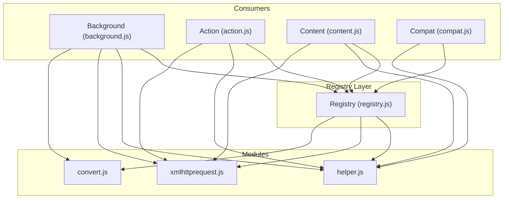
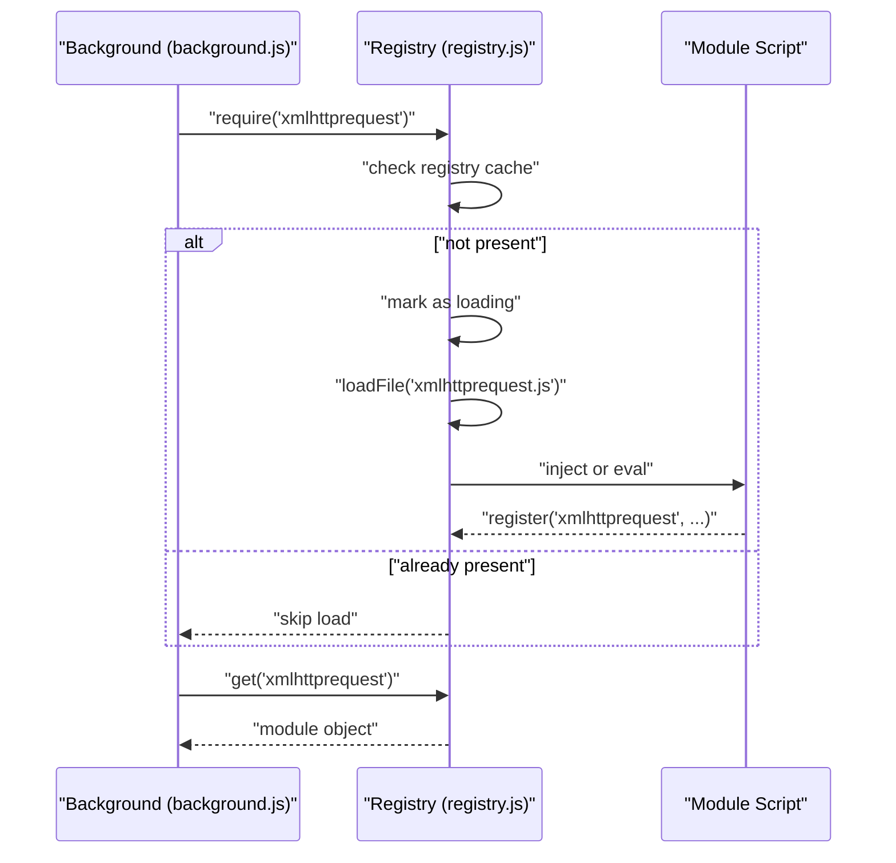
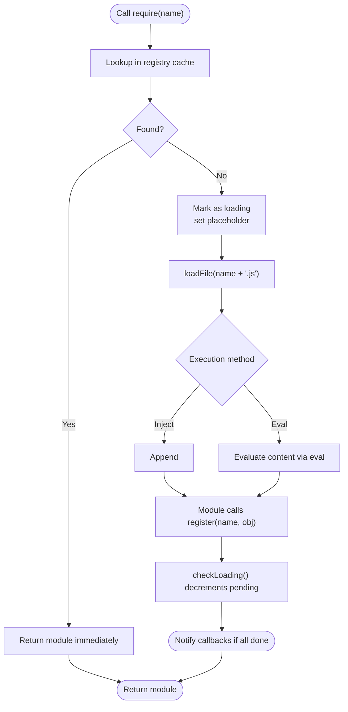
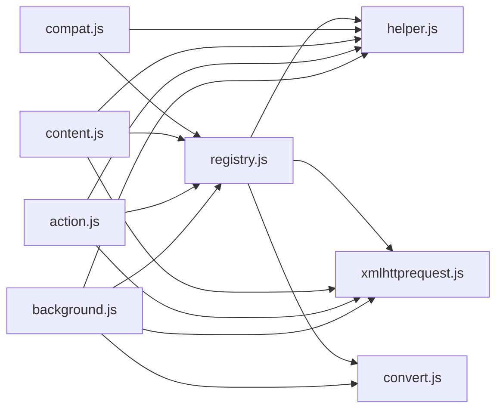

# Registry System

<cite>
**Referenced Files in This Document**
- [registry.js](file://src/registry.js)
- [background.js](file://src/background.js)
- [action.js](file://src/action.js)
- [content.js](file://src/content.js)
- [compat.js](file://src/compat.js)
- [helper.js](file://src/helper.js)
- [xmlhttprequest.js](file://src/xmlhttprequest.js)
- [convert.js](file://src/convert.js)
- [README.md](file://README.md)
</cite>

## Table of Contents
1. [Introduction](#introduction)
2. [Project Structure](#project-structure)
3. [Core Components](#core-components)
4. [Architecture Overview](#architecture-overview)
5. [Detailed Component Analysis](#detailed-component-analysis)
6. [Dependency Analysis](#dependency-analysis)
7. [Performance Considerations](#performance-considerations)
8. [Troubleshooting Guide](#troubleshooting-guide)
9. [Conclusion](#conclusion)
10. [Appendices](#appendices)

## Introduction
This document explains Tampermonkey’s registry system that enables dynamic module loading and dependency management via a require() mechanism. It covers how modules are registered, resolved, lazily loaded, cached, and integrated with the build and distribution pipeline. It also documents the registry initialization process, dependency graph construction, circular dependency handling, performance characteristics, memory management, and debugging techniques.

## Project Structure
The registry system is implemented in a single module and consumed across multiple entry points and feature modules:
- Registry core: [registry.js](file://src/registry.js)
- Consumers of the registry:
  - Background service: [background.js](file://src/background.js)
  - Action UI: [action.js](file://src/action.js)
  - Content script host: [content.js](file://src/content.js)
  - Compatibility helpers: [compat.js](file://src/compat.js)
  - Utility helpers: [helper.js](file://src/helper.js)
  - Network helper: [xmlhttprequest.js](file://src/xmlhttprequest.js)
  - Encoding helpers: [convert.js](file://src/convert.js)
- Build and distribution context: [README.md](file://README.md)

**Diagram sources**
- [registry.js](file://src/registry.js)
- [background.js](file://src/background.js)
- [action.js](file://src/action.js)
- [content.js](file://src/content.js)
- [compat.js](file://src/compat.js)
- [helper.js](file://src/helper.js)
- [xmlhttprequest.js](file://src/xmlhttprequest.js)
- [convert.js](file://src/convert.js)

**Section sources**
- [README.md](file://README.md)

## Core Components
- Registry object: central module registry with APIs for registration, retrieval, raw content access, and dynamic script loading.
- Require mechanism: deferred loading of modules by name, with safeguards against repeated loads and loops.
- Module registration: consumers register objects under stable names for later retrieval.
- Lazy loading: modules are fetched and executed only when required.
- Callback-driven readiness: consumers can attach handlers to be notified when modules finish loading.

Key responsibilities and behaviors:
- Registration and overwriting control
- Raw content fetching from extension resources
- Dynamic script injection or eval-based execution
- Loading state tracking and completion callbacks
- Safe retrieval with diagnostic logging

**Section sources**
- [registry.js](file://src/registry.js)

## Architecture Overview
The registry acts as a façade for module lifecycle management. Consumers declare dependencies early, and the registry ensures modules are loaded and registered before retrieval.

**Diagram sources**
- [registry.js](file://src/registry.js)
- [background.js](file://src/background.js)
- [xmlhttprequest.js](file://src/xmlhttprequest.js)

## Detailed Component Analysis

### Registry Core
The registry maintains:
- A module cache keyed by module name
- A raw resource cache for direct file reads
- A callback stack for load completion
- A counter for pending loads
- Debug flags for verbose logging

Behavior highlights:
- require(name): If missing, marks as loading, schedules fetch, and prevents redundant fetches during load.
- register(name, obj, overwrite): Stores module object; triggers load completion checks.
- registerRaw(name, obj, overwrite): Stores raw content for later use.
- get(name): Retrieves module; logs an error if not found.
- getRaw(file): Fetches raw content from extension URLs or cache.
- loadFile(file, evalFn?): Injects script or evaluates content depending on environment.
- onLoad(): Executes next callback if all pending loads complete.
- checkLoading(): Iterates registry to detect completion.

Circular dependency handling:
- When a module requires another, the registry sets a placeholder to prevent infinite recursion during load.

Initialization:
- The registry initializes asynchronously after startup.

**Section sources**
- [registry.js](file://src/registry.js)

### Consumers and Dependency Declaration
- Background service declares multiple dependencies early to bootstrap functionality.
- Action UI and content script host declare minimal sets to reduce initial overhead.
- Compatibility layer depends on helper utilities.

Examples of dependency declarations:
- Background: [background.js](file://src/background.js)
- Action: [action.js](file://src/action.js)
- Content: [content.js](file://src/content.js)
- Compat: [compat.js](file://src/compat.js)

Retrieval pattern:
- After requiring, consumers call get(name) to obtain module objects.

**Section sources**
- [background.js](file://src/background.js)
- [action.js](file://src/action.js)
- [content.js](file://src/content.js)
- [compat.js](file://src/compat.js)

### Module Registration Examples
- Helper utilities: [helper.js](file://src/helper.js)
- XML HTTP request wrapper: [xmlhttprequest.js](file://src/xmlhttprequest.js)
- Encoding utilities: [convert.js](file://src/convert.js)

Registration pattern:
- Modules call Registry.register('name', object) inside an IIFE to publish APIs.

**Section sources**
- [helper.js](file://src/helper.js)
- [xmlhttprequest.js](file://src/xmlhttprequest.js)
- [convert.js](file://src/convert.js)

### Lazy Loading Flow

**Diagram sources**
- [registry.js](file://src/registry.js)
- [xmlhttprequest.js](file://src/xmlhttprequest.js)

### Dependency Graph Construction
- Each consumer module declares its dependencies near the top of its file.
- The registry does not maintain a centralized dependency graph; instead, it relies on explicit require() calls and module registration order.
- Typical pattern:
  - Require phase: collect all dependencies for the current context.
  - Registration phase: modules publish themselves.
  - Retrieval phase: consumers fetch modules via get(name).

Implications:
- No automatic topological sorting; developers must ensure correct load order.
- Circular dependencies are mitigated by placeholder guards during require().

**Section sources**
- [background.js](file://src/background.js)
- [action.js](file://src/action.js)
- [content.js](file://src/content.js)
- [compat.js](file://src/compat.js)

### Integration with Build and Distribution
- The repository includes build-related assets and instructions for packaging the extension.
- The registry system operates on extension resources identified by names and URLs, aligning with packaged assets.

Build context:
- Packaging and distribution instructions are documented in the repository’s README.

**Section sources**
- [README.md](file://README.md)

## Dependency Analysis
- Coupling:
  - Consumers depend on the registry API surface.
  - Modules depend on each other through require() calls.
- Cohesion:
  - Each module encapsulates a focused responsibility (helpers, networking, encoding).
- External dependencies:
  - Uses extension APIs for resource access and script injection.
- Potential cycles:
  - The registry prevents cycles via placeholders; still, developers should avoid cycles in require() chains.

**Diagram sources**
- [registry.js](file://src/registry.js)
- [background.js](file://src/background.js)
- [action.js](file://src/action.js)
- [content.js](file://src/content.js)
- [compat.js](file://src/compat.js)
- [helper.js](file://src/helper.js)
- [xmlhttprequest.js](file://src/xmlhttprequest.js)
- [convert.js](file://src/convert.js)

**Section sources**
- [registry.js](file://src/registry.js)
- [background.js](file://src/background.js)
- [action.js](file://src/action.js)
- [content.js](file://src/content.js)
- [compat.js](file://src/compat.js)
- [helper.js](file://src/helper.js)
- [xmlhttprequest.js](file://src/xmlhttprequest.js)
- [convert.js](file://src/convert.js)

## Performance Considerations
- Module caching:
  - Registry caches resolved modules and raw resources to avoid repeated fetches.
- Lazy loading:
  - Modules are loaded only when required, reducing initial boot cost.
- Synchronous raw fetches:
  - Raw content retrieval uses synchronous XHR, which blocks the calling thread. Prefer asynchronous patterns where feasible.
- Script injection vs eval:
  - Injecting scripts via DOM avoids eval in modern environments; eval is used as a fallback. Injection is generally preferred for CSP compatibility.
- Load completion:
  - Completion callbacks are queued and executed when all pending loads finish.

Recommendations:
- Minimize deep require chains in hot paths.
- Avoid synchronous raw fetches in UI threads.
- Prefer injecting scripts over eval for better isolation and CSP alignment.

**Section sources**
- [registry.js](file://src/registry.js)

## Troubleshooting Guide
Common issues and diagnostics:
- Module not found:
  - Symptom: get(name) logs an error indicating the module was not required or found.
  - Action: Ensure require(name) is called before get(name) and that the module registers itself under the same name.
- Missing file:
  - Symptom: require(name) logs a need for name.js and sets a placeholder.
  - Action: Verify the module exists in the extension package and the filename matches require().
- Circular dependency:
  - Symptom: require() returns immediately without loading due to a placeholder.
  - Action: Restructure dependencies to eliminate cycles; rely on placeholder guards rather than deep mutual reliance.
- Synchronous raw fetch stalls:
  - Symptom: UI freezes during getRaw().
  - Action: Refactor to asynchronous loading or pre-warm caches.
- Load completion not firing:
  - Symptom: addLoadHandler callbacks never execute.
  - Action: Ensure all required modules eventually register; check for missing register() calls or runtime errors halting execution.

Debugging aids:
- Verbose logging flags (e.g., V, RV) are used throughout the registry and consumers to trace require/get/loadFile operations.

**Section sources**
- [registry.js](file://src/registry.js)
- [background.js](file://src/background.js)
- [action.js](file://src/action.js)
- [content.js](file://src/content.js)
- [compat.js](file://src/compat.js)

## Conclusion
Tampermonkey’s registry system provides a lightweight, flexible mechanism for dynamic module loading and dependency management. By combining explicit require() declarations, module registration, and lazy loading, it supports modularization across background, UI, and content contexts. While the registry does not enforce a centralized dependency graph, it offers safeguards against circular dependencies and provides hooks for completion handling. Proper use of the registry—favoring lazy loading, avoiding synchronous stalls, and ensuring correct registration—leads to robust and maintainable module composition.

## Appendices

### API Surface Summary
- require(name): Request a module by name; triggers lazy load if absent.
- register(name, obj, overwrite?): Publish a module object.
- registerRaw(name, obj, overwrite?): Store raw content for later use.
- get(name): Retrieve a previously registered module.
- getRaw(file): Fetch raw content from extension resources.
- loadFile(file, eval?): Inject or evaluate a module script.
- addLoadHandler(cb): Register a callback invoked when all pending loads complete.
- onLoad(), checkLoading(): Internal orchestration for load completion.

**Section sources**
- [registry.js](file://src/registry.js)