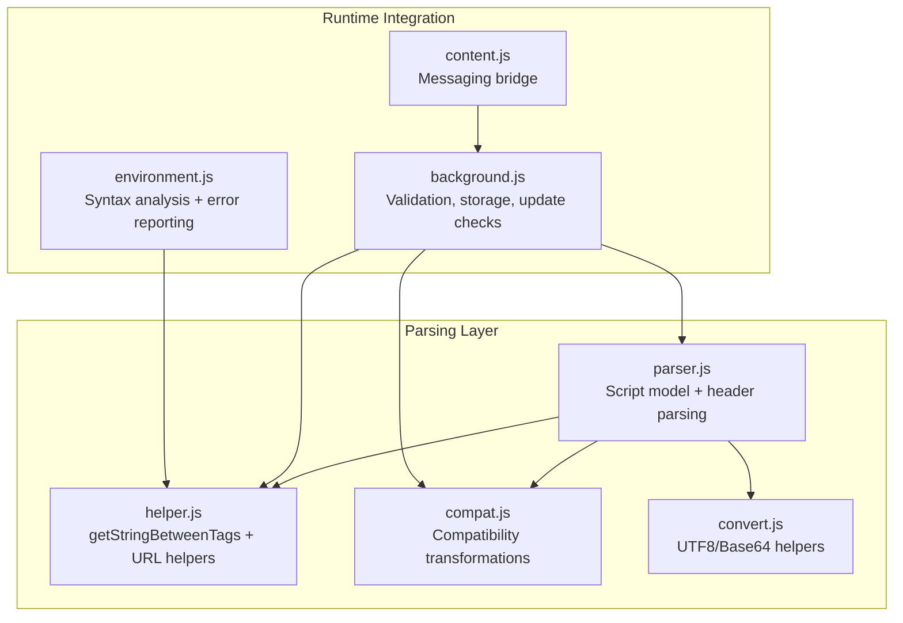
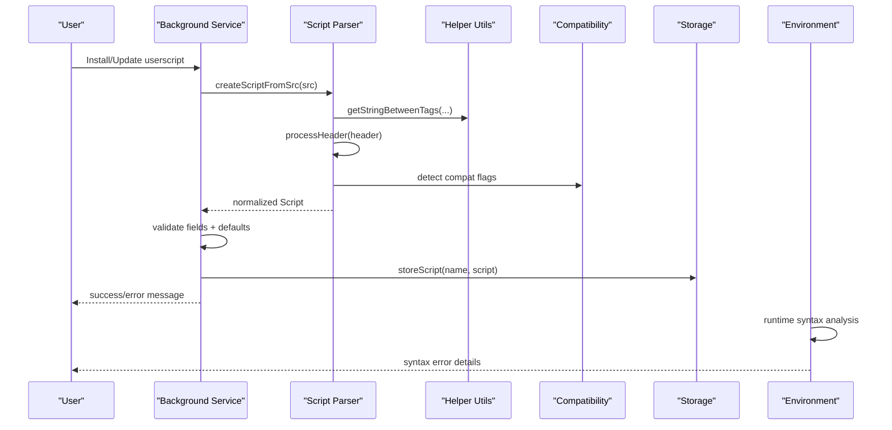
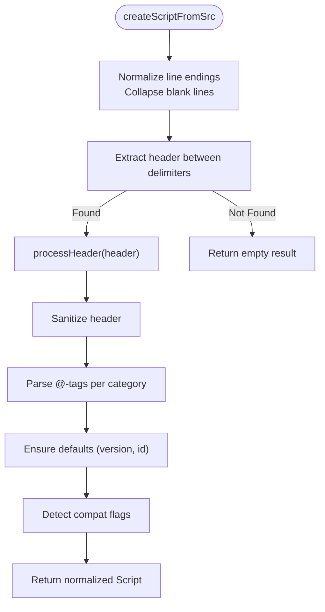
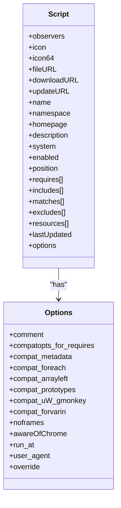
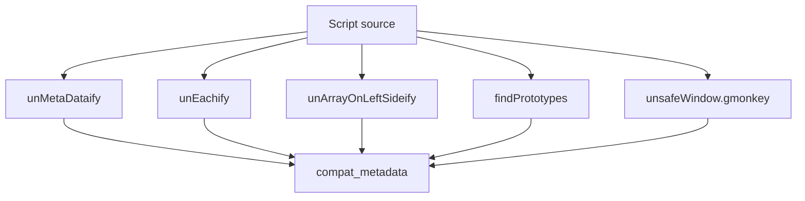
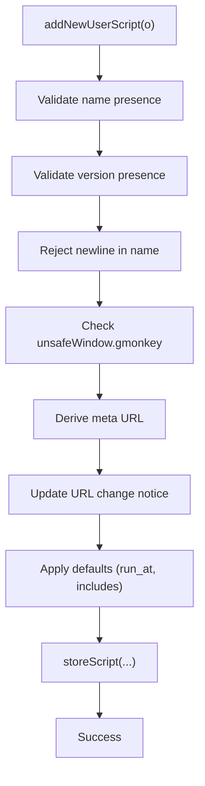
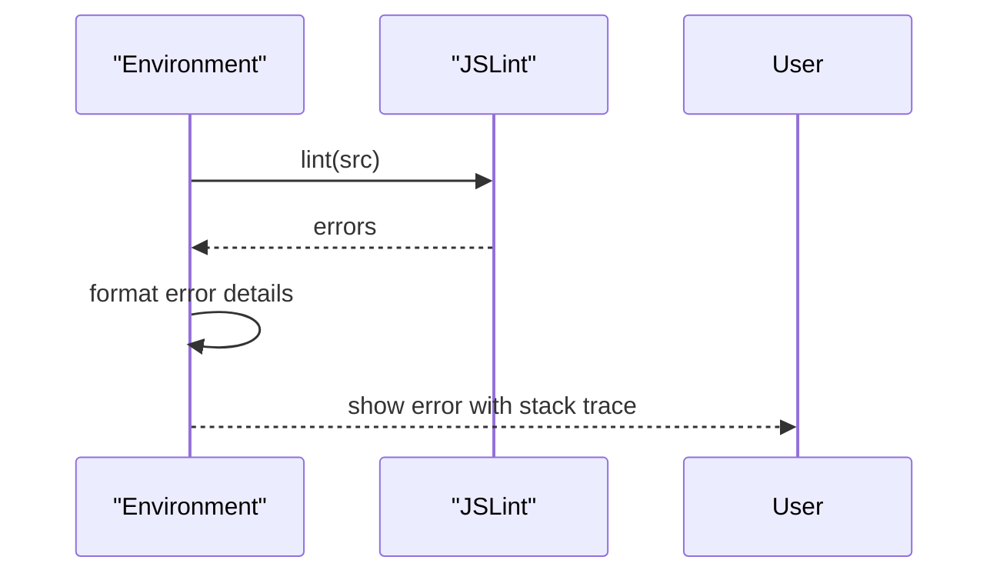
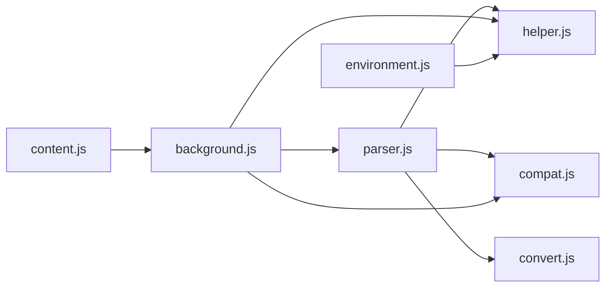

# Script Parser

<cite>
**Referenced Files in This Document**
- [parser.js](file://src/parser.js)
- [helper.js](file://src/helper.js)
- [compat.js](file://src/compat.js)
- [background.js](file://src/background.js)
- [environment.js](file://src/environment.js)
- [convert.js](file://src/convert.js)
- [content.js](file://src/content.js)
- [README.md](file://README.md)
</cite>

## Table of Contents
1. [Introduction](#introduction)
2. [Project Structure](#project-structure)
3. [Core Components](#core-components)
4. [Architecture Overview](#architecture-overview)
5. [Detailed Component Analysis](#detailed-component-analysis)
6. [Dependency Analysis](#dependency-analysis)
7. [Performance Considerations](#performance-considerations)
8. [Troubleshooting Guide](#troubleshooting-guide)
9. [Conclusion](#conclusion)

## Introduction
This document describes Tampermonkey’s userscript parser responsible for extracting metadata from userscript headers, validating scripts against userscript standards, and preparing scripts for execution. It explains the metadata parsing algorithms, userscript format compliance, validation rules, compilation and syntax analysis, error reporting, compatibility with standards such as Greasemonkey and Violentmonkey, and performance/memory optimization techniques.

## Project Structure
The parser lives in a dedicated module and integrates with helper utilities, compatibility shims, and the background/runtime environments. The key files are:
- Parser: extracts and normalizes metadata, detects compatibility flags, and builds a normalized script object
- Helper: provides string parsing utilities used by the parser
- Compatibility: transforms legacy userscript constructs into modern equivalents
- Background: orchestrates script installation, validation, and update checks
- Environment: performs syntax analysis and error reporting during runtime
- Convert: encoding/decoding helpers used across the system
- Content: messaging and environment bridging for page-level script execution

**Diagram sources**
- [parser.js:72-282](file://src/parser.js#L72-L282)
- [helper.js:29-43](file://src/helper.js#L29-L43)
- [compat.js:13-271](file://src/compat.js#L13-L271)
- [background.js:2924-3164](file://src/background.js#L2924-L3164)
- [environment.js:160-193](file://src/environment.js#L160-L193)
- [content.js:108-215](file://src/content.js#L108-L215)

**Section sources**
- [README.md:12-17](file://README.md#L12-L17)
- [parser.js:72-282](file://src/parser.js#L72-L282)

## Core Components
- Script model: encapsulates metadata, options, and lists of includes/matches/excludes/requires/resources
- Header extraction: locates the metadata block and parses @-prefixed tags
- Compatibility detection: identifies legacy constructs and sets flags for runtime transformations
- Validation pipeline: ensures required fields, applies defaults, and reports errors
- Runtime syntax analysis: validates script syntax and surfaces errors with context

**Section sources**
- [parser.js:29-67](file://src/parser.js#L29-L67)
- [parser.js:95-222](file://src/parser.js#L95-L222)
- [parser.js:251-281](file://src/parser.js#L251-L281)
- [background.js:2924-3164](file://src/background.js#L2924-L3164)
- [environment.js:160-193](file://src/environment.js#L160-L193)

## Architecture Overview
The parser is invoked by the background service when adding or updating a userscript. It extracts the header, normalizes metadata, and sets compatibility flags. The background then validates the script, stores it, and may trigger updates. During runtime, the environment performs syntax analysis and error reporting.

**Diagram sources**
- [parser.js:251-281](file://src/parser.js#L251-L281)
- [helper.js:29-43](file://src/helper.js#L29-L43)
- [compat.js:13-271](file://src/compat.js#L13-L271)
- [background.js:2924-3164](file://src/background.js#L2924-L3164)
- [environment.js:160-193](file://src/environment.js#L160-L193)

## Detailed Component Analysis

### Metadata Extraction and Normalization
- Header detection: finds the delimited metadata block and guards against HTML-like contexts
- Tag parsing: extracts @-tags for name, namespace, version, author, copyright, description, icon/icon64/homepage, include/match/exclude, require/resource, run-at/user-agent/noframes/nocompat/updateURL/downloadURL
- Security sanitization: removes quotes, normalizes whitespace, collapses comments
- Defaults: ensures version presence and computes script id

**Diagram sources**
- [parser.js:251-281](file://src/parser.js#L251-L281)
- [parser.js:95-222](file://src/parser.js#L95-L222)

**Section sources**
- [parser.js:69-70](file://src/parser.js#L69-L70)
- [parser.js:229-249](file://src/parser.js#L229-L249)
- [parser.js:95-222](file://src/parser.js#L95-L222)
- [parser.js:251-281](file://src/parser.js#L251-L281)

### Script Model and Options
The Script constructor defines fields for metadata, lists, and options. Options include compatibility flags, run timing, user agent, and override settings for include/match/exclude merging behavior.

**Diagram sources**
- [parser.js:29-67](file://src/parser.js#L29-L67)

**Section sources**
- [parser.js:29-67](file://src/parser.js#L29-L67)

### Compatibility Detection and Transformations
The parser detects legacy constructs and sets compatibility flags:
- Metadata CDATA blocks
- for each loops
- Array destructuring on left-hand side
- Prototype usage
- unsafeWindow.gmonkey usage

These flags drive runtime compatibility transformations.

**Diagram sources**
- [parser.js:265-278](file://src/parser.js#L265-L278)
- [compat.js:13-271](file://src/compat.js#L13-L271)

**Section sources**
- [parser.js:265-278](file://src/parser.js#L265-L278)
- [compat.js:13-271](file://src/compat.js#L13-L271)

### Validation Rules and Error Reporting
The background service validates scripts upon installation/update:
- Required fields: name and version must be present
- Name constraints: disallow newline characters
- URL handling: derive meta URL from file/update/download URLs
- Update URL change notifications
- Default run-at selection when missing
- Fallback include list when none provided
- Compatibility checks: reject scripts using unsafeWindow.gmonkey APIs

Errors are surfaced to the user via messages and logs.

**Diagram sources**
- [background.js:2924-3164](file://src/background.js#L2924-L3164)
- [background.js:2819-2875](file://src/background.js#L2819-L2875)

**Section sources**
- [background.js:2924-3164](file://src/background.js#L2924-L3164)
- [background.js:2819-2875](file://src/background.js#L2819-L2875)

### Syntax Analysis and Runtime Error Reporting
During runtime, the environment performs syntax analysis and reports errors with contextual details. Errors are logged with stack traces and, in debug mode, the failing source can be copied to the clipboard for inspection.

**Diagram sources**
- [environment.js:160-193](file://src/environment.js#L160-L193)

**Section sources**
- [environment.js:160-193](file://src/environment.js#L160-L193)

### Userscript Standards Compliance
- Greasemonkey-style tags: name, namespace, version, author, copyright, description, icon/icon64, homepage, include, match, exclude, require, resource, run-at, user-agent, noframes, nocompat, updateURL, downloadURL
- Additional internal tags: Uso-related metadata
- URL normalization and pattern matching helpers support @match semantics

**Section sources**
- [parser.js:98-222](file://src/parser.js#L98-L222)
- [helper.js:56-80](file://src/helper.js#L56-L80)

### Integration with Userscript Standards (Greasemonkey, Violentmonkey)
- Supports a broad set of @-tags commonly used by Greasemonkey and Violentmonkey
- Provides compatibility flags and transformations to bridge differences
- Runtime environment exposes unsafeWindow access and GM_* functions

**Section sources**
- [README.md:12-17](file://README.md#L12-L17)
- [compat.js:13-271](file://src/compat.js#L13-L271)

## Dependency Analysis
The parser depends on helper utilities for string parsing and on compatibility utilities for legacy construct detection. The background service coordinates parsing, validation, and storage. The environment performs runtime syntax analysis.

**Diagram sources**
- [parser.js:72-282](file://src/parser.js#L72-L282)
- [helper.js:29-43](file://src/helper.js#L29-L43)
- [compat.js:13-271](file://src/compat.js#L13-L271)
- [background.js:2924-3164](file://src/background.js#L2924-L3164)
- [environment.js:160-193](file://src/environment.js#L160-L193)
- [content.js:108-215](file://src/content.js#L108-L215)

**Section sources**
- [parser.js:72-282](file://src/parser.js#L72-L282)
- [background.js:2924-3164](file://src/background.js#L2924-L3164)

## Performance Considerations
- Header parsing: linear scan over header lines; minimal regex usage
- String operations: replace/collapse operations are bounded by header size
- Memory efficiency: avoids retaining large intermediate buffers; cleans up caches periodically
- Compatibility detection: lightweight scans for specific patterns
- Require caching: LRU-like cache with periodic cleanup to reduce network overhead

Practical tips:
- Keep metadata blocks concise
- Avoid excessive comments inside metadata
- Prefer explicit include/match patterns to reduce fallback logic
- Monitor cache size and tune cleanup intervals

**Section sources**
- [parser.js:251-281](file://src/parser.js#L251-L281)
- [background.js:398-431](file://src/background.js#L398-L431)

## Troubleshooting Guide
Common issues and resolutions:
- Invalid name: ensure the name field does not contain newline characters
- Missing metadata: ensure the header delimiter block is present and not embedded in HTML
- Update URL changes: the background service will notify about changes; scripts may need manual approval depending on policy
- unsafeWindow.gmonkey usage: scripts using unsafeWindow.gmonkey are rejected by the background service
- Syntax errors: the environment logs detailed error messages with stack traces; enable debug logging for full context

Debugging techniques:
- Enable verbose logging flags to capture parser and runtime logs
- Inspect stored script objects to verify parsed metadata
- Use copy-to-clipboard functionality in debug mode to share failing sources

**Section sources**
- [background.js:2924-3164](file://src/background.js#L2924-L3164)
- [environment.js:160-193](file://src/environment.js#L160-L193)

## Conclusion
Tampermonkey’s parser provides robust metadata extraction, strict validation, and compatibility detection tailored to userscript standards. It integrates tightly with the background service for installation/validation and with the environment for runtime syntax analysis. By following the documented patterns and using the troubleshooting techniques, developers can ensure reliable userscript processing and efficient operation.