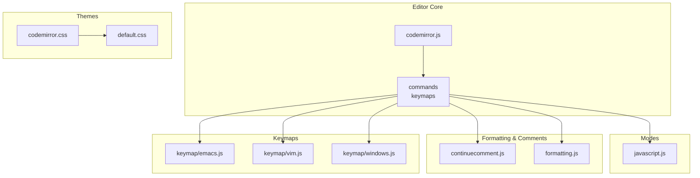
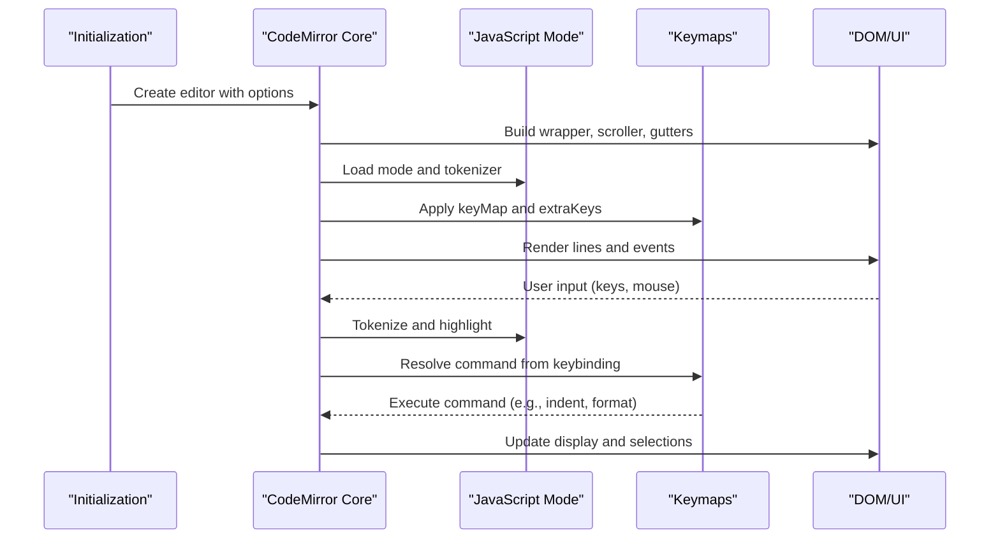
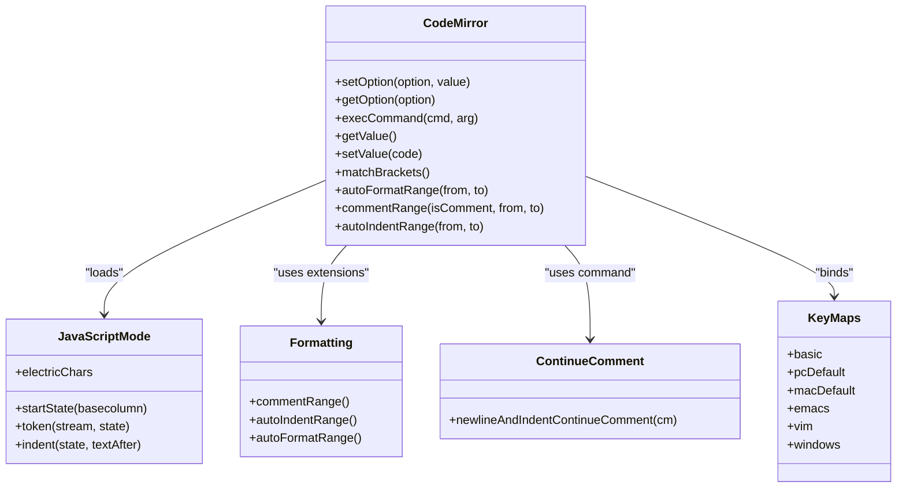
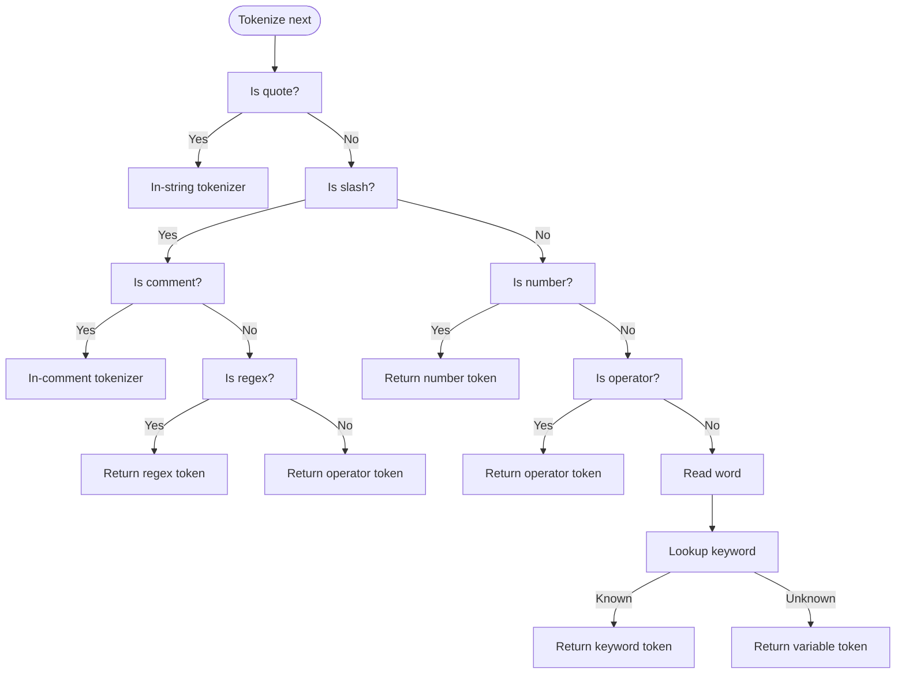
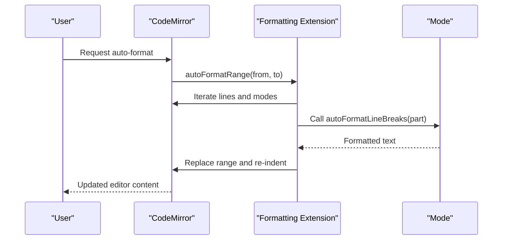
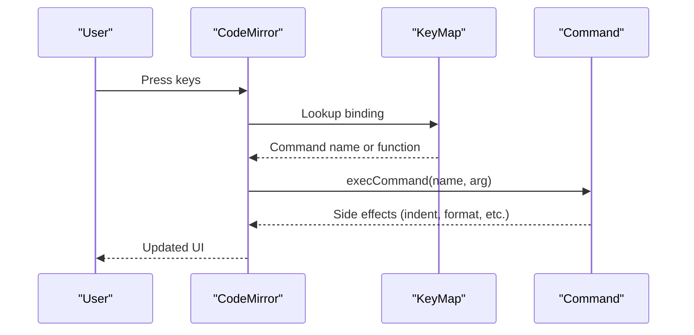
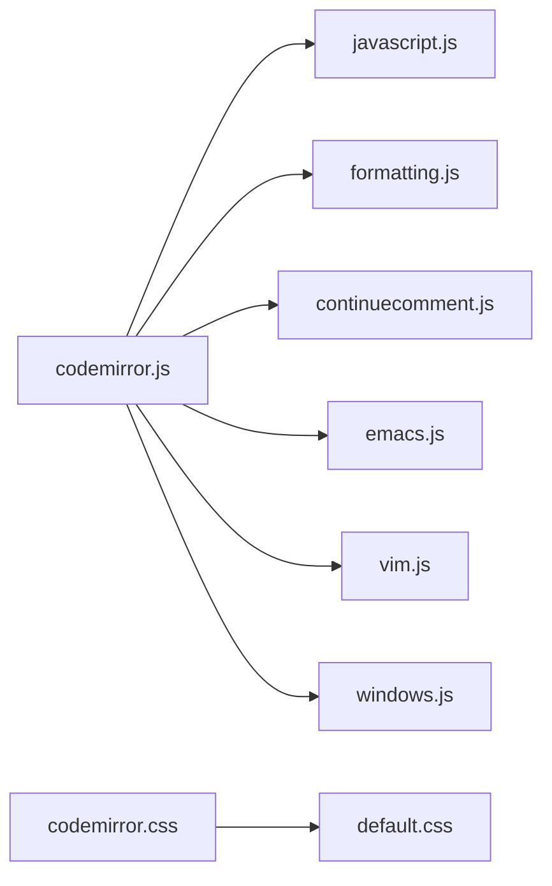

# Code Editor

<cite>
**Referenced Files in This Document**
- [codemirror.js](file://src/cm/codemirror.js)
- [javascript.js](file://src/cm/javascript.js)
- [continuecomment.js](file://src/cm/continuecomment.js)
- [formatting.js](file://src/cm/formatting.js)
- [codemirror.css](file://src/cm/codemirror.css)
- [default.css](file://src/cm/default.css)
- [emacs.js](file://src/cm/keymap/emacs.js)
- [vim.js](file://src/cm/keymap/vim.js)
- [windows.js](file://src/cm/keymap/windows.js)
</cite>

## Table of Contents
1. [Introduction](#introduction)
2. [Project Structure](#project-structure)
3. [Core Components](#core-components)
4. [Architecture Overview](#architecture-overview)
5. [Detailed Component Analysis](#detailed-component-analysis)
6. [Dependency Analysis](#dependency-analysis)
7. [Performance Considerations](#performance-considerations)
8. [Troubleshooting Guide](#troubleshooting-guide)
9. [Conclusion](#conclusion)

## Introduction
This document describes the integrated code editor in Tampermonkey, which is built on a customized version of CodeMirror 2.36. It covers the editor’s core functionality, including syntax highlighting for JavaScript userscripts, line numbering, bracket matching, and code formatting capabilities. It also explains editor modes, keyboard shortcuts, customization options, and JavaScript-specific features such as automatic indentation, comment continuation, and formatting helpers. Practical examples demonstrate configuration, theme customization, and integration with the userscript development workflow. Finally, it outlines performance optimization techniques and best practices for editing large userscript files.

## Project Structure
The editor is composed of:
- The CodeMirror core (editor engine, DOM, events, commands)
- Mode definitions (syntax highlighting and indentation logic)
- Keymap modules (keyboard bindings for different editing styles)
- Formatting and comment utilities
- CSS themes and default styles

**Diagram sources**
- [codemirror.js:2002-2199](file://src/cm/codemirror.js#L2002-L2199)
- [javascript.js:1-412](file://src/cm/javascript.js#L1-L412)
- [continuecomment.js:1-37](file://src/cm/continuecomment.js#L1-L37)
- [formatting.js:1-197](file://src/cm/formatting.js#L1-L197)
- [codemirror.css:1-171](file://src/cm/codemirror.css#L1-L171)
- [default.css:1-19](file://src/cm/default.css#L1-L19)
- [emacs.js:1-31](file://src/cm/keymap/emacs.js#L1-L31)
- [vim.js:1-909](file://src/cm/keymap/vim.js#L1-L909)
- [windows.js:1-12](file://src/cm/keymap/windows.js#L1-L12)

**Section sources**
- [codemirror.js:2002-2199](file://src/cm/codemirror.js#L2002-L2199)
- [javascript.js:1-412](file://src/cm/javascript.js#L1-L412)
- [continuecomment.js:1-37](file://src/cm/continuecomment.js#L1-L37)
- [formatting.js:1-197](file://src/cm/formatting.js#L1-L197)
- [codemirror.css:1-171](file://src/cm/codemirror.css#L1-L171)
- [default.css:1-19](file://src/cm/default.css#L1-L19)
- [emacs.js:1-31](file://src/cm/keymap/emacs.js#L1-L31)
- [vim.js:1-909](file://src/cm/keymap/vim.js#L1-L909)
- [windows.js:1-12](file://src/cm/keymap/windows.js#L1-L12)

## Core Components
- Editor core: initialization, DOM structure, event handling, display updates, and option management
- Modes: JavaScript mode with keyword/tokenization, indentation rules, and electric characters
- Formatting utilities: automatic line breaking, comment toggling, and smart indentation
- Comment continuation: block comment continuation behavior across languages
- Themes: default theme and CSS rules for syntax highlighting and UI
- Keymaps: platform defaults, Emacs-style, Vim-style, and Windows-style bindings

Key responsibilities:
- Syntax highlighting and token classification for JavaScript userscripts
- Smart indentation and bracket matching
- Keyboard-driven editing via configurable keymaps
- Formatting helpers for comments and code blocks
- Theme customization and UI styling

**Section sources**
- [codemirror.js:12-384](file://src/cm/codemirror.js#L12-L384)
- [javascript.js:359-406](file://src/cm/javascript.js#L359-L406)
- [formatting.js:132-196](file://src/cm/formatting.js#L132-L196)
- [continuecomment.js:1-37](file://src/cm/continuecomment.js#L1-L37)
- [codemirror.css:127-162](file://src/cm/codemirror.css#L127-L162)
- [default.css:1-19](file://src/cm/default.css#L1-L19)

## Architecture Overview
The editor is initialized with a set of default options and creates a DOM hierarchy that includes a scroller, optional gutters, line content, and a hidden textarea for input. Modes define tokenization and indentation behavior, while keymaps bind keystrokes to commands. Formatting utilities extend modes with formatting and comment helpers.

**Diagram sources**
- [codemirror.js:12-121](file://src/cm/codemirror.js#L12-L121)
- [javascript.js:359-406](file://src/cm/javascript.js#L359-L406)
- [vim.js:304-404](file://src/cm/keymap/vim.js#L304-L404)
- [emacs.js:12-24](file://src/cm/keymap/emacs.js#L12-L24)

## Detailed Component Analysis

### Editor Core and Options
The core defines default options such as theme, indentation unit, tab size, keymap, wrapping, line numbers, bracket matching, and cursor blink rate. It exposes APIs to set/get options, manage history, and trigger commands.

Highlights:
- Option management: setOption/getOption/update display and gutters accordingly
- Commands: selectAll, indentMore/indentLess, newlineAndIndent, undo/redo, etc.
- Keymaps: basic, pc/mac defaults, and extended maps (Emacs, Vim, Windows)
- Event wiring: input, keydown/press/up, mouse, scroll, focus/blur

Practical configuration examples (paths):
- Enable line numbers and wrapping: [codemirror.js:162-179](file://src/cm/codemirror.js#L162-L179)
- Toggle bracket matching: [codemirror.js:162-179](file://src/cm/codemirror.js#L162-L179)
- Change theme: [codemirror.js:162-179](file://src/cm/codemirror.js#L162-L179)

**Section sources**
- [codemirror.js:2002-2039](file://src/cm/codemirror.js#L2002-L2039)
- [codemirror.js:2106-2158](file://src/cm/codemirror.js#L2106-L2158)
- [codemirror.js:2160-2199](file://src/cm/codemirror.js#L2160-L2199)

### JavaScript Mode and Syntax Highlighting
The JavaScript mode tokenizes keywords, operators, strings, comments, regular expressions, and atoms. It provides indentation rules and declares electric characters for smart indentation.

Features:
- Tokenization: strings, comments, regex, operators, keywords
- Indentation: based on lexical state and indentUnit
- Electric characters: braces and colons to trigger smart indent
- MIME types: JavaScript, JSON, TypeScript variants

Practical examples (paths):
- Define mode and MIME: [javascript.js:408-412](file://src/cm/javascript.js#L408-L412)
- Indentation rules: [javascript.js:385-400](file://src/cm/javascript.js#L385-L400)

**Section sources**
- [javascript.js:1-127](file://src/cm/javascript.js#L1-L127)
- [javascript.js:149-320](file://src/cm/javascript.js#L149-L320)
- [javascript.js:359-406](file://src/cm/javascript.js#L359-L406)

### Formatting Utilities
The formatting module extends modes with:
- Comment toggling across ranges
- Smart indentation across ranges
- Automatic formatting with mode-aware line breaking

It enumerates inner modes per line to apply correct formatting rules.

Practical examples (paths):
- Auto-format range: [formatting.js:168-195](file://src/cm/formatting.js#L168-L195)
- Auto-indent range: [formatting.js:158-166](file://src/cm/formatting.js#L158-L166)
- Comment range toggle: [formatting.js:132-156](file://src/cm/formatting.js#L132-L156)

**Section sources**
- [formatting.js:1-197](file://src/cm/formatting.js#L1-L197)

### Comment Continuation
The continuecomment extension sets block comment markers for supported modes and provides a command to continue comments on new lines with proper alignment.

Practical examples (paths):
- Extend modes with block comment markers: [continuecomment.js:2-6](file://src/cm/continuecomment.js#L2-L6)
- Continue comment command: [continuecomment.js:8-35](file://src/cm/continuecomment.js#L8-L35)

**Section sources**
- [continuecomment.js:1-37](file://src/cm/continuecomment.js#L1-L37)

### Keymaps and Keyboard Shortcuts
Multiple keymaps are available:
- Basic/default: platform-appropriate bindings
- Emacs: extended bindings with a kill ring and Ctrl-X dispatcher
- Vim: modal editing with motions, operators, and insert mode
- Windows: Windows-style bindings

Practical examples (paths):
- Default keymap bindings: [codemirror.js:2160-2199](file://src/cm/codemirror.js#L2160-L2199)
- Emacs keymap: [emacs.js:12-24](file://src/cm/keymap/emacs.js#L12-L24)
- Vim keymap: [vim.js:304-404](file://src/cm/keymap/vim.js#L304-L404)
- Windows keymap: [windows.js:2-10](file://src/cm/keymap/windows.js#L2-L10)

**Section sources**
- [codemirror.js:2160-2199](file://src/cm/codemirror.js#L2160-L2199)
- [emacs.js:1-31](file://src/cm/keymap/emacs.js#L1-L31)
- [vim.js:1-909](file://src/cm/keymap/vim.js#L1-L909)
- [windows.js:1-12](file://src/cm/keymap/windows.js#L1-L12)

### Themes and Styles
The default theme defines color classes for syntax elements. The base CSS provides layout, scrollbars, cursors, and matching/non-matching brackets.

Practical examples (paths):
- Default theme color classes: [default.css:1-19](file://src/cm/default.css#L1-L19)
- Base editor styles and matching brackets: [codemirror.css:127-162](file://src/cm/codemirror.css#L127-L162)

**Section sources**
- [default.css:1-19](file://src/cm/default.css#L1-L19)
- [codemirror.css:1-171](file://src/cm/codemirror.css#L1-L171)

## Architecture Overview

**Diagram sources**
- [codemirror.js:162-384](file://src/cm/codemirror.js#L162-L384)
- [javascript.js:359-406](file://src/cm/javascript.js#L359-L406)
- [formatting.js:132-196](file://src/cm/formatting.js#L132-L196)
- [continuecomment.js:8-35](file://src/cm/continuecomment.js#L8-L35)
- [vim.js:304-404](file://src/cm/keymap/vim.js#L304-L404)
- [emacs.js:12-24](file://src/cm/keymap/emacs.js#L12-L24)
- [windows.js:2-10](file://src/cm/keymap/windows.js#L2-L10)

## Detailed Component Analysis

### JavaScript Mode Analysis
The JavaScript mode defines:
- Keyword sets (including TypeScript extensions)
- Tokenizers for strings, comments, regex, operators, numbers
- Parser combinators for statements and expressions
- Indentation logic and electric characters

**Diagram sources**
- [javascript.js:80-127](file://src/cm/javascript.js#L80-L127)
- [javascript.js:129-147](file://src/cm/javascript.js#L129-L147)
- [javascript.js:359-406](file://src/cm/javascript.js#L359-L406)

**Section sources**
- [javascript.js:1-412](file://src/cm/javascript.js#L1-L412)

### Formatting and Comment Continuation
Formatting utilities provide:
- Range-based comment toggling
- Smart indentation across lines
- Automatic formatting with mode-aware line breaks

Comment continuation ensures consistent alignment when inserting new lines inside block comments.

**Diagram sources**
- [formatting.js:168-195](file://src/cm/formatting.js#L168-L195)

**Section sources**
- [formatting.js:1-197](file://src/cm/formatting.js#L1-L197)
- [continuecomment.js:1-37](file://src/cm/continuecomment.js#L1-L37)

### Keymap Integration
Keymaps translate keystrokes into editor commands. The core resolves keymaps and falls back to basic/default maps when needed.

**Diagram sources**
- [codemirror.js:619-666](file://src/cm/codemirror.js#L619-L666)
- [codemirror.js:2160-2199](file://src/cm/codemirror.js#L2160-L2199)
- [vim.js:304-404](file://src/cm/keymap/vim.js#L304-L404)
- [emacs.js:12-24](file://src/cm/keymap/emacs.js#L12-L24)

**Section sources**
- [codemirror.js:619-666](file://src/cm/codemirror.js#L619-L666)
- [codemirror.js:2160-2199](file://src/cm/codemirror.js#L2160-L2199)
- [vim.js:1-909](file://src/cm/keymap/vim.js#L1-L909)
- [emacs.js:1-31](file://src/cm/keymap/emacs.js#L1-L31)
- [windows.js:1-12](file://src/cm/keymap/windows.js#L1-L12)

## Dependency Analysis
- Core depends on modes for tokenization and indentation
- Formatting and comment utilities depend on mode metadata
- Keymaps depend on core commands
- Themes depend on CSS selectors for syntax classes

**Diagram sources**
- [codemirror.js:2002-2199](file://src/cm/codemirror.js#L2002-L2199)
- [javascript.js:1-412](file://src/cm/javascript.js#L1-L412)
- [formatting.js:1-197](file://src/cm/formatting.js#L1-L197)
- [continuecomment.js:1-37](file://src/cm/continuecomment.js#L1-L37)
- [codemirror.css:1-171](file://src/cm/codemirror.css#L1-L171)
- [default.css:1-19](file://src/cm/default.css#L1-L19)
- [emacs.js:1-31](file://src/cm/keymap/emacs.js#L1-L31)
- [vim.js:1-909](file://src/cm/keymap/vim.js#L1-L909)
- [windows.js:1-12](file://src/cm/keymap/windows.js#L1-L12)

**Section sources**
- [codemirror.js:2002-2199](file://src/cm/codemirror.js#L2002-L2199)
- [javascript.js:1-412](file://src/cm/javascript.js#L1-L412)
- [formatting.js:1-197](file://src/cm/formatting.js#L1-L197)
- [continuecomment.js:1-37](file://src/cm/continuecomment.js#L1-L37)
- [codemirror.css:1-171](file://src/cm/codemirror.css#L1-L171)
- [default.css:1-19](file://src/cm/default.css#L1-L19)
- [emacs.js:1-31](file://src/cm/keymap/emacs.js#L1-L31)
- [vim.js:1-909](file://src/cm/keymap/vim.js#L1-L909)
- [windows.js:1-12](file://src/cm/keymap/windows.js#L1-L12)

## Performance Considerations
- Prefer smart indentation and formatting on visible ranges rather than entire documents for large files
- Use line wrapping judiciously; it increases DOM overhead
- Limit frequent theme changes; batch option updates when possible
- Avoid excessive polling by relying on core throttling and delayed updates
- For very large scripts, consider disabling non-essential features (e.g., real-time heavy syntax passes) during initial load

[No sources needed since this section provides general guidance]

## Troubleshooting Guide
Common issues and remedies:
- Brackets not matching: enable bracket matching via options and ensure the mode supports it
- Indentation not applied: verify smartIndent and indentUnit settings; confirm electricChars behavior
- Formatting not working: ensure the JavaScript mode is loaded and autoFormatLineBreaks is available for the selected range
- Comment continuation unexpected: check block comment markers and the continue comment command binding

**Section sources**
- [codemirror.js:2002-2039](file://src/cm/codemirror.js#L2002-L2039)
- [javascript.js:385-400](file://src/cm/javascript.js#L385-L400)
- [formatting.js:168-195](file://src/cm/formatting.js#L168-L195)
- [continuecomment.js:8-35](file://src/cm/continuecomment.js#L8-L35)

## Conclusion
Tampermonkey’s editor leverages a robust CodeMirror foundation with tailored JavaScript mode, formatting utilities, and flexible keymaps. By configuring options, choosing appropriate keymaps, and leveraging formatting and comment helpers, users can efficiently develop and maintain large userscript files. For optimal performance, tune display options and formatting operations to the size and complexity of the script being edited.