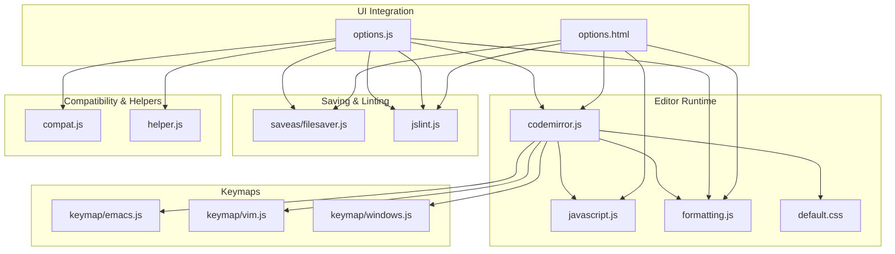
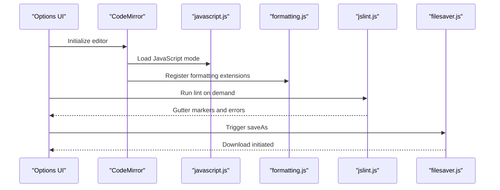
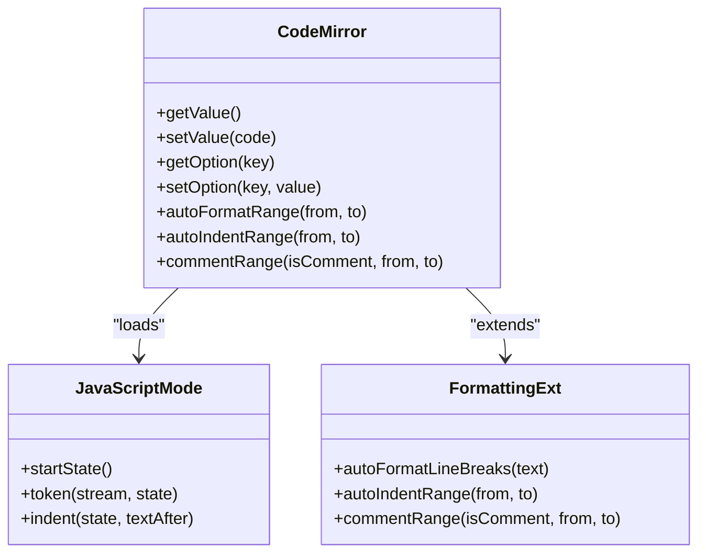
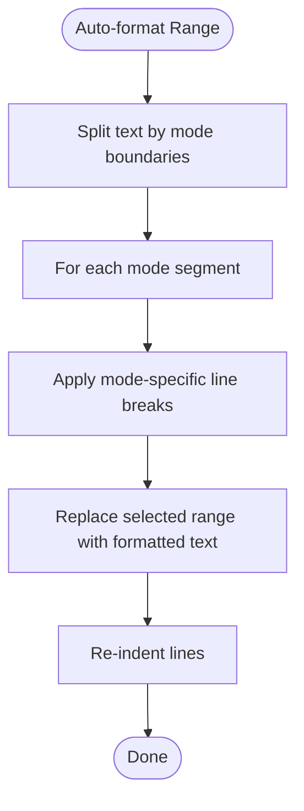
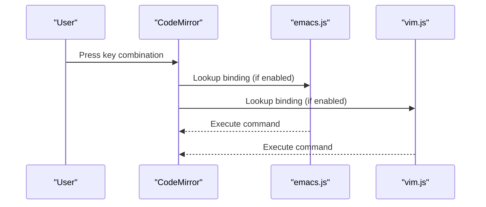
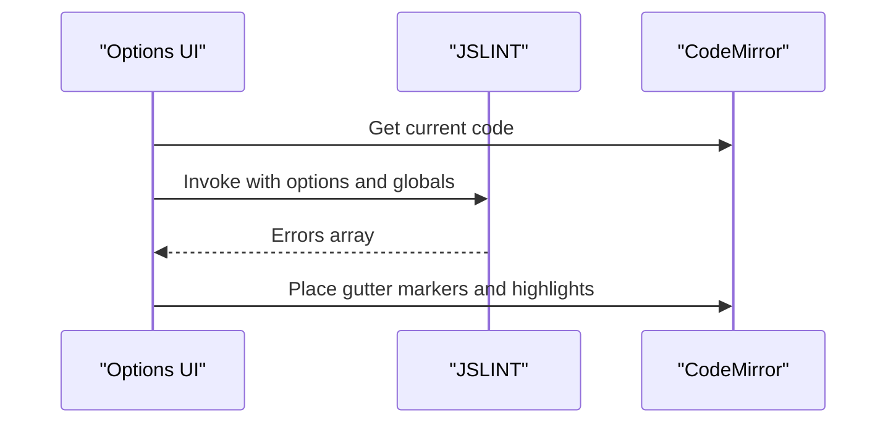
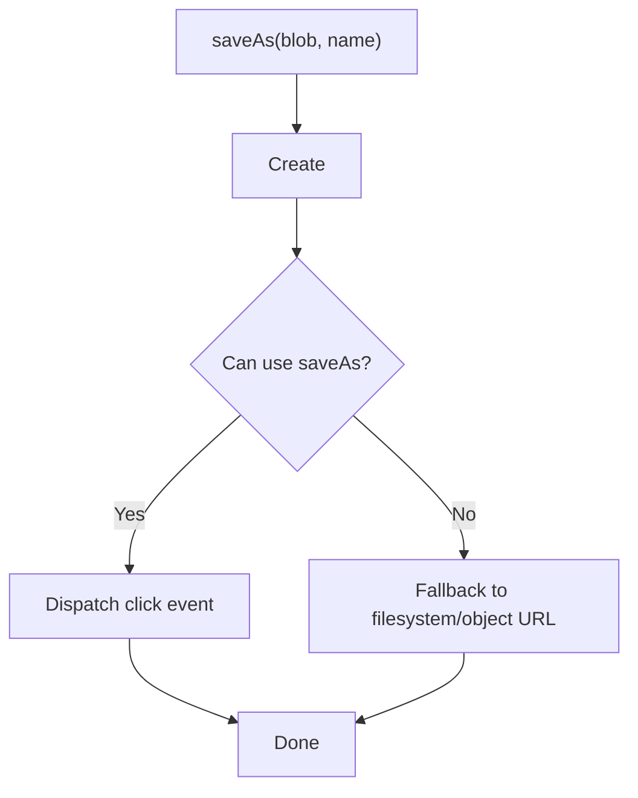
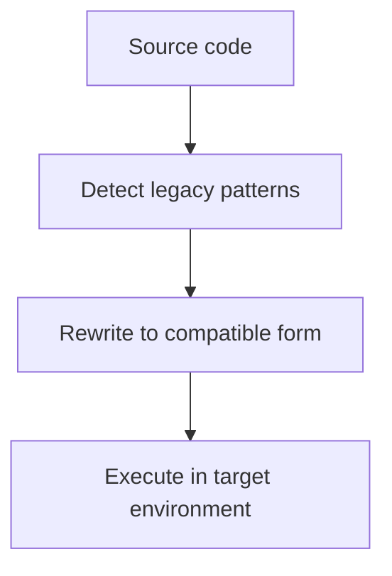
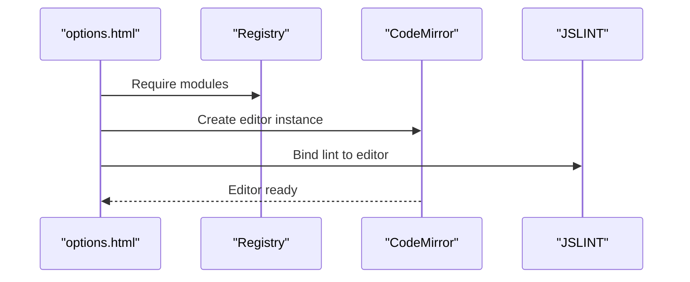
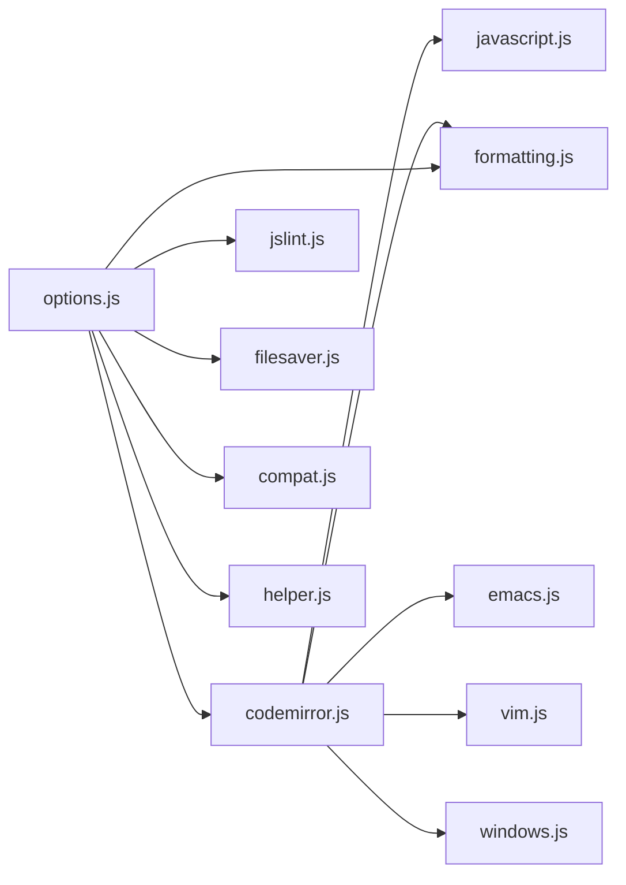

# Development Tools

<cite>
**Referenced Files in This Document**
- [codemirror.js](file://src/cm/codemirror.js)
- [formatting.js](file://src/cm/formatting.js)
- [javascript.js](file://src/cm/javascript.js)
- [default.css](file://src/cm/default.css)
- [emacs.js](file://src/cm/keymap/emacs.js)
- [vim.js](file://src/cm/keymap/vim.js)
- [windows.js](file://src/cm/keymap/windows.js)
- [filesaver.js](file://src/saveas/filesaver.js)
- [jslint.js](file://src/jslint.js)
- [compat.js](file://src/compat.js)
- [helper.js](file://src/helper.js)
- [options.html](file://src/options.html)
- [options.js](file://src/options.js)
</cite>

## Table of Contents
1. [Introduction](#introduction)
2. [Project Structure](#project-structure)
3. [Core Components](#core-components)
4. [Architecture Overview](#architecture-overview)
5. [Detailed Component Analysis](#detailed-component-analysis)
6. [Dependency Analysis](#dependency-analysis)
7. [Performance Considerations](#performance-considerations)
8. [Troubleshooting Guide](#troubleshooting-guide)
9. [Conclusion](#conclusion)

## Introduction
This document describes Tampermonkey’s development tools and utilities with a focus on the integrated CodeMirror-based editor, file saving, JavaScript linting, and cross-platform compatibility helpers. It explains how the editor is configured, how formatting and keyboard shortcuts are implemented, how JSLint integrates for quality checks, and how the development environment supports userscript authors. Practical usage scenarios and customization tips are included to help developers optimize their workflow.

## Project Structure
Tampermonkey’s development tools are primarily implemented in the src/ directory:
- Editor runtime and extensions: src/cm/*
- File saving: src/saveas/filesaver.js
- Linter: src/jslint.js
- Compatibility helpers: src/compat.js and src/helper.js
- UI integration: src/options.html and src/options.js

**Diagram sources**
- [options.html:1-38](file://src/options.html#L1-L38)
- [options.js:1-200](file://src/options.js#L1-L200)
- [codemirror.js:1-120](file://src/cm/codemirror.js#L1-L120)
- [javascript.js:1-120](file://src/cm/javascript.js#L1-L120)
- [formatting.js:1-120](file://src/cm/formatting.js#L1-L120)
- [default.css:1-19](file://src/cm/default.css#L1-L19)
- [emacs.js:1-31](file://src/cm/keymap/emacs.js#L1-L31)
- [vim.js:1-120](file://src/cm/keymap/vim.js#L1-L120)
- [windows.js](file://src/cm/keymap/windows.js)
- [filesaver.js:1-120](file://src/saveas/filesaver.js#L1-L120)
- [jslint.js:1-120](file://src/jslint.js#L1-L120)
- [compat.js:1-120](file://src/compat.js#L1-L120)
- [helper.js:1-120](file://src/helper.js#L1-L120)

**Section sources**
- [options.html:1-38](file://src/options.html#L1-L38)
- [options.js:1-200](file://src/options.js#L1-L200)

## Core Components
- Integrated CodeMirror editor: Provides editing, syntax highlighting, formatting, and keyboard shortcuts.
- Formatting extensions: Adds smart line breaking and indentation for JavaScript, CSS, and XML.
- JavaScript mode: Tokenizer and parser tailored for userscript authoring.
- Keymaps: Support for Emacs, Vim, and Windows-style editing.
- File saving: Cross-browser saveAs implementation for downloading files.
- JSLint integration: Real-time linting with configurable options and gutter markers.
- Compatibility helpers: Normalize legacy constructs and environments for broader compatibility.
- Helper utilities: DOM, URL, serialization, and platform helpers.

**Section sources**
- [codemirror.js:1-200](file://src/cm/codemirror.js#L1-L200)
- [formatting.js:1-120](file://src/cm/formatting.js#L1-L120)
- [javascript.js:1-120](file://src/cm/javascript.js#L1-L120)
- [default.css:1-19](file://src/cm/default.css#L1-L19)
- [emacs.js:1-31](file://src/cm/keymap/emacs.js#L1-L31)
- [vim.js:1-120](file://src/cm/keymap/vim.js#L1-L120)
- [windows.js](file://src/cm/keymap/windows.js)
- [filesaver.js:1-120](file://src/saveas/filesaver.js#L1-L120)
- [jslint.js:1-120](file://src/jslint.js#L1-L120)
- [compat.js:1-120](file://src/compat.js#L1-L120)
- [helper.js:1-120](file://src/helper.js#L1-L120)

## Architecture Overview
The development environment is assembled in the Options UI. The page loads CodeMirror and its extensions, then initializes the editor and binds it to the UI. Linting and saving are integrated via options.js, which communicates with the extension runtime.

**Diagram sources**
- [options.html:1-38](file://src/options.html#L1-L38)
- [options.js:2291-2492](file://src/options.js#L2291-L2492)
- [codemirror.js:1-120](file://src/cm/codemirror.js#L1-L120)
- [javascript.js:1-120](file://src/cm/javascript.js#L1-L120)
- [formatting.js:1-120](file://src/cm/formatting.js#L1-L120)
- [jslint.js:1-120](file://src/jslint.js#L1-L120)
- [filesaver.js:1-120](file://src/saveas/filesaver.js#L1-L120)

## Detailed Component Analysis

### CodeMirror Editor Runtime
- Editor lifecycle: creation, event wiring, focus/blur, selection, undo/redo, and display updates.
- Modes and tokenizer: JavaScript mode with keyword recognition, string/regexp/comment handling, and indentation rules.
- Extensions: formatting helpers for line breaks and smart indentation across multiple languages.
- Theming: default CSS defines syntax highlighting styles.

**Diagram sources**
- [codemirror.js:120-420](file://src/cm/codemirror.js#L120-L420)
- [javascript.js:357-406](file://src/cm/javascript.js#L357-L406)
- [formatting.js:132-196](file://src/cm/formatting.js#L132-L196)

**Section sources**
- [codemirror.js:1-420](file://src/cm/codemirror.js#L1-L420)
- [javascript.js:1-412](file://src/cm/javascript.js#L1-L412)
- [formatting.js:1-197](file://src/cm/formatting.js#L1-L197)
- [default.css:1-19](file://src/cm/default.css#L1-L19)

### Formatting and Indentation
- JavaScript mode extends with comment delimiters and word wrap characters.
- Auto-formatting splits on semicolons and braces, preserving quoted and commented regions.
- Smart indentation applies “smart” indentation across selected lines.
- Comment toggling wraps or unwraps selected ranges with language-specific comment markers.

**Diagram sources**
- [formatting.js:168-196](file://src/cm/formatting.js#L168-L196)

**Section sources**
- [formatting.js:1-197](file://src/cm/formatting.js#L1-L197)
- [javascript.js:43-75](file://src/cm/javascript.js#L43-L75)

### Keyboard Shortcuts and Keymaps
- Emacs keymap: Kill/yank ring, save/open, undo/redo, search, autocompletion, and page navigation.
- Vim keymap: Movement, insert mode, delete/change/yank operations, marks, and find/replace navigation.
- Windows keymap: Platform-specific bindings.

**Diagram sources**
- [emacs.js:12-30](file://src/cm/keymap/emacs.js#L12-L30)
- [vim.js:304-404](file://src/cm/keymap/vim.js#L304-L404)

**Section sources**
- [emacs.js:1-31](file://src/cm/keymap/emacs.js#L1-L31)
- [vim.js:1-404](file://src/cm/keymap/vim.js#L1-L404)
- [windows.js](file://src/cm/keymap/windows.js)

### JavaScript Linting with JSLint
- Integration: options.js runs JSLINT against the editor content with a curated option set and a global whitelist.
- Gutter markers: Errors are mapped to line markers with severity icons and inline highlights.
- Behavior: Mixed spaces/tabs detection, var placement warnings, and stopping errors are surfaced.

**Diagram sources**
- [options.js:2291-2492](file://src/options.js#L2291-L2492)
- [jslint.js:28-128](file://src/jslint.js#L28-L128)

**Section sources**
- [options.js:2291-2492](file://src/options.js#L2291-L2492)
- [jslint.js:1-120](file://src/jslint.js#L1-L120)

### File Saving System
- Cross-browser saveAs implementation: Creates a link, triggers download, falls back to filesystem APIs or object URLs.
- Supports Chrome quirks and WebKit filesystem naming conventions.

**Diagram sources**
- [filesaver.js:71-191](file://src/saveas/filesaver.js#L71-L191)

**Section sources**
- [filesaver.js:1-214](file://src/saveas/filesaver.js#L1-L214)

### Cross-Platform Compatibility Utilities
- compat.js: Rewrites legacy constructs (metadata CDATA, destructuring on left-hand side, foreach loops) and disables strict mode interference.
- helper.js: Provides URL escaping, regex generation, DOM helpers, serialization, and platform checks.

**Diagram sources**
- [compat.js:13-27](file://src/compat.js#L13-L27)
- [helper.js:29-80](file://src/helper.js#L29-L80)

**Section sources**
- [compat.js:1-275](file://src/compat.js#L1-L275)
- [helper.js:1-209](file://src/helper.js#L1-L209)

### Editor Integration in Options UI
- options.html loads CodeMirror, keymaps, formatting, and JSLint.
- options.js initializes the editor, wires linting, and handles save operations.

**Diagram sources**
- [options.html:1-38](file://src/options.html#L1-L38)
- [options.js:1-200](file://src/options.js#L1-L200)

**Section sources**
- [options.html:1-38](file://src/options.html#L1-L38)
- [options.js:1-200](file://src/options.js#L1-L200)

## Dependency Analysis
- Editor depends on JavaScript mode and formatting extensions.
- Keymaps extend the editor’s command set.
- Linting depends on JSLINT and editor content.
- Saving depends on browser APIs and polyfills.
- Compatibility and helper utilities support broader environment coverage.

**Diagram sources**
- [codemirror.js:1-120](file://src/cm/codemirror.js#L1-L120)
- [javascript.js:1-120](file://src/cm/javascript.js#L1-L120)
- [formatting.js:1-120](file://src/cm/formatting.js#L1-L120)
- [emacs.js:1-31](file://src/cm/keymap/emacs.js#L1-L31)
- [vim.js:1-120](file://src/cm/keymap/vim.js#L1-L120)
- [windows.js](file://src/cm/keymap/windows.js)
- [options.js:1-200](file://src/options.js#L1-L200)
- [jslint.js:1-120](file://src/jslint.js#L1-L120)
- [filesaver.js:1-120](file://src/saveas/filesaver.js#L1-L120)
- [compat.js:1-120](file://src/compat.js#L1-L120)
- [helper.js:1-120](file://src/helper.js#L1-L120)

**Section sources**
- [options.html:1-38](file://src/options.html#L1-L38)
- [options.js:1-200](file://src/options.js#L1-L200)

## Performance Considerations
- Formatting operations: Prefer batched replacements and limit re-indent passes to reduce layout thrashing.
- Linting: Debounce lint runs during typing; run only on save or explicit trigger to minimize overhead.
- Keymaps: Keep bindings minimal and avoid heavy command chains in frequent shortcuts.
- Compatibility rewriting: Apply only when necessary (e.g., legacy scripts) to avoid extra processing for modern code.

## Troubleshooting Guide
- Editor not focusing or keyboard shortcuts not responding:
  - Verify keymap is set and not overridden by conflicting bindings.
  - Ensure the editor is focused and input events are connected.
- Formatting not applied:
  - Confirm the JavaScript mode is active and formatting extensions are loaded.
  - Check that the selection spans the intended lines.
- Lint errors not shown:
  - Ensure JSLINT is available and options are set correctly.
  - Verify the editor content is retrieved and globals are whitelisted.
- Save fails:
  - Confirm browser supports saveAs or filesystem APIs.
  - Check for object URL revocation and fallback paths.

**Section sources**
- [codemirror.js:621-728](file://src/cm/codemirror.js#L621-L728)
- [formatting.js:168-196](file://src/cm/formatting.js#L168-L196)
- [options.js:2291-2492](file://src/options.js#L2291-L2492)
- [filesaver.js:120-214](file://src/saveas/filesaver.js#L120-L214)

## Conclusion
Tampermonkey’s development tools integrate a robust, extensible CodeMirror editor with formatting, keymaps, and linting. The Options UI ties these tools together, enabling efficient userscript authoring. By leveraging compatibility helpers and saving utilities, developers can maintain portability and productivity across platforms and workflows.