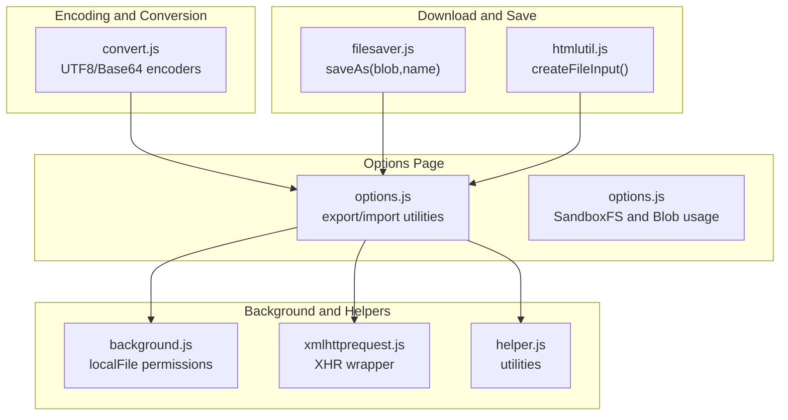
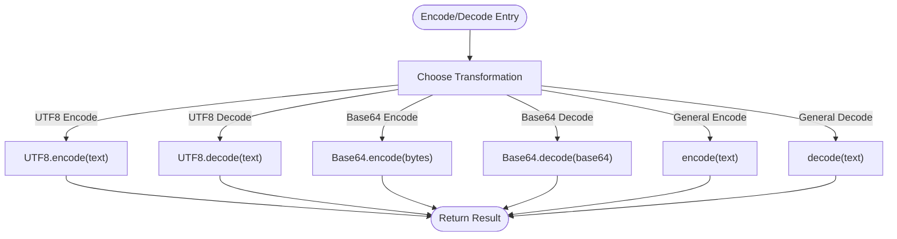
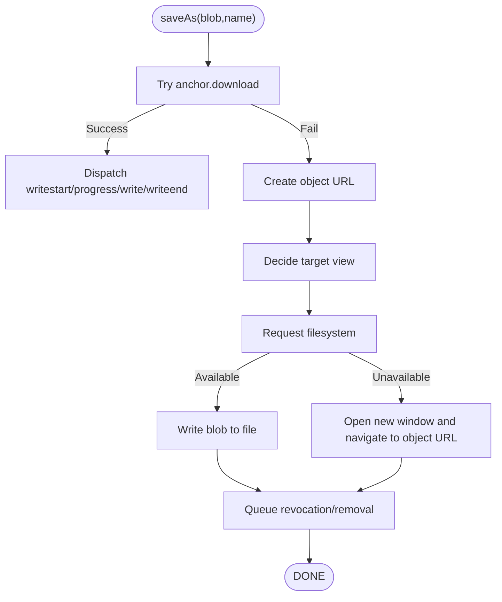
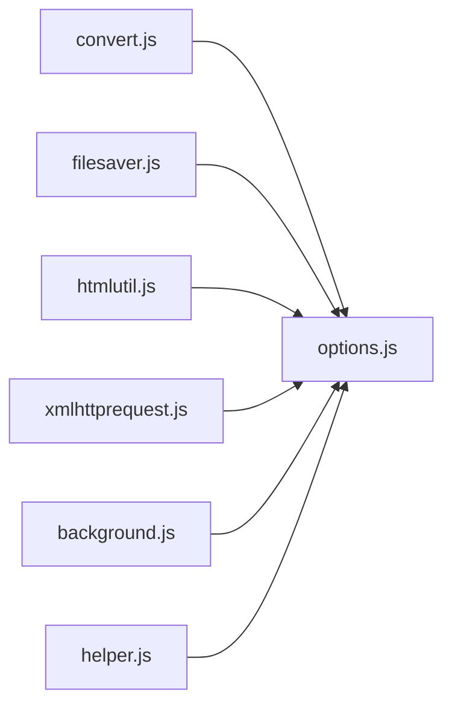

# File Operations

<cite>
**Referenced Files in This Document**
- [convert.js](file://src/convert.js)
- [filesaver.js](file://src/saveas/filesaver.js)
- [options.js](file://src/options.js)
- [htmlutil.js](file://src/htmlutil.js)
- [xmlhttprequest.js](file://src/xmlhttprequest.js)
- [background.js](file://src/background.js)
- [helper.js](file://src/helper.js)
</cite>

## Table of Contents
1. [Introduction](#introduction)
2. [Project Structure](#project-structure)
3. [Core Components](#core-components)
4. [Architecture Overview](#architecture-overview)
5. [Detailed Component Analysis](#detailed-component-analysis)
6. [Dependency Analysis](#dependency-analysis)
7. [Performance Considerations](#performance-considerations)
8. [Troubleshooting Guide](#troubleshooting-guide)
9. [Conclusion](#conclusion)

## Introduction
This document explains Tampermonkey’s file handling and conversion utilities with a focus on:
- FileSaver.js integration for downloading userscripts and related files
- Conversion functions for handling different file formats and encoding types
- File saving workflow, including local file operations and export capabilities
- Practical examples of implementing file download functionality, handling different file types, and managing file permissions
- Browser compatibility considerations and security restrictions for file operations

## Project Structure
The file operation subsystem spans several modules:
- Encoding and conversion utilities
- File download and save-as implementation
- Options page export/import and local file operations
- HTML utilities for UI-driven file operations
- Background script handling of local file permissions and storage



**Diagram sources**
- [convert.js:1-39](file://src/convert.js#L1-L39)
- [filesaver.js:16-213](file://src/saveas/filesaver.js#L16-L213)
- [options.js:474-718](file://src/options.js#L474-L718)
- [htmlutil.js:93-100](file://src/htmlutil.js#L93-L100)
- [background.js:659-766](file://src/background.js#L659-L766)
- [xmlhttprequest.js:17-153](file://src/xmlhttprequest.js#L17-L153)
- [helper.js:184-209](file://src/helper.js#L184-L209)

**Section sources**
- [convert.js:1-39](file://src/convert.js#L1-L39)
- [filesaver.js:16-213](file://src/saveas/filesaver.js#L16-L213)
- [options.js:474-718](file://src/options.js#L474-L718)
- [htmlutil.js:93-100](file://src/htmlutil.js#L93-L100)
- [background.js:659-766](file://src/background.js#L659-L766)
- [xmlhttprequest.js:17-153](file://src/xmlhttprequest.js#L17-L153)
- [helper.js:184-209](file://src/helper.js#L184-L209)

## Core Components
- Encoding and conversion utilities:
  - UTF-8 encode/decode helpers
  - Base64 encode/decode helpers
  - General encode/decode and identity functions
- File download and save-as:
  - FileSaver.js implementation of saveAs(blob, name)
  - Fallback mechanisms for browsers without native download support
- Options page export/import:
  - Export to file, textarea, and SandboxFS
  - Import from textarea, SandboxFS, and file input
  - Blob creation and encoding for export/import
- Local file operations and permissions:
  - Local file retrieval via XMLHttpRequest or iframe message
  - Sandbox filesystem usage for persistent storage
- HTML utilities:
  - File input element creation for user-driven file selection

**Section sources**
- [convert.js:8-37](file://src/convert.js#L8-L37)
- [filesaver.js:71-187](file://src/saveas/filesaver.js#L71-L187)
- [options.js:474-718](file://src/options.js#L474-L718)
- [background.js:659-766](file://src/background.js#L659-L766)
- [htmlutil.js:93-100](file://src/htmlutil.js#L93-L100)

## Architecture Overview
The file operation pipeline integrates encoding, Blob creation, and browser-native or fallback save mechanisms. Export/import flows leverage the options page UI and background permissions.

```mermaid
sequenceDiagram
participant UI as "Options UI"
participant Opt as "options.js"
participant Conv as "convert.js"
participant FS as "filesaver.js"
participant BG as "background.js"
participant XHR as "xmlhttprequest.js"
UI->>Opt : "Export to file"
Opt->>Conv : "Base64.encode(UTF8.encode(code))"
Opt->>Opt : "Create Blob(text/plain)"
Opt->>FS : "saveAs(Blob, filename)"
FS-->>UI : "Triggers browser download"
UI->>Opt : "Import from file"
Opt->>Opt : "FileReader.readAsText()"
Opt->>Conv : "UTF8.decode(Base64.decode(source))"
Opt->>BG : "chrome.extension.sendMessage(saveScript)"
BG->>XHR : "Optional XHR for remote resources"
```

**Diagram sources**
- [options.js:474-718](file://src/options.js#L474-L718)
- [convert.js:8-37](file://src/convert.js#L8-L37)
- [filesaver.js:16-213](file://src/saveas/filesaver.js#L16-L213)
- [background.js:659-766](file://src/background.js#L659-L766)
- [xmlhttprequest.js:17-153](file://src/xmlhttprequest.js#L17-L153)

## Detailed Component Analysis

### Encoding and Conversion Utilities
- Purpose:
  - Provide robust encoding/decoding for userscript content during export/import
  - Ensure cross-browser compatibility for text and binary-like transformations
- Key functions:
  - UTF-8 encode/decode for internationalization and safe transport
  - Base64 encode/decode for binary-safe serialization
  - General encode/decode and identity functions for convenience
- Complexity:
  - O(n) for string transformations
  - Minimal memory overhead; suitable for large userscripts



**Diagram sources**
- [convert.js:8-37](file://src/convert.js#L8-L37)

**Section sources**
- [convert.js:8-37](file://src/convert.js#L8-L37)

### File Download and Save-As Implementation
- Purpose:
  - Provide a cross-browser saveAs(blob, name) mechanism
  - Fallback to object URLs and filesystem APIs when native download fails
- Key behaviors:
  - Try anchor download first; if unsupported, fall back to object URL
  - Force octet-stream for Chrome tab context to ensure download triggers
  - Append .download suffix for WebKit when needed
  - Use filesystem API when available; otherwise open a new window and navigate to object URL
  - Dispatch progress and completion events
- Compatibility:
  - Works across modern browsers with feature detection
  - Graceful degradation when filesystem APIs are unavailable



**Diagram sources**
- [filesaver.js:71-187](file://src/saveas/filesaver.js#L71-L187)

**Section sources**
- [filesaver.js:16-213](file://src/saveas/filesaver.js#L16-L213)

### Options Page Export/Import and Local File Operations
- Export:
  - Export to file: creates a Blob with text/plain, then invokes saveAs
  - Export to textarea: populates a textarea with serialized content
  - Export to SandboxFS: writes a file named scripts.tmx using the filesystem API
- Import:
  - Import from textarea: parses JSON and decodes content
  - Import from SandboxFS: reads scripts.tmx via filesystem API
  - Import from file: uses FileReader to read selected files
- Local file retrieval:
  - Uses XMLHttpRequest or iframe messaging depending on configuration
  - Implements timeouts and callback cleanup
- Permissions:
  - SandboxFS requires persistent storage permission
  - File input allows users to select local files for import

```mermaid
sequenceDiagram
participant User as "User"
participant UI as "Options UI"
participant Opt as "options.js"
participant FS as "filesaver.js"
participant SB as "SandboxFS"
User->>UI : "Click Export to File"
UI->>Opt : "expo_doc()"
Opt->>Opt : "Create Blob(text/plain)"
Opt->>FS : "saveAs(blob, 'tmScripts.txt')"
FS-->>User : "Browser downloads file"
User->>UI : "Click Export to SandboxFS"
UI->>Opt : "expo_ls()"
Opt->>SB : "Get file 'scripts.tmx' and write Blob"
SB-->>User : "Write completed"
User->>UI : "Click Import from File"
UI->>Opt : "handleFileSelect()"
Opt->>Opt : "FileReader.readAsText()"
Opt->>Opt : "Parse JSON and decode content"
Opt->>Opt : "Save via background script"
```

**Diagram sources**
- [options.js:474-718](file://src/options.js#L474-L718)
- [filesaver.js:16-213](file://src/saveas/filesaver.js#L16-L213)

**Section sources**
- [options.js:474-718](file://src/options.js#L474-L718)
- [background.js:659-766](file://src/background.js#L659-L766)

### HTML Utilities for File Operations
- Provides reusable UI elements for file operations:
  - File input creation for selecting files
  - Buttons and textareas for export/import workflows
- Integrates with options page to drive export/import actions

**Section sources**
- [htmlutil.js:93-100](file://src/htmlutil.js#L93-L100)

### Background Script Local File Permissions
- Manages retrieval of local files:
  - XMLHttpRequest-based retrieval with cache-busting
  - Iframe messaging fallback with postMessage
  - Timeout and cleanup handling
- Supports persistent storage via filesystem API for export/import

**Section sources**
- [background.js:659-766](file://src/background.js#L659-L766)

### XHR Wrapper and Security Considerations
- Validates URL schemes and restricts to http/https or local images
- Handles retries and error propagation
- Ensures headers are prefixed appropriately for web requests

**Section sources**
- [xmlhttprequest.js:17-153](file://src/xmlhttprequest.js#L17-L153)

## Dependency Analysis
- convert.js is a dependency of options.js for encoding userscript content
- options.js depends on filesaver.js for file downloads and htmlutil.js for UI elements
- background.js coordinates local file retrieval and permissions
- xmlhttprequest.js underpins network operations for remote resources



**Diagram sources**
- [convert.js:31-37](file://src/convert.js#L31-L37)
- [options.js:474-718](file://src/options.js#L474-L718)
- [filesaver.js:16-213](file://src/saveas/filesaver.js#L16-L213)
- [htmlutil.js:93-100](file://src/htmlutil.js#L93-L100)
- [xmlhttprequest.js:17-153](file://src/xmlhttprequest.js#L17-L153)
- [background.js:659-766](file://src/background.js#L659-L766)
- [helper.js:184-209](file://src/helper.js#L184-L209)

**Section sources**
- [convert.js:31-37](file://src/convert.js#L31-L37)
- [options.js:474-718](file://src/options.js#L474-L718)
- [filesaver.js:16-213](file://src/saveas/filesaver.js#L16-L213)
- [htmlutil.js:93-100](file://src/htmlutil.js#L93-L100)
- [xmlhttprequest.js:17-153](file://src/xmlhttprequest.js#L17-L153)
- [background.js:659-766](file://src/background.js#L659-L766)
- [helper.js:184-209](file://src/helper.js#L184-L209)

## Performance Considerations
- Encoding/decoding is linear in input size; suitable for large userscripts
- Blob creation and saveAs are efficient; avoid unnecessary intermediate copies
- Filesystem API usage requires careful quota management and cleanup
- Network operations should reuse connections and handle retries gracefully

## Troubleshooting Guide
- Export to file does not trigger download:
  - Ensure saveAs is invoked with a Blob and a filename
  - Verify browser support for anchor.download or object URLs
- Export to SandboxFS fails:
  - Confirm persistent storage permission is granted
  - Check error handler for quota exceeded or security errors
- Import from file fails:
  - Validate JSON format and presence of required fields
  - Ensure FileReader completes before attempting to parse
- Local file retrieval issues:
  - Verify URL scheme is http/https or local image
  - Check timeout and callback cleanup logic

**Section sources**
- [options.js:558-583](file://src/options.js#L558-L583)
- [options.js:608-634](file://src/options.js#L608-L634)
- [options.js:651-670](file://src/options.js#L651-L670)
- [xmlhttprequest.js:115-152](file://src/xmlhttprequest.js#L115-L152)
- [background.js:691-766](file://src/background.js#L691-L766)

## Conclusion
Tampermonkey’s file operations combine robust encoding utilities, a resilient saveAs implementation, and a comprehensive options page export/import workflow. The system handles various file types and formats, manages browser compatibility and security constraints, and provides flexible mechanisms for both user-driven and programmatic file operations.