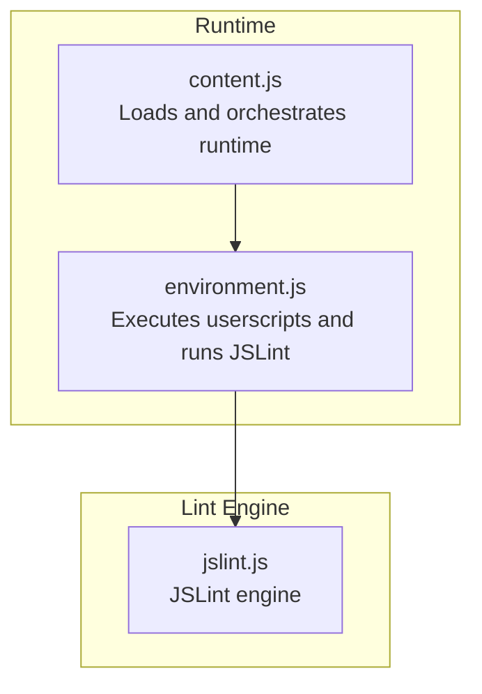
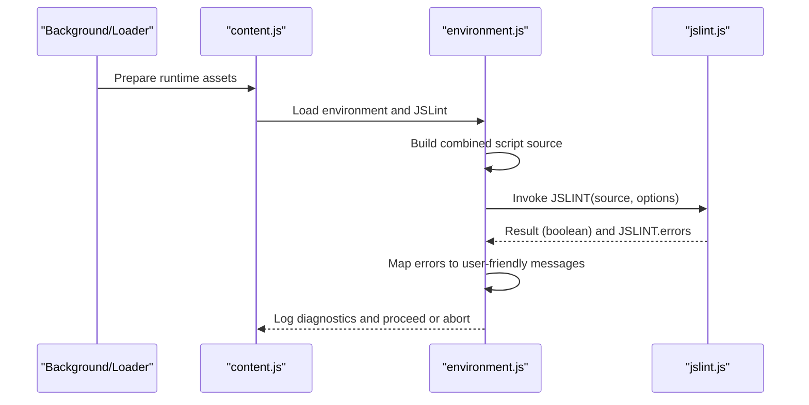
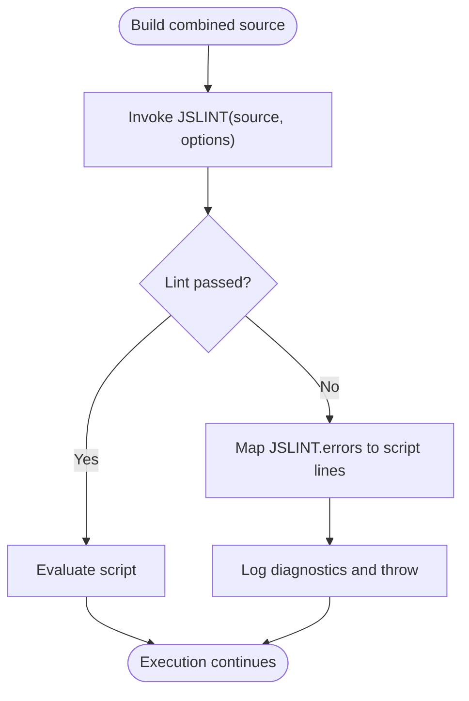
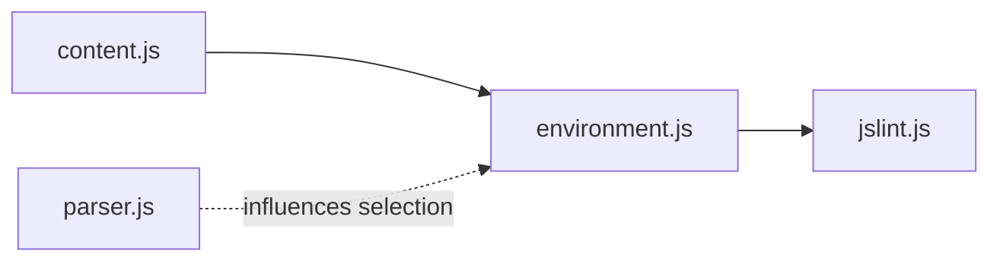

# JavaScript Linting

<cite>
**Referenced Files in This Document**
- [jslint.js](file://src/jslint.js)
- [environment.js](file://src/environment.js)
- [content.js](file://src/content.js)
- [parser.js](file://src/parser.js)
</cite>

## Table of Contents
1. [Introduction](#introduction)
2. [Project Structure](#project-structure)
3. [Core Components](#core-components)
4. [Architecture Overview](#architecture-overview)
5. [Detailed Component Analysis](#detailed-component-analysis)
6. [Dependency Analysis](#dependency-analysis)
7. [Performance Considerations](#performance-considerations)
8. [Troubleshooting Guide](#troubleshooting-guide)
9. [Conclusion](#conclusion)

## Introduction
This document explains how Tampermonkey integrates JavaScript linting powered by JSLint to enforce code quality and detect issues in userscripts. It covers the linting rules applied, error detection mechanisms, and how the system reports findings during development and runtime. It also describes the integration with the development workflow, including real-time feedback and error reporting, along with best practices and customization options for linting rules.

## Project Structure
Tampermonkey’s linting capability centers around a bundled JSLint engine and a runtime environment that applies linting to userscript code before execution. The relevant components are:
- JSLint engine: a self-contained linting library providing rule enforcement and error reporting.
- Environment runtime: prepares and executes userscripts, invoking JSLint to validate code and surface issues.
- Content pipeline: loads and passes JSLint and script artifacts to the environment for evaluation.

**Diagram sources**
- [content.js:80–120:80-120](file://src/content.js#L80-L120)
- [environment.js:52–193:52-193](file://src/environment.js#L52-L193)
- [jslint.js:28-60](file://src/jslint.js#L28-L60)

**Section sources**
- [content.js:80–120:80-120](file://src/content.js#L80-L120)
- [environment.js:52–193:52-193](file://src/environment.js#L52-L193)
- [jslint.js:28-60](file://src/jslint.js#L28-L60)

## Core Components
- JSLint engine (jslint.js)
  - Provides the JSLINT function to lint JavaScript source text with a configurable option set.
  - Exposes JSLINT.errors for collected issues and supports structured reporting via JSLINT.data().
  - Defines a rich set of lint rules and messages covering syntax, style, and safety concerns.

- Environment runtime (environment.js)
  - Builds the combined script source (including injected wrappers and requires).
  - Invokes JSLint with a tailored option set optimized for userscript environments.
  - Parses JSLINT.errors to compute human-readable diagnostics and logs them to the console.

- Content pipeline (content.js)
  - Coordinates loading of runtime assets and passes JSLint into the environment execution context.
  - Ensures JSLint is available when the environment evaluates userscripts.

**Section sources**
- [jslint.js:28-127](file://src/jslint.js#L28-L127)
- [environment.js:128-167](file://src/environment.js#L128-L167)
- [content.js:80–120:80-120](file://src/content.js#L80-L120)

## Architecture Overview
The linting workflow integrates JSLint into Tampermonkey’s userscript execution pipeline. The sequence below illustrates how linting is triggered and how errors are reported.

**Diagram sources**
- [content.js:1121-1196](file://src/content.js#L1121-L1196)
- [environment.js:128-167](file://src/environment.js#L128-L167)
- [jslint.js:28-60](file://src/jslint.js#L28-L60)

## Detailed Component Analysis

### JSLint Engine (jslint.js)
- Purpose
  - Validates JavaScript source text against a comprehensive set of rules.
  - Produces a boolean result indicating pass/fail and a detailed error array.

- Key behaviors
  - Accepts a source string and an options object controlling rule enforcement.
  - Populates JSLINT.errors with structured entries including line, character, reason, and evidence.
  - Supports stopping on first error when configured.

- Rule coverage highlights
  - Syntax and style: missing semicolons, whitespace, indentation, naming conventions.
  - Safety: eval usage, unsafe HTML/CSS injection risks, insecure regular expressions.
  - Best practices: unused variables, undefined identifiers, inconsistent use of equality operators.

- Options and defaults
  - Includes a broad set of options (e.g., browser globals, ES5 support, devel logging, plusplus, nomen, eqeq, passfail, etc.) with sensible defaults.

- Error model
  - Each error includes line, character, reason, and evidence text for precise localization.

**Section sources**
- [jslint.js:28-60](file://src/jslint.js#L28-L60)
- [jslint.js:66-127](file://src/jslint.js#L66-L127)
- [jslint.js:1120-1167](file://src/jslint.js#L1120-L1167)

### Environment Runtime (environment.js)
- Purpose
  - Executes userscripts in a controlled environment and performs lint validation prior to execution.

- Lint invocation
  - Constructs the combined script source (including injected wrappers and requires).
  - Calls JSLINT with a carefully chosen options set tuned for userscript contexts.

- Error handling and reporting
  - If lint passes, proceeds to evaluate the script.
  - If lint fails, computes a user-friendly error summary by mapping JSLINT.errors to the script’s line numbers and categorizing issues as originating from the script or its requires.
  - Logs detailed diagnostics to the console and throws to prevent execution of invalid code.

- Integration points
  - Uses a wrapper function to catch runtime errors and augment them with lint diagnostics.

**Diagram sources**
- [environment.js:128-167](file://src/environment.js#L128-L167)
- [jslint.js:28-60](file://src/jslint.js#L28-L60)

**Section sources**
- [environment.js:52-193](file://src/environment.js#L52-L193)
- [environment.js:128-167](file://src/environment.js#L128-L167)

### Content Pipeline (content.js)
- Purpose
  - Loads runtime assets and ensures JSLint is available in the environment execution context.

- JSLint integration
  - Maintains a placeholder for JSLint and injects it into the environment execution string.
  - Coordinates with background processes to fetch raw assets and pass them to the environment.

- Real-time feedback
  - Errors are surfaced via console logs and thrown exceptions to halt problematic script execution.

**Section sources**
- [content.js:80–120:80-120](file://src/content.js#L80-L120)
- [content.js:1121-1196](file://src/content.js#L1121-L1196)

### Userscript Metadata Parser (parser.js)
- Purpose
  - Parses userscript metadata (e.g., @include, @match, @require) to determine which scripts run on which pages and how resources are resolved.

- Relevance to linting
  - While not directly performing linting, accurate metadata parsing ensures the correct scripts are selected for linting and execution, preventing mismatches between targets and rules.

**Section sources**
- [parser.js:72-222](file://src/parser.js#L72-L222)

## Dependency Analysis
The linting subsystem exhibits clear separation of concerns:
- content.js depends on environment.js to execute scripts and on jslint.js indirectly via environment.js.
- environment.js depends on jslint.js for lint validation and on parser.js indirectly for metadata-driven selection of scripts.
- jslint.js is self-contained and provides the linting API consumed by environment.js.

**Diagram sources**
- [content.js:1121-1196](file://src/content.js#L1121-L1196)
- [environment.js:128-167](file://src/environment.js#L128-L167)
- [parser.js:72-222](file://src/parser.js#L72-L222)

**Section sources**
- [content.js:1121-1196](file://src/content.js#L1121-L1196)
- [environment.js:128-167](file://src/environment.js#L128-L167)
- [parser.js:72-222](file://src/parser.js#L72-L222)

## Performance Considerations
- Linting cost
  - JSLint adds CPU overhead during script preparation. The environment uses a pragmatic option set to balance thoroughness and speed.
- Error threshold
  - The option set limits the maximum number of errors reported to reduce noise and improve readability.
- Early termination
  - When configured, linting can stop on the first error to accelerate feedback loops.

[No sources needed since this section provides general guidance]

## Troubleshooting Guide
Common linting issues and resolutions:
- Syntax errors
  - Cause: Missing semicolons, unmatched brackets, incorrect operators.
  - Resolution: Add missing punctuation, fix mismatched constructs, and align operators with expectations.

- Style violations
  - Cause: Inconsistent indentation, extra spaces, or non-standard naming.
  - Resolution: Normalize whitespace and adhere to naming conventions enforced by options like nomen and white.

- Security concerns
  - Cause: Use of eval, unsafe HTML/CSS patterns, insecure regular expressions.
  - Resolution: Avoid eval; sanitize dynamic content; review regular expressions for safety.

- Undefined or unused identifiers
  - Cause: Referencing undeclared variables or unused locals.
  - Resolution: Declare globals appropriately and remove unused variables.

- Equality and comparison pitfalls
  - Cause: Using loose equality (==) instead of strict equality (===).
  - Resolution: Switch to strict equality comparisons.

Best practices for writing lint-compliant userscripts:
- Enable strict mode where appropriate.
- Declare globals explicitly to avoid “not defined” errors.
- Keep lines concise and readable to satisfy length and whitespace rules.
- Avoid eval and unsafe patterns flagged by the engine.
- Use consistent naming and spacing conventions.

Customizing linting rules:
- Adjust the option set passed to JSLINT in the environment to relax or tighten enforcement.
- Consider enabling or disabling specific options (e.g., plusplus, nomen, eqeq, passfail) depending on project needs.

**Section sources**
- [environment.js:128-167](file://src/environment.js#L128-L167)
- [jslint.js:37-44](file://src/jslint.js#L37-L44)

## Conclusion
Tampermonkey’s integration of JSLint provides robust, rule-driven quality assurance for userscripts. By validating code before execution, the system helps developers catch syntax errors, style violations, and security risks early. The environment’s error mapping and console reporting offer actionable feedback, while customizable options allow teams to tailor linting to their standards. Together, these mechanisms strengthen the reliability and maintainability of userscripts in production environments.