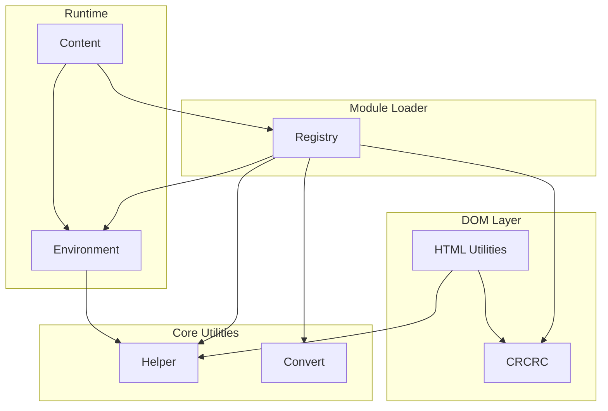
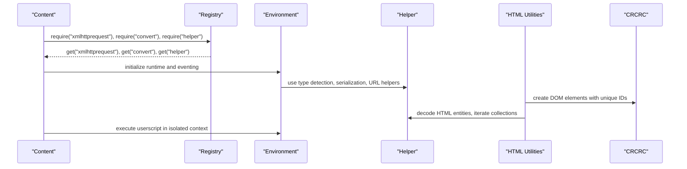
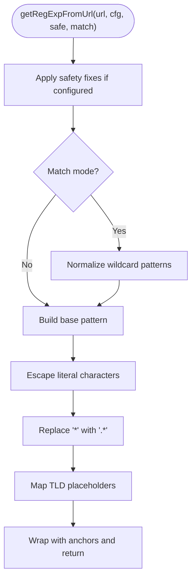
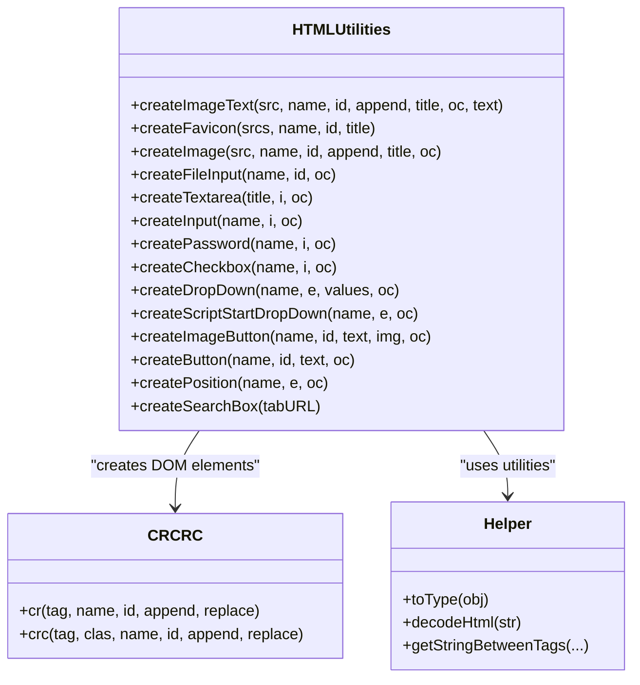
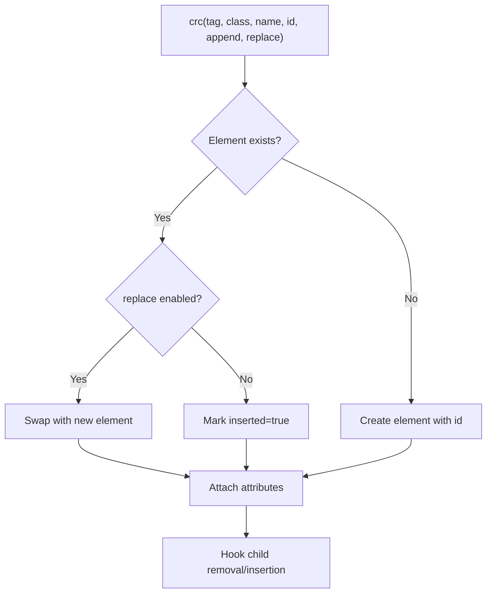
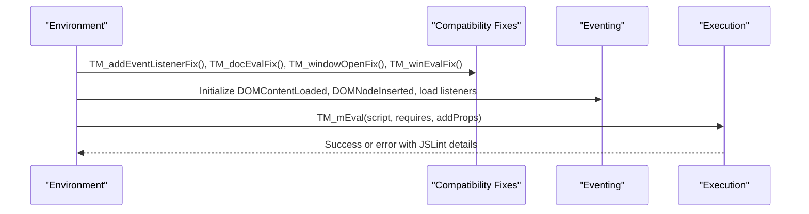
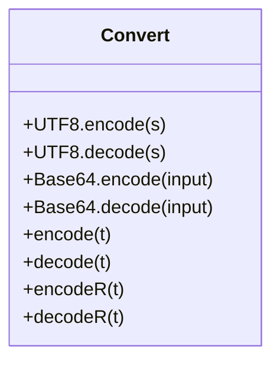
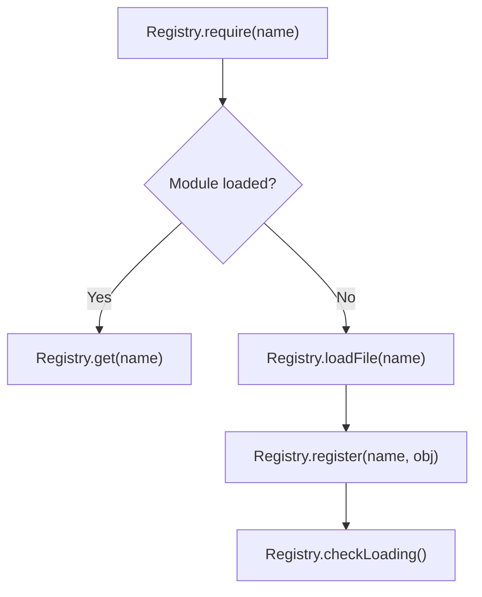
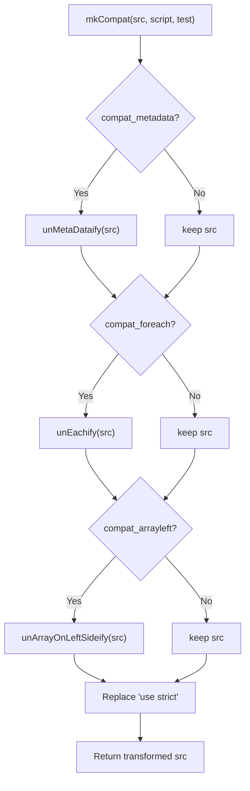
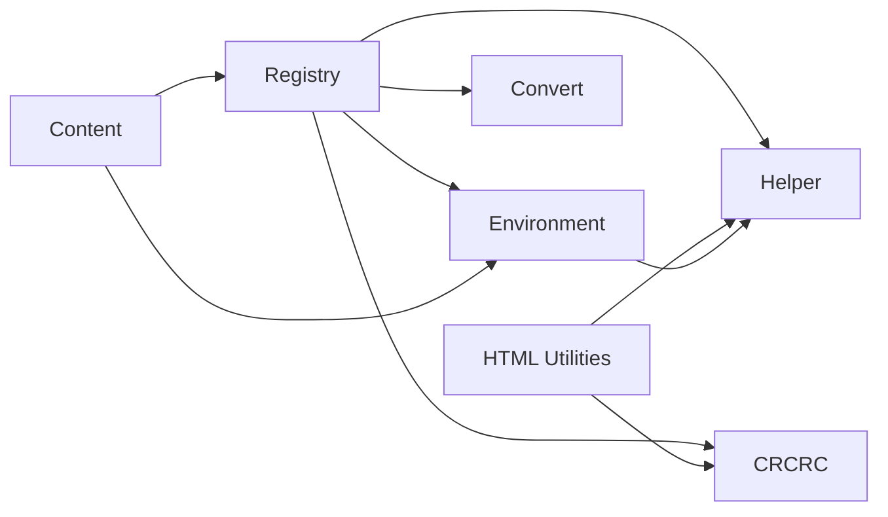

# Utility Functions

<cite>
**Referenced Files in This Document**
- [helper.js](file://src/helper.js)
- [htmlutil.js](file://src/htmlutil.js)
- [compat.js](file://src/compat.js)
- [environment.js](file://src/environment.js)
- [crcrc.js](file://src/crcrc.js)
- [registry.js](file://src/registry.js)
- [convert.js](file://src/convert.js)
- [content.js](file://src/content.js)
</cite>

## Table of Contents
1. [Introduction](#introduction)
2. [Project Structure](#project-structure)
3. [Core Components](#core-components)
4. [Architecture Overview](#architecture-overview)
5. [Detailed Component Analysis](#detailed-component-analysis)
6. [Dependency Analysis](#dependency-analysis)
7. [Performance Considerations](#performance-considerations)
8. [Troubleshooting Guide](#troubleshooting-guide)
9. [Conclusion](#conclusion)

## Introduction
This document explains Tampermonkey’s utility functions and helper modules that enable cross-platform compatibility, robust URL parsing, string manipulation, and HTML/DOM processing. It focuses on how these utilities are organized, how they integrate with the runtime environment, and how users can leverage them effectively in userscripts. Practical usage patterns, integration points, and best practices are included to help developers write portable, efficient, and maintainable userscripts.

## Project Structure
The utility layer is composed of several modules:
- Registry: module loader and dependency manager
- Helper: cross-platform helpers, URL parsing, string utilities, DOM helpers
- HTML Utilities: element creation and DOM manipulation helpers
- CRCRC: lightweight DOM element factory with deduplication and insertion tracking
- Environment: runtime environment, eventing, GM/TM compatibility shims, storage, and XHR
- Convert: encoding/decoding utilities
- Content: bootstrap and orchestration of environment initialization

**Diagram sources**
- [registry.js:11-104](file://src/registry.js#L11-L104)
- [helper.js:184-209](file://src/helper.js#L184-L209)
- [crcrc.js:12-64](file://src/crcrc.js#L12-L64)
- [htmlutil.js:7-13](file://src/htmlutil.js#L7-L13)
- [environment.js:7-1337](file://src/environment.js#L7-L1337)
- [content.js:80-92](file://src/content.js#L80-L92)

**Section sources**
- [registry.js:11-104](file://src/registry.js#L11-L104)
- [content.js:80-92](file://src/content.js#L80-L92)

## Core Components
This section highlights the primary utility modules and their responsibilities.

- Helper: Provides cross-platform compatibility helpers, URL-to-RegExp conversion, argument parsing, alert/confirm wrappers, type detection, iteration utilities, serialization, and HTML entity decoding/encoding.
- HTML Utilities: High-level helpers for creating form controls, buttons, dropdowns, images, file inputs, and search boxes; integrates with CRCRC for DOM element creation and lifecycle.
- CRCRC: Lightweight DOM element factory that ensures unique IDs, tracks insertion state, and safely appends/inserts nodes.
- Environment: Emulates browser APIs, manages events, provides GM/TM compatibility shims, handles storage, notifications, and XHR.
- Convert: Encoding/decoding utilities for UTF-8 and Base64, plus simple escape/unescape helpers.
- Registry: Module loader that registers, requires, and resolves dependencies across modules.

**Section sources**
- [helper.js:184-209](file://src/helper.js#L184-L209)
- [htmlutil.js:365-379](file://src/htmlutil.js#L365-L379)
- [crcrc.js:12-64](file://src/crcrc.js#L12-L64)
- [environment.js:7-1337](file://src/environment.js#L7-L1337)
- [convert.js:31-37](file://src/convert.js#L31-L37)
- [registry.js:35-104](file://src/registry.js#L35-L104)

## Architecture Overview
The runtime initializes modules via Registry, then Environment sets up compatibility shims and eventing. Helper and Convert provide foundational utilities. HTML Utilities build upon CRCRC and Helper to construct DOM elements consistently. Content orchestrates the bootstrap process and hands off to Environment for execution.

**Diagram sources**
- [content.js:80-92](file://src/content.js#L80-L92)
- [environment.js:1323-1332](file://src/environment.js#L1323-L1332)
- [htmlutil.js:7-13](file://src/htmlutil.js#L7-L13)
- [crcrc.js:12-64](file://src/crcrc.js#L12-L64)
- [helper.js:184-209](file://src/helper.js#L184-L209)

## Detailed Component Analysis

### Helper: Cross-Platform Compatibility, URL Parsing, String Utilities
- Unique ID generation and string sanitization for element IDs
- URL-to-RegExp conversion with wildcard and TLD handling
- Safe URL argument parsing from query strings
- Alert/Confirm wrappers with asynchronous dispatch
- Type detection and polymorphic iteration across arrays, NodeLists, XPathResults, and objects
- Serialization of objects with special handling for undefined/null/functions
- HTML entity decoding/encoding helpers

**Diagram sources**
- [helper.js:56-80](file://src/helper.js#L56-L80)

Practical usage patterns:
- Use URL-to-RegExp conversion to normalize userscript match patterns for cross-browser compatibility.
- Use serialization to log or persist complex objects safely.
- Use HTML decoding/encoding to sanitize or prepare text content for DOM insertion.

Integration examples:
- HTML Utilities rely on Helper for decoding HTML entities in dropdown items.
- Environment uses Helper for type detection and serialization during bootstrap.

**Section sources**
- [helper.js:24-209](file://src/helper.js#L24-L209)

### HTML Utilities: DOM Element Creation and Content Processing
- Image/text widgets, favicon loaders, file inputs, textareas, inputs, passwords, checkboxes, dropdowns, script start position selectors, image buttons, simple and item buttons, position selectors, and search boxes
- Built on CRCRC for element creation and deduplication
- Uses Helper for type checks and HTML decoding

**Diagram sources**
- [htmlutil.js:15-379](file://src/htmlutil.js#L15-L379)
- [crcrc.js:12-64](file://src/crcrc.js#L12-L64)
- [helper.js:122-124](file://src/helper.js#L122-L124)

Common use cases:
- Building settings panels with inputs, checkboxes, and dropdowns
- Creating interactive widgets with click handlers and titles
- Generating search UIs bound to URL navigation

**Section sources**
- [htmlutil.js:15-379](file://src/htmlutil.js#L15-L379)

### CRCRC: DOM Element Factory with Deduplication
- Creates or reuses DOM elements by unique ID
- Tracks insertion state to prevent duplicate children
- Safely appends and inserts nodes, replacing existing elements when requested

**Diagram sources**
- [crcrc.js:16-62](file://src/crcrc.js#L16-L62)

Best practices:
- Always pass unique identifiers to avoid collisions
- Use replace mode when swapping out stale elements
- Leverage insertion tracking to avoid redundant DOM mutations

**Section sources**
- [crcrc.js:12-64](file://src/crcrc.js#L12-L64)

### Environment: Runtime, Events, Compatibility Shims, Storage, XHR
- Initializes logging levels, eventing, and cleanup hooks
- Adds compatibility fixes for addEventListener, document.evaluate, window.open, and setTimeout/setInterval
- Provides GM/TM compatibility layer with storage, notifications, clipboard, tabs, and XHR
- Executes userscripts in a controlled context with error handling and JSLint integration

**Diagram sources**
- [environment.js:1323-1332](file://src/environment.js#L1323-L1332)
- [environment.js:52-193](file://src/environment.js#L52-L193)

Integration patterns:
- Use TM_addStyle to inject CSS dynamically
- Use TM_xmlhttpRequest for cross-origin requests with progress callbacks
- Use TM_registerMenuCommand to expose actions in the toolbar

**Section sources**
- [environment.js:7-1337](file://src/environment.js#L7-L1337)

### Convert: Encoding/Decoding Utilities
- UTF-8 encode/decode helpers
- Base64 encode/decode helpers
- Simple escape/unescape helpers for transport-safe strings

**Diagram sources**
- [convert.js:8-37](file://src/convert.js#L8-L37)

Use cases:
- Transporting text safely across contexts
- Handling binary data via Base64
- Normalizing text encodings for cross-browser compatibility

**Section sources**
- [convert.js:31-37](file://src/convert.js#L31-L37)

### Registry: Module Loader and Dependency Manager
- Registers modules and raw content
- Resolves dependencies via require/get
- Loads scripts asynchronously and triggers onload callbacks

**Diagram sources**
- [registry.js:48-104](file://src/registry.js#L48-L104)

Integration patterns:
- Modules declare dependencies via Registry.require
- Bootstrap code uses Registry.get to obtain dependencies

**Section sources**
- [registry.js:11-104](file://src/registry.js#L11-L104)
- [content.js:80-92](file://src/content.js#L80-L92)

### Compatibility: Legacy Feature Support
- Translates legacy JavaScript constructs to modern equivalents
- Handles metadata blocks, foreach loops, array destructuring, and strict-mode compatibility

**Diagram sources**
- [compat.js:14-26](file://src/compat.js#L14-L26)

Use cases:
- Ensures older userscripts run on modern engines
- Maintains backward compatibility for common patterns

**Section sources**
- [compat.js:13-275](file://src/compat.js#L13-L275)

## Dependency Analysis
The following diagram shows how modules depend on each other:

**Diagram sources**
- [registry.js:9-11](file://src/registry.js#L9-L11)
- [htmlutil.js:8-13](file://src/htmlutil.js#L8-L13)
- [content.js:80-92](file://src/content.js#L80-L92)

Observations:
- Helper is a foundational dependency for HTML Utilities and Environment
- CRCRC depends on Helper for unique ID generation and element reuse
- Environment depends on Helper for type detection and serialization
- Content orchestrates module loading and delegates to Environment

**Section sources**
- [helper.js:184-209](file://src/helper.js#L184-L209)
- [htmlutil.js:7-13](file://src/htmlutil.js#L7-L13)
- [crcrc.js:9-10](file://src/crcrc.js#L9-L10)
- [environment.js:7-1337](file://src/environment.js#L7-L1337)
- [content.js:80-92](file://src/content.js#L80-L92)

## Performance Considerations
- Prefer CRCRC for element creation to avoid duplicate DOM nodes and reduce layout thrash.
- Use Helper’s serialization sparingly; it recurses through objects and can be expensive for large structures.
- Avoid excessive use of HTML decoding/encoding in tight loops; cache decoded strings when reused.
- Use Environment’s TM_addStyle to inject styles once rather than manipulating inline styles repeatedly.
- Minimize compatibility transformations when not needed; only enable features required by legacy scripts.
- Batch DOM updates (e.g., create elements first, then append) to reduce reflows.

[No sources needed since this section provides general guidance]

## Troubleshooting Guide
- If elements are duplicated or not inserted, verify CRCRC usage and uniqueness of IDs.
- If URL patterns do not match as expected, review Helper’s URL-to-RegExp conversion and ensure wildcards and TLD placeholders are handled correctly.
- If scripts fail to run in strict mode, ensure compatibility transformations are enabled.
- For storage issues, confirm Environment’s storage listeners and change notifications are registered.
- For XHR failures, inspect Environment’s TM_xmlhttpRequest wrapper and response routing.

**Section sources**
- [crcrc.js:12-64](file://src/crcrc.js#L12-L64)
- [helper.js:56-80](file://src/helper.js#L56-L80)
- [compat.js:14-26](file://src/compat.js#L14-L26)
- [environment.js:820-902](file://src/environment.js#L820-L902)
- [environment.js:693-747](file://src/environment.js#L693-L747)

## Conclusion
Tampermonkey’s utility stack provides a cohesive foundation for cross-platform userscript development. Helper offers essential compatibility and parsing utilities; HTML Utilities streamline DOM construction; CRCRC ensures safe, deduplicated element creation; Environment delivers runtime compatibility and GM/TM APIs; Convert handles encoding concerns; and Registry manages modular dependencies. By leveraging these modules together, developers can write robust, portable userscripts that integrate seamlessly across browsers and platforms.