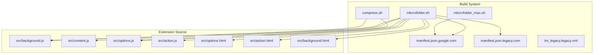
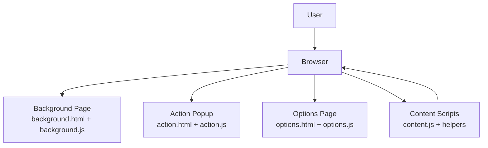
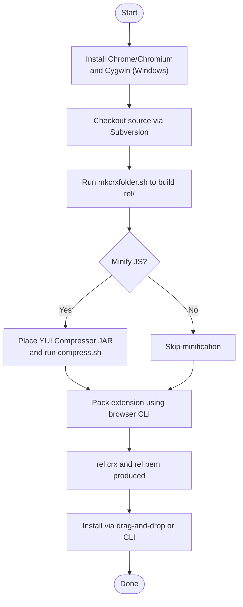
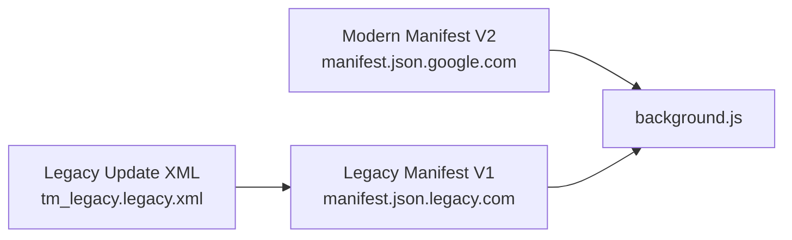
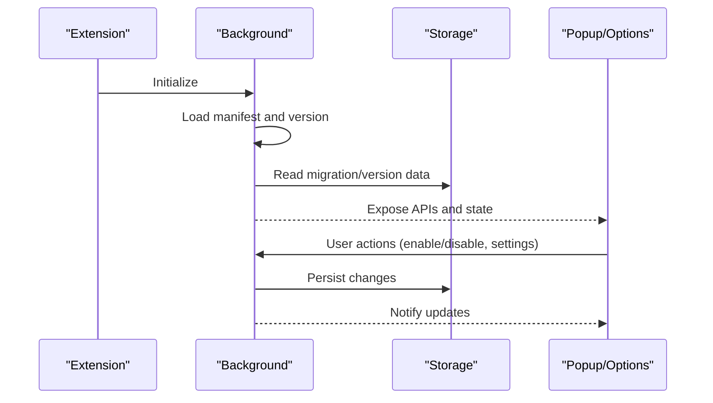
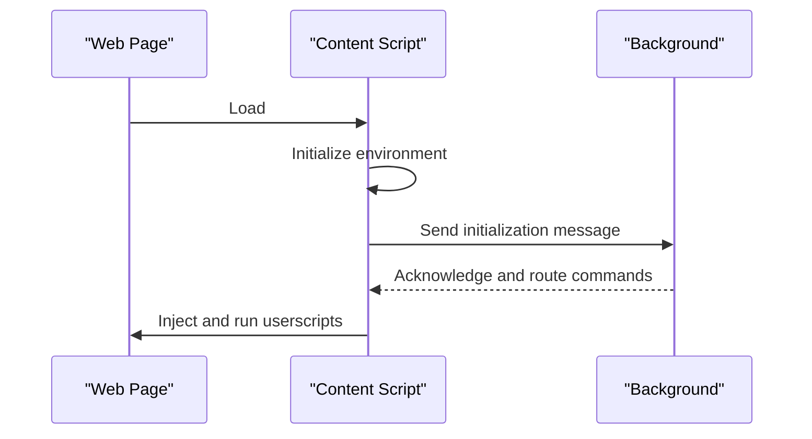
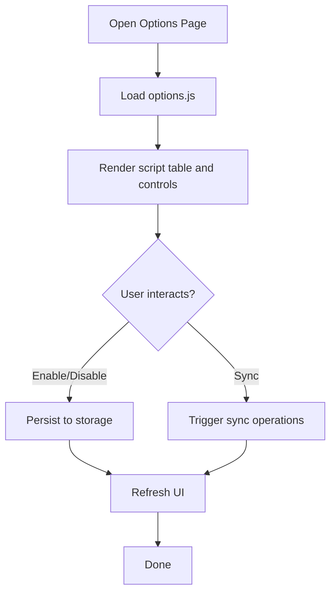
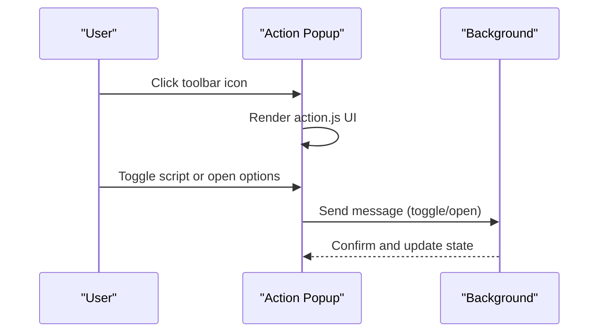
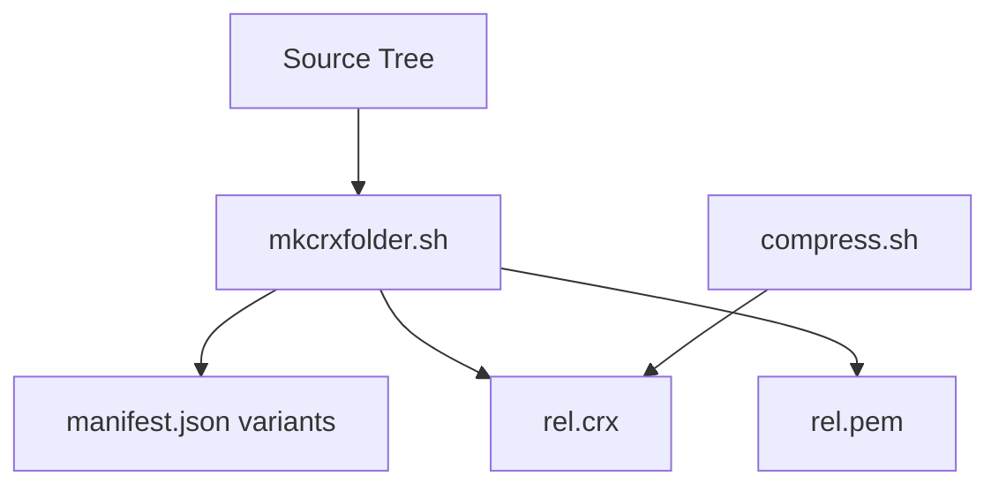

# Getting Started

<cite>
**Referenced Files in This Document**
- [README.md](file://README.md)
- [mkcrxfolder.sh](file://build_sys/mkcrxfolder.sh)
- [mkcrxfolder_mac.sh](file://build_sys/mkcrxfolder_mac.sh)
- [compress.sh](file://build_sys/compress.sh)
- [manifest.json.google.com](file://build_sys/manifest.json.google.com)
- [manifest.json.legacy.com](file://build_sys/manifest.json.legacy.com)
- [tm_legacy.legacy.xml](file://build_sys/tm_legacy.legacy.xml)
- [background.js](file://src/background.js)
- [options.js](file://src/options.js)
- [content.js](file://src/content.js)
- [action.js](file://src/action.js)
- [options.html](file://src/options.html)
- [action.html](file://src/action.html)
- [background.html](file://src/background.html)
</cite>

## Table of Contents
1. [Introduction](#introduction)
2. [Project Structure](#project-structure)
3. [Core Components](#core-components)
4. [Architecture Overview](#architecture-overview)
5. [Detailed Component Analysis](#detailed-component-analysis)
6. [Dependency Analysis](#dependency-analysis)
7. [Performance Considerations](#performance-considerations)
8. [Troubleshooting Guide](#troubleshooting-guide)
9. [Conclusion](#conclusion)
10. [Appendices](#appendices)

## Introduction
This guide helps you get started with Tampermonkey. It covers:
- Installing the extension via the Chrome Web Store (end users)
- Building and packaging the extension from source (contributors)
- Understanding the differences between stable, beta, and legacy distributions
- Verifying a successful installation
- Basic usage for new users

## Project Structure
At a high level, the repository provides:
- Source code for the extension (JavaScript, HTML, CSS, assets)
- Build scripts to assemble and package the extension
- Manifest files for modern and legacy distribution channels
- Internationalization resources and images

**Diagram sources**
- [mkcrxfolder.sh:1-137](file://build_sys/mkcrxfolder.sh#L1-L137)
- [mkcrxfolder_mac.sh:1-18](file://build_sys/mkcrxfolder_mac.sh#L1-L18)
- [compress.sh:1-84](file://build_sys/compress.sh#L1-L84)
- [manifest.json.google.com:1-43](file://build_sys/manifest.json.google.com#L1-L43)
- [manifest.json.legacy.com:1-38](file://build_sys/manifest.json.legacy.com#L1-L38)
- [tm_legacy.legacy.xml:1-7](file://build_sys/tm_legacy.legacy.xml#L1-L7)
- [background.js:1-200](file://src/background.js#L1-L200)
- [options.js:1-200](file://src/options.js#L1-L200)
- [content.js:1-200](file://src/content.js#L1-L200)
- [action.js:1-200](file://src/action.js#L1-L200)
- [options.html:1-38](file://src/options.html#L1-L38)
- [action.html:1-22](file://src/action.html#L1-L22)
- [background.html:1-19](file://src/background.html#L1-L19)

**Section sources**
- [README.md:1-112](file://README.md#L1-L112)
- [mkcrxfolder.sh:1-137](file://build_sys/mkcrxfolder.sh#L1-L137)
- [mkcrxfolder_mac.sh:1-18](file://build_sys/mkcrxfolder_mac.sh#L1-L18)
- [compress.sh:1-84](file://build_sys/compress.sh#L1-L84)
- [manifest.json.google.com:1-43](file://build_sys/manifest.json.google.com#L1-L43)
- [manifest.json.legacy.com:1-38](file://build_sys/manifest.json.legacy.com#L1-L38)
- [tm_legacy.legacy.xml:1-7](file://build_sys/tm_legacy.legacy.xml#L1-L7)

## Core Components
- Background runtime: Initializes extension logic, manages storage, updates, and cross-process communication.
- Content script: Injects and runs userscripts on web pages, coordinates with the background.
- Options UI: Manages scripts, settings, and synchronization.
- Action popup: Provides quick actions and script toggles.
- Build system: Assembles source into a distributable Chrome Extension package.

Key responsibilities:
- Background: Loads manifests, handles versioning, storage, and messaging.
- Content: Emulates environments, injects scripts, and manages events.
- Options: Renders the options page, manages script lists and settings.
- Action: Renders the browser action popup and handles user interactions.

**Section sources**
- [background.js:1-200](file://src/background.js#L1-L200)
- [content.js:1-200](file://src/content.js#L1-L200)
- [options.js:1-200](file://src/options.js#L1-L200)
- [action.js:1-200](file://src/action.js#L1-L200)

## Architecture Overview
The extension consists of:
- Manifest-driven registration of content scripts and background pages
- A background page that orchestrates long-running tasks
- Content scripts injected into web pages to execute userscripts
- UI pages (popup and options) for user interaction

**Diagram sources**
- [background.html:1-19](file://src/background.html#L1-L19)
- [background.js:1-200](file://src/background.js#L1-L200)
- [action.html:1-22](file://src/action.html#L1-L22)
- [action.js:1-200](file://src/action.js#L1-L200)
- [options.html:1-38](file://src/options.html#L1-L38)
- [options.js:1-200](file://src/options.js#L1-L200)
- [content.js:1-200](file://src/content.js#L1-L200)

## Detailed Component Analysis

### Installation Paths and Versions
- Stable: Distributed via the Chrome Web Store.
- Beta: Developer preview builds (may contain bugs).
- Legacy (Manifest V1): For older Chromium-based browsers.
- Retro: Very old version (no support).

Installation links and metadata are documented in the repository’s README.

**Section sources**
- [README.md:28-41](file://README.md#L28-L41)

### Build Prerequisites
- Supported browsers: Google Chrome or Chromium 17 or higher.
- Windows contributors: Install Cygwin.
- Optional: YUI Compressor JAR for minification during build.

**Section sources**
- [README.md:66-70](file://README.md#L66-L70)
- [compress.sh:7-20](file://build_sys/compress.sh#L7-L20)

### Build and Packaging Steps
1. Prepare environment
   - Install Google Chrome or Chromium.
   - On Windows, install Cygwin.
2. Obtain source
   - Use Subversion to check out the repository.
3. Prepare build folder
   - Link the build script and run it to populate the rel/ directory.
4. Optional: Minify JavaScript using the YUI Compressor.
5. Package the extension
   - Use the browser’s pack-extension command to produce a CRX and private key.
6. Install the extension
   - Drag-and-drop the CRX onto the Extensions page or launch via command line.

**Diagram sources**
- [README.md:70-104](file://README.md#L70-L104)
- [mkcrxfolder.sh:1-137](file://build_sys/mkcrxfolder.sh#L1-L137)
- [compress.sh:1-84](file://build_sys/compress.sh#L1-L84)

**Section sources**
- [README.md:70-104](file://README.md#L70-L104)
- [mkcrxfolder.sh:1-137](file://build_sys/mkcrxfolder.sh#L1-L137)
- [compress.sh:1-84](file://build_sys/compress.sh#L1-L84)

### Version Variants and Manifests
- Modern (Manifest V2): Uses manifest.json.google.com, supports latest APIs.
- Legacy (Manifest V1): Uses manifest.json.legacy.com, intended for older browsers.
- Update mechanism for legacy: A hosted XML file defines update URLs and versions.

**Diagram sources**
- [manifest.json.google.com:1-43](file://build_sys/manifest.json.google.com#L1-L43)
- [manifest.json.legacy.com:1-38](file://build_sys/manifest.json.legacy.com#L1-L38)
- [tm_legacy.legacy.xml:1-7](file://build_sys/tm_legacy.legacy.xml#L1-L7)
- [background.js:1-200](file://src/background.js#L1-L200)

**Section sources**
- [manifest.json.google.com:1-43](file://build_sys/manifest.json.google.com#L1-L43)
- [manifest.json.legacy.com:1-38](file://build_sys/manifest.json.legacy.com#L1-L38)
- [tm_legacy.legacy.xml:1-7](file://build_sys/tm_legacy.legacy.xml#L1-L7)

### Background Runtime
Responsibilities:
- Initialize logging and internal state
- Load and compare versions
- Manage storage and update notifications
- Handle extension lifecycle and messaging

**Diagram sources**
- [background.js:1-200](file://src/background.js#L1-L200)

**Section sources**
- [background.js:1-200](file://src/background.js#L1-L200)

### Content Script Execution
Responsibilities:
- Detect DOM readiness and injection timing
- Establish environment for userscripts
- Coordinate with background via messaging

**Diagram sources**
- [content.js:1-200](file://src/content.js#L1-L200)
- [background.js:1-200](file://src/background.js#L1-L200)

**Section sources**
- [content.js:1-200](file://src/content.js#L1-L200)
- [background.js:1-200](file://src/background.js#L1-L200)

### Options UI
Responsibilities:
- Render script list and settings
- Handle script enable/disable and actions
- Manage synchronization and import/export

**Diagram sources**
- [options.html:1-38](file://src/options.html#L1-L38)
- [options.js:1-200](file://src/options.js#L1-L200)

**Section sources**
- [options.html:1-38](file://src/options.html#L1-L38)
- [options.js:1-200](file://src/options.js#L1-L200)

### Action Popup
Responsibilities:
- Provide quick access to script toggles and menu commands
- Open options for a selected script

**Diagram sources**
- [action.html:1-22](file://src/action.html#L1-L22)
- [action.js:1-200](file://src/action.js#L1-L200)
- [background.js:1-200](file://src/background.js#L1-L200)

**Section sources**
- [action.html:1-22](file://src/action.html#L1-L22)
- [action.js:1-200](file://src/action.js#L1-L200)
- [background.js:1-200](file://src/background.js#L1-L200)

## Dependency Analysis
- Build-time dependencies:
  - Shell utilities and Subversion for source retrieval
  - Browser pack-extension CLI for CRX creation
  - Optional YUI Compressor JAR for minification
- Runtime dependencies:
  - Manifest-defined permissions and content scripts
  - Internal module loading via registry and helper utilities

**Diagram sources**
- [mkcrxfolder.sh:1-137](file://build_sys/mkcrxfolder.sh#L1-L137)
- [compress.sh:1-84](file://build_sys/compress.sh#L1-L84)
- [manifest.json.google.com:1-43](file://build_sys/manifest.json.google.com#L1-L43)
- [manifest.json.legacy.com:1-38](file://build_sys/manifest.json.legacy.com#L1-L38)

**Section sources**
- [mkcrxfolder.sh:1-137](file://build_sys/mkcrxfolder.sh#L1-L137)
- [compress.sh:1-84](file://build_sys/compress.sh#L1-L84)
- [manifest.json.google.com:1-43](file://build_sys/manifest.json.google.com#L1-L43)
- [manifest.json.legacy.com:1-38](file://build_sys/manifest.json.legacy.com#L1-L38)

## Performance Considerations
- Minification: Use the YUI Compressor to reduce payload size.
- Conditional bundling: Choose between compressed and uncompressed builds depending on deployment needs.
- Efficient content script injection: Ensure scripts run at appropriate times (document_start) to minimize page impact.

[No sources needed since this section provides general guidance]

## Troubleshooting Guide
Common issues and resolutions:
- Cannot install CRX
  - Ensure you are using a supported browser version.
  - Verify the CRX was built with the correct manifest variant.
- Extension does not appear in Chrome
  - Enable “Developer mode” and load unpacked extension.
  - Confirm the extension ID matches expectations for the chosen variant.
- Legacy version not updating
  - Check the hosted update XML for correct version and base URL.
- Build fails on Windows
  - Install and configure Cygwin properly.
  - Ensure Subversion client is available in PATH.

Verification steps:
- After installation, open the extension options page and confirm it loads without errors.
- Toggle a test userscript and verify it runs on a target site.
- Check the action popup for script status indicators.

**Section sources**
- [README.md:66-104](file://README.md#L66-L104)
- [tm_legacy.legacy.xml:1-7](file://build_sys/tm_legacy.legacy.xml#L1-L7)

## Conclusion
You now have the essentials to install Tampermonkey from the Chrome Web Store or build it locally. Use the modern variant for current browsers, the legacy variant for older Chromium-based browsers, and follow the build and verification steps to ensure a smooth setup.

[No sources needed since this section summarizes without analyzing specific files]

## Appendices

### Quick Links
- Stable download and documentation links are listed in the repository’s README.
- API and FAQ references are provided for further learning.

**Section sources**
- [README.md:50-57](file://README.md#L50-L57)