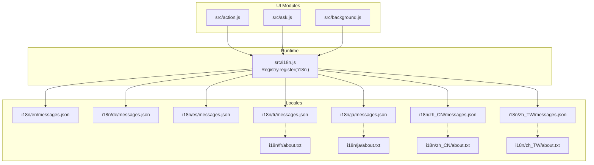
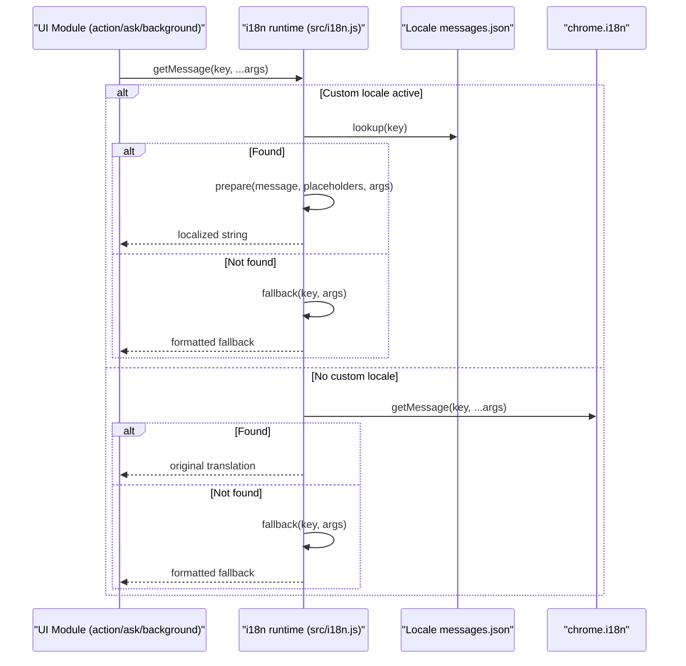
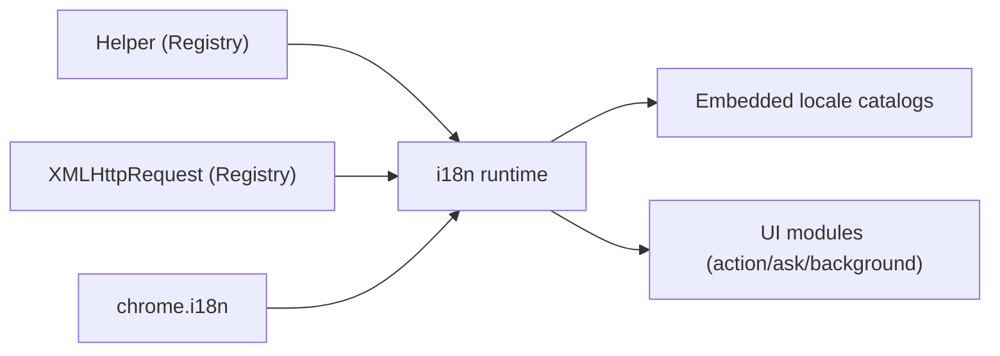

# Internationalization Support

<cite>
**Referenced Files in This Document**
- [src/i18n.js](file://src/i18n.js)
- [i18n/en/messages.json](file://i18n/en/messages.json)
- [i18n/de/messages.json](file://i18n/de/messages.json)
- [i18n/es/messages.json](file://i18n/es/messages.json)
- [i18n/fr/messages.json](file://i18n/fr/messages.json)
- [i18n/ja/messages.json](file://i18n/ja/messages.json)
- [i18n/zh_CN/messages.json](file://i18n/zh_CN/messages.json)
- [i18n/zh_TW/messages.json](file://i18n/zh_TW/messages.json)
- [i18n/fr/about.txt](file://i18n/fr/about.txt)
- [i18n/ja/about.txt](file://i18n/ja/about.txt)
- [i18n/zh_CN/about.txt](file://i18n/zh_CN/about.txt)
- [i18n/zh_TW/about.txt](file://i18n/zh_TW/about.txt)
- [src/action.js](file://src/action.js)
- [src/ask.js](file://src/ask.js)
- [src/background.js](file://src/background.js)
</cite>

## Table of Contents
1. [Introduction](#introduction)
2. [Project Structure](#project-structure)
3. [Core Components](#core-components)
4. [Architecture Overview](#architecture-overview)
5. [Detailed Component Analysis](#detailed-component-analysis)
6. [Dependency Analysis](#dependency-analysis)
7. [Performance Considerations](#performance-considerations)
8. [Troubleshooting Guide](#troubleshooting-guide)
9. [Conclusion](#conclusion)
10. [Appendices](#appendices)

## Introduction
This document explains Tampermonkey's internationalization (i18n) system. It covers the runtime translation engine, message file structure, supported locales, fallback behavior, and practical workflows for adding and maintaining translations. It also provides guidance for contributors adding new locales and best practices for translatable content and cultural adaptation.

## Project Structure
The i18n system consists of:
- A runtime JavaScript module that loads and resolves localized messages
- A set of locale directories under i18n/<lang>/ containing messages.json files
- Optional per-locale about.txt files with contributor metadata and links
- Application code that calls the i18n service to render localized UI text

**Diagram sources**
- [src/i18n.js:132-139](file://src/i18n.js#L132-L139)
- [i18n/en/messages.json:1-20](file://i18n/en/messages.json#L1-L20)
- [i18n/de/messages.json:1-20](file://i18n/de/messages.json#L1-L20)
- [i18n/es/messages.json:1-20](file://i18n/es/messages.json#L1-L20)
- [i18n/fr/messages.json:1-20](file://i18n/fr/messages.json#L1-L20)
- [i18n/ja/messages.json:1-20](file://i18n/ja/messages.json#L1-L20)
- [i18n/zh_CN/messages.json:1-20](file://i18n/zh_CN/messages.json#L1-L20)
- [i18n/zh_TW/messages.json:1-20](file://i18n/zh_TW/messages.json#L1-L20)
- [src/action.js:130-140](file://src/action.js#L130-L140)
- [src/ask.js:120-135](file://src/ask.js#L120-L135)
- [src/background.js:2350-2360](file://src/background.js#L2350-L2360)

**Section sources**
- [src/i18n.js:1-140](file://src/i18n.js#L1-L140)
- [i18n/en/messages.json:1-20](file://i18n/en/messages.json#L1-L20)
- [i18n/de/messages.json:1-20](file://i18n/de/messages.json#L1-L20)
- [i18n/es/messages.json:1-20](file://i18n/es/messages.json#L1-L20)
- [i18n/fr/messages.json:1-20](file://i18n/fr/messages.json#L1-L20)
- [i18n/ja/messages.json:1-20](file://i18n/ja/messages.json#L1-L20)
- [i18n/zh_CN/messages.json:1-20](file://i18n/zh_CN/messages.json#L1-L20)
- [i18n/zh_TW/messages.json:1-20](file://i18n/zh_TW/messages.json#L1-L20)

## Core Components
- Runtime i18n module: Provides getMessage, getOriginalMessage, setLocale, getLocale, and askForLocale. It loads locale-specific messages from embedded resources and applies placeholders and argument binding.
- Message catalogs: Each locale directory contains a messages.json with entries keyed by message identifiers and optional placeholders.
- UI integration: Action, ask, and background modules call i18n.getMessage to render localized text.

Key capabilities:
- Locale loading via setLocale
- Placeholder substitution with positional arguments
- Fallback to original Chrome i18n when a custom locale is not set
- Graceful fallback to underscore-based formatting when a message is missing

**Section sources**
- [src/i18n.js:72-88](file://src/i18n.js#L72-L88)
- [src/i18n.js:94-122](file://src/i18n.js#L94-L122)
- [src/i18n.js:132-139](file://src/i18n.js#L132-L139)

## Architecture Overview
The i18n runtime follows a layered approach:
- UI modules request localized strings via i18n.getMessage
- If a custom locale is active, the runtime resolves from the loaded locale catalog
- If no custom locale is active, it delegates to the browser's native i18n.getMessage
- If a message is missing, it applies a fallback formatter that replaces placeholders and underscores

**Diagram sources**
- [src/i18n.js:60-88](file://src/i18n.js#L60-L88)
- [src/i18n.js:15-33](file://src/i18n.js#L15-L33)

**Section sources**
- [src/i18n.js:60-88](file://src/i18n.js#L60-L88)
- [src/i18n.js:15-33](file://src/i18n.js#L15-L33)

## Detailed Component Analysis

### Runtime i18n Engine
The i18n engine exposes:
- getMessage(key, ...args): Resolves a localized message with placeholder replacement
- getOriginalMessage(key, ...args): Uses the browser's native i18n.getMessage
- setLocale(locale): Loads a locale catalog from embedded resources
- getLocale(): Returns the currently active locale
- askForLocale(callback): Requests current locale from background context

Placeholder processing:
- Placeholders are defined per-message with keys and numeric content indices
- Arguments are bound positionally to placeholders
- Fallback formatting replaces underscores and inserts arguments when placeholders mismatch

Fallback mechanism:
- If a message is not found in the active locale, the engine formats a fallback string
- If locale loading fails, it logs an error and continues with fallback behavior

**Section sources**
- [src/i18n.js:35-58](file://src/i18n.js#L35-L58)
- [src/i18n.js:60-88](file://src/i18n.js#L60-L88)
- [src/i18n.js:94-122](file://src/i18n.js#L94-L122)
- [src/i18n.js:132-139](file://src/i18n.js#L132-L139)

### Message File Structure
Each locale directory contains:
- messages.json: A JSON object mapping message identifiers to objects with:
  - message: The localized string
  - placeholders: Optional object mapping placeholder keys to content specs with positional indices
- about.txt (optional): Contributor info and links for coordination

Example structure highlights:
- Identifiers are hierarchical or descriptive (e.g., "Update_URL_", "Tampermonkey_assumes_0urlAllHttp0")
- Placeholders use $key$ syntax and content indices like $1, $2
- Numeric keys appear for digit-only labels (e.g., "1", "15_Seconds")

**Section sources**
- [i18n/en/messages.json:11-21](file://i18n/en/messages.json#L11-L21)
- [i18n/de/messages.json:11-21](file://i18n/de/messages.json#L11-L21)
- [i18n/es/messages.json:11-21](file://i18n/es/messages.json#L11-L21)
- [i18n/fr/messages.json:1-20](file://i18n/fr/messages.json#L1-L20)
- [i18n/ja/messages.json:1-20](file://i18n/ja/messages.json#L1-L20)
- [i18n/zh_CN/messages.json:11-21](file://i18n/zh_CN/messages.json#L11-L21)
- [i18n/zh_TW/messages.json:11-21](file://i18n/zh_TW/messages.json#L11-L21)

### Supported Locales and Coverage
Supported locales include:
- English (en)
- German (de)
- Spanish (es)
- French (fr)
- Japanese (ja)
- Chinese Simplified (zh_CN)
- Chinese Traditional (zh_TW)

Notes:
- Some locales include additional about.txt files with contributor contact info and links
- The presence of placeholders indicates dynamic insertion of values (names, URLs, versions)

**Section sources**
- [i18n/fr/about.txt:1-2](file://i18n/fr/about.txt#L1-L2)
- [i18n/ja/about.txt:1-5](file://i18n/ja/about.txt#L1-L5)
- [i18n/zh_CN/about.txt:1-7](file://i18n/zh_CN/about.txt#L1-L7)
- [i18n/zh_TW/about.txt:1-4](file://i18n/zh_TW/about.txt#L1-L4)

### Locale Loading and Activation
- setLocale(locale) loads messages.json from the embedded resource path _locales/<locale>/messages.json
- On success, the runtime switches to the custom locale; on failure, it logs and remains in a safe fallback state
- askForLocale(callback) requests the current locale from the background context

**Section sources**
- [src/i18n.js:94-122](file://src/i18n.js#L94-L122)
- [src/i18n.js:124-130](file://src/i18n.js#L124-L130)

### UI Integration Examples
- action.js uses i18n.getMessage for enabling/disabling states, dialogs, and notifications
- ask.js uses i18n.getMessage for installer prompts and progress text
- background.js uses i18n.getMessage for TamperFire status and update notifications

These integrations demonstrate:
- Static message keys for labels and buttons
- Dynamic keys with placeholders for names, URLs, and versions
- Consistent fallback behavior when keys are missing

**Section sources**
- [src/action.js:130-140](file://src/action.js#L130-L140)
- [src/action.js:250-260](file://src/action.js#L250-L260)
- [src/ask.js:120-135](file://src/ask.js#L120-L135)
- [src/ask.js:170-185](file://src/ask.js#L170-L185)
- [src/background.js:920-940](file://src/background.js#L920-L940)
- [src/background.js:1200-1245](file://src/background.js#L1200-L1245)

## Dependency Analysis
The i18n runtime depends on:
- Registry for helper utilities and XMLHttpRequest
- Embedded locale catalogs via Registry.getRaw
- Browser chrome.i18n for fallback resolution

UI modules depend on:
- i18n.getMessage for rendering localized text
- Config values for initial locale selection

**Diagram sources**
- [src/i18n.js:8-9](file://src/i18n.js#L8-L9)
- [src/i18n.js:94-122](file://src/i18n.js#L94-L122)

**Section sources**
- [src/i18n.js:8-9](file://src/i18n.js#L8-L9)
- [src/i18n.js:94-122](file://src/i18n.js#L94-L122)

## Performance Considerations
- Locale switching involves parsing JSON and iterating placeholders; keep message catalogs concise
- Prefer static message keys over dynamic keys to minimize runtime processing
- Avoid excessive placeholder substitutions in hot paths; batch UI updates when possible
- Use getOriginalMessage only when necessary to leverage browser caching

## Troubleshooting Guide
Common issues and resolutions:
- Missing locale file: setLocale logs a parsing failure; verify the locale directory exists and messages.json is valid
- Missing message key: fallback formatter replaces underscores and attempts argument insertion; confirm the key exists in the active locale
- Argument count mismatch: placeholder processing logs warnings; ensure placeholders match the number of provided arguments
- Locale activation problems: ensure the locale string matches the directory name and messages.json is properly formatted

Operational checks:
- Verify setLocale returns true after successful loading
- Confirm askForLocale callback receives a valid locale identifier
- Test fallback behavior by temporarily removing a message key

**Section sources**
- [src/i18n.js:108-113](file://src/i18n.js#L108-L113)
- [src/i18n.js:49-55](file://src/i18n.js#L49-L55)
- [src/i18n.js:15-33](file://src/i18n.js#L15-L33)

## Conclusion
Tampermonkey’s i18n system provides a robust, extensible foundation for localization. The runtime engine supports dynamic locale switching, placeholder substitution, and graceful fallbacks. The message catalogs enable consistent translation across UI modules, while contributor metadata helps maintain quality and coordination.

## Appendices

### Practical Workflows

#### Adding a New Translation
1. Create a new locale directory under i18n/<new_locale>/ and add messages.json with translated strings and placeholders
2. Optionally add an about.txt with contributor info and links
3. Load the locale using setLocale("<new_locale>") in the UI
4. Verify translations appear correctly and fallbacks behave as expected

#### Updating Existing Messages
1. Edit the appropriate messages.json for the target locale
2. Ensure placeholder keys and indices remain consistent with UI code
3. Validate argument counts and test dynamic keys with sample values

#### Testing Internationalization Features
- Switch locales dynamically and observe UI updates
- Temporarily remove a message key to verify fallback formatting
- Use getOriginalMessage to compare against browser-provided translations

Best practices for translatable content:
- Keep keys descriptive and stable across versions
- Use placeholders for dynamic values (names, URLs, versions)
- Avoid concatenating translated segments; use placeholders instead
- Consider cultural adaptations (date/time formats, number formatting) at higher layers if needed

**Section sources**
- [src/i18n.js:94-122](file://src/i18n.js#L94-L122)
- [i18n/fr/about.txt:1-2](file://i18n/fr/about.txt#L1-L2)
- [i18n/ja/about.txt:1-5](file://i18n/ja/about.txt#L1-L5)
- [i18n/zh_CN/about.txt:1-7](file://i18n/zh_CN/about.txt#L1-L7)
- [i18n/zh_TW/about.txt:1-4](file://i18n/zh_TW/about.txt#L1-L4)