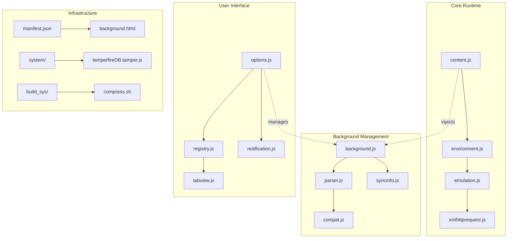
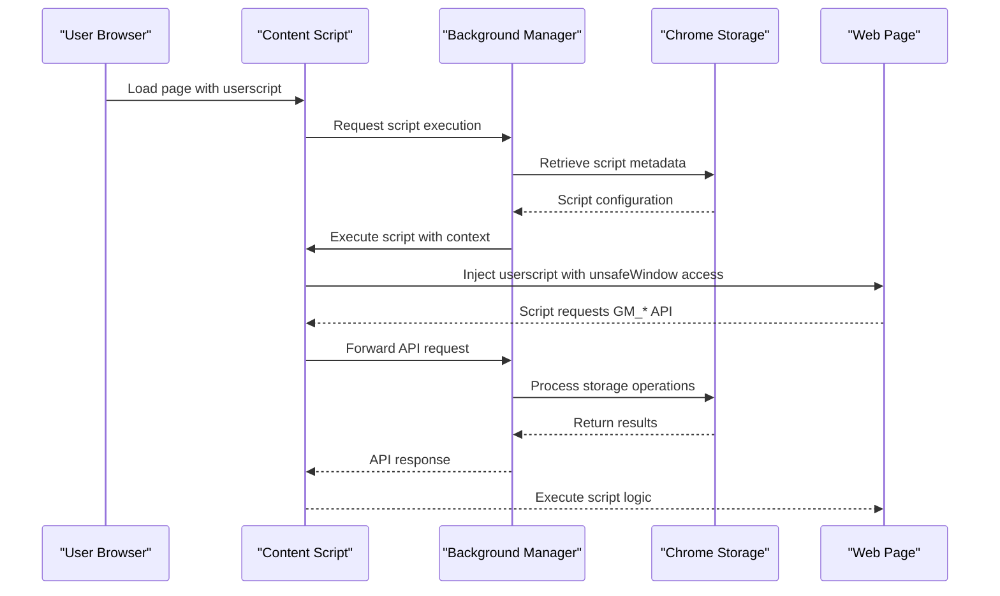
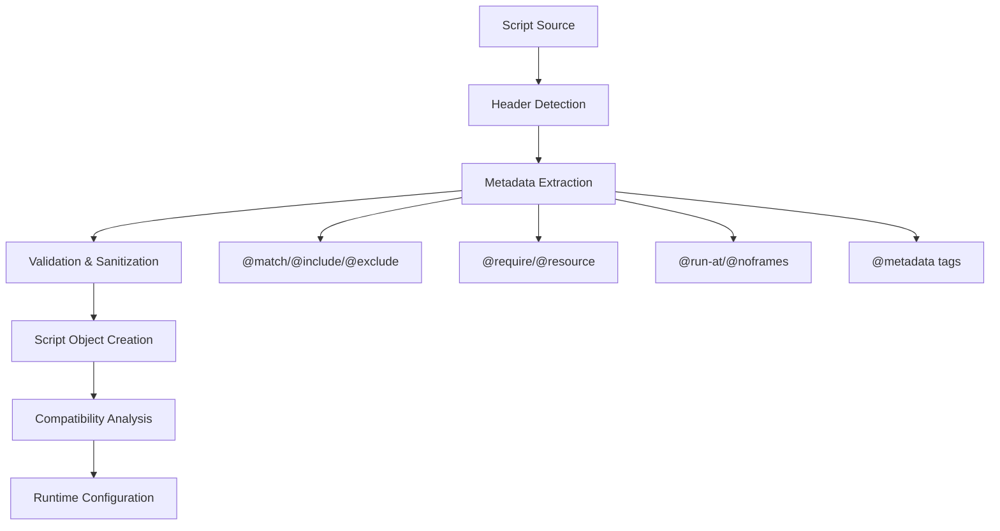
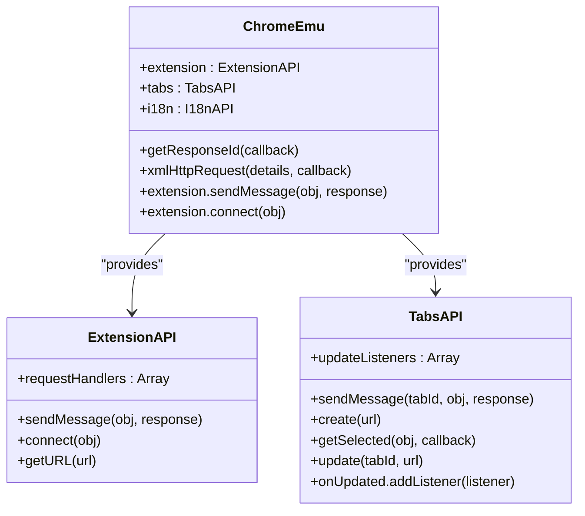
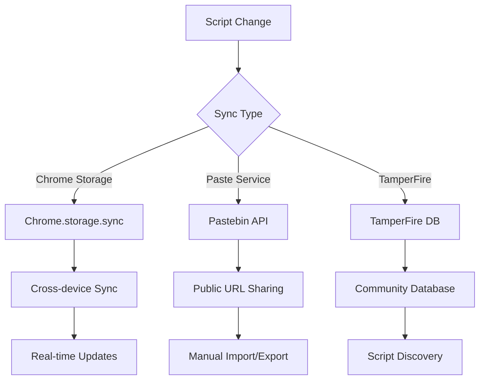
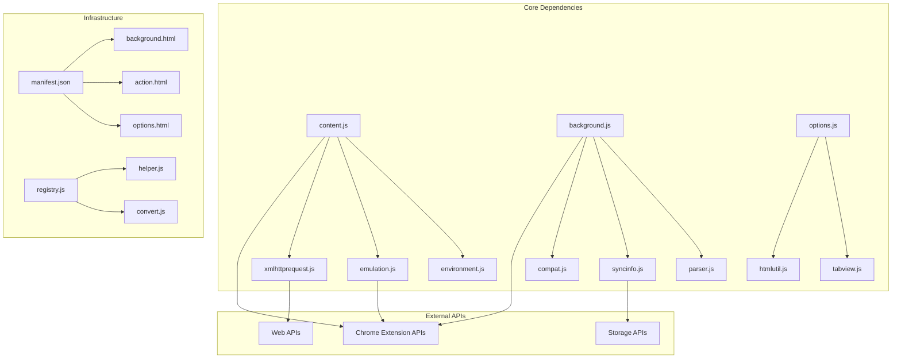

# Project Overview

<cite>
**Referenced Files in This Document**
- [README.md](file://README.md)
- [COPYING](file://COPYING)
- [manifest.json.google.com](file://build_sys/manifest.json.google.com)
- [background.js](file://src/background.js)
- [content.js](file://src/content.js)
- [options.js](file://src/options.js)
- [parser.js](file://src/parser.js)
- [compat.js](file://src/compat.js)
- [emulation.js](file://src/emulation.js)
- [syncinfo.js](file://src/syncinfo.js)
- [tamperfireDB.tamper.js](file://src/system/tamperfireDB.tamper.js)
</cite>

## Table of Contents
1. [Introduction](#introduction)
2. [Project Structure](#project-structure)
3. [Core Components](#core-components)
4. [Architecture Overview](#architecture-overview)
5. [Detailed Component Analysis](#detailed-component-analysis)
6. [Dependency Analysis](#dependency-analysis)
7. [Performance Considerations](#performance-considerations)
8. [Troubleshooting Guide](#troubleshooting-guide)
9. [Conclusion](#conclusion)

## Introduction
Tampermonkey is the most popular userscript manager for Google Chrome. It provides a comprehensive platform for installing, managing, editing, and synchronizing userscripts across Chrome instances. The project emphasizes broad API compatibility with Greasemonkey and Scriptish, extensive metadata tag support, and robust cross-domain request capabilities.

Key highlights:
- Userscript lifecycle management (install, edit, enable/disable, update, uninstall)
- Full unsafeWindow access for advanced page manipulation
- Complete GM_* API compatibility including GM_registerMenuCommand, GM_getResourceText, GM_getResourceURL, and GM_notification
- Multi-format synchronization (Chrome Storage Sync, Pastebin, and TamperFire integration)
- Advanced editing capabilities with CodeMirror integration and multiple keymap modes
- Support for Greasemonkey-style metadata tags (@resource, @require, @match, @include, @exclude)

The project operates under the GPLv3 license for versions up to 2.9, with newer versions distributed under proprietary licensing. This open-source foundation demonstrates Tampermonkey's commitment to transparency and community-driven development.

**Section sources**
- [README.md:4-17](file://README.md#L4-L17)
- [COPYING:1-674](file://COPYING#L1-L674)

## Project Structure
The Tampermonkey codebase follows a modular architecture with distinct layers for content injection, background management, UI components, and infrastructure services.

**Diagram sources**
- [manifest.json.google.com:1-43](file://build_sys/manifest.json.google.com#L1-L43)
- [content.js:1-800](file://src/content.js#L1-L800)
- [background.js:1-800](file://src/background.js#L1-L800)
- [options.js:1-800](file://src/options.js#L1-L800)

The project is organized around several key directories:
- `src/`: Core JavaScript modules for content injection, background management, and UI
- `build_sys/`: Build scripts and manifest configurations for Chrome Extension packaging
- `i18n/`: Internationalization resources for multiple languages
- `images/`: Extension icons and UI assets
- `server/`: Update service endpoint for script auto-updates

**Section sources**
- [manifest.json.google.com:1-43](file://build_sys/manifest.json.google.com#L1-L43)

## Core Components
Tampermonkey's functionality centers around four primary components that work together to provide seamless userscript management:

### Content Script Engine
The content script engine injects userscripts into web pages and manages their execution environment. It provides a secure sandbox while maintaining access to page resources through unsafeWindow emulation.

### Background Manager
The background manager handles persistent operations including script storage, update checking, synchronization coordination, and cross-tab communication. It maintains the extension's state and coordinates with Chrome's native APIs.

### Editor Interface
The editor interface offers a comprehensive development environment with CodeMirror integration, syntax highlighting, multiple keymap modes, and advanced editing features including search, formatting, and comment continuation.

### Synchronization System
The synchronization system enables userscripts to be shared across multiple Chrome installations through various mechanisms including Chrome's native storage sync, external paste services, and TamperFire database integration.

**Section sources**
- [content.js:1-800](file://src/content.js#L1-L800)
- [background.js:1-800](file://src/background.js#L1-L800)
- [options.js:1-800](file://src/options.js#L1-L800)
- [syncinfo.js:1-395](file://src/syncinfo.js#L1-L395)

## Architecture Overview
Tampermonkey implements a layered architecture that separates concerns between content injection, background management, and user interface components while maintaining tight integration with Chrome's extension APIs.

**Diagram sources**
- [content.js:108-307](file://src/content.js#L108-L307)
- [background.js:642-800](file://src/background.js#L642-L800)
- [emulation.js:40-329](file://src/emulation.js#L40-L329)

The architecture ensures separation of concerns while enabling efficient communication between components. The content script layer handles page-level interactions, the background layer manages persistent state and Chrome integration, and the UI layer provides user-facing functionality.

**Section sources**
- [content.js:1-800](file://src/content.js#L1-L800)
- [background.js:1-800](file://src/background.js#L1-L800)
- [emulation.js:1-329](file://src/emulation.js#L1-L329)

## Detailed Component Analysis

### Script Parser and Metadata System
The parser component extracts and validates userscript metadata from the script header, supporting a comprehensive set of Greasemonkey-compatible tags including @match, @include, @exclude, @require, @resource, and @run-at directives.

**Diagram sources**
- [parser.js:75-282](file://src/parser.js#L75-L282)

The parser implements robust validation and sanitization to prevent security issues while supporting advanced features like custom user-agent strings, frame restrictions, and compatibility mode detection.

**Section sources**
- [parser.js:1-286](file://src/parser.js#L1-L286)
- [compat.js:1-275](file://src/compat.js#L1-L275)

### Emulation Layer for GM_API Compatibility
The emulation layer provides full compatibility with Greasemonkey's API by translating GM_* function calls into Chrome extension equivalents while maintaining the original API surface.

**Diagram sources**
- [emulation.js:40-329](file://src/emulation.js#L40-L329)

The emulation layer handles complex scenarios like cross-frame communication, storage operations, and asynchronous request/response patterns while maintaining API compatibility.

**Section sources**
- [emulation.js:1-329](file://src/emulation.js#L1-L329)

### Synchronization Infrastructure
The synchronization system supports multiple mechanisms for sharing userscripts across devices, including Chrome's native storage sync, external paste services, and TamperFire database integration.

**Diagram sources**
- [syncinfo.js:68-395](file://src/syncinfo.js#L68-L395)
- [tamperfireDB.tamper.js:1-352](file://src/system/tamperfireDB.tamper.js#L1-L352)

The synchronization system implements conflict resolution, change detection, and batch processing to ensure reliable cross-device script management.

**Section sources**
- [syncinfo.js:1-395](file://src/syncinfo.js#L1-L395)
- [tamperfireDB.tamper.js:1-352](file://src/system/tamperfireDB.tamper.js#L1-L352)

## Dependency Analysis
Tampermonkey's dependency graph reveals a well-structured modular system with clear separation of concerns and minimal external dependencies.

**Diagram sources**
- [manifest.json.google.com:1-43](file://build_sys/manifest.json.google.com#L1-L43)
- [content.js:1-800](file://src/content.js#L1-L800)
- [background.js:1-800](file://src/background.js#L1-L800)
- [options.js:1-800](file://src/options.js#L1-L800)

The dependency analysis shows that Tampermonkey relies primarily on Chrome's native extension APIs and implements most functionality internally, minimizing external dependencies and maximizing portability.

**Section sources**
- [manifest.json.google.com:1-43](file://build_sys/manifest.json.google.com#L1-L43)

## Performance Considerations
Tampermonkey implements several performance optimizations to minimize overhead on page load and script execution:

- **Lazy Loading**: Scripts are only processed when needed, with caching mechanisms for frequently accessed resources
- **Efficient Message Passing**: Optimized communication between content scripts and background pages reduces latency
- **Memory Management**: Proper cleanup of event listeners and temporary objects prevents memory leaks
- **Selective Injection**: Scripts are only injected into pages where they match configured patterns
- **Batch Operations**: Synchronization and update operations are batched to reduce API calls

The project maintains performance through careful resource management and efficient algorithm design, ensuring that userscripts execute quickly without impacting browser performance.

## Troubleshooting Guide
Common issues and their solutions:

### Script Not Running
- Verify script matches are correctly configured in the options panel
- Check for conflicts with page scripts or ad blockers
- Review console logs for error messages during script initialization

### Synchronization Issues
- Ensure Chrome storage sync is enabled in browser settings
- Verify network connectivity for external sync services
- Check for quota limits on storage sync API

### API Compatibility Problems
- Review compatibility options for specific userscripts
- Check for unsupported GM_* functions in the target script
- Verify @grant declarations match available permissions

### Performance Issues
- Disable unused scripts to reduce injection overhead
- Review script execution timing (@run-at settings)
- Monitor memory usage through Chrome's task manager

**Section sources**
- [content.js:455-608](file://src/content.js#L455-L608)
- [background.js:642-800](file://src/background.js#L642-L800)

## Conclusion
Tampermonkey represents a mature, feature-rich userscript management solution that has established itself as the definitive choice for Chrome users seeking advanced userscript capabilities. Its comprehensive API compatibility, robust synchronization system, and extensive metadata support demonstrate a deep understanding of the userscript ecosystem's needs.

The project's open-source foundation (GPLv3) for versions up to 2.9 provides transparency and community involvement, while the modern Chrome Extension architecture ensures reliable performance and security. The modular design allows for easy maintenance and extension of functionality while maintaining backward compatibility with existing userscripts.

Key strengths include:
- Broad API compatibility with Greasemonkey and Scriptish
- Comprehensive metadata tag support
- Advanced editing capabilities with CodeMirror integration
- Multiple synchronization mechanisms
- Robust cross-domain request handling
- Security-conscious design with unsafeWindow access controls

The project continues to serve as a cornerstone of the Chrome extension ecosystem, providing users and developers with powerful tools for customizing their browsing experience while maintaining the flexibility needed for complex userscript development.