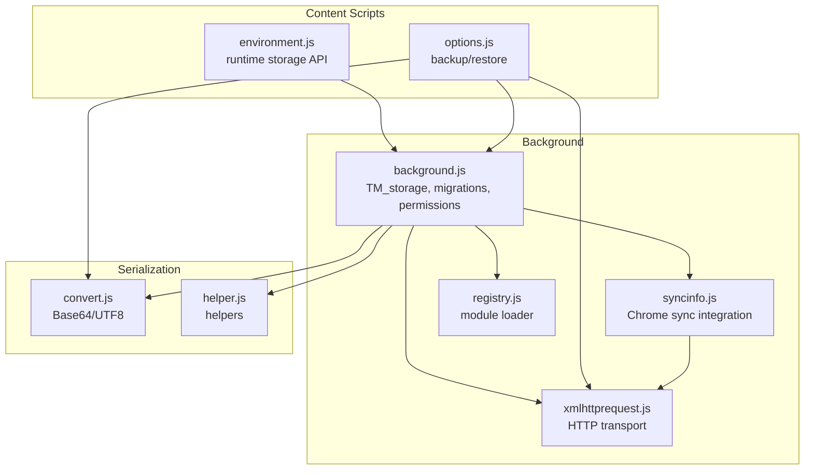
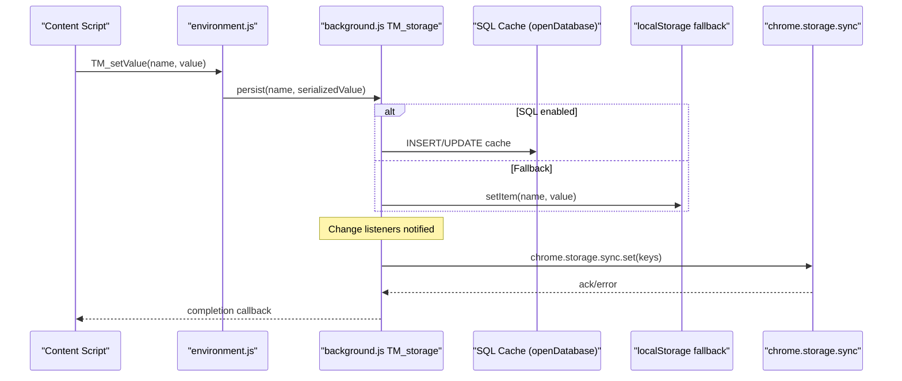
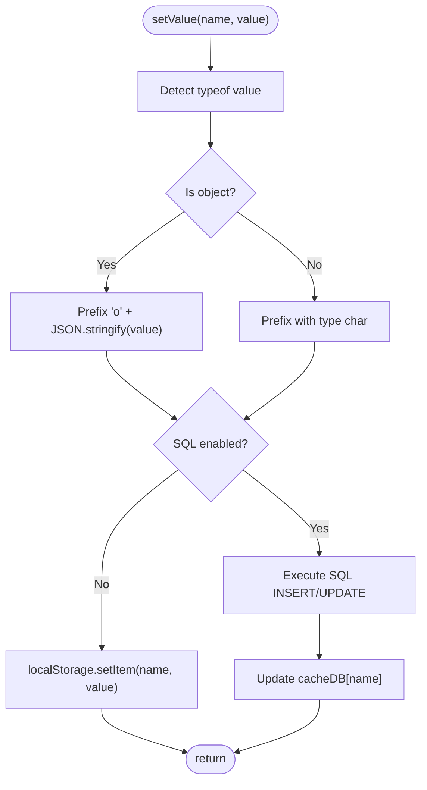
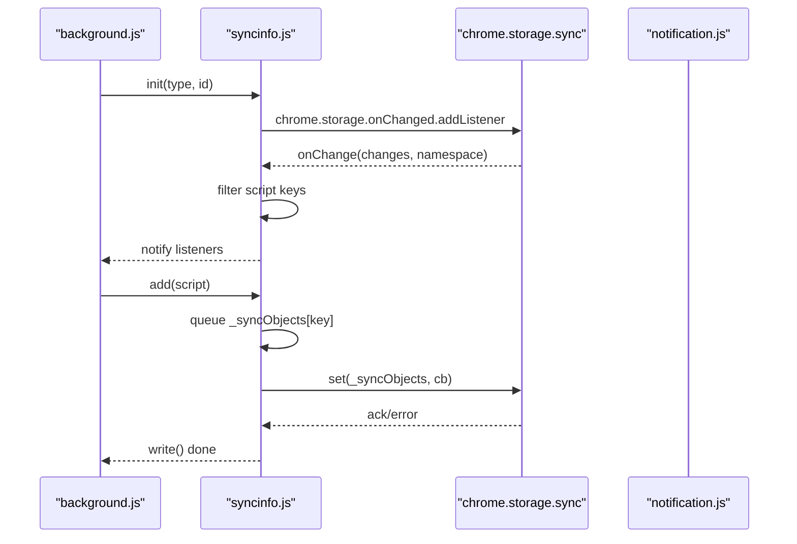
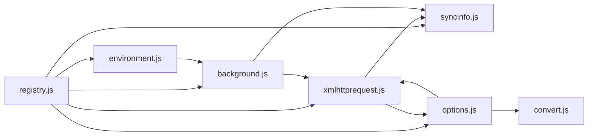

# Storage and Persistence

<cite>
**Referenced Files in This Document**
- [background.js](file://src/background.js)
- [syncinfo.js](file://src/syncinfo.js)
- [environment.js](file://src/environment.js)
- [options.js](file://src/options.js)
- [xmlhttprequest.js](file://src/xmlhttprequest.js)
- [convert.js](file://src/convert.js)
- [helper.js](file://src/helper.js)
- [registry.js](file://src/registry.js)
- [notification.js](file://src/notification.js)
</cite>

## Table of Contents
1. [Introduction](#introduction)
2. [Project Structure](#project-structure)
3. [Core Components](#core-components)
4. [Architecture Overview](#architecture-overview)
5. [Detailed Component Analysis](#detailed-component-analysis)
6. [Dependency Analysis](#dependency-analysis)
7. [Performance Considerations](#performance-considerations)
8. [Troubleshooting Guide](#troubleshooting-guide)
9. [Conclusion](#conclusion)
10. [Appendices](#appendices)

## Introduction
This document explains Tampermonkey’s storage and persistence system. It covers local storage mechanisms, database schema for script metadata and configuration, storage APIs, serialization, backup/restore, integration with Chrome’s storage APIs, migration strategies, version compatibility, and practical guidance for performance, security, and best practices.

## Project Structure
The storage system spans several modules:
- Background storage manager and persistence: [background.js](file://src/background.js)
- Chrome storage synchronization: [syncinfo.js](file://src/syncinfo.js)
- Content-script storage API: [environment.js](file://src/environment.js)
- Backup/restore utilities: [options.js](file://src/options.js)
- Network transport for sync and migrations: [xmlhttprequest.js](file://src/xmlhttprequest.js)
- Serialization helpers: [convert.js](file://src/convert.js), [helper.js](file://src/helper.js)
- Module loader: [registry.js](file://src/registry.js)
- Permission prompts: [notification.js](file://src/notification.js)



**Diagram sources**
- [background.js](file://src/background.js)
- [syncinfo.js](file://src/syncinfo.js)
- [environment.js](file://src/environment.js)
- [options.js](file://src/options.js)
- [xmlhttprequest.js](file://src/xmlhttprequest.js)
- [convert.js](file://src/convert.js)
- [helper.js](file://src/helper.js)
- [registry.js](file://src/registry.js)

**Section sources**
- [background.js](file://src/background.js)
- [syncinfo.js](file://src/syncinfo.js)
- [environment.js](file://src/environment.js)
- [options.js](file://src/options.js)
- [xmlhttprequest.js](file://src/xmlhttprequest.js)
- [convert.js](file://src/convert.js)
- [helper.js](file://src/helper.js)
- [registry.js](file://src/registry.js)

## Core Components
- Local storage manager (background): Provides a unified API to persist extension configuration and script metadata. It supports a SQL-backed cache and falls back to browser storage when needed.
- Chrome storage synchronization: Integrates with Chrome’s storage.sync for cross-device script metadata synchronization and change notifications.
- Content-script storage API: Exposes a lightweight storage interface to content scripts with automatic persistence and change notifications.
- Backup/restore utilities: Export/import scripts and configuration via textarea, file, or sandboxed filesystem.
- Migration engine: Converts legacy storage formats and updates keys across versions.
- Permissions and notifications: Requests storage permission for Chrome sync and displays prompts.

**Section sources**
- [background.js](file://src/background.js)
- [syncinfo.js](file://src/syncinfo.js)
- [environment.js](file://src/environment.js)
- [options.js](file://src/options.js)

## Architecture Overview
The storage architecture combines:
- A background storage manager with optional SQL-backed cache
- Browser storage fallback
- Chrome storage sync integration
- Content-script storage API
- Backup/restore pipeline
- Migration and versioning logic



**Diagram sources**
- [background.js](file://src/background.js)
- [environment.js](file://src/environment.js)
- [syncinfo.js](file://src/syncinfo.js)

## Detailed Component Analysis

### Local Storage Manager (Background)
Responsibilities:
- Initialize storage backend (SQL cache or localStorage)
- Serialize/deserialize values by type
- Provide setValue/getValue/deleteValue/listValues
- Maintain a cache for fast reads
- Support migration from legacy storage

Key behaviors:
- Type-aware serialization prefixes values with a single-character type marker, then stores JSON for objects.
- Uses SQL transactions for inserts/updates/deletes when available.
- Falls back to localStorage when SQL is disabled.
- Maintains an in-memory cache keyed by escaped names.



**Diagram sources**
- [background.js](file://src/background.js)

**Section sources**
- [background.js](file://src/background.js)

### Database Schema for Script Metadata and Configuration
Schema:
- Table: config
  - Columns: ID (autoincrement), name (TEXT), value (TEXT)
- Indexes: implicit primary key on ID; name is used as a unique key in practice

Initialization and caching:
- On startup, the background initializes the table and loads all rows into an in-memory cache for fast lookup.

Constraints and limits:
- Values are stored as TEXT; serialization handles type safety.
- Maximum DB size is configured during openDatabase initialization.

**Section sources**
- [background.js](file://src/background.js)

### Storage API Surface
- Background storage API (TM_storage):
  - setValue(name, value, cb)
  - getValue(name, defaultValue)
  - deleteValue(name, cb)
  - deleteAll(cb)
  - listValues()
- Content-script storage API (environment.js):
  - TM_setValue(name, value)
  - TM_getValue(name, defaultValue)
  - TM_deleteValue(name)
  - TM_listValues()
  - TM_addValueChangeListener(name, cb)
  - TM_removeValueChangeListener(id)

Notes:
- Content-script API serializes values similarly and persists them via background.
- Change listeners are invoked locally on the content context.

**Section sources**
- [background.js](file://src/background.js)
- [environment.js](file://src/environment.js)

### Data Serialization and Versioning
Serialization:
- Values are prefixed with a type marker:
  - 'b' for booleans
  - 'n' for numbers
  - 'o' for objects (JSON)
  - default for strings
- Objects are serialized with JSON; deserialization attempts JSON parsing and returns default on failure.

Versioning and migration:
- On startup, the system detects the installed version and runs a series of migration steps to upgrade storage from older versions.
- Migrations copy data from localStorage to SQL-backed storage, re-save scripts, normalize keys, and reset counters as needed.

**Section sources**
- [background.js](file://src/background.js)
- [helper.js](file://src/helper.js)
- [convert.js](file://src/convert.js)

### Backup and Restore
Backup:
- Export scripts and configuration to:
  - Text area (JSON)
  - Downloaded file
  - Sandbox filesystem (PERSISTENT)

Restore:
- Import from:
  - Text area
  - File
  - Sandbox filesystem

Mechanics:
- Export constructs a JSON payload containing script metadata and encoded source.
- Import decodes and sends messages to the background to save scripts and update options.

```mermaid
sequenceDiagram
participant UI as "Options UI"
participant OPT as "options.js"
participant BG as "background.js"
participant FS as "SandboxFS/File"
UI->>OPT : Export to Textarea
OPT->>UI : JSON payload
UI->>OPT : Export to File
OPT->>FS : Write blob to file
UI->>OPT : Import from Textarea
OPT->>BG : sendMessage(saveScript, ...)
UI->>OPT : Import from File
OPT->>FS : Read file
OPT->>BG : sendMessage(saveScript, ...)
```

**Diagram sources**
- [options.js](file://src/options.js)

**Section sources**
- [options.js](file://src/options.js)

### Integration with Chrome’s Storage APIs
- Chrome sync integration:
  - Subscribes to chrome.storage.onChanged for script-related keys ending with a specific appendix.
  - Writes pending sync objects to chrome.storage.sync with retry logic and locking.
  - Supports listing remote scripts and removing entries.
- Permission handling:
  - Requests storage permission when needed for Chrome sync.
  - Displays a notification prompt and handles user response.



**Diagram sources**
- [syncinfo.js](file://src/syncinfo.js)
- [background.js](file://src/background.js)
- [notification.js](file://src/notification.js)

**Section sources**
- [syncinfo.js](file://src/syncinfo.js)
- [background.js](file://src/background.js)
- [notification.js](file://src/notification.js)

### Data Migration Strategies and Version Compatibility
- Deterministic version detection and comparison
- Conditional migration steps executed in order
- Examples of migrations:
  - Copy from localStorage to SQL-backed storage
  - Re-save scripts to normalize metadata
  - Reset update-check counters
  - Rename/remove obsolete keys
- Graceful fallbacks and retries for network operations

**Section sources**
- [background.js](file://src/background.js)

### Practical Examples of Storage Operations
- Set a value in background storage:
  - Call TM_storage.setValue with a typed value; the manager serializes and persists it.
- Get a value with defaults:
  - Use TM_storage.getValue(name, defaultValue); deserializes and returns appropriate type.
- Delete a value:
  - TM_storage.deleteValue(name) removes from cache and underlying storage.
- List values:
  - TM_storage.listValues enumerates keys from cache or localStorage.
- Content-script storage:
  - Use TM_setValue/TM_getValue/TM_deleteValue within content scripts; changes propagate to background and listeners.

Note: These operations are implemented in the referenced files and use the serialization and persistence patterns described above.

**Section sources**
- [background.js](file://src/background.js)
- [environment.js](file://src/environment.js)

## Dependency Analysis
- background.js depends on:
  - openDatabase for SQL cache
  - localStorage fallback
  - xmlhttpRequest for migrations and sync
  - Registry for module loading
- syncinfo.js depends on:
  - xmlhttpRequest for HTTP sync
  - chrome.storage APIs for sync
- environment.js depends on:
  - background messaging to persist values
- options.js depends on:
  - xmlhttpRequest for file operations
  - convert helpers for encoding
- registry.js provides module loading for all components



**Diagram sources**
- [registry.js](file://src/registry.js)
- [background.js](file://src/background.js)
- [syncinfo.js](file://src/syncinfo.js)
- [environment.js](file://src/environment.js)
- [options.js](file://src/options.js)
- [xmlhttprequest.js](file://src/xmlhttprequest.js)
- [convert.js](file://src/convert.js)

**Section sources**
- [registry.js](file://src/registry.js)
- [background.js](file://src/background.js)
- [syncinfo.js](file://src/syncinfo.js)
- [environment.js](file://src/environment.js)
- [options.js](file://src/options.js)
- [xmlhttprequest.js](file://src/xmlhttprequest.js)
- [convert.js](file://src/convert.js)

## Performance Considerations
- Prefer batched writes for sync:
  - The sync layer queues changes and writes periodically to reduce API churn.
- Use the SQL cache for frequent reads:
  - The cache avoids repeated SQL queries and localStorage lookups.
- Limit object sizes:
  - Large objects incur serialization overhead; consider splitting data or deferring heavy payloads.
- Network retries:
  - HTTP operations include retry logic; configure timeouts appropriately to balance reliability and latency.
- Avoid excessive change notifications:
  - Minimize rapid successive writes to prevent redundant listener invocations.

[No sources needed since this section provides general guidance]

## Troubleshooting Guide
Common issues and resolutions:
- Storage permission errors for Chrome sync:
  - Request permission via the built-in prompt; the system handles user consent and restarts if needed.
- Deserialization failures:
  - If JSON parsing fails during getValue, the system logs an error and returns the default value.
- Migration failures:
  - Migrations run conditionally by version; if a step fails, inspect logs and rerun the migration.
- Sync conflicts:
  - The sync layer filters script-related keys and ignores non-script changes; verify key naming conventions.

**Section sources**
- [background.js](file://src/background.js)
- [syncinfo.js](file://src/syncinfo.js)
- [notification.js](file://src/notification.js)

## Conclusion
Tampermonkey’s storage system combines a robust background storage manager with optional SQL caching, a content-script storage API, and seamless Chrome storage integration. It includes comprehensive migration logic, serialization safeguards, and backup/restore utilities. Following the best practices outlined here will help ensure reliable, secure, and performant data management across devices and versions.

[No sources needed since this section summarizes without analyzing specific files]

## Appendices

### API Definitions

- Background storage API (TM_storage)
  - setValue(name, value, cb)
  - getValue(name, defaultValue)
  - deleteValue(name, cb)
  - deleteAll(cb)
  - listValues()

- Content-script storage API (environment.js)
  - TM_setValue(name, value)
  - TM_getValue(name, defaultValue)
  - TM_deleteValue(name)
  - TM_listValues()
  - TM_addValueChangeListener(name, cb)
  - TM_removeValueChangeListener(id)

- Chrome sync API (syncinfo.js)
  - init(type, id)
  - list(callback)
  - add(script, cb)
  - remove(script, cb)
  - reset(cb)
  - addChangeListener(cb)
  - types (e.g., eCHROMESYNC, ePASTEBIN)

**Section sources**
- [background.js](file://src/background.js)
- [environment.js](file://src/environment.js)
- [syncinfo.js](file://src/syncinfo.js)