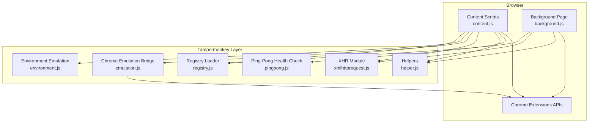
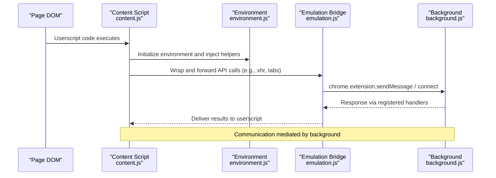
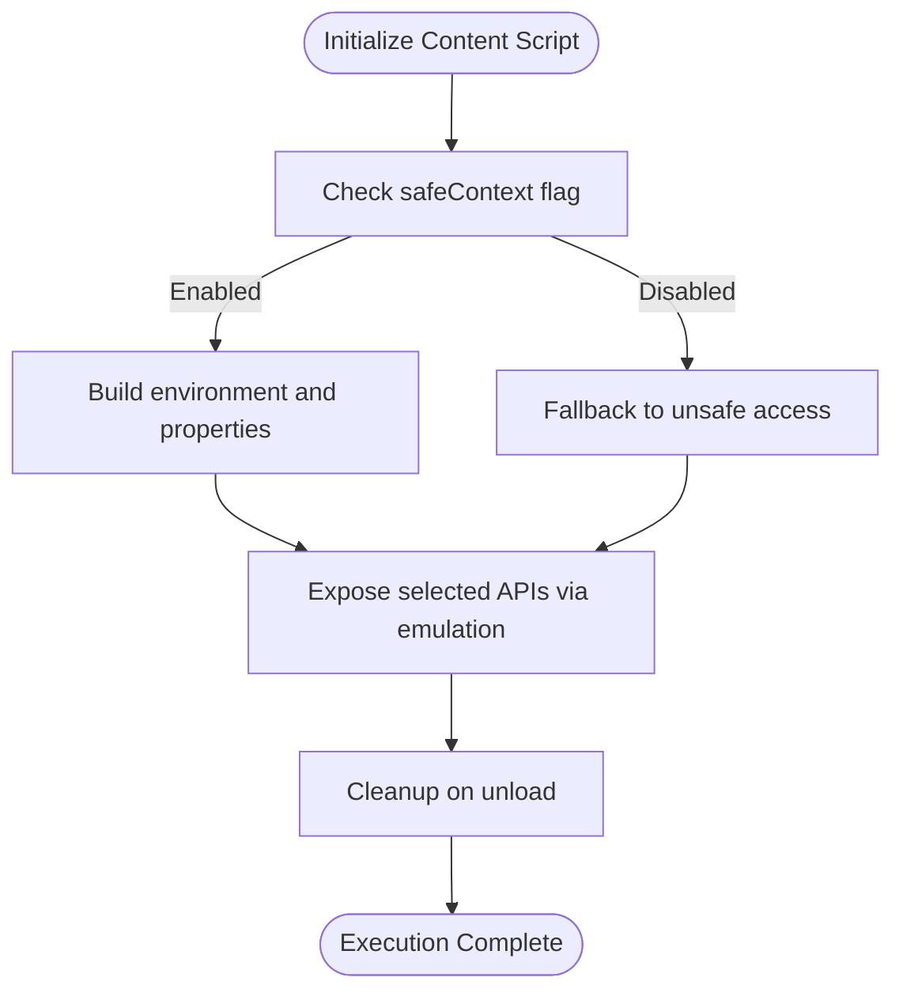
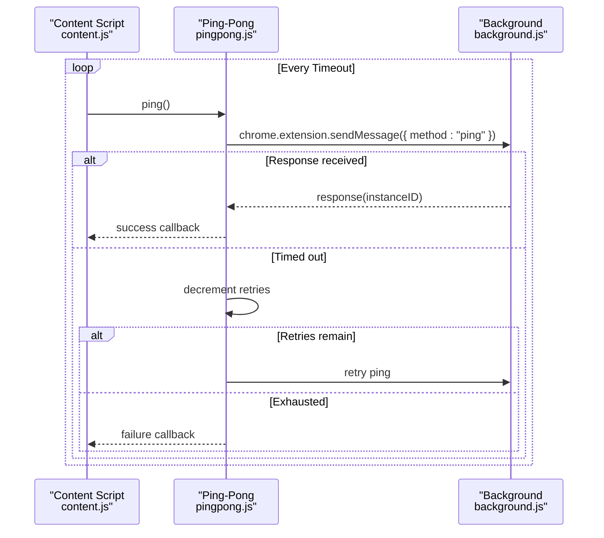
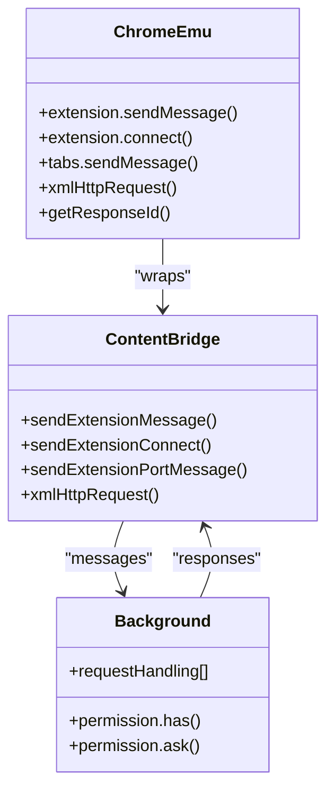
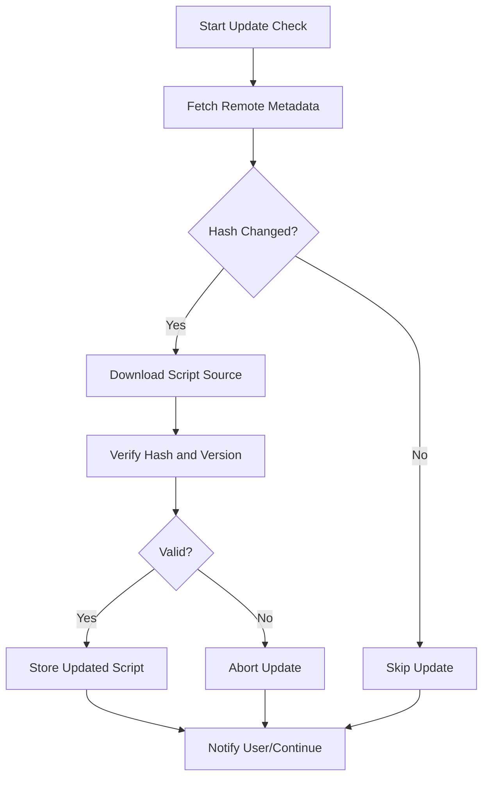
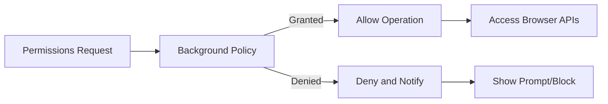
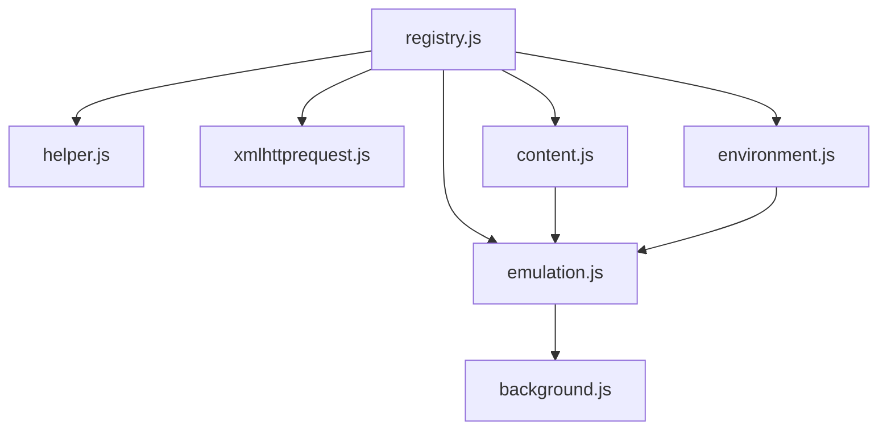

# System Integration and Security

<cite>
**Referenced Files in This Document**
- [background.js](file://src/background.js)
- [content.js](file://src/content.js)
- [environment.js](file://src/environment.js)
- [emulation.js](file://src/emulation.js)
- [pingpong.js](file://src/pingpong.js)
- [xmlhttprequest.js](file://src/xmlhttprequest.js)
- [helper.js](file://src/helper.js)
- [registry.js](file://src/registry.js)
- [manifest.json.legacy.com](file://build_sys/manifest.json.legacy.com)
- [README.md](file://README.md)
</cite>

## Table of Contents
1. [Introduction](#introduction)
2. [Project Structure](#project-structure)
3. [Core Components](#core-components)
4. [Architecture Overview](#architecture-overview)
5. [Detailed Component Analysis](#detailed-component-analysis)
6. [Dependency Analysis](#dependency-analysis)
7. [Performance Considerations](#performance-considerations)
8. [Troubleshooting Guide](#troubleshooting-guide)
9. [Conclusion](#conclusion)
10. [Appendices](#appendices)

## Introduction
This document explains Tampermonkey’s system integration and security model with a focus on Chrome extension security, sandboxing, privilege management, and the ping-pong communication between background and content scripts. It also covers integrity checking, validation processes, browser API relationships, permission models, and practical secure coding practices for userscript development. The goal is to make the security architecture understandable for both developers and power users.

## Project Structure
The Tampermonkey codebase is organized around three primary layers:
- Background page: privileged extension logic, storage, update checks, and permission orchestration.
- Content scripts: per-page execution environment with a controlled sandbox and emulation bridge to background APIs.
- Environment and emulation: a JavaScript emulation layer that safely exposes selected browser APIs to userscripts while maintaining isolation.

**Diagram sources**
- [content.js:108-215](file://src/content.js#L108-L215)
- [background.js:1-120](file://src/background.js#L1-L120)
- [environment.js:1-60](file://src/environment.js#L1-L60)
- [emulation.js:40-329](file://src/emulation.js#L40-L329)
- [xmlhttprequest.js:1-161](file://src/xmlhttprequest.js#L1-L161)
- [helper.js:1-209](file://src/helper.js#L1-L209)
- [registry.js:1-107](file://src/registry.js#L1-L107)
- [pingpong.js:1-53](file://src/pingpong.js#L1-L53)

**Section sources**
- [README.md:1-112](file://README.md#L1-L112)
- [manifest.json.legacy.com:1-38](file://build_sys/manifest.json.legacy.com#L1-L38)

## Core Components
- Registry loader: dynamic module loading and lazy initialization of core modules.
- Content script environment: safe injection, event bridging, and API emulation.
- Emulation bridge: translates userscript calls into background-executed operations.
- XHR module: HTTP transport with scheme validation and progress reporting.
- Permission and policy enforcement: background-side gating of sensitive operations.
- Ping-pong health check: verifies background availability and responsiveness.

**Section sources**
- [registry.js:11-107](file://src/registry.js#L11-L107)
- [content.js:108-215](file://src/content.js#L108-L215)
- [environment.js:52-193](file://src/environment.js#L52-L193)
- [emulation.js:40-329](file://src/emulation.js#L40-L329)
- [xmlhttprequest.js:17-153](file://src/xmlhttprequest.js#L17-L153)
- [pingpong.js:14-51](file://src/pingpong.js#L14-L51)

## Architecture Overview
The architecture separates concerns across layers:
- Content scripts run in the page context with restricted globals and a safe injection mechanism.
- An emulation layer bridges userscript calls to background APIs via message passing.
- Background manages permissions, storage, update checks, and privileged operations.
- A ping-pong mechanism ensures the background is reachable and responsive.

**Diagram sources**
- [content.js:108-215](file://src/content.js#L108-L215)
- [environment.js:648-771](file://src/environment.js#L648-L771)
- [emulation.js:126-195](file://src/emulation.js#L126-L195)
- [background.js:4503-4560](file://src/background.js#L4503-L4560)

## Detailed Component Analysis

### Chrome Extension Security Model and Sandbox
- Content scripts execute in the page’s origin sandbox with limited access to extension APIs. Tampermonkey extends this by injecting a controlled environment and an emulation bridge.
- The environment initializes a safe context, defines properties carefully, and cleans up after execution to minimize leakage.
- UnsafeWindow access is retrieved via a controlled mechanism and exposed only when necessary, with fallbacks and detection for script blockers.

**Diagram sources**
- [content.js:456-608](file://src/content.js#L456-L608)
- [environment.js:520-624](file://src/environment.js#L520-L624)

**Section sources**
- [content.js:456-608](file://src/content.js#L456-L608)
- [environment.js:520-624](file://src/environment.js#L520-L624)

### Ping-Pong Communication Health Check
- The ping-pong module periodically sends a ping to the background and expects a response within a timeout. Retries are attempted until exhausted.
- This validates that the background is alive and responsive, preventing stalled userscript execution.

**Diagram sources**
- [pingpong.js:14-51](file://src/pingpong.js#L14-L51)
- [background.js:4503-4560](file://src/background.js#L4503-L4560)

**Section sources**
- [pingpong.js:14-51](file://src/pingpong.js#L14-L51)

### Emulation Bridge and Privilege Management
- The emulation layer wraps userscript calls and forwards them to background handlers via message channels.
- Responses are routed back to the content script using response IDs, ensuring request-response correlation.
- Sensitive operations are gated by background-side policies and permission checks.

**Diagram sources**
- [emulation.js:40-329](file://src/emulation.js#L40-L329)
- [content.js:352-453](file://src/content.js#L352-L453)
- [background.js:4503-4560](file://src/background.js#L4503-L4560)

**Section sources**
- [emulation.js:40-329](file://src/emulation.js#L40-L329)
- [content.js:352-453](file://src/content.js#L352-L453)
- [background.js:4503-4560](file://src/background.js#L4503-L4560)

### Integrity Checking and Validation Processes
- Update checks compare remote metadata hashes and versions against stored values to detect changes and trigger updates.
- Scheme validation restricts HTTP(S) requests in the XHR module to mitigate unintended local resource access.
- Local file retrieval uses either XMLHttpRequest or iframe-based message exchange with callbacks and timeouts.

**Diagram sources**
- [background.js:3461-3537](file://src/background.js#L3461-L3537)
- [xmlhttprequest.js:12-15](file://src/xmlhttprequest.js#L12-L15)

**Section sources**
- [background.js:3461-3537](file://src/background.js#L3461-L3537)
- [xmlhttprequest.js:12-15](file://src/xmlhttprequest.js#L12-L15)

### Browser APIs, Permissions, and Security Restrictions
- The legacy manifest grants broad permissions including tabs, webRequest, webRequestBlocking, and unlimited storage, enabling Tampermonkey to intercept network traffic and manage scripts across origins.
- Optional permissions (e.g., contentSettings) are requested dynamically when needed.
- Background-side permission checks gate access to sensitive operations, prompting users when required.

**Diagram sources**
- [manifest.json.legacy.com:29-36](file://build_sys/manifest.json.legacy.com#L29-L36)
- [background.js:5361-5398](file://src/background.js#L5361-L5398)

**Section sources**
- [manifest.json.legacy.com:29-36](file://build_sys/manifest.json.legacy.com#L29-L36)
- [background.js:5361-5398](file://src/background.js#L5361-L5398)

### Practical Secure Coding Practices and Mitigation
- Prefer HTTPS and validated URLs for script sources and resources.
- Use the emulation bridge for cross-origin requests to leverage background permissions and validation.
- Avoid unsafe eval and limit dynamic code generation; rely on the environment’s wrapper and JSLint integration for safety.
- Validate and sanitize inputs from page context before invoking privileged operations.
- Implement timeouts and retries for network operations; monitor background health via ping-pong.

**Section sources**
- [environment.js:125-193](file://src/environment.js#L125-L193)
- [xmlhttprequest.js:115-153](file://src/xmlhttprequest.js#L115-L153)
- [pingpong.js:14-51](file://src/pingpong.js#L14-L51)

### Threat Models, Attack Vectors, and Defensive Techniques
- Cross-site scripting and malicious page scripts attempting to access extension APIs.
- Privilege escalation via unsafeWindow manipulation or injected code.
- Man-in-the-middle attacks on script sources; mitigated by hash/version checks and HTTPS.
- Resource exhaustion via excessive network requests; mitigated by retries, timeouts, and background throttling.

Defensive techniques:
- Strict property exposure and cleanup in the environment.
- Controlled message routing and response ID correlation.
- Permission prompts and optional permissions for granular control.
- Scheme validation and safe local file retrieval.

**Section sources**
- [content.js:456-608](file://src/content.js#L456-L608)
- [emulation.js:126-195](file://src/emulation.js#L126-L195)
- [background.js:5361-5398](file://src/background.js#L5361-L5398)

## Dependency Analysis
The system relies on a registry-driven module loading pattern. Modules are lazily required and cached, reducing startup overhead and enabling modular security enforcement.

**Diagram sources**
- [registry.js:48-107](file://src/registry.js#L48-L107)
- [content.js:80-91](file://src/content.js#L80-L91)
- [environment.js:7-35](file://src/environment.js#L7-L35)
- [emulation.js:9-329](file://src/emulation.js#L9-L329)
- [background.js:28-35](file://src/background.js#L28-L35)

**Section sources**
- [registry.js:48-107](file://src/registry.js#L48-L107)

## Performance Considerations
- Require cache: background maintains a require cache with periodic cleanup to reduce repeated downloads.
- Event batching and deferred execution: environment defers certain listeners until DOM readiness to avoid blocking.
- Network retries and timeouts: XHR module retries transient failures and reports progress for large payloads.

**Section sources**
- [background.js:398-433](file://src/background.js#L398-L433)
- [environment.js:325-343](file://src/environment.js#L325-L343)
- [xmlhttprequest.js:67-91](file://src/xmlhttprequest.js#L67-L91)

## Troubleshooting Guide
- Background unreachable: use the ping-pong health check to detect and recover from background failures.
- Script blocker interference: environment detects script blockers and notifies background; adjust user agent or disable conflicting extensions.
- Permission denied: review optional permissions and prompt the user for additional access when required.

**Section sources**
- [pingpong.js:14-51](file://src/pingpong.js#L14-L51)
- [content.js:484-499](file://src/content.js#L484-L499)
- [background.js:5372-5398](file://src/background.js#L5372-L5398)

## Conclusion
Tampermonkey’s architecture balances usability with security by isolating userscript execution in a controlled environment, exposing only necessary APIs via an emulation bridge, and enforcing permissions centrally in the background. The ping-pong health check, integrity verification, and strict validation guard against common attack vectors and misconfiguration risks.

## Appendices

### Appendix A: Key Security-Related Constants and Flags
- Safe context flags and logging toggles in content and environment modules.
- Instance ID and response ID correlation for secure message routing.

**Section sources**
- [content.js:48-76](file://src/content.js#L48-L76)
- [environment.js:22-35](file://src/environment.js#L22-L35)
- [emulation.js:197-207](file://src/emulation.js#L197-L207)