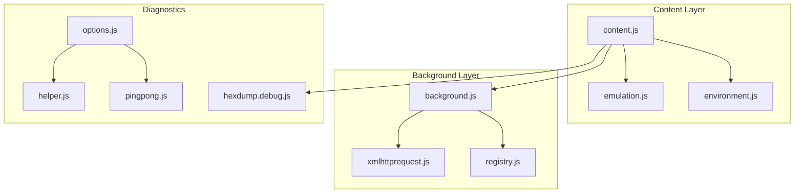
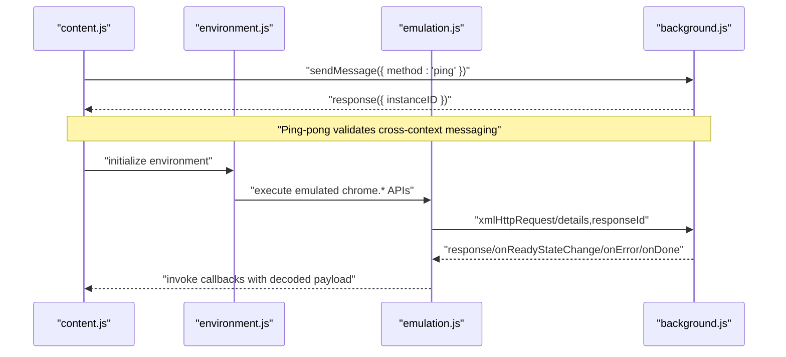
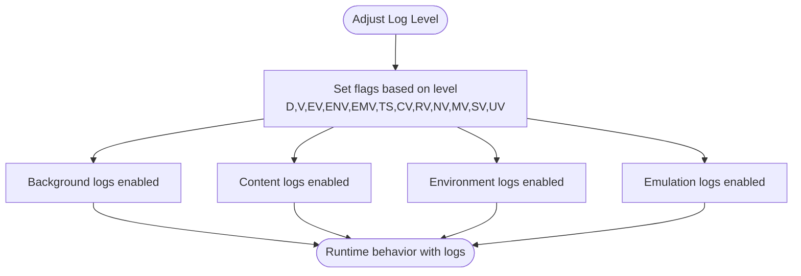
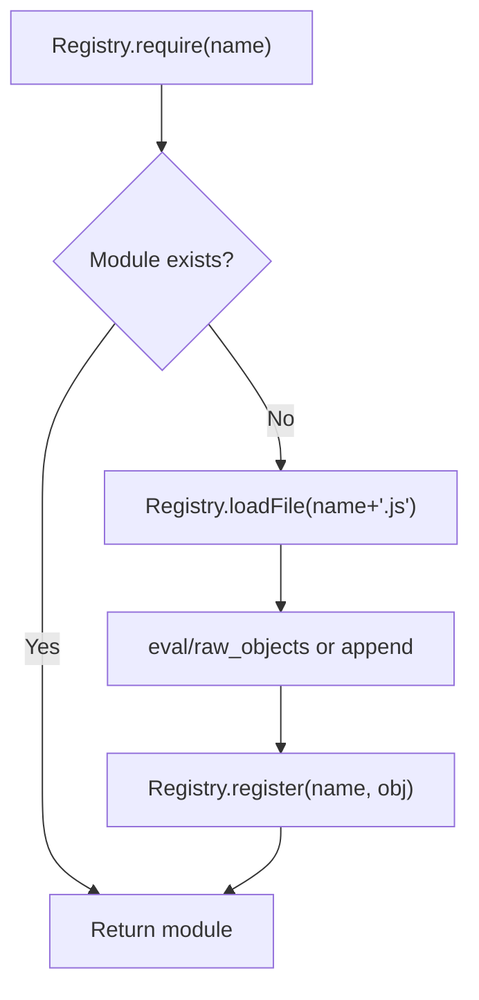
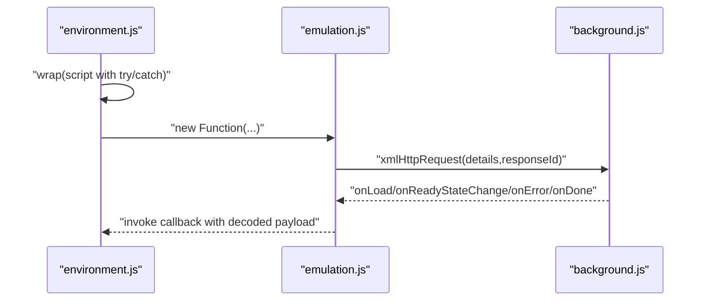
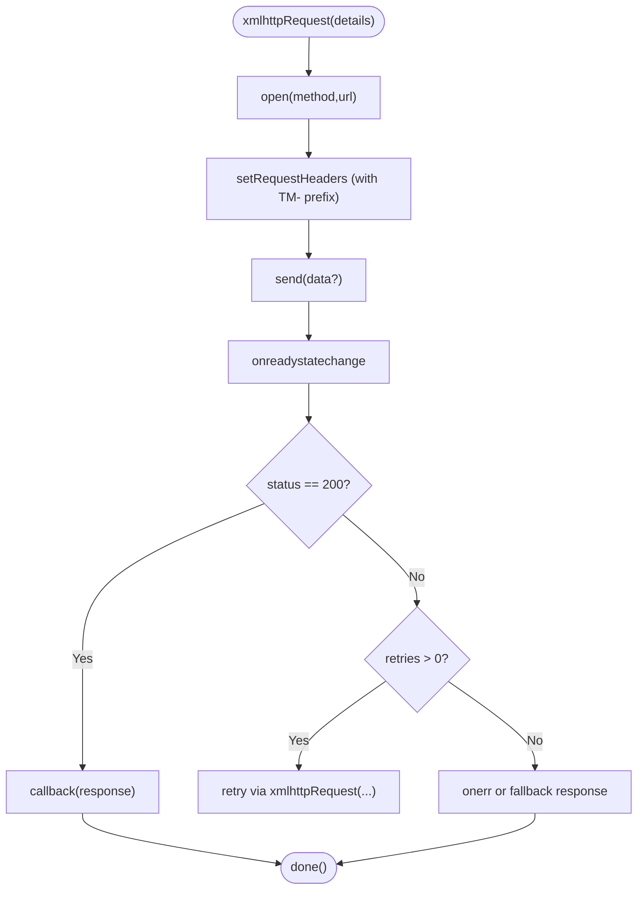
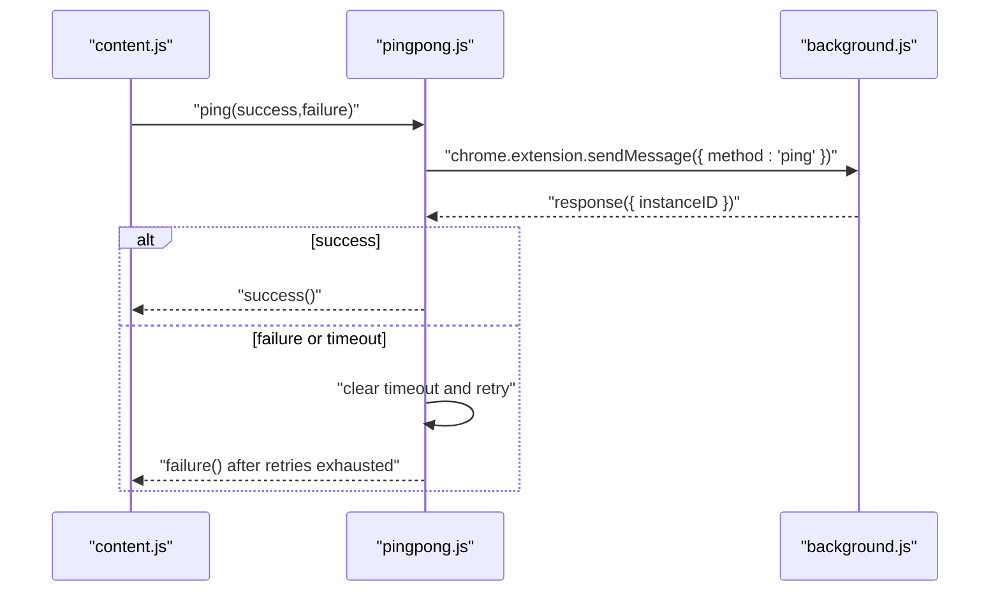
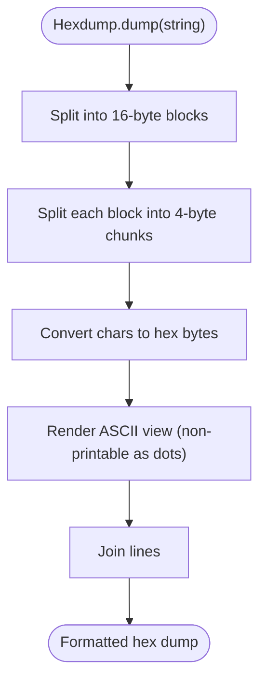
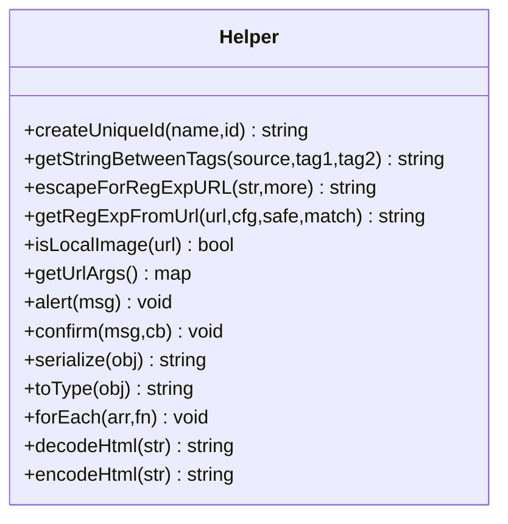
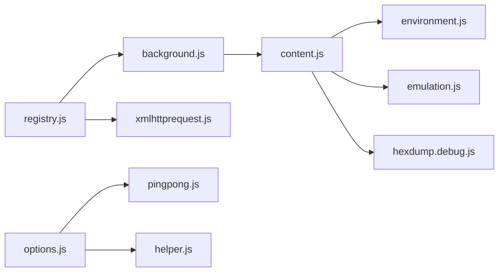

# Testing and Debugging

<cite>
**Referenced Files in This Document**
- [hexdump.debug.js](file://src/hexdump.debug.js)
- [pingpong.js](file://src/pingpong.js)
- [helper.js](file://src/helper.js)
- [background.js](file://src/background.js)
- [content.js](file://src/content.js)
- [xmlhttprequest.js](file://src/xmlhttprequest.js)
- [registry.js](file://src/registry.js)
- [options.js](file://src/options.js)
- [environment.js](file://src/environment.js)
- [emulation.js](file://src/emulation.js)
</cite>

## Table of Contents
1. [Introduction](#introduction)
2. [Project Structure](#project-structure)
3. [Core Components](#core-components)
4. [Architecture Overview](#architecture-overview)
5. [Detailed Component Analysis](#detailed-component-analysis)
6. [Dependency Analysis](#dependency-analysis)
7. [Performance Considerations](#performance-considerations)
8. [Troubleshooting Guide](#troubleshooting-guide)
9. [Conclusion](#conclusion)
10. [Appendices](#appendices)

## Introduction
This document explains how to test and debug Tampermonkey userscripts and the extension internals. It covers built-in logging, diagnostic utilities, low-level inspection helpers, communication testing, and best practices for isolating and resolving runtime issues. It also outlines how to interpret logs, leverage the registry and environment/emulation layers, and apply performance-aware techniques during development.

## Project Structure
The testing and debugging surface spans several modules:
- Logging and diagnostics: background, content, environment, emulation, registry
- Communication testing: ping-pong module
- Low-level inspection: hex dump utility
- Helper utilities: serialization, type detection, URL matching, and more
- HTTP request emulation and retries
- Options UI integration for utilities and diagnostics

**Diagram sources**
- [content.js](file://src/content.js)
- [environment.js](file://src/environment.js)
- [emulation.js](file://src/emulation.js)
- [background.js](file://src/background.js)
- [registry.js](file://src/registry.js)
- [xmlhttprequest.js](file://src/xmlhttprequest.js)
- [pingpong.js](file://src/pingpong.js)
- [hexdump.debug.js](file://src/hexdump.debug.js)
- [helper.js](file://src/helper.js)
- [options.js](file://src/options.js)

**Section sources**
- [background.js](file://src/background.js)
- [content.js](file://src/content.js)
- [registry.js](file://src/registry.js)
- [xmlhttprequest.js](file://src/xmlhttprequest.js)
- [pingpong.js](file://src/pingpong.js)
- [hexdump.debug.js](file://src/hexdump.debug.js)
- [helper.js](file://src/helper.js)
- [options.js](file://src/options.js)

## Core Components
- Logging and verbosity flags: D, V, EV, ENV, EMV, TS, CV, RV, NV, MV, SV, UV, etc., are toggled via log level adjustments and influence console output across modules.
- Registry: dynamic module loader and logger for require/register/get/loadFile.
- Environment and Emulation: sandboxed script execution, request/response bridging, and JSON-safe transport.
- HTTP Request: wrapper around XMLHttpRequest with retries and progress reporting.
- Ping-Pong: lightweight communication health check between content and background.
- Hex Dump: printable hex representation of binary-like strings for low-level inspection.
- Helpers: serialization, type detection, URL matching, argument parsing, alerts, confirms, HTML encoding/decoding, and more.

**Section sources**
- [background.js](file://src/background.js)
- [content.js](file://src/content.js)
- [environment.js](file://src/environment.js)
- [emulation.js](file://src/emulation.js)
- [registry.js](file://src/registry.js)
- [xmlhttprequest.js](file://src/xmlhttprequest.js)
- [pingpong.js](file://src/pingpong.js)
- [hexdump.debug.js](file://src/hexdump.debug.js)
- [helper.js](file://src/helper.js)

## Architecture Overview
The content script initializes environment and emulation layers, bridges requests to the background, and executes userscripts in a controlled context. Background manages logging flags, caches, and dispatches requests. The registry coordinates module loading and logs activity.

**Diagram sources**
- [content.js](file://src/content.js)
- [environment.js](file://src/environment.js)
- [emulation.js](file://src/emulation.js)
- [background.js](file://src/background.js)
- [pingpong.js](file://src/pingpong.js)

## Detailed Component Analysis

### Logging and Verbosity Flags
- Flags include D (debug), V (verbose), EV (events), ENV (environment), EMV (emulation), TS (time-stamp), CV (cache), RV (registry), NV (network), MV (misc), SV (storage), UV (URL).
- Adjust log level in background and propagate to content/emulation via initialization handshake.

**Diagram sources**
- [background.js](file://src/background.js)
- [content.js](file://src/content.js)
- [environment.js](file://src/environment.js)
- [emulation.js](file://src/emulation.js)

**Section sources**
- [background.js](file://src/background.js)
- [content.js](file://src/content.js)
- [environment.js](file://src/environment.js)
- [emulation.js](file://src/emulation.js)

### Registry: Module Loading and Diagnostics
- Tracks loaded modules, logs require/register/get/loadFile, and supports raw content retrieval.
- Detects missing dependencies and logs errors.

**Diagram sources**
- [registry.js](file://src/registry.js)

**Section sources**
- [registry.js](file://src/registry.js)

### Environment and Emulation: Execution and Transport
- Environment builds a masked execution context, injects requires, and wraps execution with error handling and optional linting.
- Emulation translates chrome.* calls to content-to-background messages, managing response IDs and JSON-safe payloads.

**Diagram sources**
- [environment.js](file://src/environment.js)
- [emulation.js](file://src/emulation.js)
- [xmlhttprequest.js](file://src/xmlhttprequest.js)

**Section sources**
- [environment.js](file://src/environment.js)
- [emulation.js](file://src/emulation.js)
- [xmlhttprequest.js](file://src/xmlhttprequest.js)

### HTTP Request Wrapper: Retries and Progress
- Validates schemes, retries on non-200 status, computes progress from headers or response length, and logs errors.

**Diagram sources**
- [xmlhttprequest.js](file://src/xmlhttprequest.js)

**Section sources**
- [xmlhttprequest.js](file://src/xmlhttprequest.js)

### Ping-Pong Communication Test
- Sends a ping message to background, expects a response with instance ID, handles timeouts and retries, and logs warnings for pseudo responses.

**Diagram sources**
- [pingpong.js](file://src/pingpong.js)
- [background.js](file://src/background.js)

**Section sources**
- [pingpong.js](file://src/pingpong.js)
- [background.js](file://src/background.js)

### Hex Dump Utility (Low-Level Inspection)
- Converts strings into readable hex blocks with ASCII representation, useful for inspecting binary-like payloads or encoded data.

**Diagram sources**
- [hexdump.debug.js](file://src/hexdump.debug.js)

**Section sources**
- [hexdump.debug.js](file://src/hexdump.debug.js)

### Helper Utilities
- Serialization, type detection, URL matching, argument parsing, alerts/confirm dialogs, HTML encoding/decoding, and constants for visibility and URLs.

**Diagram sources**
- [helper.js](file://src/helper.js)

**Section sources**
- [helper.js](file://src/helper.js)

### Options Utilities and Diagnostics
- Options UI integrates ping-pong and helper utilities, exposes import/export of scripts, and logs diagnostics for parsing and filesystem operations.

**Section sources**
- [options.js](file://src/options.js)

## Dependency Analysis
- Content depends on environment and emulation for sandboxed execution and chrome.* emulation.
- Emulation depends on background for request routing and response handling.
- Background depends on registry for module loading and on XMLHTTPRequest wrapper for network tasks.
- Options integrates ping-pong and helper for diagnostics and utilities.

**Diagram sources**
- [registry.js](file://src/registry.js)
- [background.js](file://src/background.js)
- [content.js](file://src/content.js)
- [environment.js](file://src/environment.js)
- [emulation.js](file://src/emulation.js)
- [xmlhttprequest.js](file://src/xmlhttprequest.js)
- [options.js](file://src/options.js)
- [pingpong.js](file://src/pingpong.js)
- [helper.js](file://src/helper.js)
- [hexdump.debug.js](file://src/hexdump.debug.js)

**Section sources**
- [registry.js](file://src/registry.js)
- [background.js](file://src/background.js)
- [content.js](file://src/content.js)
- [environment.js](file://src/environment.js)
- [emulation.js](file://src/emulation.js)
- [xmlhttprequest.js](file://src/xmlhttprequest.js)
- [options.js](file://src/options.js)
- [pingpong.js](file://src/pingpong.js)
- [helper.js](file://src/helper.js)
- [hexdump.debug.js](file://src/hexdump.debug.js)

## Performance Considerations
- Logging overhead: Enable verbose logs selectively for problematic runs; excessive logging can slow down page loads.
- Network retries: Tune retry counts and timeouts to balance reliability and latency.
- Cache behavior: Background maintains a require cache keyed by URL; monitor cache hits/misses to optimize script loading.
- Serialization costs: Large payloads passed via JSON-safe transport incur overhead; minimize payload sizes.
- Mutation observation: DOM attribute monitoring adds overhead; disable or limit observers when not debugging.

[No sources needed since this section provides general guidance]

## Troubleshooting Guide
Common issues and resolutions:
- Cross-context messaging failures
  - Use the ping-pong module to verify connectivity between content and background.
  - Inspect logs for pseudo responses and timeouts.
  - Verify response IDs and JSON parsing in emulation handlers.
- Script execution errors
  - Environment wraps execution with try/catch and logs stack traces; use these to locate failing lines.
  - Optional linting highlights syntax errors; review reported lines and characters.
- Network failures
  - Check scheme validation and retry logic; ensure headers are properly prefixed for web requests.
  - Use hex dump to inspect binary or encoded payloads if decoding appears incorrect.
- Registry errors
  - Missing dependencies are logged; ensure modules are registered and loaded before use.
- Import/export issues
  - Options UI logs parsing errors and filesystem exceptions; validate JSON and permissions.

**Section sources**
- [pingpong.js](file://src/pingpong.js)
- [environment.js](file://src/environment.js)
- [emulation.js](file://src/emulation.js)
- [xmlhttprequest.js](file://src/xmlhttprequest.js)
- [registry.js](file://src/registry.js)
- [options.js](file://src/options.js)

## Conclusion
Tampermonkey’s debugging toolkit combines structured logging, a robust registry, sandboxed execution, and emulation to isolate and resolve userscript issues. Use the ping-pong module for communication tests, hex dump for low-level inspection, and environment/emulation logs for execution diagnostics. Apply selective verbosity and network tuning to maintain performance while debugging.

[No sources needed since this section summarizes without analyzing specific files]

## Appendices

### Practical Debugging Workflows
- Quick connectivity check
  - Invoke ping-pong; observe success/failure and retries in logs.
- Inspect request/response payloads
  - Wrap data with hex dump to reveal hidden characters or encoding artifacts.
- Validate environment execution
  - Temporarily increase verbosity flags; review wrapped execution logs and linting output.
- Audit network behavior
  - Monitor retries, progress reporting, and header transformations.

[No sources needed since this section provides general guidance]