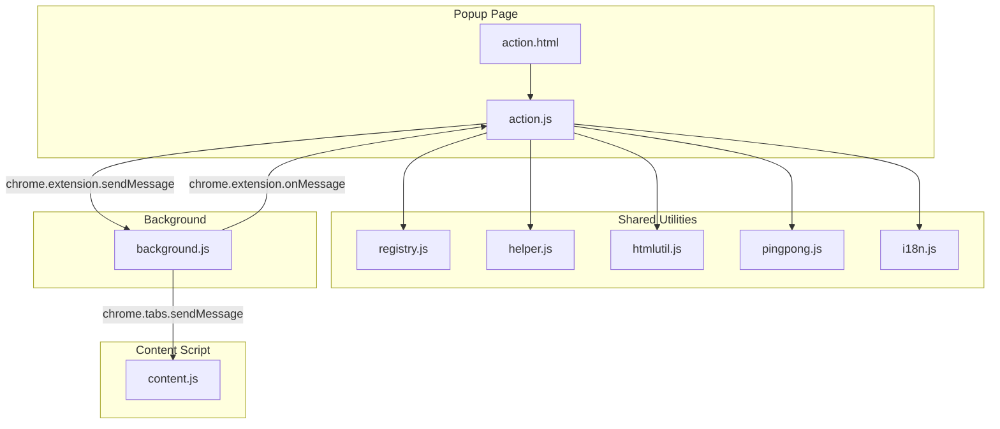
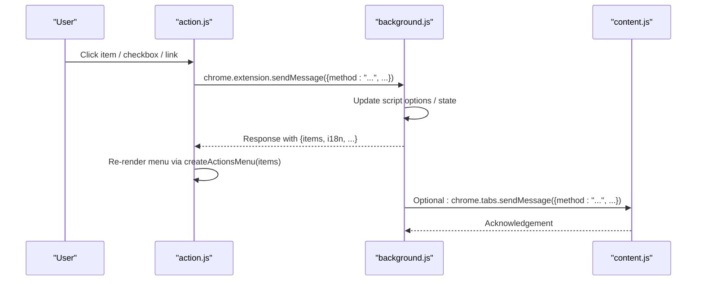
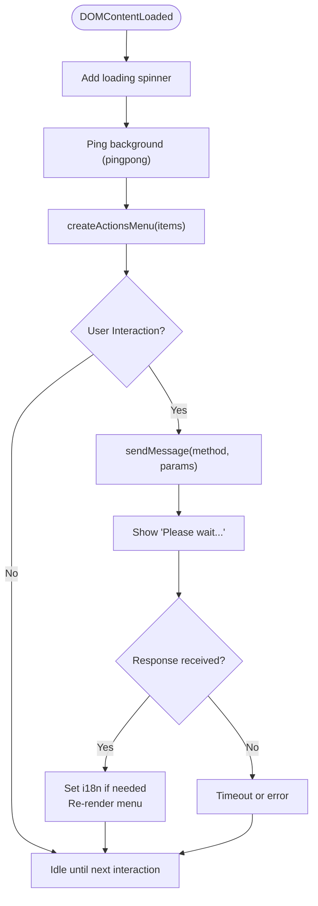
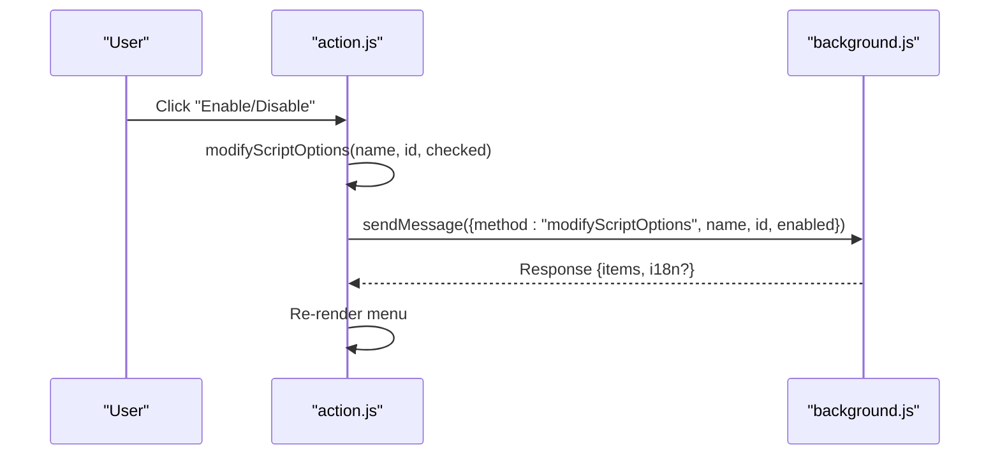
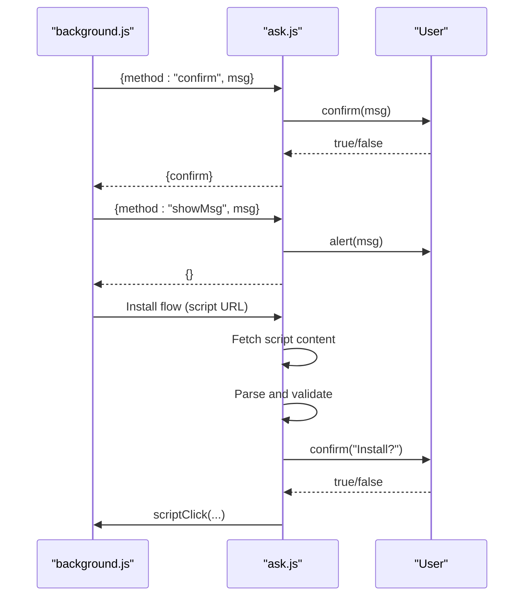
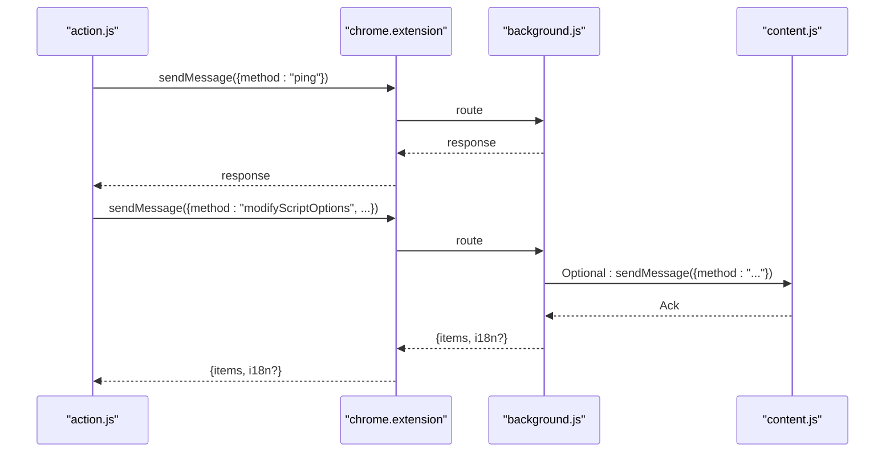
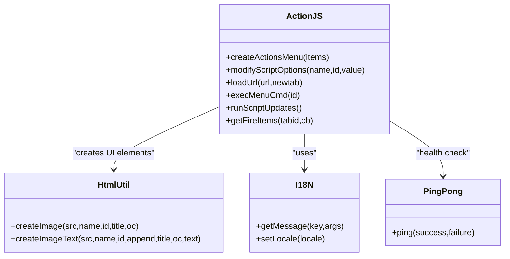
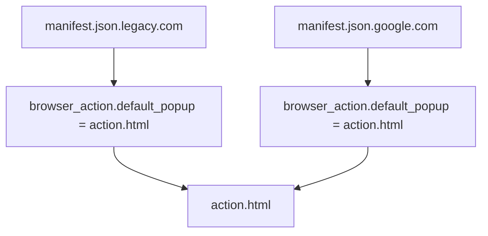
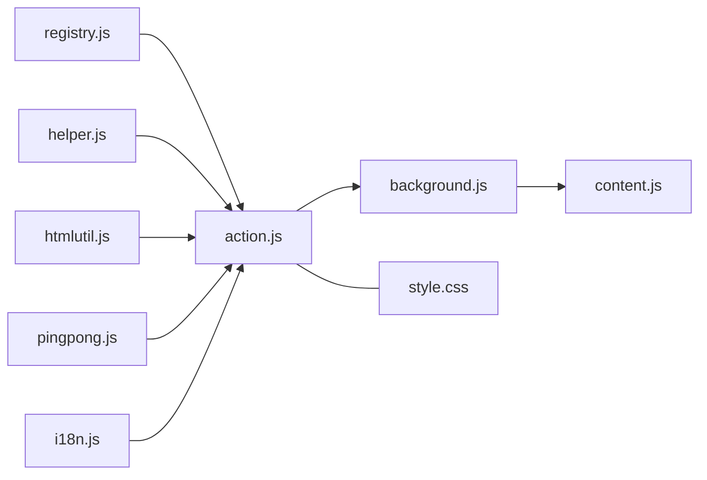

# Action Popup

<cite>
**Referenced Files in This Document**
- [action.html](file://src/action.html)
- [action.js](file://src/action.js)
- [ask.html](file://src/ask.html)
- [ask.js](file://src/ask.js)
- [background.js](file://src/background.js)
- [content.js](file://src/content.js)
- [helper.js](file://src/helper.js)
- [htmlutil.js](file://src/htmlutil.js)
- [pingpong.js](file://src/pingpong.js)
- [i18n.js](file://src/i18n.js)
- [style.css](file://src/style.css)
- [registry.js](file://src/registry.js)
- [manifest.json.legacy.com](file://build_sys/manifest.json.legacy.com)
- [manifest.json.google.com](file://build_sys/manifest.json.google.com)
</cite>

## Table of Contents
1. [Introduction](#introduction)
2. [Project Structure](#project-structure)
3. [Core Components](#core-components)
4. [Architecture Overview](#architecture-overview)
5. [Detailed Component Analysis](#detailed-component-analysis)
6. [Dependency Analysis](#dependency-analysis)
7. [Performance Considerations](#performance-considerations)
8. [Troubleshooting Guide](#troubleshooting-guide)
9. [Conclusion](#conclusion)

## Introduction
The Action Popup is the browser action popup that provides quick access to script management functions, displays script status, and offers user interaction points. It is a lightweight interface integrated with the background script to reflect real-time script status and enable immediate actions such as enabling/disabling scripts, opening URLs, and triggering updates. The popup communicates with the content script and background process to activate or deactivate scripts and to present confirmation dialogs when necessary.

## Project Structure
The Action Popup is implemented as a minimal HTML page with embedded JavaScript that constructs a dynamic menu of actions. It relies on shared utilities for internationalization, DOM creation, and messaging with the background script.

**Diagram sources**
- [action.html:1-22](file://src/action.html#L1-L22)
- [action.js:1-321](file://src/action.js#L1-L321)
- [registry.js:1-107](file://src/registry.js#L1-L107)
- [helper.js:1-209](file://src/helper.js#L1-L209)
- [htmlutil.js:1-381](file://src/htmlutil.js#L1-L381)
- [pingpong.js:1-53](file://src/pingpong.js#L1-L53)
- [i18n.js:1-140](file://src/i18n.js#L1-L140)
- [background.js:1-800](file://src/background.js#L1-L800)
- [content.js:1-200](file://src/content.js#L1-L200)

**Section sources**
- [action.html:1-22](file://src/action.html#L1-L22)
- [action.js:1-321](file://src/action.js#L1-L321)
- [registry.js:1-107](file://src/registry.js#L1-L107)

## Core Components
- Popup page and controller: action.html and action.js construct the menu, handle user interactions, and communicate with the background script.
- Shared utilities:
  - registry.js: module loader and registry for lazy-loading modules.
  - helper.js: DOM helpers, URL parsing, alerts, and confirm dialogs.
  - htmlutil.js: reusable DOM element creators for images, checkboxes, buttons, and composite widgets.
  - pingpong.js: a lightweight health-check mechanism to ensure the background is responsive.
  - i18n.js: localization support for messages.
- Background integration: background.js handles script activation/deactivation, tab context, and responds to popup requests.
- Content script: content.js runs in web pages and receives commands from the background for script execution.

**Section sources**
- [action.js:1-321](file://src/action.js#L1-L321)
- [registry.js:1-107](file://src/registry.js#L1-L107)
- [helper.js:1-209](file://src/helper.js#L1-L209)
- [htmlutil.js:1-381](file://src/htmlutil.js#L1-L381)
- [pingpong.js:1-53](file://src/pingpong.js#L1-L53)
- [i18n.js:1-140](file://src/i18n.js#L1-L140)
- [background.js:1-800](file://src/background.js#L1-L800)
- [content.js:1-200](file://src/content.js#L1-L200)

## Architecture Overview
The Action Popup is invoked via the browser action and presents a table-based menu. User actions trigger messages to the background script, which updates state and reflects changes back to the popup. The popup uses a ping mechanism to verify responsiveness and shows localized messages.

**Diagram sources**
- [action.js:192-267](file://src/action.js#L192-L267)
- [background.js:1-800](file://src/background.js#L1-L800)
- [content.js:1-200](file://src/content.js#L1-L200)

## Detailed Component Analysis

### Popup Lifecycle and Rendering
- Initialization: On DOMContentLoaded/load, the popup sets up a waiting indicator and performs a ping to the background to ensure readiness.
- Menu construction: The popup builds a table-driven UI from a provided items array, supporting:
  - Dividers
  - Checkboxes for enabling/disabling
  - Links to open URLs (same or new tab)
  - Menu command triggers
  - Script status indicators with click-to-toggle
  - Update triggers
- Real-time updates: Responses from the background may include updated items or locale changes, prompting a re-render.

**Diagram sources**
- [action.js:281-318](file://src/action.js#L281-L318)
- [action.js:269-279](file://src/action.js#L269-L279)
- [pingpong.js:14-49](file://src/pingpong.js#L14-L49)

**Section sources**
- [action.js:22-190](file://src/action.js#L22-L190)
- [action.js:269-318](file://src/action.js#L269-L318)
- [pingpong.js:1-53](file://src/pingpong.js#L1-L53)

### User Interaction Handlers
- Checkbox toggles: Trigger modifyScriptOptions with name/id/value to toggle script enabled state.
- URL links: Open in current or new tab via loadUrl, which either opens a new tab or sends a message to the selected tab.
- Menu commands: execMenuCmd forwards to the background.
- Script status toggles: Clicking the LED-like icon toggles enabled state; right-click or Ctrl-click opens options for that script.
- Run updates: runScriptUpdates triggers background update checks.

**Diagram sources**
- [action.js:57-70](file://src/action.js#L57-L70)
- [action.js:248-267](file://src/action.js#L248-L267)

**Section sources**
- [action.js:57-158](file://src/action.js#L57-L158)
- [action.js:192-224](file://src/action.js#L192-L224)
- [action.js:248-267](file://src/action.js#L248-L267)

### Ask Dialog System
The ask dialog is used for user confirmation prompts and script installation flows. It listens for confirmation and alert requests from the background and renders a page with tabs and editors as needed.

- Confirmation prompt: The background sends a "confirm" message; the ask dialog shows a confirmation dialog and returns the result.
- Alert messages: The background sends a "showMsg" message; the ask dialog shows an alert.
- Installation flow: When installing a userscript, the ask dialog fetches the script content, validates it, and asks for confirmation before invoking the background to install.

**Diagram sources**
- [ask.js:208-225](file://src/ask.js#L208-L225)
- [ask.js:177-184](file://src/ask.js#L177-L184)
- [ask.js:118-120](file://src/ask.js#L118-L120)

**Section sources**
- [ask.html:1-32](file://src/ask.html#L1-L32)
- [ask.js:1-240](file://src/ask.js#L1-L240)

### Communication Mechanisms
- Popup to Background: Uses chrome.extension.sendMessage with various methods (e.g., modifyScriptOptions, execMenuCmd, runScriptUpdates, getFireItems).
- Background to Content: Uses chrome.tabs.sendMessage to deliver commands to the content script.
- Health Check: pingpong.js sends a "ping" message and expects a response; timeouts trigger retries or failure handling.

**Diagram sources**
- [action.js:269-279](file://src/action.js#L269-L279)
- [action.js:192-224](file://src/action.js#L192-L224)
- [action.js:248-267](file://src/action.js#L248-L267)
- [pingpong.js:14-49](file://src/pingpong.js#L14-L49)
- [background.js:1-800](file://src/background.js#L1-L800)
- [content.js:1-200](file://src/content.js#L1-L200)

**Section sources**
- [action.js:192-267](file://src/action.js#L192-L267)
- [pingpong.js:1-53](file://src/pingpong.js#L1-L53)
- [background.js:1-800](file://src/background.js#L1-L800)
- [content.js:1-200](file://src/content.js#L1-L200)

### Responsive Design and UI Patterns
- Lightweight layout: The popup uses a simple table structure with minimal styling to keep rendering fast.
- Hover effects: actionitem hover styles improve interactivity.
- Icons and LED indicators: Status LEDs provide immediate visual feedback for script enabled/disabled state.
- Internationalization: Messages are localized via i18n.js and updated dynamically when the background reports locale changes.

**Diagram sources**
- [action.js:22-190](file://src/action.js#L22-L190)
- [htmlutil.js:15-43](file://src/htmlutil.js#L15-L43)
- [i18n.js:76-88](file://src/i18n.js#L76-L88)
- [pingpong.js:14-49](file://src/pingpong.js#L14-L49)

**Section sources**
- [style.css:395-434](file://src/style.css#L395-L434)
- [style.css:407-420](file://src/style.css#L407-L420)
- [action.js:134-147](file://src/action.js#L134-L147)
- [i18n.js:94-122](file://src/i18n.js#L94-L122)

### Browser Action Configuration
The browser action is configured to open action.html as the popup. The manifest defines default icons, title, and permissions required for tab management and background operations.

**Diagram sources**
- [manifest.json.legacy.com:14-18](file://build_sys/manifest.json.legacy.com#L14-L18)
- [manifest.json.google.com:18-22](file://build_sys/manifest.json.google.com#L18-L22)

**Section sources**
- [manifest.json.legacy.com:1-38](file://build_sys/manifest.json.legacy.com#L1-L38)
- [manifest.json.google.com:1-43](file://build_sys/manifest.json.google.com#L1-L43)

## Dependency Analysis
- Module loading: registry.js lazily loads modules and exposes them via Registry.get.
- Utility dependencies:
  - action.js depends on registry.js, helper.js, htmlutil.js, pingpong.js, and i18n.js.
  - ask.js depends on helper.js, htmlutil.js, i18n.js, and other utilities for UI and messaging.
- Messaging dependencies:
  - action.js uses chrome.extension.sendMessage to talk to background.js.
  - background.js uses chrome.tabs.sendMessage to talk to content.js.
- Styles:
  - style.css defines the popup’s appearance, including table layouts, hover states, and LED indicators.

**Diagram sources**
- [registry.js:48-100](file://src/registry.js#L48-L100)
- [action.js:11-20](file://src/action.js#L11-L20)
- [ask.js:26-42](file://src/ask.js#L26-L42)
- [style.css:395-434](file://src/style.css#L395-L434)

**Section sources**
- [registry.js:1-107](file://src/registry.js#L1-L107)
- [action.js:1-321](file://src/action.js#L1-L321)
- [ask.js:1-240](file://src/ask.js#L1-L240)
- [style.css:1-849](file://src/style.css#L1-L849)

## Performance Considerations
- Minimal DOM: The popup uses a simple table layout to reduce rendering overhead.
- Lazy loading: Modules are loaded on demand via registry.js to minimize initial load cost.
- Health check: pingpong.js ensures responsiveness; timeouts trigger retries or fallback behavior.
- Efficient updates: After an operation, the popup replaces innerHTML with localized messages and re-renders only when the background returns updated items.

## Troubleshooting Guide
- Popup does not respond:
  - Verify background is reachable via pingpong; if timed out, the popup shows a wait indicator and retries.
  - Check chrome extension messaging logs for errors.
- Actions do nothing:
  - Confirm the background method handlers exist and respond appropriately.
  - Ensure the correct tab is selected when opening URLs via loadUrl.
- Localization issues:
  - The background may send an i18n update; the popup applies it and re-renders.
- Installation prompts:
  - The ask dialog handles confirmations; if the background sends a "confirm" or "showMsg" message, the dialog handles it accordingly.

**Section sources**
- [action.js:281-318](file://src/action.js#L281-L318)
- [action.js:269-279](file://src/action.js#L269-L279)
- [ask.js:208-225](file://src/ask.js#L208-L225)
- [i18n.js:94-122](file://src/i18n.js#L94-L122)

## Conclusion
The Action Popup provides a streamlined interface for managing user scripts, reflecting real-time status and enabling immediate actions. Its lightweight design, robust messaging with the background, and integration with shared utilities ensure reliable operation across different screen sizes and user interactions. The ask dialog system complements the popup by handling user confirmations and installation flows, while the ping mechanism guarantees responsiveness.