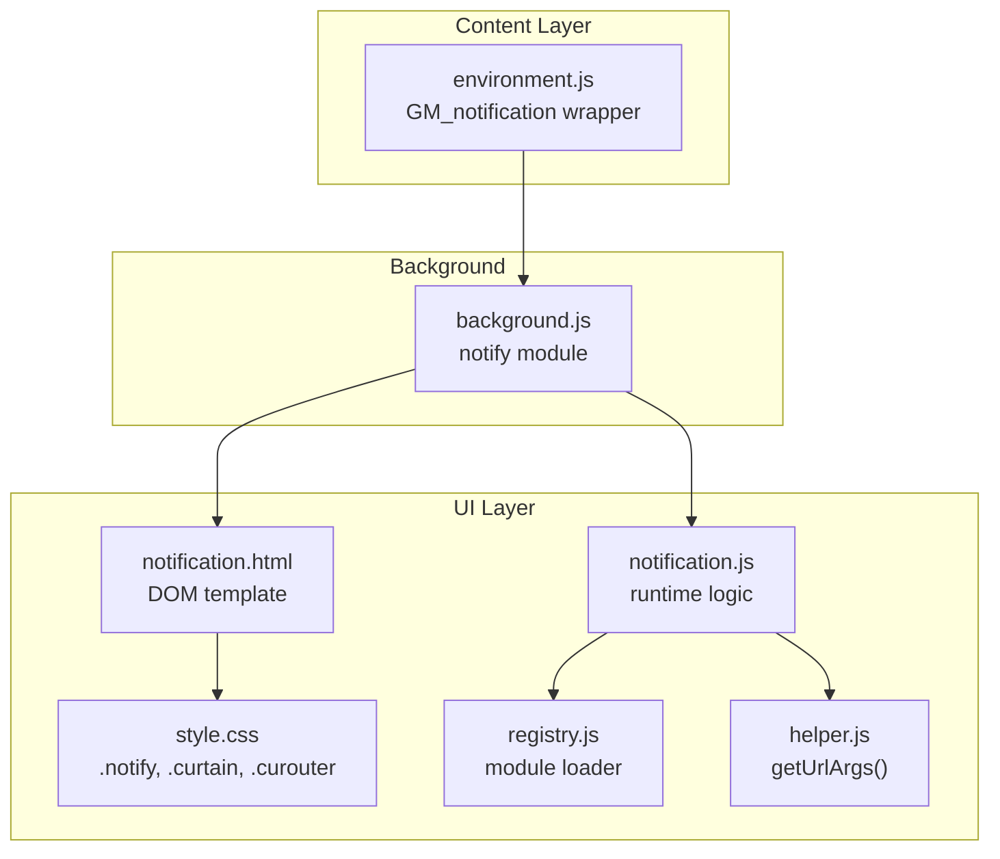
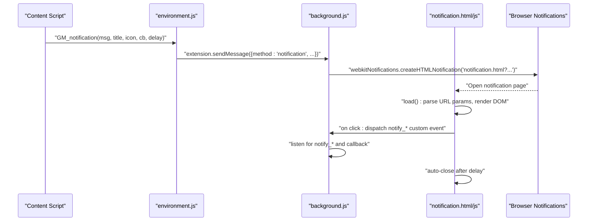
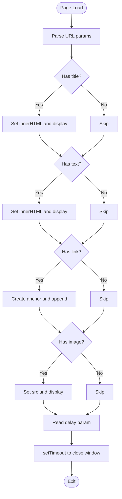
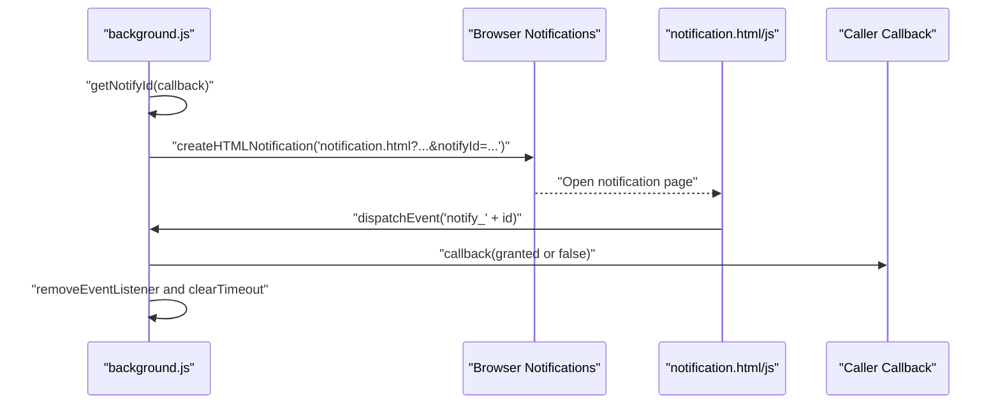
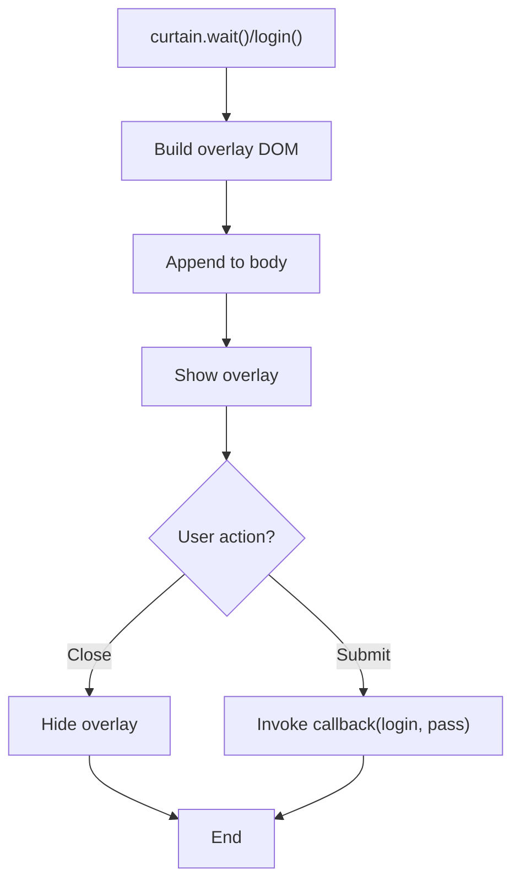
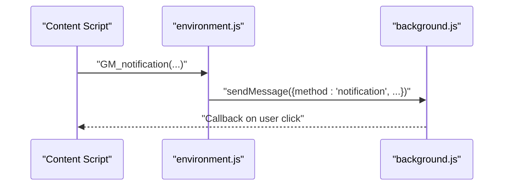
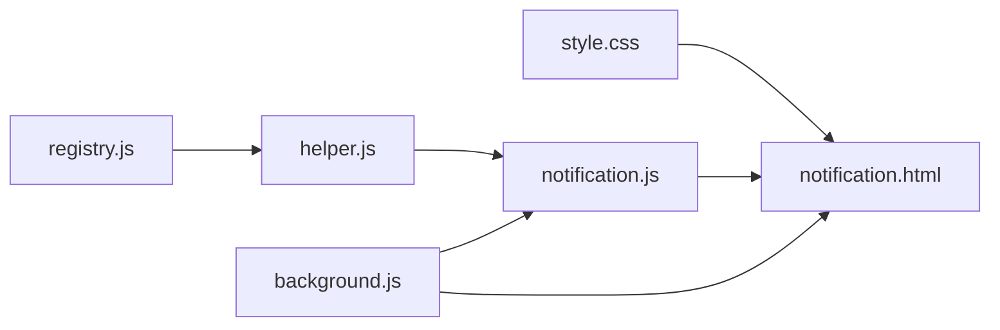

# Notification System

<cite>
**Referenced Files in This Document**
- [notification.html](file://src/notification.html)
- [notification.js](file://src/notification.js)
- [background.js](file://src/background.js)
- [style.css](file://src/style.css)
- [registry.js](file://src/registry.js)
- [helper.js](file://src/helper.js)
- [environment.js](file://src/environment.js)
</cite>

## Table of Contents
1. [Introduction](#introduction)
2. [Project Structure](#project-structure)
3. [Core Components](#core-components)
4. [Architecture Overview](#architecture-overview)
5. [Detailed Component Analysis](#detailed-component-analysis)
6. [Dependency Analysis](#dependency-analysis)
7. [Performance Considerations](#performance-considerations)
8. [Troubleshooting Guide](#troubleshooting-guide)
9. [Conclusion](#conclusion)

## Introduction
This document describes the Tampermonkey Notification System, which displays user feedback, system alerts, and script execution status messages. It covers:
- The notification interface for rendering title, text, optional image, and clickable link
- The overlay curtain system used for modal-like waits and login prompts
- Positioning and styling via shared CSS classes
- Event-driven triggering from the background script and content scripts
- Auto-dismiss behavior and integration with browser notification APIs
- Notification types and accessibility considerations
- Responsive design patterns for different notification sizes and positions

## Project Structure
The notification system spans three primary modules:
- Background script orchestrates notifications and permissions
- Notification page renders the UI and handles user interactions
- Shared styles define layout, positioning, and responsiveness

**Diagram sources**
- [background.js:3276-3338](file://src/background.js#L3276-L3338)
- [notification.html:1-22](file://src/notification.html#L1-L22)
- [notification.js:1-98](file://src/notification.js#L1-L98)
- [style.css:775-788](file://src/style.css#L775-L788)
- [registry.js:1-107](file://src/registry.js#L1-L107)
- [helper.js:89-105](file://src/helper.js#L89-L105)
- [environment.js:1017-1028](file://src/environment.js#L1017-L1028)

**Section sources**
- [notification.html:1-22](file://src/notification.html#L1-L22)
- [notification.js:1-98](file://src/notification.js#L1-L98)
- [background.js:3276-3338](file://src/background.js#L3276-L3338)
- [style.css:775-788](file://src/style.css#L775-L788)
- [registry.js:1-107](file://src/registry.js#L1-L107)
- [helper.js:89-105](file://src/helper.js#L89-L105)
- [environment.js:1017-1028](file://src/environment.js#L1017-L1028)

## Core Components
- Notification page (HTML/CSS/JS): Renders title, text, optional image, and a link; supports click-to-dismiss and permission requests; auto-closes after a delay.
- Background notify module: Generates notification URLs with parameters, listens for user clicks via custom events, and optionally requests permissions.
- Environment wrapper: Exposes GM_notification to content scripts, forwarding messages to the background.
- Curtain system: Provides modal overlays for “Please wait…” and login prompts using shared CSS classes.

Key responsibilities:
- Triggering: background.js creates HTML notifications with query parameters
- Rendering: notification.html + notification.js populate DOM elements
- Interaction: click handlers dispatch custom events to background.js
- Styling: style.css defines .notify, .curtain, and .curouter classes
- Module loading: registry.js loads helper.js and initializes notification runtime

**Section sources**
- [notification.html:11-20](file://src/notification.html#L11-L20)
- [notification.js:15-98](file://src/notification.js#L15-L98)
- [background.js:3276-3338](file://src/background.js#L3276-L3338)
- [style.css:668-788](file://src/style.css#L668-L788)
- [registry.js:35-55](file://src/registry.js#L35-L55)
- [helper.js:89-105](file://src/helper.js#L89-L105)
- [environment.js:1017-1028](file://src/environment.js#L1017-L1028)

## Architecture Overview
The notification pipeline connects content scripts to the background and finally to a temporary HTML page that renders the UI.

**Diagram sources**
- [environment.js:1017-1028](file://src/environment.js#L1017-L1028)
- [background.js:3276-3338](file://src/background.js#L3276-L3338)
- [notification.html:1-22](file://src/notification.html#L1-L22)
- [notification.js:15-98](file://src/notification.js#L15-L98)

## Detailed Component Analysis

### Notification Page (HTML/CSS/JS)
- Purpose: Minimal DOM to display title, text, optional image, and a link; handle click and permission flows; auto-dismiss.
- Rendering:
  - Title, text, and link are populated from URL parameters.
  - Image is shown when provided.
  - Delay controls auto-close timing.
- Interactions:
  - Click triggers a MutationEvent named after the notification ID, sent to the background.
  - Permission requests open a permission prompt and propagate the result back via the same event mechanism.
- Auto-dismiss:
  - Uses a timeout to close the window after the specified delay.

**Diagram sources**
- [notification.js:15-98](file://src/notification.js#L15-L98)
- [notification.html:11-20](file://src/notification.html#L11-L20)

**Section sources**
- [notification.html:11-20](file://src/notification.html#L11-L20)
- [notification.js:15-98](file://src/notification.js#L15-L98)

### Background Notify Module
- Purpose: Centralized notification orchestration, including permission requests and click handling.
- Features:
  - Generates unique notification IDs for click callbacks.
  - Builds query parameters for the notification page.
  - Registers event listeners for user interactions and timeouts.
  - Optionally requests browser permissions and forwards results.
- Types and defaults:
  - Success vs error vs warning vs info are not explicit types in the code; the system passes through title/text/image/delay/link and relies on the UI to render them.
- Auto-dismiss:
  - Uses a long timeout plus a small buffer to resolve callbacks if the user does not click.

**Diagram sources**
- [background.js:3276-3338](file://src/background.js#L3276-L3338)
- [notification.js:52-92](file://src/notification.js#L52-L92)

**Section sources**
- [background.js:3276-3338](file://src/background.js#L3276-L3338)
- [notification.js:52-92](file://src/notification.js#L52-L92)

### Curtain System (Modal Overlays)
- Purpose: Provide modal overlays for “Please wait…” and login prompts using shared CSS classes.
- Behavior:
  - Creates a layered overlay with a centered message area.
  - Supports dynamic text updates and controlled visibility.
  - Used for long-running operations and authentication flows.

**Diagram sources**
- [curtain.js:72-121](file://src/curtain.js#L72-L121)
- [curtain.js:123-213](file://src/curtain.js#L123-L213)
- [style.css:668-773](file://src/style.css#L668-L773)

**Section sources**
- [curtain.js:72-121](file://src/curtain.js#L72-L121)
- [curtain.js:123-213](file://src/curtain.js#L123-L213)
- [style.css:668-773](file://src/style.css#L668-L773)

### Content Script Integration
- Purpose: Expose GM_notification to content scripts and forward to background.
- Behavior:
  - Wraps arguments into a message and sends it to the background.
  - Optional callback invoked when the user interacts with the notification.

**Diagram sources**
- [environment.js:1017-1028](file://src/environment.js#L1017-L1028)
- [background.js:3276-3338](file://src/background.js#L3276-L3338)

**Section sources**
- [environment.js:1017-1028](file://src/environment.js#L1017-L1028)
- [background.js:3276-3338](file://src/background.js#L3276-L3338)

## Dependency Analysis
- notification.js depends on:
  - helper.js for parsing URL parameters
  - registry.js for module loading
- background.js depends on:
  - browser notification APIs to open the HTML page
  - internal event listeners for click handling
- Styles depend on:
  - .notify for notification layout
  - .curtain/.curouter for modal overlays

**Diagram sources**
- [registry.js:35-55](file://src/registry.js#L35-L55)
- [helper.js:89-105](file://src/helper.js#L89-L105)
- [notification.js:7-8](file://src/notification.js#L7-L8)
- [notification.html:1-22](file://src/notification.html#L1-L22)
- [style.css:775-788](file://src/style.css#L775-L788)
- [background.js:3276-3338](file://src/background.js#L3276-L3338)

**Section sources**
- [registry.js:35-55](file://src/registry.js#L35-L55)
- [helper.js:89-105](file://src/helper.js#L89-L105)
- [notification.js:7-8](file://src/notification.js#L7-L8)
- [notification.html:1-22](file://src/notification.html#L1-L22)
- [style.css:775-788](file://src/style.css#L775-L788)
- [background.js:3276-3338](file://src/background.js#L3276-L3338)

## Performance Considerations
- Single-use pages: Notification windows are short-lived and closed after delay, minimizing memory footprint.
- Event cleanup: Listeners and timers are removed upon user interaction or timeout to prevent leaks.
- Minimal DOM: The notification page uses a compact table layout optimized for small text and icons.
- Avoid heavy assets: Images are optional and sized to 48x48 pixels to reduce load time.

[No sources needed since this section provides general guidance]

## Troubleshooting Guide
Common issues and resolutions:
- Notification does not appear:
  - Verify background.js created the HTML notification and that the URL parameters are correctly encoded.
  - Confirm the notification page is accessible and not blocked by CSP.
- Click handler not firing:
  - Ensure the notifyId parameter is present and the event name matches "notify_" + id.
  - Check that the listener is registered before the timeout and not prematurely removed.
- Auto-dismiss too fast/slow:
  - Adjust the delay parameter passed to the notify module.
  - Remember the background adds a small buffer to the timeout before resolving.
- Permission request not working:
  - Confirm the requestPerm parameter includes both permission name and notifyId.
  - Ensure the granted result is forwarded via the custom event with the correct attribute.

**Section sources**
- [background.js:3276-3338](file://src/background.js#L3276-L3338)
- [notification.js:52-92](file://src/notification.js#L52-L92)

## Conclusion
The Tampermonkey Notification System provides a lightweight, event-driven mechanism for delivering user feedback and system alerts. It leverages a minimal HTML page for rendering, a background module for orchestration, and shared CSS for consistent styling. While explicit notification types (success/error/warning/info) are not defined in code, the system’s flexible parameter model allows rich presentation and interaction patterns. The curtain system complements the notification flow by offering modal overlays for longer operations and authentication.