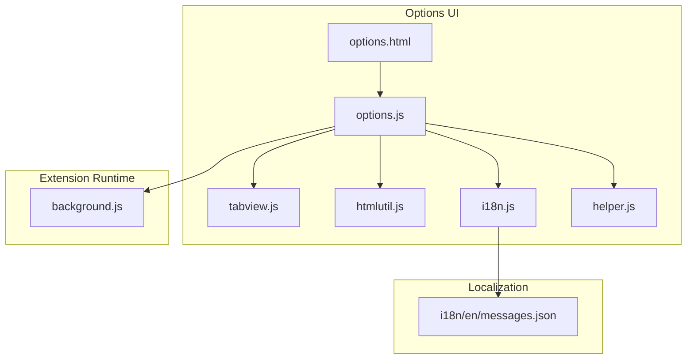
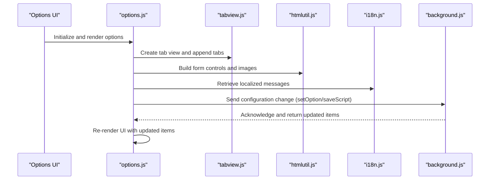
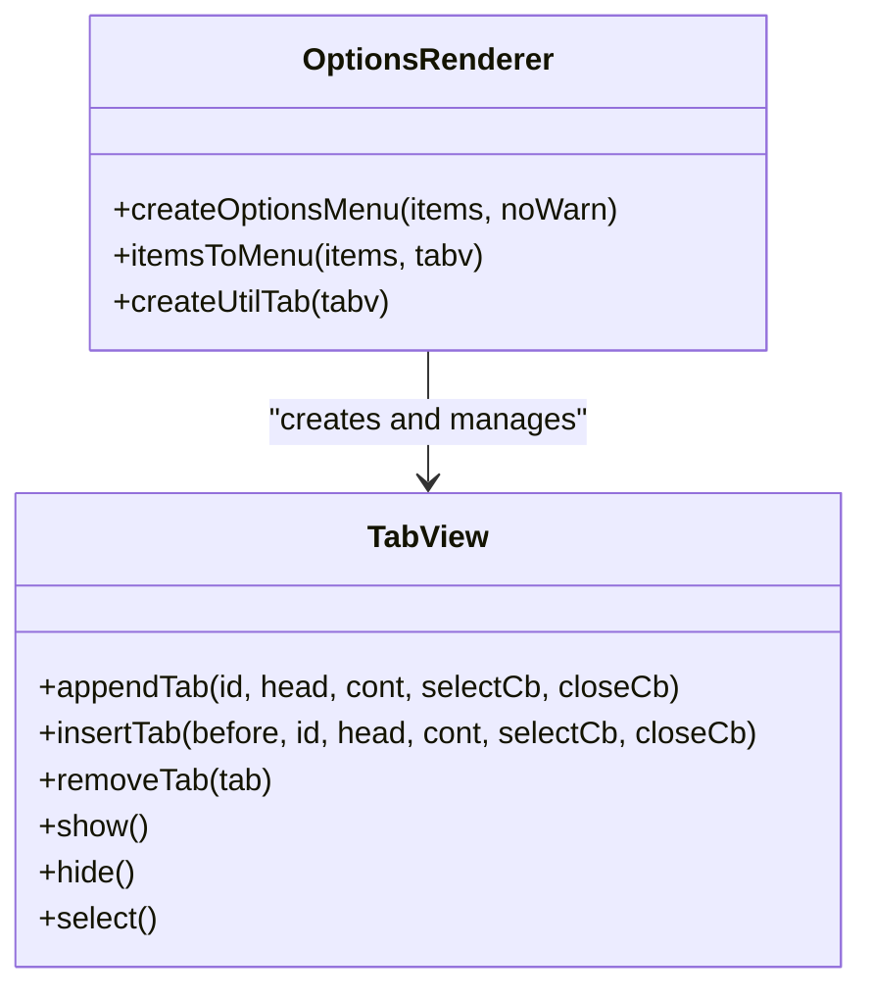
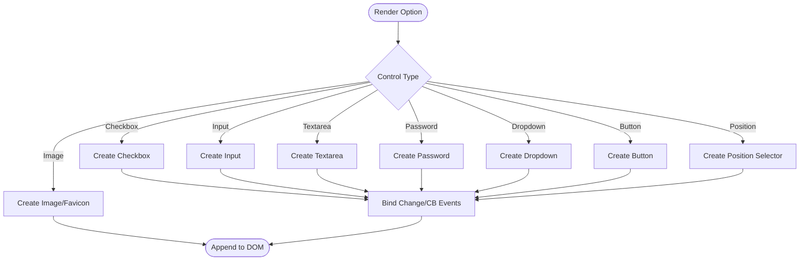
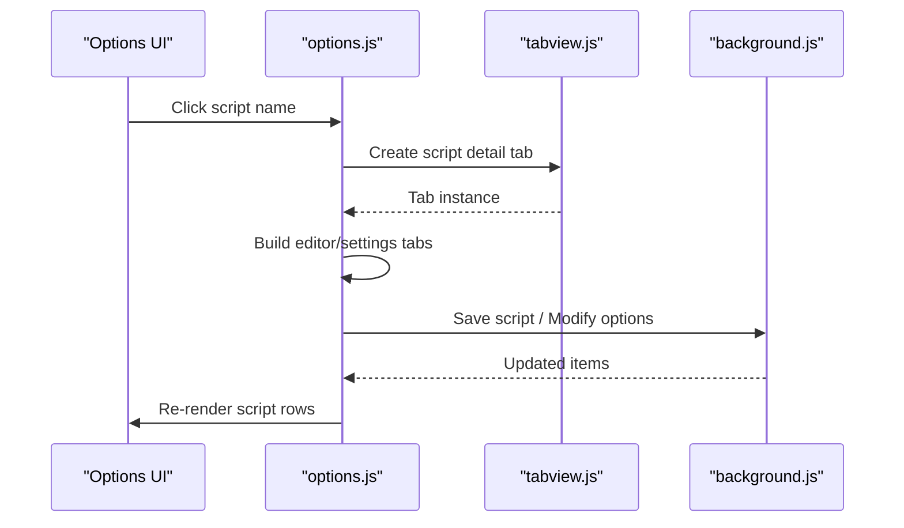
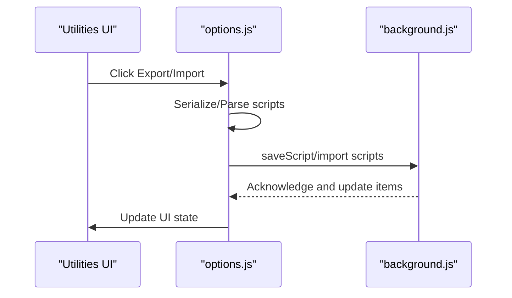
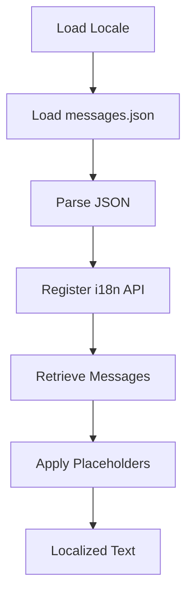
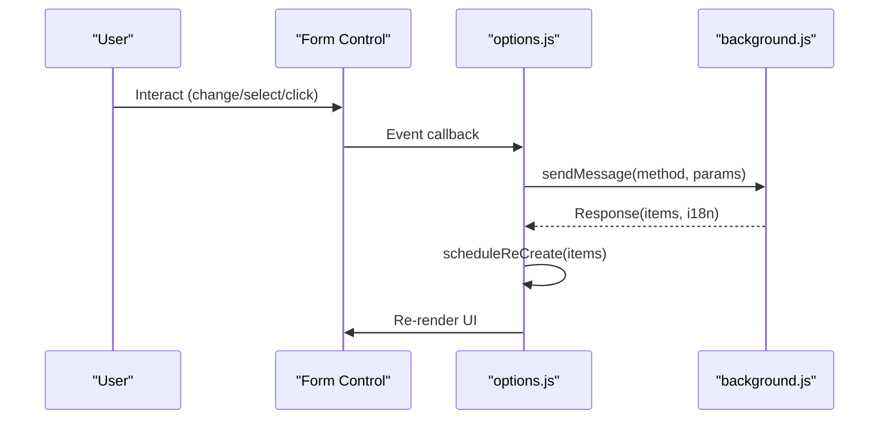
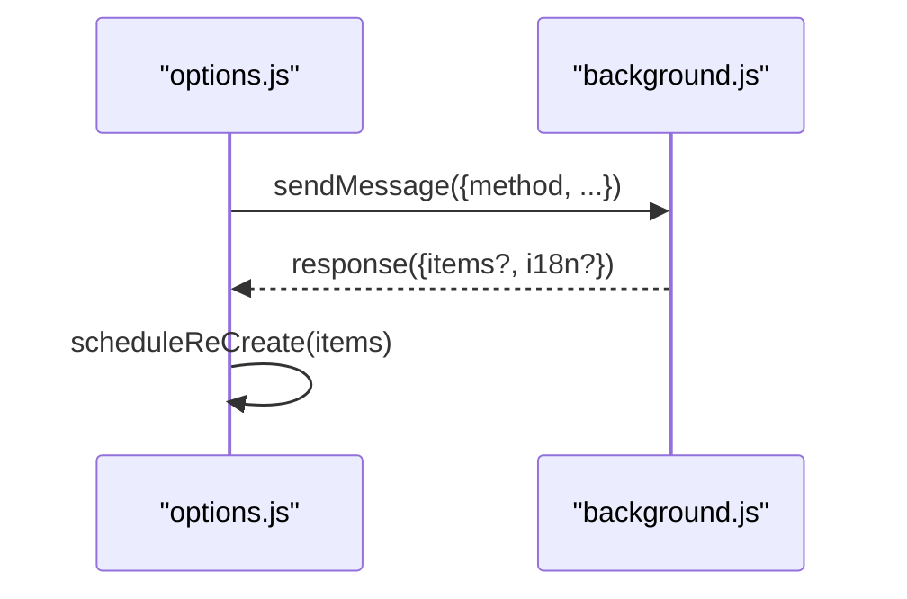
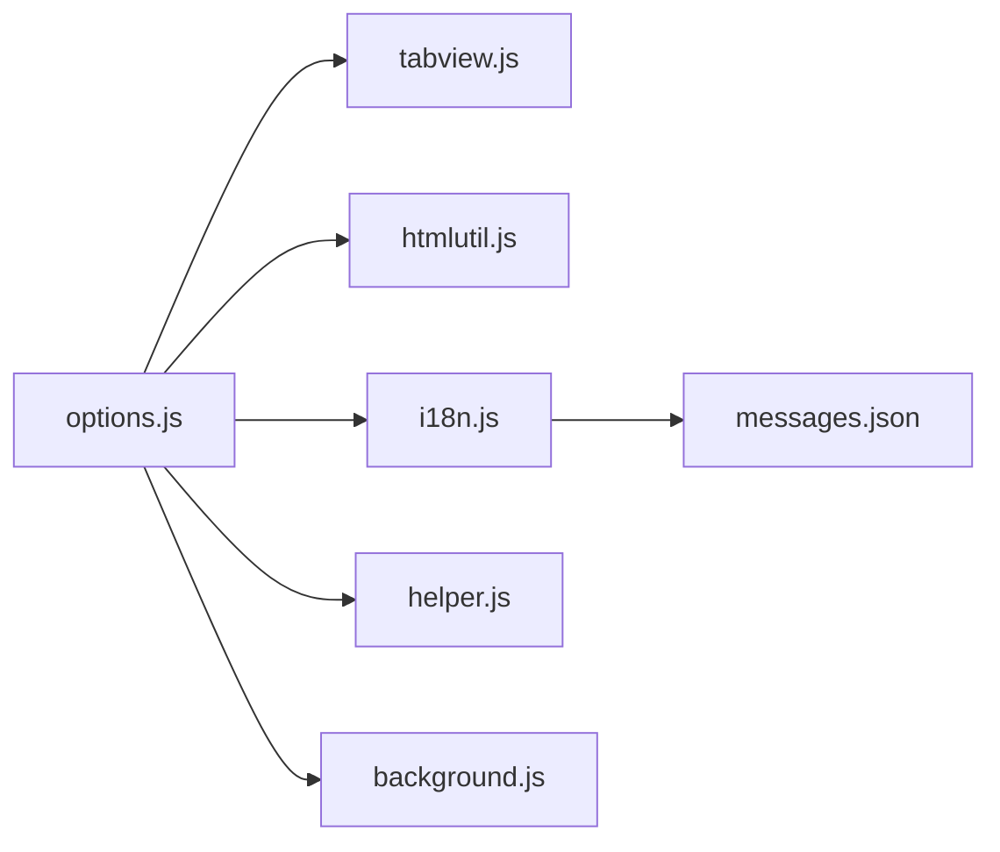

# Options Page

<cite>
**Referenced Files in This Document**
- [options.html](file://src/options.html)
- [options.js](file://src/options.js)
- [tabview.js](file://src/tabview.js)
- [htmlutil.js](file://src/htmlutil.js)
- [i18n.js](file://src/i18n.js)
- [helper.js](file://src/helper.js)
- [background.js](file://src/background.js)
- [messages.json](file://i18n/en/messages.json)
</cite>

## Table of Contents
1. [Introduction](#introduction)
2. [Project Structure](#project-structure)
3. [Core Components](#core-components)
4. [Architecture Overview](#architecture-overview)
5. [Detailed Component Analysis](#detailed-component-analysis)
6. [Dependency Analysis](#dependency-analysis)
7. [Performance Considerations](#performance-considerations)
8. [Troubleshooting Guide](#troubleshooting-guide)
9. [Conclusion](#conclusion)

## Introduction
This document describes the Tampermonkey Options Page component, which provides the main configuration interface for managing userscripts, system preferences, and settings. It covers the tabbed interface architecture, dynamic content rendering, menu organization, script listing and management, import/export utilities, and internationalization support. It also explains the data binding patterns, event handling mechanisms, and integration with the background script for configuration persistence.

## Project Structure
The Options Page is implemented as a self-contained HTML page with JavaScript modules that render a configurable UI, manage user interactions, and communicate with the extension’s background script.

**Diagram sources**
- [options.html:1-38](file://src/options.html#L1-L38)
- [options.js:1-100](file://src/options.js#L1-L100)
- [tabview.js:1-60](file://src/tabview.js#L1-L60)
- [htmlutil.js:1-60](file://src/htmlutil.js#L1-L60)
- [i18n.js:1-60](file://src/i18n.js#L1-L60)
- [helper.js:1-60](file://src/helper.js#L1-L60)
- [background.js:1-60](file://src/background.js#L1-L60)
- [messages.json:1-60](file://i18n/en/messages.json#L1-L60)

**Section sources**
- [options.html:1-38](file://src/options.html#L1-L38)

## Core Components
- Options renderer: Builds the main UI from a declarative item specification, generating forms, tables, and tabs.
- Tab view system: Manages tabbed navigation and content switching.
- HTML utilities: Provides reusable helpers for creating form controls, images, and interactive elements.
- Internationalization: Loads localized messages and exposes a message retrieval API.
- Background integration: Sends configuration changes to the background script and receives updates.
- Utilities tab: Implements import/export and backup/restore operations for userscripts.

**Section sources**
- [options.js:720-792](file://src/options.js#L720-L792)
- [tabview.js:17-322](file://src/tabview.js#L17-L322)
- [htmlutil.js:102-381](file://src/htmlutil.js#L102-L381)
- [i18n.js:72-138](file://src/i18n.js#L72-L138)
- [options.js:2531-2642](file://src/options.js#L2531-L2642)

## Architecture Overview
The Options Page follows a modular architecture:
- options.html loads required libraries and initializes options.js.
- options.js orchestrates rendering, event handling, and communication with the background script.
- tabview.js encapsulates tabbed UI behavior.
- htmlutil.js centralizes DOM construction for form controls and images.
- i18n.js manages localization and message retrieval.
- background.js handles persistence and responds to configuration requests.

**Diagram sources**
- [options.js:720-792](file://src/options.js#L720-L792)
- [tabview.js:214-322](file://src/tabview.js#L214-L322)
- [htmlutil.js:102-381](file://src/htmlutil.js#L102-L381)
- [i18n.js:72-138](file://src/i18n.js#L72-L138)
- [background.js:1-60](file://src/background.js#L1-L60)

## Detailed Component Analysis

### Tabbed Interface and Content Rendering
The Options Page uses a tabbed layout to organize settings and script management. The tab view system:
- Creates a container with tab headers and content areas.
- Manages selection, visibility, and lifecycle of tabs.
- Supports optional close buttons and dynamic insertion.

**Diagram sources**
- [tabview.js:214-322](file://src/tabview.js#L214-L322)
- [options.js:720-792](file://src/options.js#L720-L792)

**Section sources**
- [tabview.js:17-322](file://src/tabview.js#L17-L322)
- [options.js:720-792](file://src/options.js#L720-L792)

### Form Controls and Dynamic Content Generation
The HTML utilities module generates form controls dynamically:
- Inputs, textareas, passwords, checkboxes, dropdowns, buttons, images, and position selectors.
- Search box creation and favicon handling.
- Event wiring for change and click handlers.

**Diagram sources**
- [htmlutil.js:102-381](file://src/htmlutil.js#L102-L381)

**Section sources**
- [htmlutil.js:102-381](file://src/htmlutil.js#L102-L381)

### Script Listing and Management Interface
The script listing presents userscripts and native extensions in a sortable table with:
- Selection checkboxes for multi-select actions.
- Enable/disable toggles with position controls.
- Feature indicators (HTTPS access, storage, unsafeWindow, compatibility flags).
- Site icons derived from includes/matches.
- Edit links that open script detail tabs with editor and settings.

**Diagram sources**
- [options.js:1485-1838](file://src/options.js#L1485-L1838)
- [options.js:1248-1483](file://src/options.js#L1248-L1483)
- [options.js:1084-1246](file://src/options.js#L1084-L1246)

**Section sources**
- [options.js:1485-1838](file://src/options.js#L1485-L1838)
- [options.js:1248-1483](file://src/options.js#L1248-L1483)
- [options.js:1084-1246](file://src/options.js#L1084-L1246)

### Import/Export and Backup/Restore Utilities
The Utilities tab provides import/export capabilities:
- Export to textarea, file, or sandboxed filesystem.
- Import from textarea, file, or sandboxed filesystem.
- Encodes/decodes scripts and integrates with the background script to save/import.

**Diagram sources**
- [options.js:457-718](file://src/options.js#L457-L718)
- [options.js:2531-2562](file://src/options.js#L2531-L2562)

**Section sources**
- [options.js:457-718](file://src/options.js#L457-L718)
- [options.js:2531-2562](file://src/options.js#L2531-L2562)

### Internationalization Support
Localization is handled by:
- Loading locale-specific messages from i18n JSON files.
- Providing a message retrieval API with placeholders and fallbacks.
- Using localized strings for UI labels and prompts.

**Diagram sources**
- [i18n.js:72-138](file://src/i18n.js#L72-L138)
- [messages.json:164-260](file://i18n/en/messages.json#L164-L260)

**Section sources**
- [i18n.js:72-138](file://src/i18n.js#L72-L138)
- [messages.json:164-260](file://i18n/en/messages.json#L164-L260)

### Data Binding Patterns and Event Handling
- Declarative item specification drives UI generation.
- Event handlers bind to controls and call into background APIs.
- Changes trigger background updates and UI refresh via scheduled recreation.

**Diagram sources**
- [options.js:2564-2642](file://src/options.js#L2564-L2642)
- [options.js:2498-2511](file://src/options.js#L2498-L2511)

**Section sources**
- [options.js:2564-2642](file://src/options.js#L2564-L2642)
- [options.js:2498-2511](file://src/options.js#L2498-L2511)

### Integration with Background Script
Communication with the background script is performed via message passing:
- Methods include saving scripts, setting options, modifying script options, running updates, and more.
- Responses may include updated items and locale changes.

**Diagram sources**
- [options.js:2531-2642](file://src/options.js#L2531-L2642)
- [background.js:1-60](file://src/background.js#L1-L60)

**Section sources**
- [options.js:2531-2642](file://src/options.js#L2531-L2642)
- [background.js:1-60](file://src/background.js#L1-L60)

## Dependency Analysis
The Options Page depends on several modules:
- Registry-based loading ensures dependencies are available before use.
- Helper utilities provide common operations (DOM traversal, type checks, alerts).
- TabView and HtmlUtil encapsulate UI concerns.
- i18n provides localized strings.
- background.js handles persistence and updates.

**Diagram sources**
- [options.js:8-17](file://src/options.js#L8-L17)
- [tabview.js:8-14](file://src/tabview.js#L8-L14)
- [htmlutil.js:8-14](file://src/htmlutil.js#L8-L14)
- [i18n.js:8-14](file://src/i18n.js#L8-L14)
- [helper.js:1-6](file://src/helper.js#L1-L6)
- [messages.json:1-60](file://i18n/en/messages.json#L1-L60)

**Section sources**
- [options.js:8-17](file://src/options.js#L8-L17)
- [tabview.js:8-14](file://src/tabview.js#L8-L14)
- [htmlutil.js:8-14](file://src/htmlutil.js#L8-L14)
- [i18n.js:8-14](file://src/i18n.js#L8-L14)
- [helper.js:1-6](file://src/helper.js#L1-L6)
- [messages.json:1-60](file://i18n/en/messages.json#L1-L60)

## Performance Considerations
- Batch updates: Multi-select actions trigger a single refresh after applying changes to multiple items.
- Debounced recreation: UI recreation is scheduled to avoid frequent reflows.
- Lazy initialization: Editor and advanced features are initialized on demand to reduce startup cost.
- Efficient DOM updates: Re-rendering targets only changed sections rather than rebuilding the entire UI.

## Troubleshooting Guide
- Unknown method errors: The Options Page logs unknown methods and returns false to the message listener.
- Internal errors: On DOMContentLoaded/load failure, the page prompts to visit the forum.
- Import/Export failures: Errors are surfaced via alerts and logged to the console.
- Locale issues: If locale parsing fails, the system falls back to original messages.

**Section sources**
- [options.js:2688-2694](file://src/options.js#L2688-L2694)
- [options.js:2706-2714](file://src/options.js#L2706-L2714)
- [i18n.js:108-113](file://src/i18n.js#L108-L113)

## Conclusion
The Tampermonkey Options Page is a robust, modular system that renders a comprehensive configuration interface. Its tabbed architecture, dynamic form generation, and strong integration with the background script enable efficient userscript and preference management. The utilities tab provides powerful import/export capabilities, while internationalization support ensures accessibility across locales. The event-driven model and scheduled UI updates keep the interface responsive and consistent.