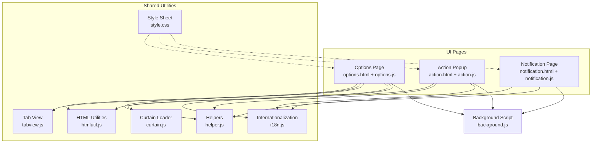
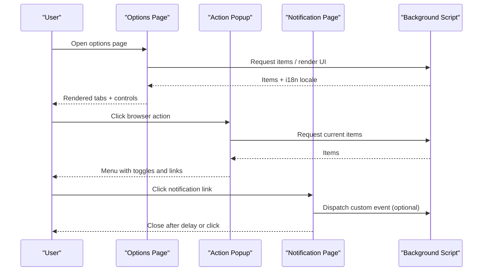
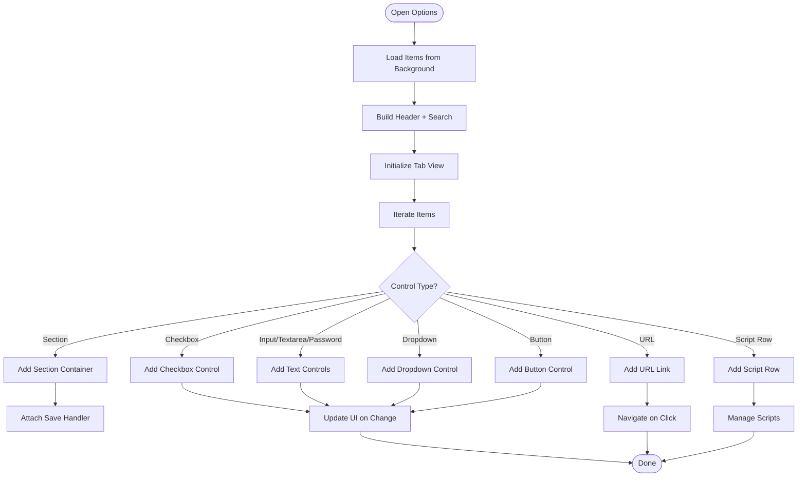
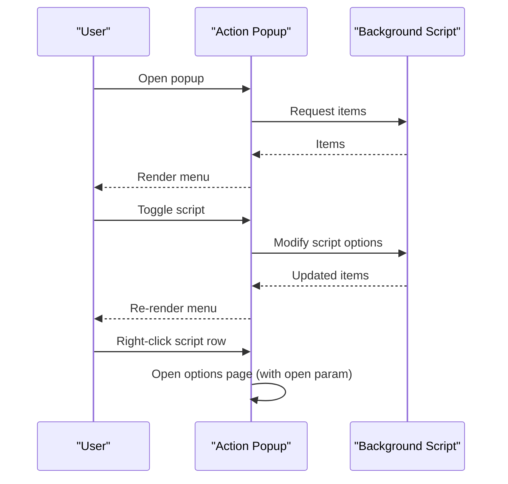
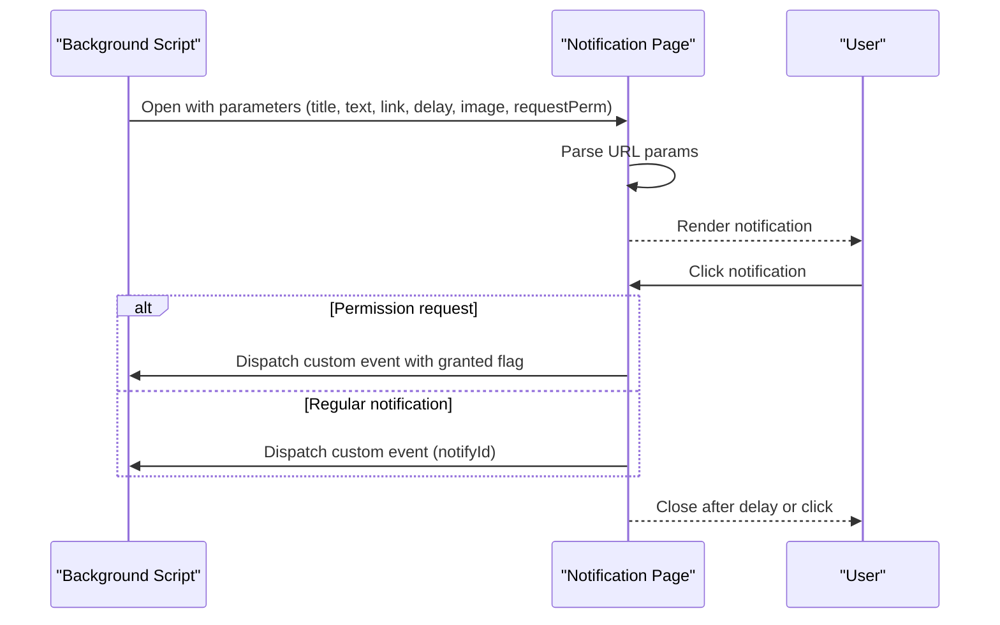
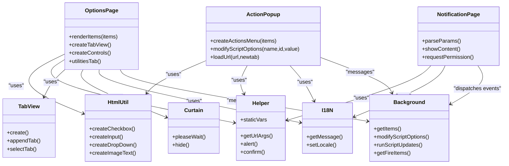
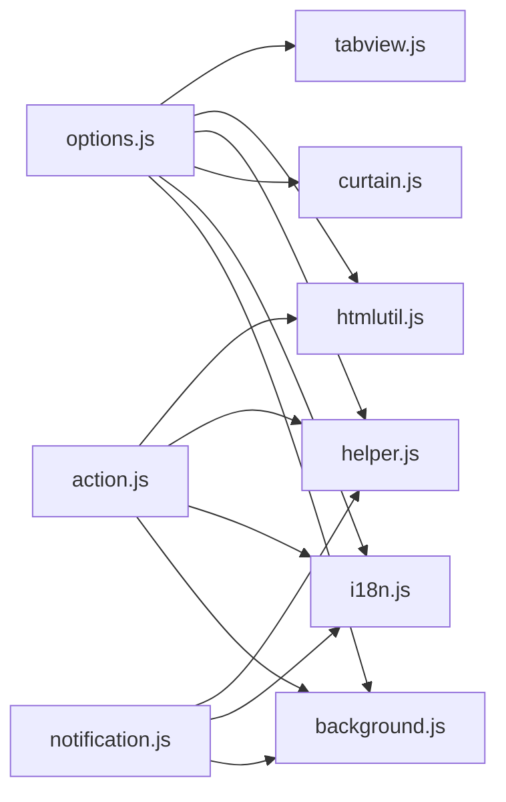

# User Interface Components

<cite>
**Referenced Files in This Document**
- [options.html](file://src/options.html)
- [options.js](file://src/options.js)
- [action.html](file://src/action.html)
- [action.js](file://src/action.js)
- [notification.html](file://src/notification.html)
- [notification.js](file://src/notification.js)
- [style.css](file://src/style.css)
- [htmlutil.js](file://src/htmlutil.js)
- [helper.js](file://src/helper.js)
- [tabview.js](file://src/tabview.js)
- [curtain.js](file://src/curtain.js)
- [i18n.js](file://src/i18n.js)
- [background.js](file://src/background.js)
</cite>

## Table of Contents
1. [Introduction](#introduction)
2. [Project Structure](#project-structure)
3. [Core Components](#core-components)
4. [Architecture Overview](#architecture-overview)
5. [Detailed Component Analysis](#detailed-component-analysis)
6. [Dependency Analysis](#dependency-analysis)
7. [Performance Considerations](#performance-considerations)
8. [Troubleshooting Guide](#troubleshooting-guide)
9. [Conclusion](#conclusion)
10. [Appendices](#appendices)

## Introduction
This document describes Tampermonkey’s user interface components with a focus on the options page, the browser action popup, and the notification system. It explains the UI architecture, component interactions, and user workflow patterns. It also covers customization and theming via shared styles, internationalization support, and accessibility considerations. Finally, it outlines development guidelines for styling, responsiveness, and data binding/event handling patterns that connect UI components to the extension’s background system.

## Project Structure
The UI is composed of three primary pages:
- Options page: A configuration and script management interface built dynamically from item definitions and rendered inside a tabbed layout.
- Browser action popup: A compact menu overlay that allows quick toggling of scripts and navigation to the options page.
- Notification page: A lightweight overlay for transient user feedback, permission requests, and optional links.

These pages share common utilities and styles:
- Shared styles define typography, layout, and reusable UI patterns.
- Utility libraries provide DOM helpers, internationalization, tabbed views, and loading overlays.

**Diagram sources**
- [options.html:1-38](file://src/options.html#L1-L38)
- [options.js:1-800](file://src/options.js#L1-L800)
- [action.html:1-22](file://src/action.html#L1-L22)
- [action.js:1-321](file://src/action.js#L1-L321)
- [notification.html:1-23](file://src/notification.html#L1-L23)
- [notification.js:1-98](file://src/notification.js#L1-L98)
- [style.css:1-200](file://src/style.css#L1-L200)
- [htmlutil.js:1-200](file://src/htmlutil.js#L1-L200)
- [helper.js:1-200](file://src/helper.js#L1-L200)
- [tabview.js:1-200](file://src/tabview.js#L1-L200)
- [curtain.js:1-200](file://src/curtain.js#L1-L200)
- [i18n.js:1-140](file://src/i18n.js#L1-L140)
- [background.js:1-200](file://src/background.js#L1-L200)

**Section sources**
- [options.html:1-38](file://src/options.html#L1-L38)
- [action.html:1-22](file://src/action.html#L1-L22)
- [notification.html:1-23](file://src/notification.html#L1-L23)
- [style.css:1-200](file://src/style.css#L1-L200)

## Core Components
- Options page (configuration and script management):
  - Dynamically renders a tabbed interface from item definitions.
  - Supports controls for booleans, text, password, dropdowns, buttons, and script rows.
  - Provides a dedicated utilities tab for import/export of scripts and sandboxed storage operations.
- Browser action popup (quick access):
  - Presents a compact menu of actions and script toggles.
  - Integrates with the background script to toggle script states and open the options page.
- Notification system (user feedback):
  - Displays transient notifications with optional icons, titles, and links.
  - Supports permission requests and click-to-dismiss behavior.

**Section sources**
- [options.js:56-792](file://src/options.js#L56-L792)
- [action.js:22-267](file://src/action.js#L22-L267)
- [notification.js:15-94](file://src/notification.js#L15-L94)

## Architecture Overview
The UI components communicate with the background script through message passing. The options page initializes a tabbed view and constructs controls from item definitions. The action popup fetches current items and updates dynamically after user interactions. The notification page receives parameters via URL query and optionally triggers permission requests or background events.

**Diagram sources**
- [options.js:720-792](file://src/options.js#L720-L792)
- [action.js:248-267](file://src/action.js#L248-L267)
- [notification.js:54-92](file://src/notification.js#L54-L92)
- [background.js:1-200](file://src/background.js#L1-L200)

## Detailed Component Analysis

### Options Page
The options page builds a main container with a header and a tabbed view. It iterates through item definitions to create controls and script rows, supports sectioned forms with save buttons, and exposes a utilities tab for import/export and sandboxed storage operations.

Key behaviors:
- Dynamic rendering of controls (checkboxes, inputs, dropdowns, buttons, URLs).
- Sectioned forms with per-section save handlers.
- Script table with multi-select actions and sorting.
- Utilities tab with import/export to textarea, file, and sandboxed filesystem.

**Diagram sources**
- [options.js:58-455](file://src/options.js#L58-L455)
- [options.js:457-718](file://src/options.js#L457-L718)

**Section sources**
- [options.html:1-38](file://src/options.html#L1-L38)
- [options.js:56-792](file://src/options.js#L56-L792)
- [tabview.js:17-150](file://src/tabview.js#L17-L150)
- [htmlutil.js:102-200](file://src/htmlutil.js#L102-L200)
- [helper.js:184-200](file://src/helper.js#L184-L200)

### Browser Action Popup
The action popup presents a compact menu of actions and script toggles. It listens for messages from the background to refresh its content and handles clicks to toggle script states or navigate to URLs. Right-clicking a script row opens the options page for that script.

**Diagram sources**
- [action.js:22-190](file://src/action.js#L22-L190)
- [action.js:248-267](file://src/action.js#L248-L267)
- [action.js:192-208](file://src/action.js#L192-L208)

**Section sources**
- [action.html:1-22](file://src/action.html#L1-L22)
- [action.js:22-267](file://src/action.js#L22-L267)

### Notification System
The notification page reads parameters from the URL to display a transient message with optional icon, title, and link. It supports click-to-dismiss and permission requests. After a configurable delay, the window closes automatically.

**Diagram sources**
- [notification.html:1-23](file://src/notification.html#L1-L23)
- [notification.js:15-94](file://src/notification.js#L15-L94)

**Section sources**
- [notification.html:1-23](file://src/notification.html#L1-L23)
- [notification.js:15-94](file://src/notification.js#L15-L94)

### UI Architecture and Component Interactions
- Shared utilities:
  - HTML utilities construct controls and composite widgets.
  - Helpers provide URL parsing, visibility toggling, and localization helpers.
  - Tab view manages tab selection and content visibility.
  - Curtain provides a modal overlay for “please wait” messaging.
  - Internationalization supplies localized strings and locale switching.
- Integration with background:
  - Options and action pages request items and update UI accordingly.
  - Action popup modifies script options and refreshes items.
  - Notifications can trigger background events and permission requests.

**Diagram sources**
- [options.js:720-792](file://src/options.js#L720-L792)
- [action.js:22-267](file://src/action.js#L22-L267)
- [notification.js:15-94](file://src/notification.js#L15-L94)
- [htmlutil.js:15-200](file://src/htmlutil.js#L15-L200)
- [helper.js:89-121](file://src/helper.js#L89-L121)
- [tabview.js:17-150](file://src/tabview.js#L17-L150)
- [curtain.js:72-121](file://src/curtain.js#L72-L121)
- [i18n.js:94-138](file://src/i18n.js#L94-L138)
- [background.js:1-200](file://src/background.js#L1-L200)

**Section sources**
- [htmlutil.js:15-200](file://src/htmlutil.js#L15-L200)
- [helper.js:89-121](file://src/helper.js#L89-L121)
- [tabview.js:17-150](file://src/tabview.js#L17-L150)
- [curtain.js:72-121](file://src/curtain.js#L72-L121)
- [i18n.js:94-138](file://src/i18n.js#L94-L138)
- [background.js:1-200](file://src/background.js#L1-L200)

## Dependency Analysis
- Options page depends on:
  - Tab view for layout.
  - HTML utilities for control creation.
  - Helpers for URL parsing and visibility.
  - Curtain for loading states.
  - Internationalization for labels.
  - Background for items and i18n updates.
- Action popup depends on:
  - HTML utilities for images and text.
  - Helpers for URL parsing.
  - Internationalization for labels.
  - Background for items and modifications.
- Notification page depends on:
  - Helpers for URL parsing.
  - Internationalization for labels.
  - Background for dispatching events.

**Diagram sources**
- [options.js:7-35](file://src/options.js#L7-L35)
- [action.js:11-21](file://src/action.js#L11-L21)
- [notification.js:7-9](file://src/notification.js#L7-L9)

**Section sources**
- [options.js:7-35](file://src/options.js#L7-L35)
- [action.js:11-21](file://src/action.js#L11-L21)
- [notification.js:7-9](file://src/notification.js#L7-L9)

## Performance Considerations
- Minimize DOM updates by batching control creation and deferring heavy operations until after initial render.
- Use tab view caching to avoid reconstructing tab entries unnecessarily.
- Defer long-running tasks behind curtain overlays to prevent UI stalls.
- Avoid excessive reflows by setting styles in bulk and using CSS classes rather than inline styles where possible.
- Leverage helper utilities for efficient iteration and visibility toggling.

[No sources needed since this section provides general guidance]

## Troubleshooting Guide
Common issues and resolutions:
- Controls not updating after changes:
  - Verify that the background responds to modification requests and returns updated items.
  - Ensure event listeners are attached and not overwritten during re-render.
- Internationalization not applied:
  - Confirm that the i18n locale is set and messages are retrieved via the i18n module.
- Notifications not closing:
  - Check delay parameter and ensure click-to-dismiss logic is wired.
  - Confirm that permission requests resolve to a granted/dismissed state.

**Section sources**
- [action.js:269-279](file://src/action.js#L269-L279)
- [notification.js:54-92](file://src/notification.js#L54-L92)
- [i18n.js:94-138](file://src/i18n.js#L94-L138)

## Conclusion
Tampermonkey’s UI components are modular, utility-driven, and tightly integrated with the background script. The options page offers a comprehensive configuration surface with a tabbed layout and utilities. The action popup provides quick access and script toggling. The notification system delivers timely feedback and integrates with background events. Shared utilities and styles ensure consistent behavior and appearance across components.

[No sources needed since this section summarizes without analyzing specific files]

## Appendices

### Styling Conventions and Theming
- Typography and spacing:
  - Consistent font stack and sizes are defined in the stylesheet.
  - Margins and paddings are standardized for alignment and readability.
- Layout primitives:
  - Floats, centers, and visibility helpers provide flexible positioning.
  - Tables and containers enforce consistent widths and heights.
- Theming:
  - Centralized color and border definitions enable easy theme swaps.
  - Visibility helpers allow dynamic show/hide without layout thrashing.

**Section sources**
- [style.css:2-200](file://src/style.css#L2-L200)

### Accessibility Features
- Keyboard-friendly controls:
  - Buttons and links are focusable and actionable via Enter/Space.
- Screen reader support:
  - Descriptive labels and titles are used for interactive elements.
- Focus management:
  - Ensure focus moves predictably after dynamic updates.

[No sources needed since this section provides general guidance]

### Responsive Design Considerations
- Flexible widths:
  - Use percentage-based widths and min-width constraints for optimal scaling.
- Adaptive layouts:
  - Breakpoints can be introduced via media queries to adjust spacing and font sizes.
- Mobile touch targets:
  - Ensure interactive elements are adequately sized for touch interaction.

[No sources needed since this section provides general guidance]

### UI Development Guidelines
- Keep UI logic declarative:
  - Define item structures and let the renderer create controls.
- Encapsulate cross-cutting concerns:
  - Use helpers for URL parsing, visibility, and localization.
- Message-driven updates:
  - Prefer background-initiated updates to keep UI state consistent.
- Event handling patterns:
  - Attach event listeners once and reuse handlers across re-renders.
- Data binding patterns:
  - Bind control values to item definitions and propagate changes back to the background.

**Section sources**
- [options.js:56-792](file://src/options.js#L56-L792)
- [action.js:22-267](file://src/action.js#L22-L267)
- [helper.js:89-121](file://src/helper.js#L89-L121)