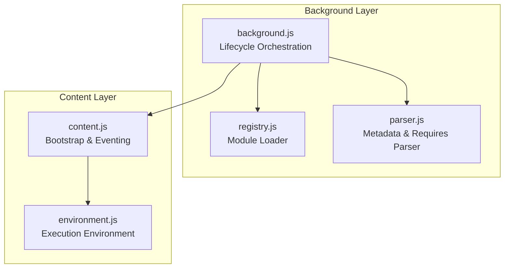
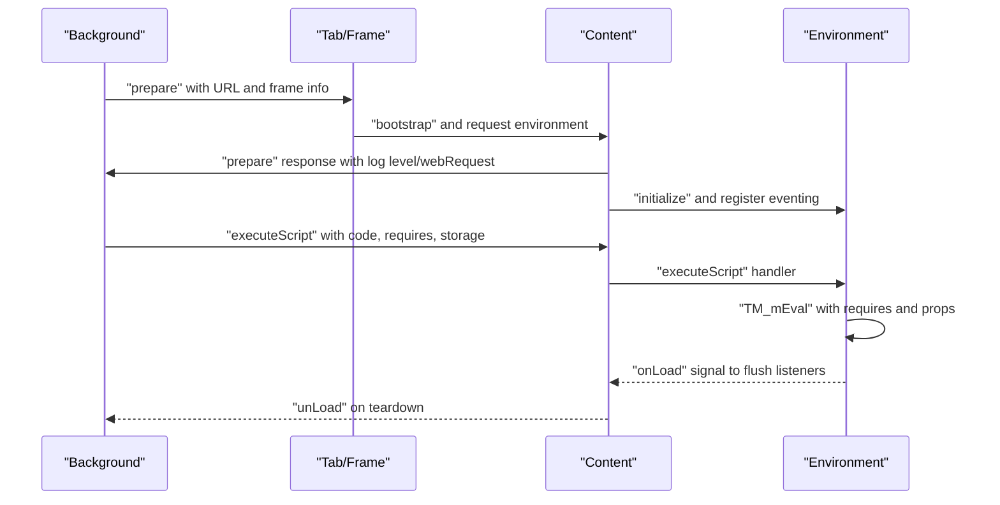
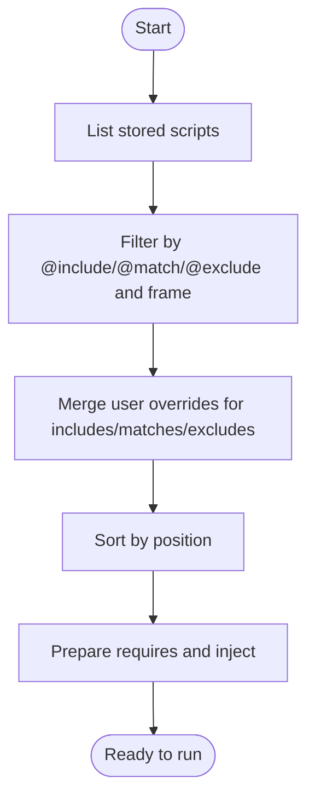
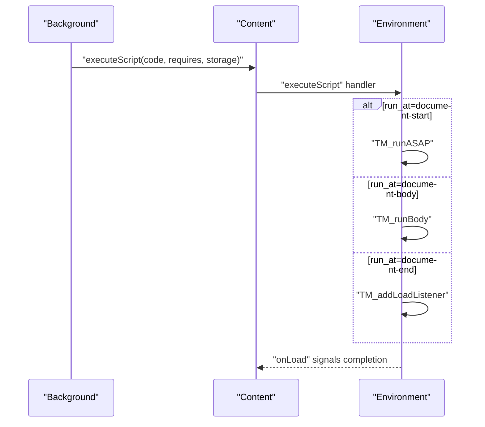
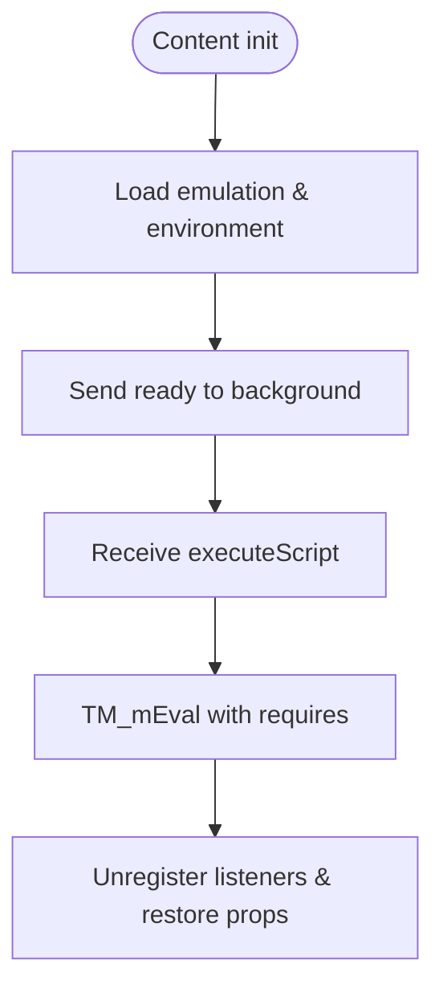
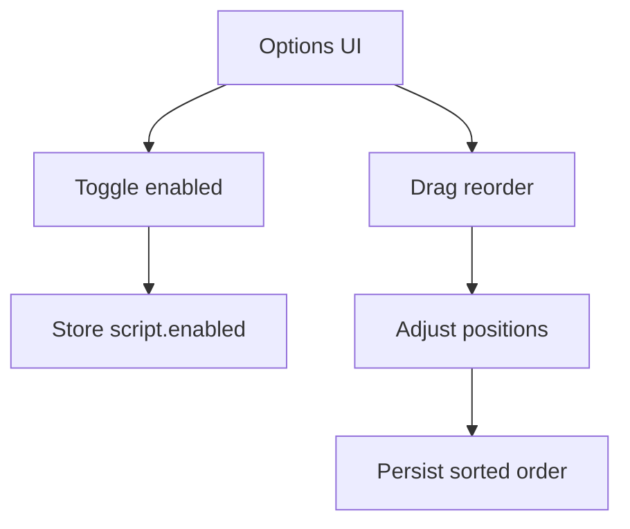
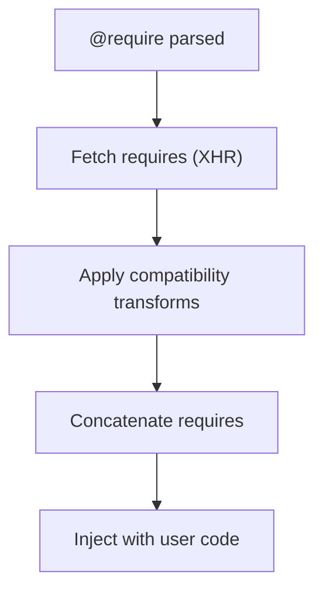
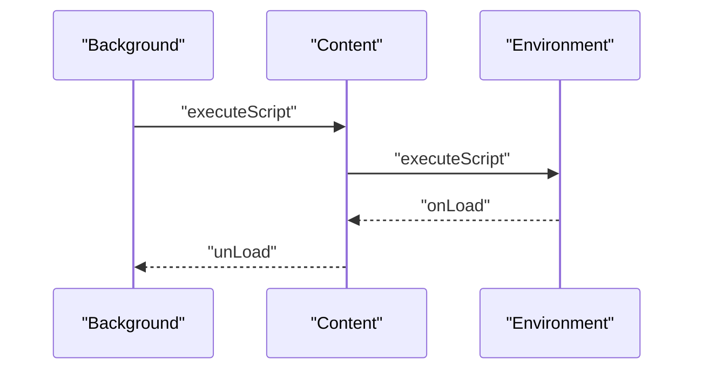
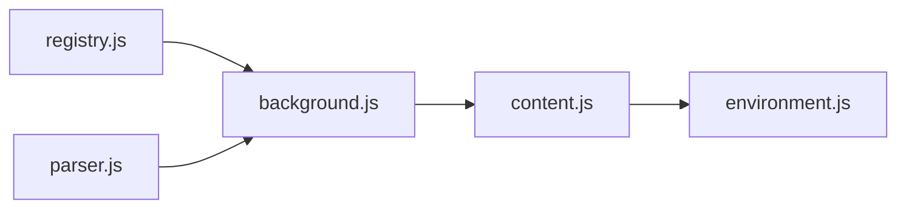

# Script Lifecycle Management

<cite>
**Referenced Files in This Document**
- [background.js](file://src/background.js)
- [content.js](file://src/content.js)
- [environment.js](file://src/environment.js)
- [registry.js](file://src/registry.js)
- [parser.js](file://src/parser.js)
- [options.js](file://src/options.js)
- [htmlutil.js](file://src/htmlutil.js)
</cite>

## Table of Contents
1. [Introduction](#introduction)
2. [Project Structure](#project-structure)
3. [Core Components](#core-components)
4. [Architecture Overview](#architecture-overview)
5. [Detailed Component Analysis](#detailed-component-analysis)
6. [Dependency Analysis](#dependency-analysis)
7. [Performance Considerations](#performance-considerations)
8. [Troubleshooting Guide](#troubleshooting-guide)
9. [Conclusion](#conclusion)

## Introduction
This document explains Tampermonkey’s script lifecycle management system end-to-end. It covers installation and validation, activation, execution, and cleanup phases; state transitions; timing mechanisms; coordination between background processes and content scripts; enable/disable controls; ordering and priority; dependency resolution via @require; and the execution environment initialization, resource allocation, and cleanup procedures. It also provides examples of lifecycle hooks, state monitoring, and troubleshooting strategies for startup failures and execution timeouts.

## Project Structure
The lifecycle spans three major layers:
- Background: orchestrates script discovery, validation, dependency fetching, injection scheduling, and state persistence.
- Content: hosts the isolated execution environment per tab/frame, manages timing hooks, and coordinates with background.
- Environment: defines the sandboxed runtime, event wiring, and cleanup routines.

**Diagram sources**
- [background.js:1-120](file://src/background.js#L1-L120)
- [content.js:1-120](file://src/content.js#L1-L120)
- [environment.js:1-120](file://src/environment.js#L1-L120)
- [registry.js:1-107](file://src/registry.js#L1-L107)
- [parser.js:1-120](file://src/parser.js#L1-L120)

**Section sources**
- [background.js:1-120](file://src/background.js#L1-L120)
- [content.js:1-120](file://src/content.js#L1-L120)
- [environment.js:1-120](file://src/environment.js#L1-L120)
- [registry.js:1-107](file://src/registry.js#L1-L107)
- [parser.js:1-120](file://src/parser.js#L1-L120)

## Core Components
- Background orchestration and storage:
  - Script discovery and filtering by URL conditions (@include/@match/@exclude/@noframes).
  - Sorting by user-defined position and merging user overrides.
  - Dependency resolution via @require with compatibility transformations.
  - Injection scheduling and message passing to content.
  - Persistence of scripts, conditions, and storage snapshots.
- Content bootstrap and eventing:
  - Establishes context ID, logs in, and requests environment initialization.
  - Registers event handlers for background-to-content messaging.
  - Coordinates timing hooks (document-start/document-body/document-end).
- Environment runtime:
  - Applies compatibility and debug options.
  - Executes user scripts with injected requires and storage context.
  - Manages DOM event simulation and cleanup on unload.

**Section sources**
- [background.js:3642-3710](file://src/background.js#L3642-L3710)
- [background.js:2758-2795](file://src/background.js#L2758-L2795)
- [content.js:1188-1196](file://src/content.js#L1188-L1196)
- [environment.js:1261-1286](file://src/environment.js#L1261-L1286)

## Architecture Overview
The lifecycle is a coordinated sequence across background and content:

**Diagram sources**
- [background.js:2717-2735](file://src/background.js#L2717-L2735)
- [background.js:2758-2795](file://src/background.js#L2758-L2795)
- [content.js:1188-1196](file://src/content.js#L1188-L1196)
- [environment.js:1261-1286](file://src/environment.js#L1261-L1286)

## Detailed Component Analysis

### 1) Script Discovery, Validation, and Ordering
- Discovery:
  - Enumerates stored scripts and filters by URL conditions and frame eligibility (@noframes).
- Validation:
  - Parses metadata and collects @include/@match/@exclude/@require/@resource/@run-at/@user-agent.
- Ordering and Priority:
  - Maintains numeric position for explicit ordering; reordering adjusts positions and persists.
- Dependency Resolution:
  - Collects @require entries and fetches their text content; applies compatibility transforms per script options.

**Diagram sources**
- [background.js:3642-3691](file://src/background.js#L3642-L3691)
- [background.js:3656-3679](file://src/background.js#L3656-L3679)
- [background.js:2762-2771](file://src/background.js#L2762-L2771)
- [parser.js:157-213](file://src/parser.js#L157-L213)

**Section sources**
- [background.js:3642-3691](file://src/background.js#L3642-L3691)
- [background.js:3656-3679](file://src/background.js#L3656-L3679)
- [background.js:2762-2771](file://src/background.js#L2762-L2771)
- [parser.js:157-213](file://src/parser.js#L157-L213)

### 2) Activation and Timing Hooks
- Background schedules injection per script and prepares requires.
- Content receives “executeScript” with code and requires; environment decides timing:
  - document-start: immediate execution.
  - document-body: run when body is ready.
  - document-end: deferred until load listeners fire.

**Diagram sources**
- [background.js:2758-2795](file://src/background.js#L2758-L2795)
- [environment.js:1261-1275](file://src/environment.js#L1261-L1275)

**Section sources**
- [background.js:2758-2795](file://src/background.js#L2758-L2795)
- [environment.js:1261-1275](file://src/environment.js#L1261-L1275)

### 3) Execution Environment Initialization and Cleanup
- Bootstrap:
  - Content initializes eventing, loads emulation and environment modules, and waits for background readiness.
- Execution:
  - Environment merges requires, applies compatibility and debug options, and evaluates user code safely.
- Cleanup:
  - Removes event listeners, restores properties, and disconnects storage ports on unload.

**Diagram sources**
- [content.js:1122-1196](file://src/content.js#L1122-L1196)
- [environment.js:52-193](file://src/environment.js#L52-L193)
- [environment.js:309-323](file://src/environment.js#L309-L323)

**Section sources**
- [content.js:1122-1196](file://src/content.js#L1122-L1196)
- [environment.js:52-193](file://src/environment.js#L52-L193)
- [environment.js:309-323](file://src/environment.js#L309-L323)

### 4) Enable/Disable and Priority Controls
- Enable/disable toggles are exposed in the options UI and persisted to storage.
- Reordering updates positions and triggers re-sorting; persistence ensures deterministic execution order.

**Diagram sources**
- [options.js:1765-1791](file://src/options.js#L1765-L1791)
- [background.js:3656-3679](file://src/background.js#L3656-L3679)

**Section sources**
- [options.js:1765-1791](file://src/options.js#L1765-L1791)
- [background.js:3656-3679](file://src/background.js#L3656-L3679)

### 5) Dependency Resolution via @require
- Parser extracts @require entries and stores them with lazy text content loading.
- Background fetches requires, applies compatibility transforms, concatenates them, and injects before user code.

**Diagram sources**
- [parser.js:173-178](file://src/parser.js#L173-L178)
- [background.js:2762-2771](file://src/background.js#L2762-L2771)

**Section sources**
- [parser.js:173-178](file://src/parser.js#L173-L178)
- [background.js:2762-2771](file://src/background.js#L2762-L2771)

### 6) Coordination Between Background and Content Scripts
- Message-based eventing:
  - Content registers event handlers for background-to-content messages.
  - Background sends “executeScript”, “onLoad”, and navigation commands.
- Context isolation:
  - Each tab/frame gets a unique context ID; messages are filtered by ID.

**Diagram sources**
- [content.js:913-962](file://src/content.js#L913-L962)
- [environment.js:1251-1319](file://src/environment.js#L1251-L1319)

**Section sources**
- [content.js:913-962](file://src/content.js#L913-L962)
- [environment.js:1251-1319](file://src/environment.js#L1251-L1319)

### 7) Lifecycle Hooks and State Monitoring
- Hooks:
  - document-start: immediate execution.
  - document-body: run when body exists.
  - document-end: deferred until load listeners fire.
- State monitoring:
  - Background tracks running/disabled counts per tab via context registry.
  - Environment logs and timestamps events for tracing.

**Section sources**
- [environment.js:1261-1286](file://src/environment.js#L1261-L1286)
- [background.js:437-558](file://src/background.js#L437-L558)

### 8) Resource Allocation and Cleanup Procedures
- Resource allocation:
  - Requires are cached and periodically cleaned.
  - Storage snapshots are passed per script execution.
- Cleanup:
  - Removes DOM listeners, restores window properties, disconnects ports, and clears caches.

**Section sources**
- [background.js:395-433](file://src/background.js#L395-L433)
- [environment.js:309-323](file://src/environment.js#L309-L323)

## Dependency Analysis
- Module loader:
  - Registry lazily loads modules and resolves dependencies across files.
- Parser:
  - Provides metadata parsing and @require/@resource extraction.
- Background:
  - Uses parser and registry to assemble scripts and requires; persists state and coordinates injection.

**Diagram sources**
- [registry.js:48-104](file://src/registry.js#L48-L104)
- [parser.js:72-282](file://src/parser.js#L72-L282)
- [background.js:2758-2795](file://src/background.js#L2758-L2795)
- [content.js:1122-1196](file://src/content.js#L1122-L1196)
- [environment.js:1233-1247](file://src/environment.js#L1233-L1247)

**Section sources**
- [registry.js:48-104](file://src/registry.js#L48-L104)
- [parser.js:72-282](file://src/parser.js#L72-L282)
- [background.js:2758-2795](file://src/background.js#L2758-L2795)
- [content.js:1122-1196](file://src/content.js#L1122-L1196)
- [environment.js:1233-1247](file://src/environment.js#L1233-L1247)

## Performance Considerations
- Require caching reduces repeated network fetches; periodic cleanup prevents memory bloat.
- Deferred execution (document-end) avoids blocking page load.
- Batched writes and transactional DB operations minimize I/O overhead during updates.

[No sources needed since this section provides general guidance]

## Troubleshooting Guide
Common issues and remedies:
- Startup failures:
  - Verify background readiness and retry logic; inspect message handler responses and context ID filtering.
  - Check require fetch errors and compatibility transform outcomes.
- Execution timeouts:
  - Ensure run_at alignment with page state; use document-body for earlier execution when appropriate.
  - Confirm onLoad signaling completes before teardown.
- Enable/disable anomalies:
  - Validate persisted enabled state and re-sort order; refresh options page to reflect changes.
- Dependency resolution errors:
  - Inspect @require URLs and fetch results; confirm compatibility mode settings.

**Section sources**
- [content.js:1122-1196](file://src/content.js#L1122-L1196)
- [background.js:2762-2771](file://src/background.js#L2762-L2771)
- [options.js:1765-1791](file://src/options.js#L1765-L1791)

## Conclusion
Tampermonkey’s lifecycle management integrates background orchestration with a robust content-side execution environment. Scripts are discovered, validated, ordered, and injected with carefully managed timing and dependencies. The system provides hooks for precise execution control, strong isolation via context IDs, and comprehensive cleanup to maintain stability across tabs and frames.