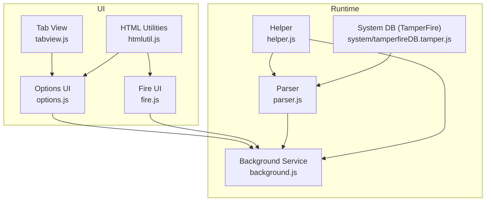
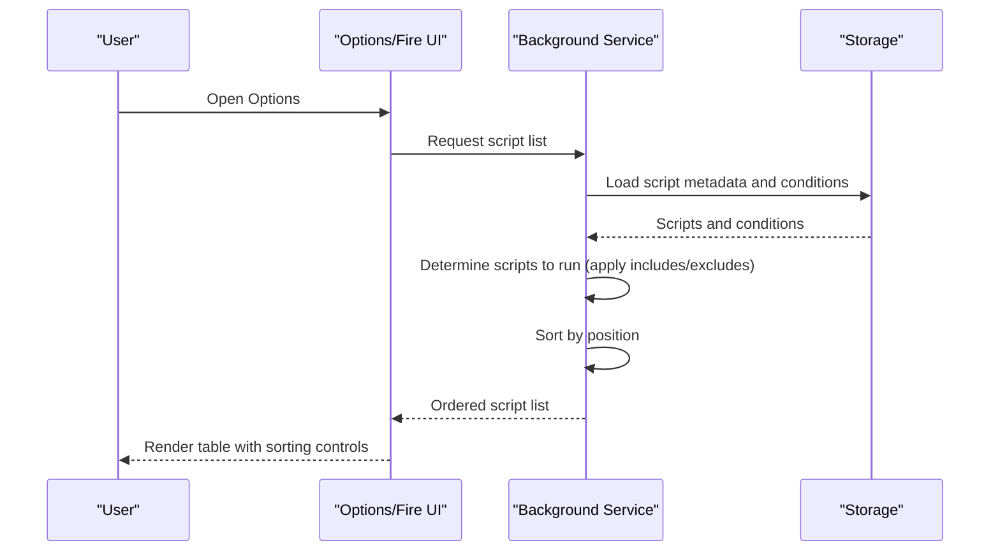
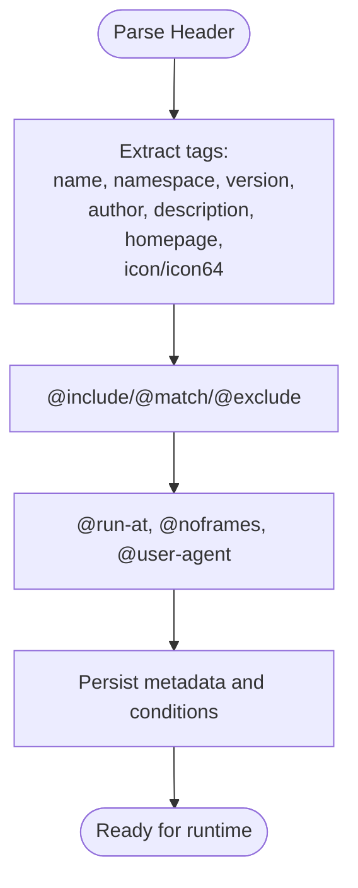
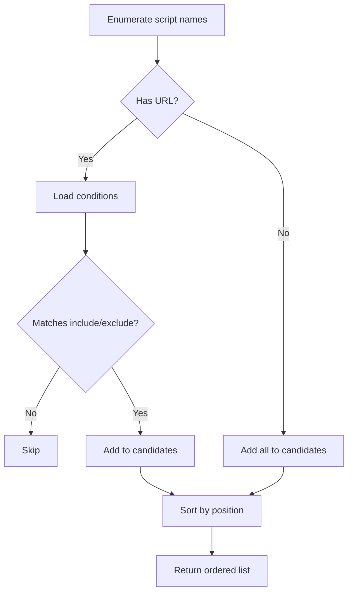
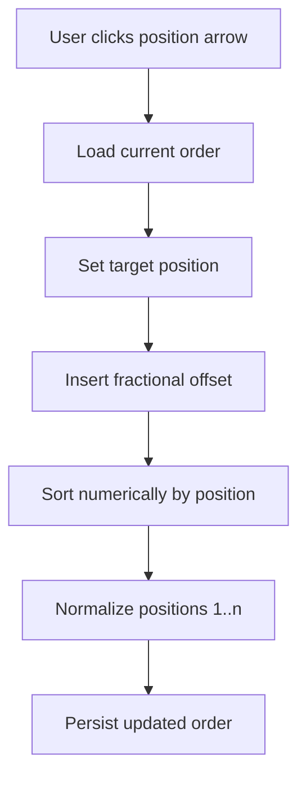
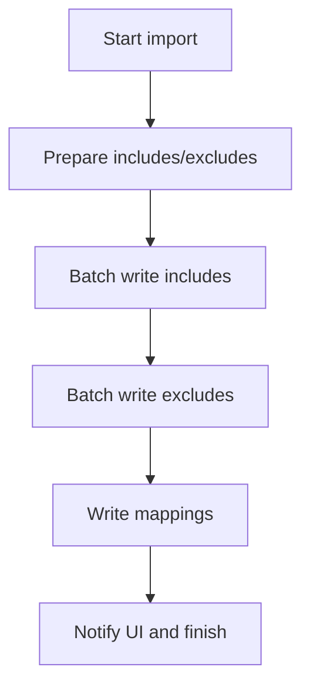
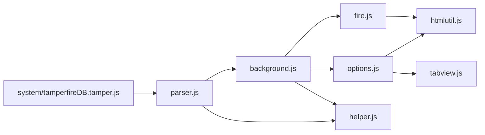

# Script Organization and Categorization

<cite>
**Referenced Files in This Document**
- [README.md](file://README.md)
- [background.js](file://src/background.js)
- [options.js](file://src/options.js)
- [fire.js](file://src/fire.js)
- [parser.js](file://src/parser.js)
- [helper.js](file://src/helper.js)
- [htmlutil.js](file://src/htmlutil.js)
- [tabview.js](file://src/tabview.js)
- [tamperfireDB.tamper.js](file://src/system/tamperfireDB.tamper.js)
</cite>

## Table of Contents
1. [Introduction](#introduction)
2. [Project Structure](#project-structure)
3. [Core Components](#core-components)
4. [Architecture Overview](#architecture-overview)
5. [Detailed Component Analysis](#detailed-component-analysis)
6. [Dependency Analysis](#dependency-analysis)
7. [Performance Considerations](#performance-considerations)
8. [Troubleshooting Guide](#troubleshooting-guide)
9. [Conclusion](#conclusion)

## Introduction
This document explains how Tampermonkey organizes and categorizes userscripts in the extension’s interface and runtime. It covers the folder-like organization in the Options UI, the sorting and ordering mechanisms, the role of script metadata in automatic categorization, and manual organization controls. It also documents bulk management operations and provides best practices and troubleshooting guidance for common issues such as duplicates and misclassification.

## Project Structure
The script organization and categorization system spans several modules:
- Background service: manages script storage, determines which scripts run on a page, and maintains order.
- Options UI: renders the script list, supports sorting, manual reordering, and bulk actions.
- Fire UI: provides an alternate view with advanced sorting and caching.
- Parser: extracts metadata and inclusion/exclusion rules from userscript headers.
- Helpers and utilities: provide shared utilities for URL handling, HTML generation, and tabbed views.



**Diagram sources**
- [options.js:1-200](file://src/options.js#L1-L200)
- [fire.js:126-652](file://src/fire.js#L126-L652)
- [tabview.js:1-200](file://src/tabview.js#L1-L200)
- [htmlutil.js:1-200](file://src/htmlutil.js#L1-L200)
- [background.js:3642-3710](file://src/background.js#L3642-L3710)
- [parser.js:1-200](file://src/parser.js#L1-L200)
- [helper.js:1-200](file://src/helper.js#L1-L200)
- [tamperfireDB.tamper.js:75-126](file://src/system/tamperfireDB.tamper.js#L75-L126)

**Section sources**
- [README.md:1-112](file://README.md#L1-L112)

## Core Components
- Script metadata extraction and storage: The parser reads userscript headers to populate fields such as name, namespace, version, homepage, icon, and inclusion/exclusion rules. These fields are persisted via the background service.
- Determination of scripts to run: The background service enumerates stored scripts, applies inclusion/exclusion conditions, and sorts them by position.
- UI organization and sorting: The Options UI displays scripts in a table with sortable columns. The Fire UI offers advanced sorting and caching of sorted lists.
- Manual ordering: Users can adjust the execution order of scripts, which updates the stored position and triggers re-sorting.
- Bulk management: The background service supports bulk operations during import and synchronization.

**Section sources**
- [parser.js:29-67](file://src/parser.js#L29-L67)
- [background.js:3642-3710](file://src/background.js#L3642-L3710)
- [options.js:109-138](file://src/options.js#L109-L138)
- [fire.js:145-652](file://src/fire.js#L145-L652)

## Architecture Overview
The system separates concerns between parsing, storage, runtime selection, and UI rendering:
- Parsing: Extracts metadata and rules from userscript headers.
- Storage: Persists scripts and conditions in the extension’s storage.
- Runtime: Determines applicable scripts per page and orders them by position.
- UI: Presents scripts, allows sorting and manual reordering, and supports bulk actions.



**Diagram sources**
- [background.js:3681-3710](file://src/background.js#L3681-L3710)
- [options.js:109-138](file://src/options.js#L109-L138)
- [fire.js:528-652](file://src/fire.js#L528-L652)

## Detailed Component Analysis

### Script Metadata Extraction and Storage
- The parser constructs a script object populated from header tags such as name, namespace, version, author, description, homepage, icon/icon64, and resource/require entries. It also parses @include, @match, @exclude, @run-at, and @noframes.
- The background service stores script metadata and associated conditions, and loads them when needed.



**Diagram sources**
- [parser.js:95-200](file://src/parser.js#L95-L200)
- [background.js:3729-3770](file://src/background.js#L3729-L3770)

**Section sources**
- [parser.js:95-200](file://src/parser.js#L95-L200)
- [background.js:3729-3770](file://src/background.js#L3729-L3770)

### Determining Scripts to Run and Sorting
- The background service enumerates stored script names, filters by inclusion/exclusion conditions when a URL is provided, and sorts by position.
- Position-based sorting ensures deterministic execution order.



**Diagram sources**
- [background.js:3681-3710](file://src/background.js#L3681-L3710)
- [background.js:3675-3679](file://src/background.js#L3675-L3679)

**Section sources**
- [background.js:3681-3710](file://src/background.js#L3681-L3710)
- [background.js:3675-3679](file://src/background.js#L3675-L3679)

### UI Organization and Sorting Controls
- Options UI: Renders a table with columns for Name, Version, Type, Sites, Features, Homepage, Last Updated, Sort, and Delete. Sorting is available for multiple fields.
- Fire UI: Provides sortable columns and a caching mechanism to improve performance when re-sorting large lists.

```mermaid
sequenceDiagram
participant Opt as "Options UI"
participant Fir as "Fire UI"
participant BG as "Background Service"
Opt->>BG : Request script list
BG-->>Opt : Ordered list
Opt->>Opt : Render table with sortable headers
Fir->>BG : Request script list
BG-->>Fir : Ordered list
Fir->>Fir : Apply sorting and cache result
```

**Diagram sources**
- [options.js:109-138](file://src/options.js#L109-L138)
- [fire.js:145-652](file://src/fire.js#L145-L652)

**Section sources**
- [options.js:109-138](file://src/options.js#L109-L138)
- [fire.js:145-652](file://src/fire.js#L145-L652)

### Manual Ordering and Reordering
- Users can adjust a script’s position via arrow controls in the Options UI. The background service recalculates positions and persists the updated order.
- The reorder operation inserts a fractional offset to avoid collisions and then normalizes positions.



**Diagram sources**
- [options.js:1963-1994](file://src/options.js#L1963-L1994)
- [background.js:3656-3673](file://src/background.js#L3656-L3673)

**Section sources**
- [options.js:1963-1994](file://src/options.js#L1963-L1994)
- [background.js:3656-3673](file://src/background.js#L3656-L3673)

### Bulk Management Operations
- Import and synchronization pathways support bulk insertion and updates of scripts. During import, the background service prepares inclusion and exclusion sets and writes them in batches.
- The system tracks progress and writes include/exclude mappings efficiently.



**Diagram sources**
- [background.js:1217-1324](file://src/background.js#L1217-L1324)
- [background.js:1571-1594](file://src/background.js#L1571-L1594)

**Section sources**
- [background.js:1217-1324](file://src/background.js#L1217-L1324)
- [background.js:1571-1594](file://src/background.js#L1571-L1594)

### Relationship Between Metadata and Automatic Categorization
- Automatic categorization is not explicitly implemented in the analyzed code. Instead, the system relies on:
  - Name and namespace for identification and display.
  - Homepage and icon for presentation.
  - Inclusion/exclusion/match rules for scoping.
- Users can influence perceived “categories” through naming conventions and consistent use of metadata.

**Section sources**
- [parser.js:95-200](file://src/parser.js#L95-L200)
- [tamperfireDB.tamper.js:128-225](file://src/system/tamperfireDB.tamper.js#L128-L225)

### Custom Naming Conventions and Best Practices
- Use descriptive names and namespaces to facilitate filtering and organization.
- Keep versions consistent to simplify updates and comparisons.
- Prefer explicit @match rules for precise scoping; fallback to @include/@exclude as needed.
- Use icons and homepages to visually distinguish scripts in the UI.

[No sources needed since this section provides general guidance]

### Examples of Effective Organization Strategies
- Group scripts by domain or function using consistent naming prefixes and suffixes.
- Maintain a single primary script per domain and use secondary scripts for complementary features.
- Use @match rules to limit scope and reduce accidental activation.

[No sources needed since this section provides general guidance]

## Dependency Analysis
The following diagram highlights key dependencies among modules involved in script organization and categorization.



**Diagram sources**
- [parser.js:1-200](file://src/parser.js#L1-L200)
- [background.js:3642-3710](file://src/background.js#L3642-L3710)
- [options.js:109-138](file://src/options.js#L109-L138)
- [fire.js:145-652](file://src/fire.js#L145-L652)
- [htmlutil.js:1-200](file://src/htmlutil.js#L1-L200)
- [tabview.js:1-200](file://src/tabview.js#L1-L200)
- [helper.js:1-200](file://src/helper.js#L1-L200)
- [tamperfireDB.tamper.js:75-126](file://src/system/tamperfireDB.tamper.js#L75-L126)

**Section sources**
- [parser.js:1-200](file://src/parser.js#L1-L200)
- [background.js:3642-3710](file://src/background.js#L3642-L3710)
- [options.js:109-138](file://src/options.js#L109-L138)
- [fire.js:145-652](file://src/fire.js#L145-L652)
- [htmlutil.js:1-200](file://src/htmlutil.js#L1-L200)
- [tabview.js:1-200](file://src/tabview.js#L1-L200)
- [helper.js:1-200](file://src/helper.js#L1-L200)
- [tamperfireDB.tamper.js:75-126](file://src/system/tamperfireDB.tamper.js#L75-L126)

## Performance Considerations
- Sorting caches: The Fire UI caches sorted tables to avoid repeated DOM manipulation for large lists.
- Batch writes: Bulk import operations write include/exclude mappings in batches to minimize overhead.
- Position normalization: After reordering, positions are normalized to integers to prevent fragmentation.

[No sources needed since this section provides general guidance]

## Troubleshooting Guide
Common issues and resolutions:
- Duplicate scripts: If two scripts share the same name, conflicts can arise. Use distinct names and consider adding a namespace prefix to differentiate them.
- Misclassification or unexpected activation: Verify @include/@match/@exclude rules. Prefer @match for stricter matching.
- Order not applied: Ensure the position adjustment was saved and that the list was refreshed in the UI.
- Slow sorting in large lists: Use the Fire UI’s caching mode to improve responsiveness.

**Section sources**
- [background.js:3656-3673](file://src/background.js#L3656-L3673)
- [fire.js:528-652](file://src/fire.js#L528-L652)

## Conclusion
Tampermonkey’s script organization relies on metadata-driven scoping and position-based ordering rather than explicit categories. The Options and Fire UIs provide robust sorting and manual reordering capabilities, while the background service ensures deterministic execution order. By adopting clear naming conventions, precise inclusion rules, and consistent metadata, users can maintain an efficient and predictable userscript ecosystem.