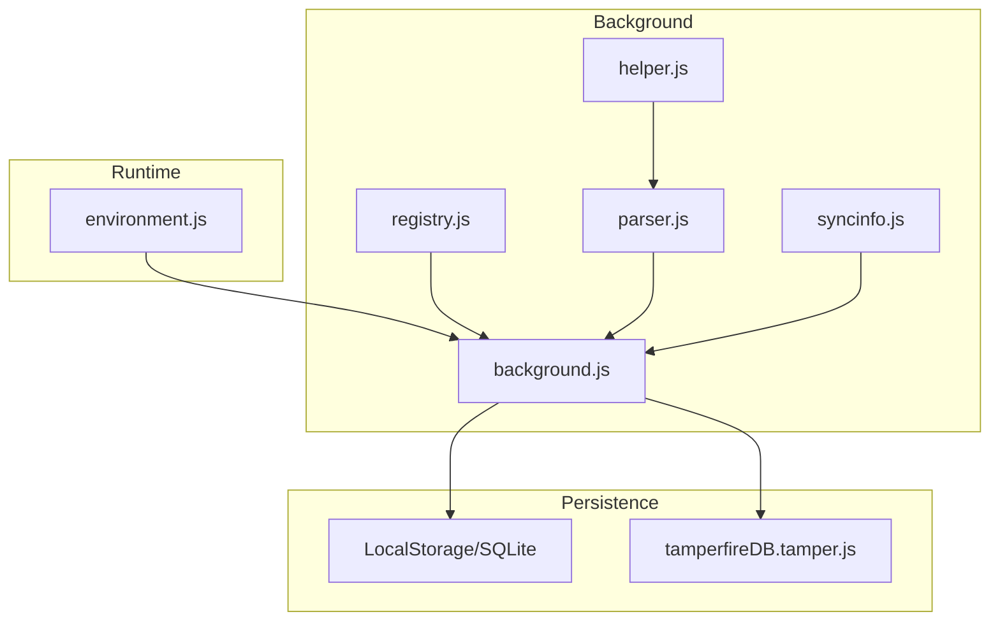
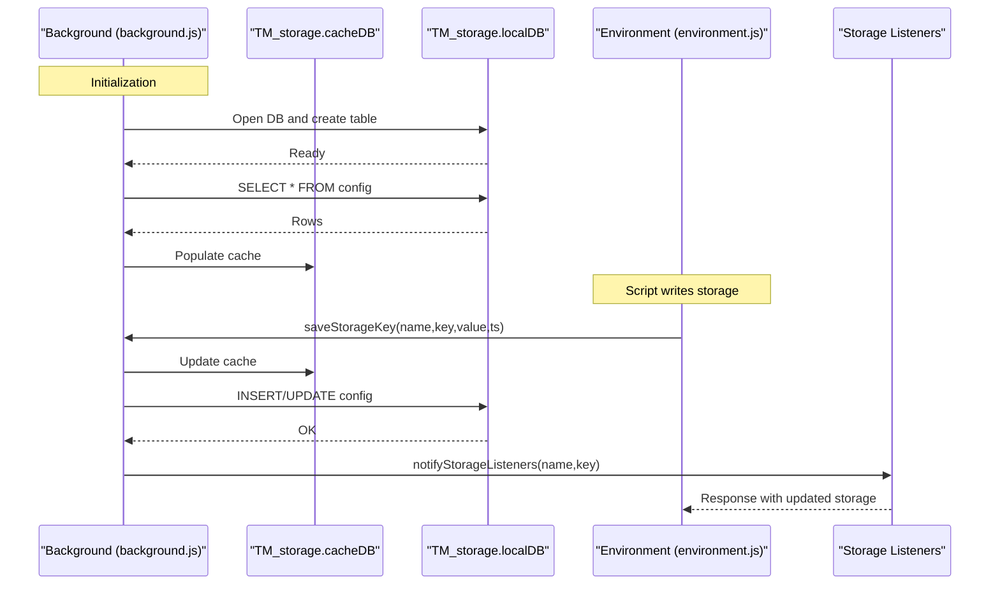
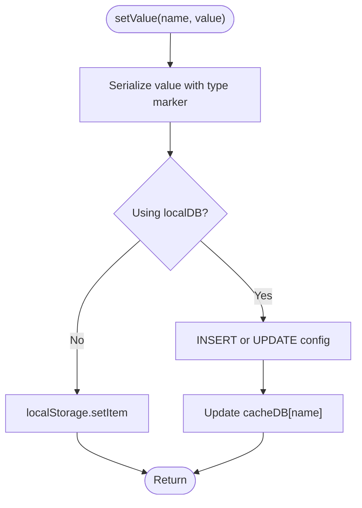
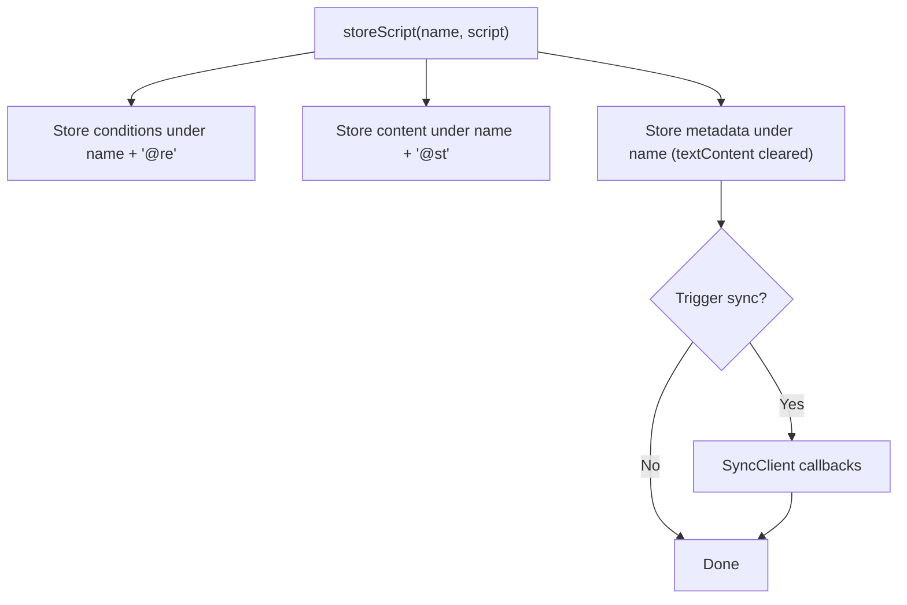
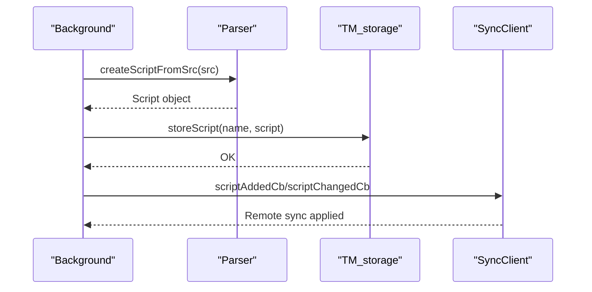
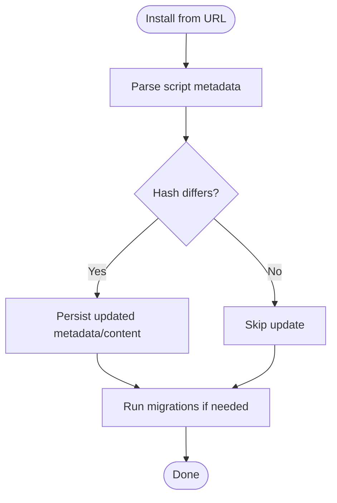
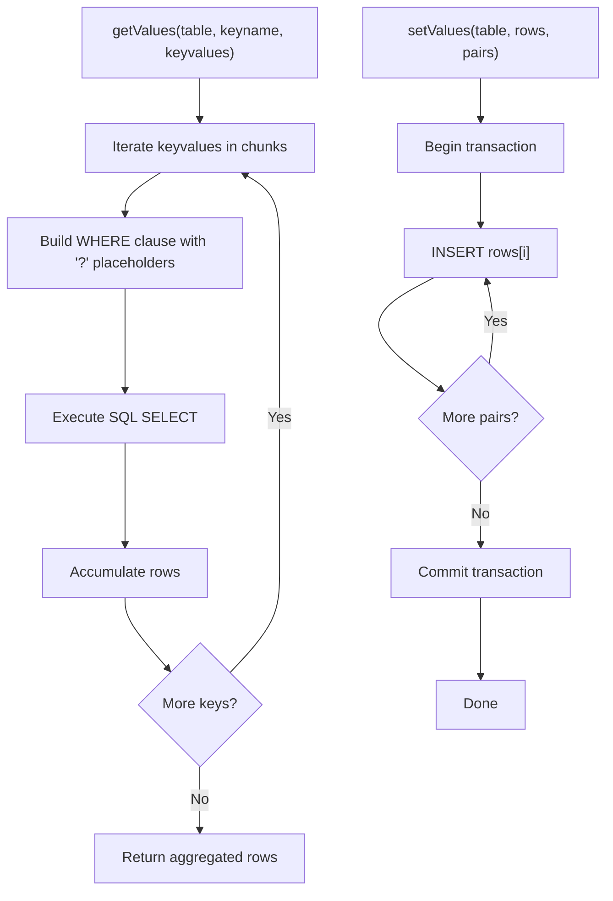
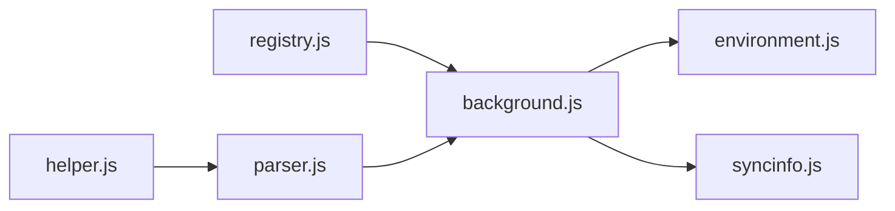

# Script Storage and Persistence

<cite>
**Referenced Files in This Document**
- [background.js](file://src/background.js)
- [parser.js](file://src/parser.js)
- [helper.js](file://src/helper.js)
- [registry.js](file://src/registry.js)
- [environment.js](file://src/environment.js)
- [syncinfo.js](file://src/syncinfo.js)
- [tamperfireDB.tamper.js](file://src/system/tamperfireDB.tamper.js)
</cite>

## Table of Contents
1. [Introduction](#introduction)
2. [Project Structure](#project-structure)
3. [Core Components](#core-components)
4. [Architecture Overview](#architecture-overview)
5. [Detailed Component Analysis](#detailed-component-analysis)
6. [Dependency Analysis](#dependency-analysis)
7. [Performance Considerations](#performance-considerations)
8. [Troubleshooting Guide](#troubleshooting-guide)
9. [Conclusion](#conclusion)

## Introduction
This document explains Tampermonkey’s script storage and persistence system. It covers how userscripts are stored, organized, and retrieved; how metadata and content are persisted; how upgrades and migrations are handled; and how the storage integrates with the registry and runtime environments. It also documents storage lifecycle events (installation, updates, removal), conflict resolution, backup and cleanup mechanisms, and practical guidance for queries, bulk operations, and troubleshooting.

## Project Structure
The storage system spans several modules:
- Background service orchestrates storage initialization, migrations, and script lifecycle operations.
- Parser extracts and normalizes userscript metadata and content.
- Helper utilities support parsing and string manipulation.
- Registry provides module loading and lazy initialization.
- Environment exposes GM_* storage APIs to scripts.
- Sync integration listens for and reacts to storage changes.
- A legacy database tool supports bulk metadata extraction.

**Diagram sources**
- [background.js:1705-1870](file://src/background.js#L1705-L1870)
- [registry.js:11-104](file://src/registry.js#L11-L104)
- [parser.js:72-282](file://src/parser.js#L72-L282)
- [helper.js:29-43](file://src/helper.js#L29-L43)
- [environment.js:868-1104](file://src/environment.js#L868-L1104)
- [syncinfo.js:149-184](file://src/syncinfo.js#L149-L184)
- [tamperfireDB.tamper.js:1-352](file://src/system/tamperfireDB.tamper.js#L1-L352)

**Section sources**
- [background.js:1705-1870](file://src/background.js#L1705-L1870)
- [registry.js:11-104](file://src/registry.js#L11-L104)
- [parser.js:72-282](file://src/parser.js#L72-L282)
- [helper.js:29-43](file://src/helper.js#L29-L43)
- [environment.js:868-1104](file://src/environment.js#L868-L1104)
- [syncinfo.js:149-184](file://src/syncinfo.js#L149-L184)
- [tamperfireDB.tamper.js:1-352](file://src/system/tamperfireDB.tamper.js#L1-L352)

## Core Components
- Storage abstraction: centralized TM_storage with a cache layer and optional SQLite-backed persistence.
- Script model: parsed metadata and content stored under distinct keys.
- Lifecycle handlers: install, update, remove, and reorder operations.
- Migration engine: version-aware conversions and data copying.
- Runtime storage API: GM_setValue/GM_getValue/GM_deleteValue exposed via environment.
- Change propagation: listeners and notifications for storage updates.

**Section sources**
- [background.js:1705-1870](file://src/background.js#L1705-L1870)
- [background.js:3714-3770](file://src/background.js#L3714-L3770)
- [background.js:3772-3829](file://src/background.js#L3772-L3829)
- [parser.js:29-67](file://src/parser.js#L29-L67)
- [environment.js:868-1104](file://src/environment.js#L868-L1104)

## Architecture Overview
The storage architecture combines a cache-first design with optional SQL persistence and a runtime API surface for scripts.

**Diagram sources**
- [background.js:1705-1870](file://src/background.js#L1705-L1870)
- [background.js:3833-3906](file://src/background.js#L3833-L3906)
- [environment.js:868-1104](file://src/environment.js#L868-L1104)

## Detailed Component Analysis

### Storage Abstraction (TM_storage)
- Dual backend: cache + optional SQL table.
- Type-prefixed serialization for values.
- Bulk operations and transactional updates.
- Delete-all and delete-value semantics.

Key behaviors:
- Initialization loads existing rows into cache and sets a flag.
- setValue serializes values with a leading type marker, then inserts or updates the table and updates cache.
- getValue deserializes cached or localStorage values using the type marker.
- deleteValue removes entries from cache and table.
- deleteAll drops the table or clears localStorage keys.

**Diagram sources**
- [background.js:1753-1790](file://src/background.js#L1753-L1790)

**Section sources**
- [background.js:1705-1870](file://src/background.js#L1705-L1870)

### Script Metadata and Content Organization
Scripts are stored across multiple keys:
- Name key: stores the normalized script object (textContent removed to reduce duplication).
- Conditions key: stores include/match/exclude lists.
- Content key: stores raw script content separately.

Operations:
- loadScriptByName retrieves both metadata and content.
- storeScript persists conditions, content, and metadata; triggers sync notifications.
- removeUserScript deletes all associated keys and notifies sync.

**Diagram sources**
- [background.js:3739-3770](file://src/background.js#L3739-L3770)

**Section sources**
- [background.js:3714-3770](file://src/background.js#L3714-L3770)

### Storage Lifecycle: Install, Update, Remove
- Install: addNewUserScript parses source, validates metadata, computes hash, and persists via storeScript.
- Update: hash comparison determines if content changed; metadata is updated and persisted.
- Remove: removeUserScript deletes all keys and notifies sync.

**Diagram sources**
- [background.js:2925-2975](file://src/background.js#L2925-L2975)
- [background.js:3739-3770](file://src/background.js#L3739-L3770)
- [parser.js:251-281](file://src/parser.js#L251-L281)

**Section sources**
- [background.js:2925-2975](file://src/background.js#L2925-L2975)
- [background.js:3739-3770](file://src/background.js#L3739-L3770)
- [parser.js:251-281](file://src/parser.js#L251-L281)

### Conflict Resolution and Data Integrity
- Hash-based detection: when installing from URL, hash is compared to detect content changes.
- Version migrations: convertData runs version-specific checks and copies data from localStorage to SQL when migrating.
- Require cache: short-lived cache for @require resources with periodic cleanup.

**Diagram sources**
- [background.js:2925-2975](file://src/background.js#L2925-L2975)
- [background.js:145-391](file://src/background.js#L145-L391)

**Section sources**
- [background.js:2925-2975](file://src/background.js#L2925-L2975)
- [background.js:145-391](file://src/background.js#L145-L391)

### Backup Mechanisms and Cleanup
- Backup: convertData migrates localStorage entries to SQL during version upgrades.
- Cleanup: deleteAll drops the SQL table or clears localStorage keys; periodic require cache cleanup prunes stale entries.

**Section sources**
- [background.js:257-276](file://src/background.js#L257-L276)
- [background.js:410-431](file://src/background.js#L410-L431)
- [background.js:1837-1853](file://src/background.js#L1837-L1853)

### Migration Strategies
- Version-aware checks: convertData sequences handle specific version transitions.
- Data restoration: restoreAllScriptsEx and resaveAllScriptsEx reprocess stored scripts to align with new internal formats.

**Section sources**
- [background.js:145-391](file://src/background.js#L145-L391)

### Relationship Between Storage and Registry
- Registry lazily loads modules (parser, helper, xmlhttprequest) and initializes them via Registry.require.
- Storage initialization is performed in background initialization, ensuring modules are ready before storage operations.

**Section sources**
- [registry.js:28-34](file://src/registry.js#L28-L34)
- [background.js:28-34](file://src/background.js#L28-L34)

### Runtime Storage API (GM_* in Environment)
- Scripts use GM_setValue/GM_getValue/GM_deleteValue, which map to internal storage operations.
- Value change listeners are supported via TM_addValueChangeListener/TM_removeValueChangeListener.
- Storage keys are scoped per script and timestamped.

**Section sources**
- [environment.js:868-1104](file://src/environment.js#L868-L1104)
- [background.js:3833-3906](file://src/background.js#L3833-L3906)

### Bulk Operations and Queries
- Bulk retrieval: TM_fire.getValues supports batching by constructing OR clauses and iterating in chunks.
- Bulk insertion: TM_fire.setValues executes multiple INSERT statements in a single transaction.

**Diagram sources**
- [background.js:1420-1462](file://src/background.js#L1420-L1462)
- [background.js:1384-1418](file://src/background.js#L1384-L1418)

**Section sources**
- [background.js:1420-1462](file://src/background.js#L1420-L1462)
- [background.js:1384-1418](file://src/background.js#L1384-L1418)

### Legacy Database Tool (tamperfireDB.tamper.js)
- Extracts and parses userscript metadata from external sources.
- Supports threaded fetching and result aggregation.

**Section sources**
- [tamperfireDB.tamper.js:236-318](file://src/system/tamperfireDB.tamper.js#L236-L318)

## Dependency Analysis
- background.js depends on parser.js for metadata parsing and helper.js for string utilities.
- environment.js depends on background.js via messaging to persist and retrieve script storage.
- syncinfo.js listens to storage changes and coordinates remote sync.

**Diagram sources**
- [registry.js:11-104](file://src/registry.js#L11-L104)
- [background.js:28-34](file://src/background.js#L28-L34)
- [parser.js:9-15](file://src/parser.js#L9-L15)
- [environment.js:868-1104](file://src/environment.js#L868-L1104)
- [syncinfo.js:149-184](file://src/syncinfo.js#L149-L184)

**Section sources**
- [registry.js:11-104](file://src/registry.js#L11-L104)
- [background.js:28-34](file://src/background.js#L28-L34)
- [parser.js:9-15](file://src/parser.js#L9-L15)
- [environment.js:868-1104](file://src/environment.js#L868-L1104)
- [syncinfo.js:149-184](file://src/syncinfo.js#L149-L184)

## Performance Considerations
- Cache-first reads minimize SQL overhead; ensure cache is primed after DB initialization.
- Use bulk operations (TM_fire.setValues/getValues) to reduce round-trips.
- Periodic cleanup of require cache prevents memory bloat.
- Avoid storing large content in metadata; keep content in dedicated keys.

[No sources needed since this section provides general guidance]

## Troubleshooting Guide
Common issues and remedies:
- Storage not initialized: ensure TM_storage.init completes and cache is populated.
- Version upgrade failures: verify convertData ran and localStorage entries were migrated.
- Listener not firing: check notifyStorageListeners and port-based messaging for storage updates.
- Sync conflicts: inspect SyncClient callbacks and remote change handling.

**Section sources**
- [background.js:1705-1751](file://src/background.js#L1705-L1751)
- [background.js:145-391](file://src/background.js#L145-L391)
- [background.js:3772-3829](file://src/background.js#L3772-L3829)
- [background.js:3833-3906](file://src/background.js#L3833-L3906)
- [syncinfo.js:149-184](file://src/syncinfo.js#L149-L184)

## Conclusion
Tampermonkey’s storage system combines a cache-first design with optional SQL persistence, robust migrations, and a clear separation between metadata and content. The runtime exposes a familiar GM_* API, while background services manage lifecycle, sync, and bulk operations. Following the documented patterns ensures reliable persistence, efficient queries, and smooth upgrades.