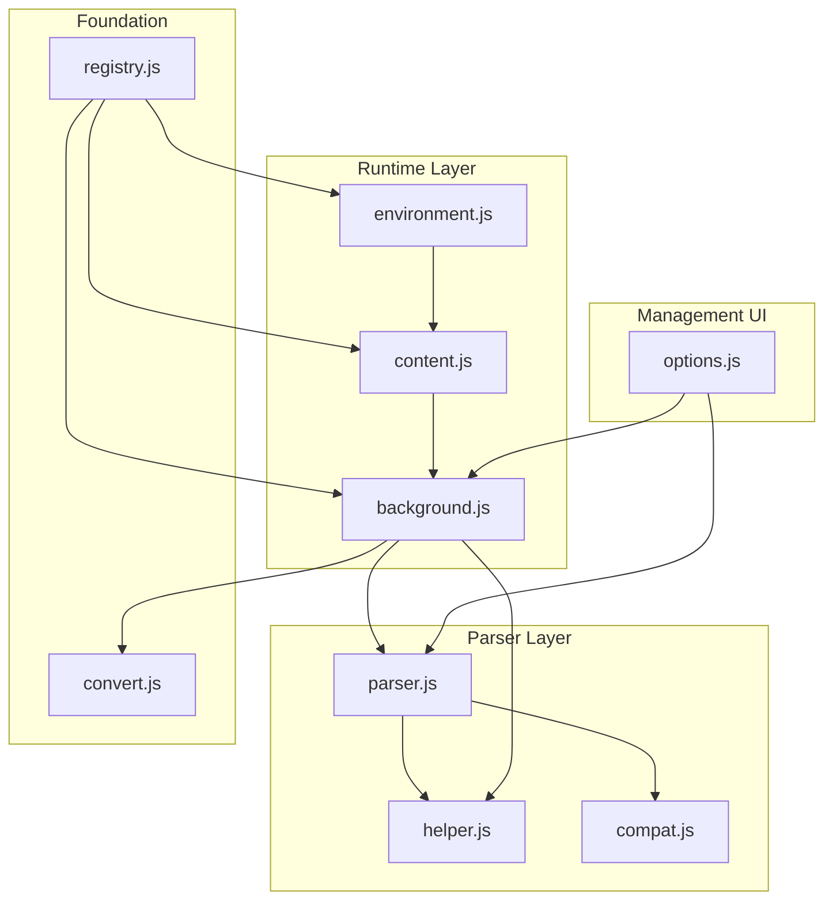
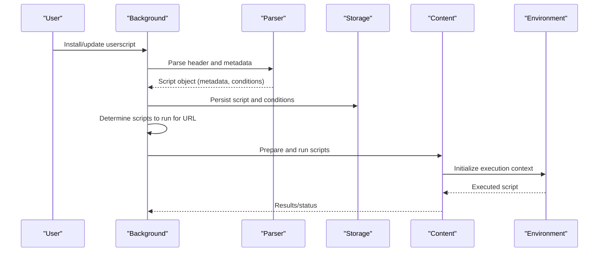
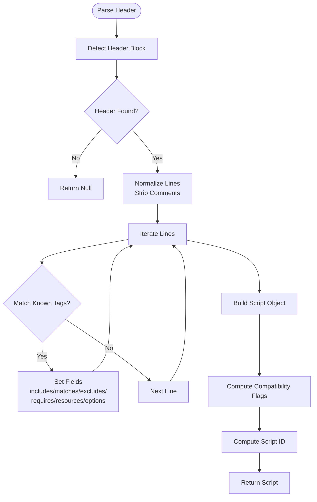
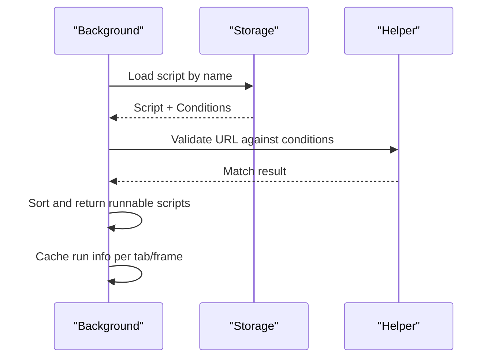
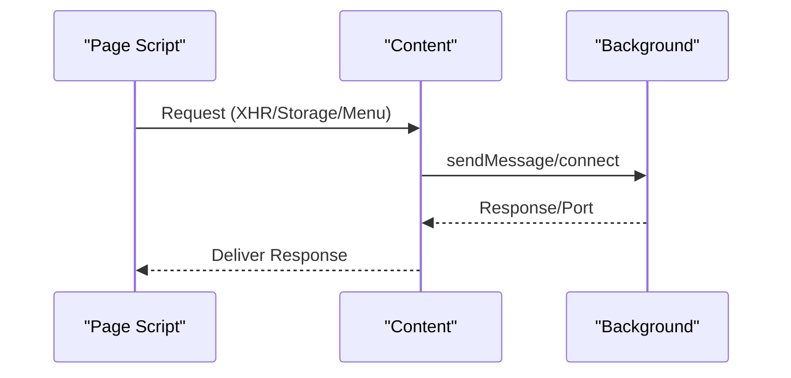
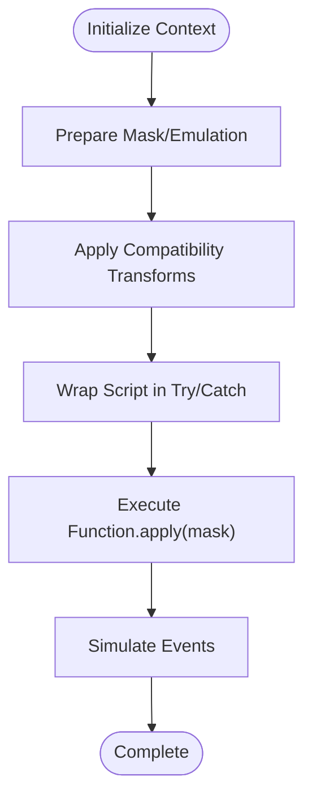
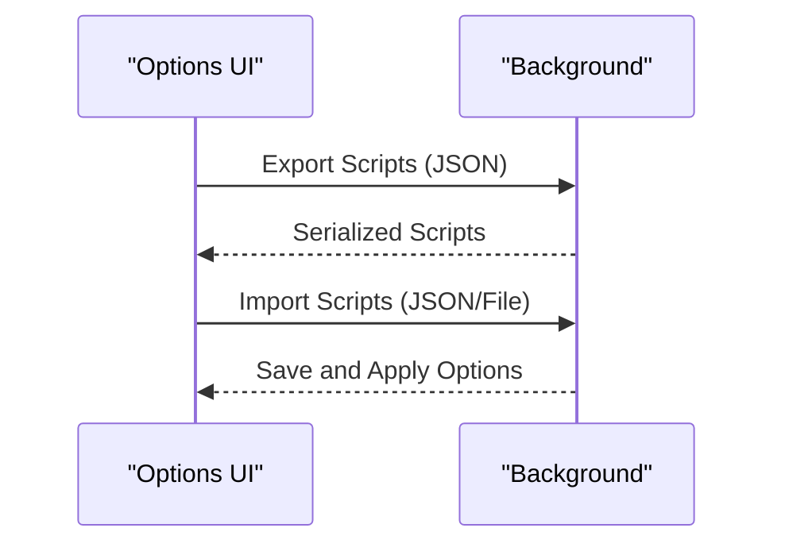
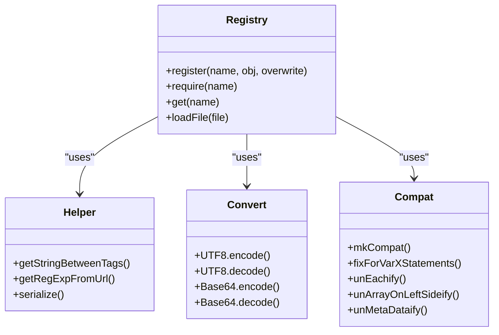
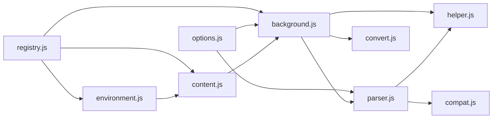

# Userscript Management

<cite>
**Referenced Files in This Document**
- [parser.js](file://src/parser.js)
- [background.js](file://src/background.js)
- [content.js](file://src/content.js)
- [environment.js](file://src/environment.js)
- [options.js](file://src/options.js)
- [registry.js](file://src/registry.js)
- [helper.js](file://src/helper.js)
- [convert.js](file://src/convert.js)
- [compat.js](file://src/compat.js)
- [README.md](file://README.md)
</cite>

## Table of Contents
1. [Introduction](#introduction)
2. [Project Structure](#project-structure)
3. [Core Components](#core-components)
4. [Architecture Overview](#architecture-overview)
5. [Detailed Component Analysis](#detailed-component-analysis)
6. [Dependency Analysis](#dependency-analysis)
7. [Performance Considerations](#performance-considerations)
8. [Troubleshooting Guide](#troubleshooting-guide)
9. [Conclusion](#conclusion)
10. [Appendices](#appendices)

## Introduction
This document explains Tampermonkey’s userscript management system end-to-end: from installation and metadata parsing, through validation and storage, to enabling/disabling and execution. It also covers supported userscript metadata tags, compatibility with Greasemonkey standards, script organization and sorting, import/export capabilities, and the relationships among the parser, storage system, and execution engine.

## Project Structure
The userscript management system spans several modules:
- Parser: extracts metadata and conditions from the userscript header
- Background: orchestrates storage, updates, and runtime selection
- Content: bridges page context and background
- Environment: sandboxed execution environment for scripts
- Options: UI for managing scripts, categories, and import/export
- Registry/Helpers/Convert/Compat: foundational utilities for module loading, string handling, encoding, and compatibility transformations

**Diagram sources**
- [parser.js:1-286](file://src/parser.js#L1-L286)
- [background.js:1-800](file://src/background.js#L1-L800)
- [content.js:1-800](file://src/content.js#L1-L800)
- [environment.js:1-800](file://src/environment.js#L1-L800)
- [options.js:1-800](file://src/options.js#L1-L800)
- [registry.js:1-107](file://src/registry.js#L1-L107)
- [helper.js:1-209](file://src/helper.js#L1-L209)
- [convert.js:1-39](file://src/convert.js#L1-L39)
- [compat.js:1-275](file://src/compat.js#L1-L275)

**Section sources**
- [README.md:12-16](file://README.md#L12-L16)
- [parser.js:1-286](file://src/parser.js#L1-L286)
- [background.js:1-800](file://src/background.js#L1-L800)
- [content.js:1-800](file://src/content.js#L1-L800)
- [environment.js:1-800](file://src/environment.js#L1-L800)
- [options.js:1-800](file://src/options.js#L1-L800)
- [registry.js:1-107](file://src/registry.js#L1-L107)
- [helper.js:1-209](file://src/helper.js#L1-L209)
- [convert.js:1-39](file://src/convert.js#L1-L39)
- [compat.js:1-275](file://src/compat.js#L1-L275)

## Core Components
- Parser
  - Extracts metadata from the userscript header block
  - Parses @include/@match/@exclude, @require, @resource, @run-at, @user-agent, @noframes, and other tags
  - Computes a stable script identifier and sets compatibility flags
- Background
  - Stores scripts and conditions, manages update checks, and selects scripts per URL
  - Handles require caching, storage listeners, and synchronization callbacks
- Content
  - Bridges page context to background, handles XHR emulation, and message routing
- Environment
  - Provides a sandboxed execution context, event simulation, and GM_* API surface
- Options
  - Manages script lists, enabling/disabling, sorting, and import/export (JSON/TXT/FS)
- Foundation Utilities
  - Registry: module loader and dependency resolution
  - Helper: string parsing, regex generation, URL matching helpers
  - Convert: UTF-8 and Base64 encoding/decoding
  - Compat: compatibility transformations for legacy userscript constructs

**Section sources**
- [parser.js:29-76](file://src/parser.js#L29-L76)
- [parser.js:72-282](file://src/parser.js#L72-L282)
- [background.js:3712-3770](file://src/background.js#L3712-L3770)
- [content.js:108-453](file://src/content.js#L108-L453)
- [environment.js:52-193](file://src/environment.js#L52-L193)
- [options.js:474-718](file://src/options.js#L474-L718)
- [registry.js:11-104](file://src/registry.js#L11-L104)
- [helper.js:29-80](file://src/helper.js#L29-L80)
- [convert.js:8-37](file://src/convert.js#L8-L37)
- [compat.js:13-271](file://src/compat.js#L13-L271)

## Architecture Overview
The system follows a layered architecture:
- Parser reads the userscript header and produces a normalized script object
- Background persists scripts, resolves conditions, and triggers execution
- Content mediates between page and extension
- Environment executes scripts in a controlled context with simulated events and APIs
- Options provides management and import/export

**Diagram sources**
- [parser.js:251-282](file://src/parser.js#L251-L282)
- [background.js:3712-3770](file://src/background.js#L3712-L3770)
- [background.js:2762-2771](file://src/background.js#L2762-L2771)
- [content.js:108-182](file://src/content.js#L108-L182)
- [environment.js:52-126](file://src/environment.js#L52-L126)

## Detailed Component Analysis

### Parser: Metadata Extraction and Compatibility Flags
- Header detection and extraction
- Tag parsing for name, namespace, version, author, description, homepage/icon, includes/matches/excludes, requires, resources, run-at, user-agent, noframes, and update/download URLs
- Compatibility detection for metadata blocks, foreach statements, array-left-hand assignments, prototypes, and unsafeWindow.gmonkey usage
- Script ID computation based on name

**Diagram sources**
- [parser.js:72-282](file://src/parser.js#L72-L282)
- [parser.js:29-76](file://src/parser.js#L29-L76)

**Section sources**
- [parser.js:72-282](file://src/parser.js#L72-L282)
- [parser.js:29-76](file://src/parser.js#L29-L76)

### Background: Storage, Conditions, and Runtime Selection
- Stores three parts per script: the script object, conditions (includes/matches/excludes), and raw source
- Loads and validates conditions against the current URL
- Determines which scripts to run per tab/frame and caches decisions
- Manages require caching with TTL and periodic cleanup
- Handles storage listeners and synchronization callbacks
- Supports update checks and version-aware migrations

**Diagram sources**
- [background.js:3729-3737](file://src/background.js#L3729-L3737)
- [background.js:3687-3710](file://src/background.js#L3687-L3710)
- [helper.js:56-80](file://src/helper.js#L56-L80)

**Section sources**
- [background.js:3712-3770](file://src/background.js#L3712-L3770)
- [background.js:3729-3737](file://src/background.js#L3729-L3737)
- [background.js:3687-3710](file://src/background.js#L3687-L3710)
- [background.js:395-431](file://src/background.js#L395-L431)
- [helper.js:56-80](file://src/helper.js#L56-L80)

### Content: Messaging and Emulation Bridge
- Sends extension messages and handles responses
- Emulates XMLHttpRequest and other APIs for scripts
- Routes requests to background and forwards responses
- Manages ports for persistent connections

**Diagram sources**
- [content.js:273-307](file://src/content.js#L273-L307)
- [content.js:352-408](file://src/content.js#L352-L408)
- [content.js:309-342](file://src/content.js#L309-L342)

**Section sources**
- [content.js:108-453](file://src/content.js#L108-L453)
- [content.js:273-307](file://src/content.js#L273-L307)
- [content.js:352-408](file://src/content.js#L352-L408)
- [content.js:309-342](file://src/content.js#L309-L342)

### Environment: Execution Engine
- Builds a masked execution context and wraps script execution in try/catch
- Injects compatibility wrappers and simulates DOM events (DOMContentLoaded/load/inserted)
- Exposes GM_* functions and manages storage listeners
- Applies compatibility transforms to script and required code

**Diagram sources**
- [environment.js:52-126](file://src/environment.js#L52-L126)
- [environment.js:195-343](file://src/environment.js#L195-L343)
- [compat.js:13-271](file://src/compat.js#L13-L271)

**Section sources**
- [environment.js:52-126](file://src/environment.js#L52-L126)
- [environment.js:195-343](file://src/environment.js#L195-L343)
- [compat.js:13-271](file://src/compat.js#L13-L271)

### Options: Organization, Enabling/Disabling, Import/Export
- Lists scripts with columns for name, version, sites, features, homepage, last updated, and sort controls
- Enables toggling enabled state and reordering positions
- Supports import/export via textarea, file, and sandboxed filesystem
- Encodes/decodes script source and options during export/import

**Diagram sources**
- [options.js:474-718](file://src/options.js#L474-L718)
- [options.js:1963-1994](file://src/options.js#L1963-L1994)

**Section sources**
- [options.js:474-718](file://src/options.js#L474-L718)
- [options.js:1963-1994](file://src/options.js#L1963-L1994)

### Registry, Helper, Convert, Compat: Foundations
- Registry: dynamic module loading and dependency management
- Helper: string utilities, regex construction for URL matching, serialization
- Convert: UTF-8 and Base64 conversions
- Compat: compatibility transformations for legacy userscript patterns

**Diagram sources**
- [registry.js:11-104](file://src/registry.js#L11-L104)
- [helper.js:29-166](file://src/helper.js#L29-L166)
- [convert.js:8-37](file://src/convert.js#L8-L37)
- [compat.js:13-271](file://src/compat.js#L13-L271)

**Section sources**
- [registry.js:11-104](file://src/registry.js#L11-L104)
- [helper.js:29-166](file://src/helper.js#L29-L166)
- [convert.js:8-37](file://src/convert.js#L8-L37)
- [compat.js:13-271](file://src/compat.js#L13-L271)

## Dependency Analysis
- Parser depends on Helper and Compat to normalize and transform userscript content
- Background depends on Parser, Helper, and Convert for storage and URL matching
- Content depends on background messaging and XMLHTTPRequest emulation
- Environment depends on Content for messaging and on Compat for compatibility
- Options depends on Background for storage and on Convert for import/export

**Diagram sources**
- [parser.js:9-15](file://src/parser.js#L9-L15)
- [background.js:28-34](file://src/background.js#L28-L34)
- [content.js:80-91](file://src/content.js#L80-L91)
- [environment.js:7-35](file://src/environment.js#L7-L35)
- [options.js:7-17](file://src/options.js#L7-L17)
- [registry.js:11-104](file://src/registry.js#L11-L104)

**Section sources**
- [parser.js:9-15](file://src/parser.js#L9-L15)
- [background.js:28-34](file://src/background.js#L28-L34)
- [content.js:80-91](file://src/content.js#L80-L91)
- [environment.js:7-35](file://src/environment.js#L7-L35)
- [options.js:7-17](file://src/options.js#L7-L17)
- [registry.js:11-104](file://src/registry.js#L11-L104)

## Performance Considerations
- Require caching reduces network overhead and improves startup time
- Local SQL-backed storage minimizes latency for frequent reads/writes
- URL condition matching uses precomputed regular expressions to speed up evaluation
- Event simulation defers execution until appropriate DOM readiness to avoid redundant work

[No sources needed since this section provides general guidance]

## Troubleshooting Guide
Common issues and resolutions:
- Syntax errors during execution
  - The environment logs detailed stack traces and highlights whether the error is in script or require code
  - Use the “copy to clipboard” helper to share failing code
- Storage inconsistencies
  - Background stores separate entries for script object, conditions, and source; ensure all keys exist
  - Use storage listeners to detect and reconcile changes
- URL matching failures
  - Verify @include/@match/@exclude patterns and ensure they align with the current URL
  - Helper generates regex from URL patterns; incorrect patterns prevent scripts from running
- Import/export problems
  - Ensure JSON validity and correct encoding/decoding of script source
  - When importing HTML documents, the parser strips non-header content

**Section sources**
- [environment.js:169-191](file://src/environment.js#L169-L191)
- [background.js:3714-3727](file://src/background.js#L3714-L3727)
- [helper.js:56-80](file://src/helper.js#L56-L80)
- [options.js:496-556](file://src/options.js#L496-L556)

## Conclusion
Tampermonkey’s userscript management system integrates a robust parser, a reliable storage layer, a secure execution environment, and a comprehensive management UI. It supports a wide range of Greasemonkey-compatible metadata tags, provides compatibility shims for legacy scripts, and offers flexible organization and import/export workflows.

[No sources needed since this section summarizes without analyzing specific files]

## Appendices

### Supported Userscript Metadata Tags
- Identity and presentation: name, namespace, version, author, copyright, description, icon/icon64, homepage/homepageURL
- Conditions: include, match, exclude
- Dependencies and resources: require, resource
- Execution control: run-at, user-agent, noframes
- Update and distribution: updateURL, downloadURL

These tags are parsed and validated by the parser and used by the background to determine eligibility and execution context.

**Section sources**
- [parser.js:95-222](file://src/parser.js#L95-L222)
- [README.md:12-16](file://README.md#L12-L16)