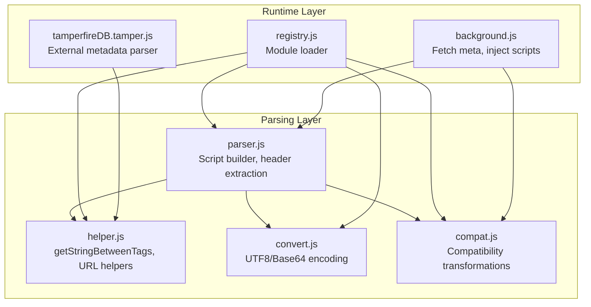
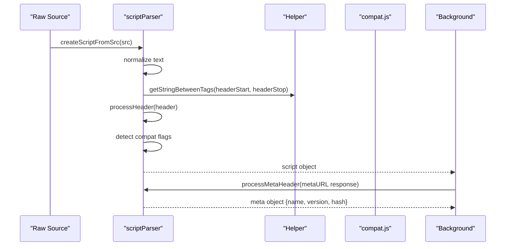
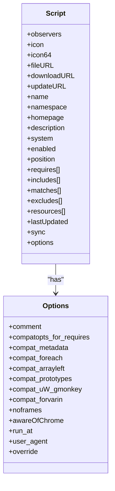
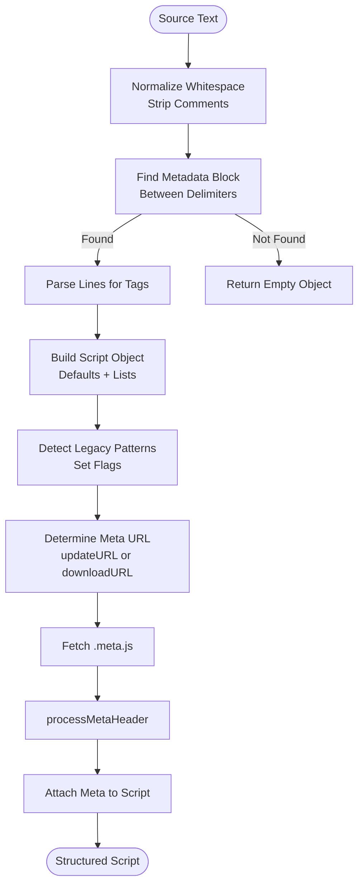
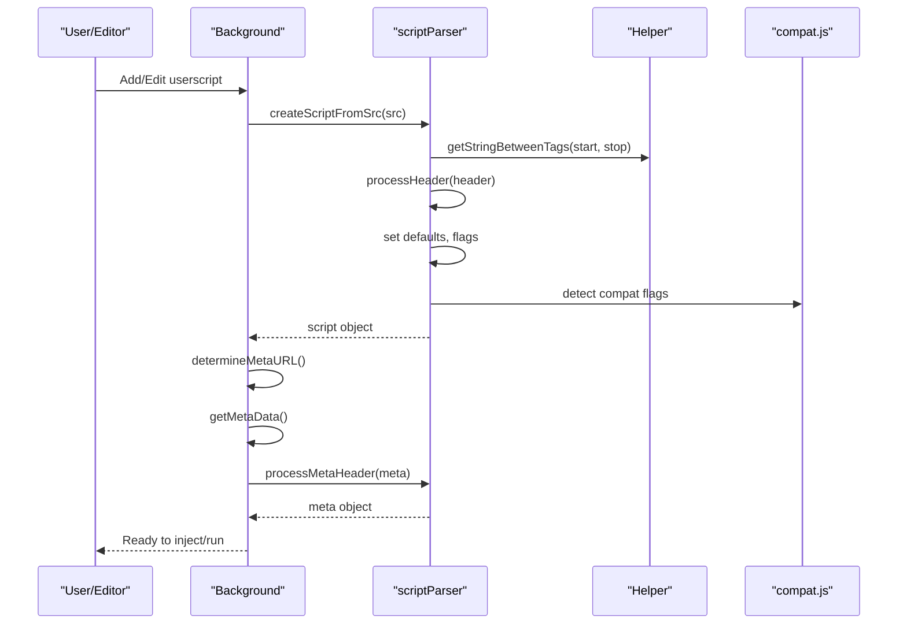
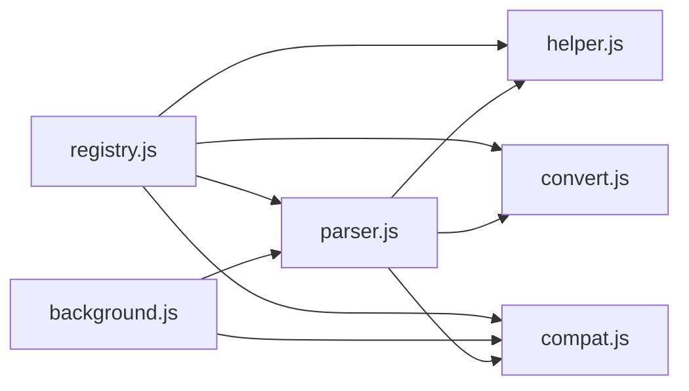

# Userscript Parsing and Validation

<cite>
**Referenced Files in This Document**
- [parser.js](file://src/parser.js)
- [helper.js](file://src/helper.js)
- [convert.js](file://src/convert.js)
- [compat.js](file://src/compat.js)
- [registry.js](file://src/registry.js)
- [background.js](file://src/background.js)
- [tamperfireDB.tamper.js](file://src/system/tamperfireDB.tamper.js)
</cite>

## Table of Contents
1. [Introduction](#introduction)
2. [Project Structure](#project-structure)
3. [Core Components](#core-components)
4. [Architecture Overview](#architecture-overview)
5. [Detailed Component Analysis](#detailed-component-analysis)
6. [Dependency Analysis](#dependency-analysis)
7. [Performance Considerations](#performance-considerations)
8. [Troubleshooting Guide](#troubleshooting-guide)
9. [Conclusion](#conclusion)

## Introduction
This document explains Tampermonkey’s userscript parsing and validation system. It covers the complete workflow from raw userscript source to a structured script object, including metadata extraction, validation rules, error handling, and compatibility detection. It documents supported metadata tags, their formats, and processing logic, and provides guidance for diagnosing malformed headers.

## Project Structure
The parsing pipeline spans several modules:
- Parser: extracts metadata, builds the script object, and detects compatibility flags
- Helper: provides utilities for string parsing, URL escaping, and regex conversion
- Convert: encodes/decodes text and base64 utilities
- Compat: transforms legacy JavaScript constructs to be compatible with the environment
- Registry: module loader and dependency management
- Background: orchestrates fetching metadata, injecting scripts, and runtime behavior
- TamperfireDB: alternate parser variant for external metadata sources



**Diagram sources**
- [parser.js:1-286](file://src/parser.js#L1-L286)
- [helper.js:1-209](file://src/helper.js#L1-L209)
- [convert.js:1-39](file://src/convert.js#L1-L39)
- [compat.js:1-275](file://src/compat.js#L1-L275)
- [registry.js:1-107](file://src/registry.js#L1-L107)
- [background.js:2846-2875](file://src/background.js#L2846-L2875)
- [tamperfireDB.tamper.js:128-225](file://src/system/tamperfireDB.tamper.js#L128-L225)

**Section sources**
- [parser.js:1-286](file://src/parser.js#L1-L286)
- [helper.js:1-209](file://src/helper.js#L1-L209)
- [convert.js:1-39](file://src/convert.js#L1-L39)
- [compat.js:1-275](file://src/compat.js#L1-L275)
- [registry.js:1-107](file://src/registry.js#L1-L107)
- [background.js:2846-2875](file://src/background.js#L2846-L2875)
- [tamperfireDB.tamper.js:128-225](file://src/system/tamperfireDB.tamper.js#L128-L225)

## Core Components
- Script object: holds parsed metadata, lists of includes/matches/excludes, requires/resources, and options
- Header extraction: locates the metadata block delimited by special markers and parses tags line-by-line
- Compatibility detection: scans the source for legacy constructs and sets flags for later transformation
- ID generation: derives a stable identifier from the script name

Key responsibilities:
- Extract @name, @version, @description, @include, @match, @exclude, @require, @resource, @run-at, @user-agent, @noframes, @nocompat, @updateURL, @downloadURL
- Normalize whitespace, strip comments, and sanitize quotes
- Build a normalized script object with defaults and flags
- Detect legacy JS patterns and set compatibility options

**Section sources**
- [parser.js:29-67](file://src/parser.js#L29-L67)
- [parser.js:95-222](file://src/parser.js#L95-L222)
- [parser.js:17-27](file://src/parser.js#L17-L27)

## Architecture Overview
The parsing workflow:
1. Normalize source text
2. Locate metadata block between delimiters
3. Parse each line for supported tags
4. Build the script object with defaults and flags
5. Detect compatibility options and set flags
6. Optionally fetch external metadata for update/download URLs



**Diagram sources**
- [parser.js:251-281](file://src/parser.js#L251-L281)
- [parser.js:75-93](file://src/parser.js#L75-L93)
- [background.js:2846-2875](file://src/background.js#L2846-L2875)

## Detailed Component Analysis

### Script Object Model
The script object stores metadata, lists, and options. It includes:
- Identity: name, namespace, version, homepage
- Descriptive: description, icon/icon64
- Targeting: includes, matches, excludes
- Dependencies: requires, resources
- Options: run_at, user_agent, noframes, compat flags, override controls
- Lifecycle: lastUpdated, sync, enabled, position



**Diagram sources**
- [parser.js:29-67](file://src/parser.js#L29-L67)

**Section sources**
- [parser.js:29-67](file://src/parser.js#L29-L67)

### Metadata Extraction and Validation Rules
Supported tags and processing logic:
- @name: required identity; used to generate script id
- @version: defaults to “0.0” if absent
- @description: free-text description
- @include: target URL patterns; normalized and appended to includes
- @match: Chrome-style patterns; enables awareness of Chrome features
- @exclude: exclusion patterns
- @require: external script URL; stored with loading state
- @resource: resource name and URL; stored with loading state
- @run-at: execution timing hint
- @user-agent: UA override for requests
- @noframes: blocks frame injection
- @nocompat: marks awareness of Chrome features
- @updateURL/@downloadURL: external metadata and download locations

Validation and normalization:
- Strip quotes and normalize tabs/spaces
- Remove comments and collapse extra whitespace
- Normalize spaces in URLs and strip control characters
- Enforce minimal defaults (e.g., version fallback)
- Detect presence of @match to set awareness flags

Processing flow:
- Split header into lines
- For each line, match against supported tag prefixes
- Extract value after the tag and trim
- Append to appropriate arrays or set properties
- Set options flags based on tags

**Section sources**
- [parser.js:95-222](file://src/parser.js#L95-L222)
- [parser.js:17-27](file://src/parser.js#L17-L27)

### Header Delimiting and Safety Checks
- Metadata block boundaries: special start and end markers
- HTML safety: if the block appears inside HTML tags before the header, treat as invalid
- Return null if header cannot be extracted

**Section sources**
- [parser.js:69-70](file://src/parser.js#L69-L70)
- [parser.js:229-249](file://src/parser.js#L229-L249)

### ID Generation Algorithm
- Derived from @name
- Encode name to URI-safe form
- Extract alphanumeric characters; if none, encode with Base64 and extract alphanumeric
- Return the resulting identifier

**Section sources**
- [parser.js:17-27](file://src/parser.js#L17-L27)
- [convert.js:18-29](file://src/convert.js#L18-L29)

### Compatibility Detection Mechanisms
Flags are set based on scanning the source:
- compat_metadata: detects legacy CDATA-like constructs
- compat_foreach: detects for each statements
- compat_arrayleft: detects array destructuring on left-hand side
- compat_prototypes: detects prototype usage patterns
- compat_uW_gmonkey: detects unsafeWindow.gmonkey usage

These flags drive transformations in the compatibility layer.

**Section sources**
- [parser.js:265-279](file://src/parser.js#L265-L279)
- [compat.js:14-26](file://src/compat.js#L14-L26)
- [compat.js:28-38](file://src/compat.js#L28-L38)
- [compat.js:114-151](file://src/compat.js#L114-L151)
- [compat.js:167-213](file://src/compat.js#L167-L213)
- [compat.js:238-270](file://src/compat.js#L238-L270)

### External Metadata Fetching
- Determine metadata URL from fileURL/downloadURL/updateURL
- Request .meta.js file and parse with processMetaHeader
- Store meta and raw response for later use

**Section sources**
- [background.js:2822-2844](file://src/background.js#L2822-L2844)
- [background.js:2846-2875](file://src/background.js#L2846-L2875)
- [parser.js:75-93](file://src/parser.js#L75-L93)

### Alternate Parser for External Sources
- TamperfireDB provides an alternate header processor that supports additional Uso tags and includes @match handling differently
- Uses the same helper utilities for extracting values

**Section sources**
- [tamperfireDB.tamper.js:128-225](file://src/system/tamperfireDB.tamper.js#L128-L225)
- [helper.js:29-43](file://src/helper.js#L29-L43)

## Architecture Overview



**Diagram sources**
- [parser.js:251-281](file://src/parser.js#L251-L281)
- [parser.js:75-93](file://src/parser.js#L75-L93)
- [background.js:2822-2875](file://src/background.js#L2822-L2875)

## Detailed Component Analysis

### Parsing Workflow Sequence


**Diagram sources**
- [parser.js:251-281](file://src/parser.js#L251-L281)
- [parser.js:75-93](file://src/parser.js#L75-L93)
- [background.js:2822-2875](file://src/background.js#L2822-L2875)

### Tag Processing Logic
```mermaid
flowchart TD
A["Line"] --> B{"Tag Prefix?"}
B --> |@name/@version/@description/etc| C["Set Property"]
B --> |@include| D["Normalize URL<br/>Append to includes"]
B --> |@match| E["Normalize URL<br/>Append to matches<br/>Set awareOfChrome"]
B --> |@exclude| F["Normalize URL<br/>Append to excludes"]
B --> |@require| G["Store {url, loaded=false}"]
B --> |@resource| H["Split name/url<br/>Store {name,url,loaded=false}"]
B --> |@run-at| I["Set run_at option"]
B --> |@user-agent| J["Set user_agent option"]
B --> |@noframes| K["Set noframes flag"]
B --> |@nocompat| L["Set awareOfChrome flag"]
B --> |@updateURL/@downloadURL| M["Set property"]
B --> |Other| N["Ignore/No-op"]
```

**Diagram sources**
- [parser.js:157-212](file://src/parser.js#L157-L212)

### URL Pattern Normalization
- Spaces replaced with percent-encoded tokens
- Control characters stripped
- Matches are marked to enable Chrome-aware behavior

**Section sources**
- [parser.js:157-172](file://src/parser.js#L157-L172)
- [parser.js:162-167](file://src/parser.js#L162-L167)

### Compatibility Transformations
- CDATA-like constructs converted to modern strings
- for each rewritten to standard for-in with hasOwnProperty checks
- Array destructuring on left-hand side expanded to indexed assignments
- Prototype usage detection flags compatibility mode
- unsafeWindow.gmonkey detection toggles compatibility flag

**Section sources**
- [compat.js:14-26](file://src/compat.js#L14-L26)
- [compat.js:167-213](file://src/compat.js#L167-L213)
- [compat.js:114-151](file://src/compat.js#L114-L151)
- [compat.js:238-270](file://src/compat.js#L238-L270)
- [parser.js:265-279](file://src/parser.js#L265-L279)

## Dependency Analysis
- Parser depends on Helper for string parsing and on Convert for encoding utilities
- Parser optionally invokes Compat to detect legacy patterns
- Background uses Parser to build script objects and to fetch external metadata
- Registry loads modules lazily and resolves dependencies



**Diagram sources**
- [parser.js:9-15](file://src/parser.js#L9-L15)
- [background.js:2846-2875](file://src/background.js#L2846-L2875)
- [registry.js:48-55](file://src/registry.js#L48-L55)

**Section sources**
- [parser.js:9-15](file://src/parser.js#L9-L15)
- [registry.js:48-55](file://src/registry.js#L48-L55)

## Performance Considerations
- Header parsing is linear in the number of lines; keep metadata concise
- URL normalization and regex conversions are O(n) per line
- External metadata fetching adds network latency; cache results when possible
- Compatibility detection scans entire source; avoid unnecessary large scripts

## Troubleshooting Guide
Common issues and resolutions:
- Malformed header delimiters: ensure the metadata block starts and ends with the correct markers
- HTML embedded in userscript: if the header appears inside HTML tags before the block, it is treated as invalid
- Missing @name: script id generation relies on @name; provide a unique name
- Invalid @include/@match/@exclude patterns: ensure patterns are valid and normalized
- @require blacklisted: some hosts are blocked; use allowed domains
- External metadata not found: verify @updateURL/@downloadURL and that .meta.js is accessible

Diagnostic tips:
- Inspect the parsed script object for missing fields or empty lists
- Check compatibility flags to identify legacy constructs
- Verify normalized URLs and patterns

**Section sources**
- [parser.js:229-249](file://src/parser.js#L229-L249)
- [parser.js:215-222](file://src/parser.js#L215-L222)
- [background.js:2676-2678](file://src/background.js#L2676-L2678)
- [background.js:2846-2875](file://src/background.js#L2846-L2875)

## Conclusion
Tampermonkey’s parsing pipeline converts raw userscript sources into robust, validated script objects. It supports a comprehensive set of metadata tags, normalizes inputs, and detects compatibility requirements. The system provides clear pathways for external metadata and integrates tightly with runtime injection and update mechanisms.