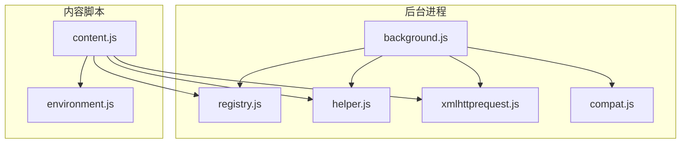
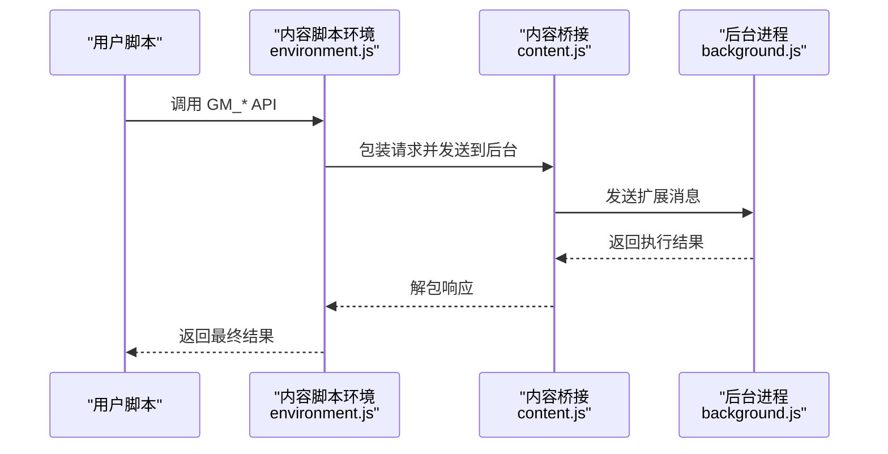
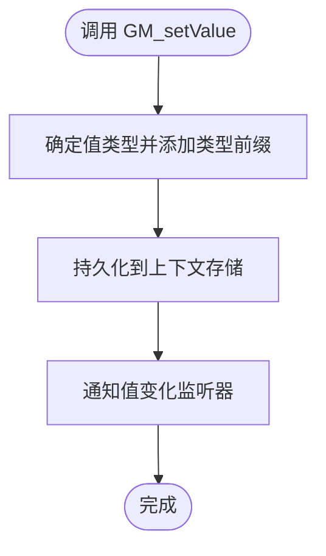
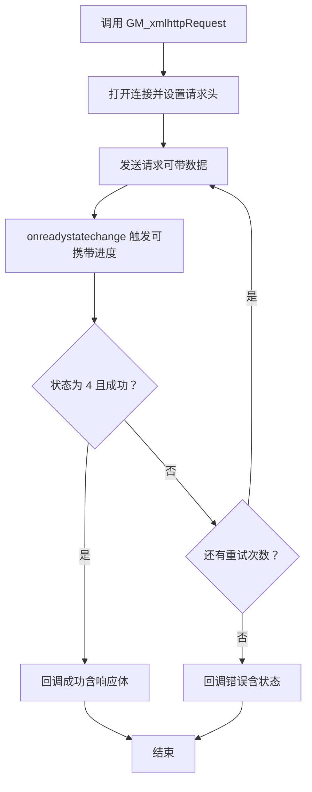
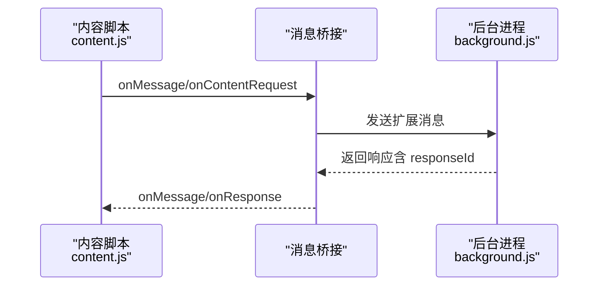
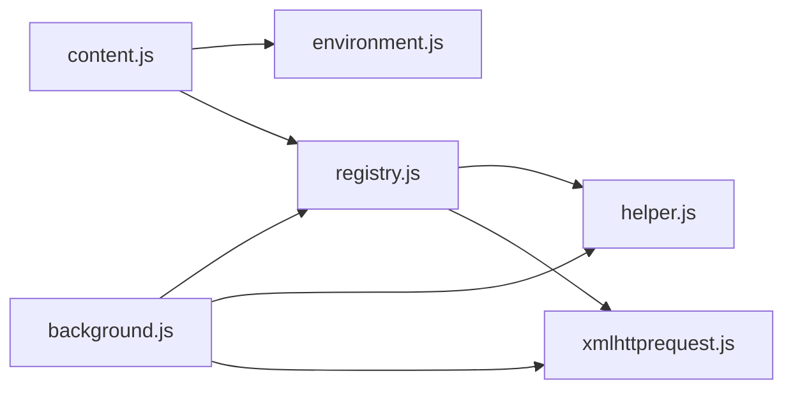

# API 参考文档

<cite>
**本文档引用的文件**
- [README.md](file://README.md)
- [environment.js](file://src/environment.js)
- [content.js](file://src/content.js)
- [background.js](file://src/background.js)
- [xmlhttprequest.js](file://src/xmlhttprequest.js)
- [registry.js](file://src/registry.js)
- [helper.js](file://src/helper.js)
- [compat.js](file://src/compat.js)
- [options.js](file://src/options.js)
</cite>

## 目录
1. [简介](#简介)
2. [项目结构](#项目结构)
3. [核心组件](#核心组件)
4. [架构总览](#架构总览)
5. [详细组件分析](#详细组件分析)
6. [依赖关系分析](#依赖关系分析)
7. [性能考量](#性能考量)
8. [故障排查指南](#故障排查指南)
9. [结论](#结论)
10. [附录](#附录)

## 简介
本参考文档面向 Tampermonkey 用户与脚本开发者，系统梳理 Tampermonkey 提供的 GM_* API 与扩展集成接口，覆盖函数签名、参数说明、返回值、使用示例、版本兼容性与变更历史、错误处理与调试技巧。内容基于仓库源码解析，确保信息准确可追溯。

## 项目结构
Tampermonkey 采用模块化架构：后台进程负责脚本调度、存储、网络请求与扩展 API 注入；内容脚本负责在页面上下文中注入脚本环境与实现 GM_* API；注册器负责模块加载与依赖管理；工具模块提供通用辅助能力；兼容层用于适配旧版脚本语法。

**图表来源**
- [background.js:1-120](file://src/background.js#L1-L120)
- [registry.js:1-107](file://src/registry.js#L1-L107)
- [helper.js:1-209](file://src/helper.js#L1-L209)
- [xmlhttprequest.js:1-161](file://src/xmlhttprequest.js#L1-L161)
- [compat.js:1-275](file://src/compat.js#L1-L275)
- [content.js:1-120](file://src/content.js#L1-L120)
- [environment.js:1-120](file://src/environment.js#L1-L120)

**章节来源**
- [README.md:1-112](file://README.md#L1-L112)
- [background.js:1-120](file://src/background.js#L1-L120)
- [content.js:1-120](file://src/content.js#L1-L120)

## 核心组件
- 后台进程（background.js）：负责脚本生命周期管理、存储读写、网络请求转发、扩展消息路由、版本迁移与数据转换。
- 内容脚本（content.js）：在页面上下文注入运行时环境，桥接 GM_* API 调用与后台实现。
- 环境模拟（environment.js）：实现 GM_* API 的具体逻辑，包括存储、日志、菜单命令、资源访问、XMLHttpRequest 等。
- 请求模块（xmlhttprequest.js）：封装跨域与本地文件访问，支持重试与进度回调。
- 注册器（registry.js）：模块化加载与依赖管理。
- 工具模块（helper.js）：正则匹配、序列化、URL 处理等通用能力。
- 兼容层（compat.js）：对旧版脚本语法进行兼容转换。

**章节来源**
- [environment.js:1053-1104](file://src/environment.js#L1053-L1104)
- [content.js:108-215](file://src/content.js#L108-L215)
- [background.js:1-120](file://src/background.js#L1-L120)
- [xmlhttprequest.js:1-161](file://src/xmlhttprequest.js#L1-L161)
- [registry.js:1-107](file://src/registry.js#L1-L107)
- [helper.js:1-209](file://src/helper.js#L1-L209)
- [compat.js:1-275](file://src/compat.js#L1-L275)

## 架构总览
下图展示了 GM_* API 的调用链路：用户脚本通过 GM_* 方法发起调用，内容脚本将请求转发至后台，后台执行具体逻辑并返回结果。

**图表来源**
- [environment.js:1053-1104](file://src/environment.js#L1053-L1104)
- [content.js:273-307](file://src/content.js#L273-L307)
- [background.js:4523-4541](file://src/background.js#L4523-L4541)

## 详细组件分析

### GM_* API 概览与分类
根据源码实现，GM_* API 主要分为以下类别：

- 存储与配置
  - GM_getValue / GM_setValue / GM_deleteValue / GM_listValues / GM_addValueChangeListener / GM_removeValueChangeListener
- 日志与通知
  - GM_log / GM_notification
- 资源访问
  - GM_getResourceText / GM_getResourceURL
- 网络请求
  - GM_xmlhttpRequest
- UI 与交互
  - GM_registerMenuCommand / GM_openInTab
- 其他
  - GM_info（由环境注入）

上述 API 在环境模拟中以 GM_EMU 对象形式暴露，并映射到后台存储与网络实现。

**章节来源**
- [environment.js:1053-1104](file://src/environment.js#L1053-L1104)
- [environment.js:868-978](file://src/environment.js#L868-L978)
- [options.js:2308-2344](file://src/options.js#L2308-L2344)

### 存储 API（GM_getValue/GM_setValue/GM_deleteValue/GM_listValues/GM_addValueChangeListener/GM_removeValueChangeListener）
- 功能描述
  - 提供键值存储能力，支持布尔、数字、对象与字符串类型，内部以类型前缀保存。
  - 支持为指定键添加值变化监听器，监听器被触发时回调接收键名、旧值、新值与是否远程修改标记。
- 参数与返回
  - GM_getValue(name, defaultValue) → 值（按类型解析）
  - GM_setValue(name, value) → 无（内部持久化并触发监听器）
  - GM_deleteValue(name) → 无
  - GM_listValues() → 字符串数组（列出所有键）
  - GM_addValueChangeListener(name, callback) → 数字（监听器 ID）
  - GM_removeValueChangeListener(id) → 布尔（是否移除成功）
- 使用场景
  - 缓存用户偏好、状态标记、临时数据。
- 限制与最佳实践
  - 对象类型会序列化存储，注意大小限制与 JSON 兼容性。
  - 监听器 ID 由系统分配，移除监听器需保留并传递该 ID。
  - 不同脚本共享同一命名空间，建议使用前缀避免冲突。
- 错误处理
  - 解析失败或类型不匹配时，GM_getValue 返回默认值。
  - 设置对象类型失败会记录错误并忽略设置。

**图表来源**
- [environment.js:956-978](file://src/environment.js#L956-L978)
- [environment.js:868-978](file://src/environment.js#L868-L978)

**章节来源**
- [environment.js:868-978](file://src/environment.js#L868-L978)
- [background.js:1753-1768](file://src/background.js#L1753-L1768)

### 日志与通知（GM_log/GM_notification）
- 功能描述
  - GM_log 输出调试信息到控制台。
  - GM_notification 显示桌面通知（部分平台支持）。
- 参数与返回
  - GM_log(message) → 无
  - GM_notification(msg, title, icon, callback, delay) → 无（异步）
- 使用场景
  - 调试脚本执行流程、提示用户操作结果。
- 限制与最佳实践
  - 避免在高频事件中频繁输出日志，影响性能。
  - 通知图标路径需可访问，延迟参数按平台支持情况传入。

**章节来源**
- [environment.js:1078-1104](file://src/environment.js#L1078-L1104)

### 资源访问（GM_getResourceText/GM_getResourceURL）
- 功能描述
  - 读取 @resource 定义的文本资源内容或生成可访问的资源 URL。
- 参数与返回
  - GM_getResourceText(name) → 字符串
  - GM_getResourceURL(name) → 字符串（URL）
- 使用场景
  - 加载内嵌图片、样式、模板等静态资源。
- 限制与最佳实践
  - 资源名称需与元数据中 @resource 的键一致。
  - 资源 URL 仅在受信任上下文中有效。

**章节来源**
- [environment.js:1098-1104](file://src/environment.js#L1098-L1104)

### 网络请求（GM_xmlhttpRequest）
- 功能描述
  - 封装跨域与本地文件访问，支持重试、进度回调与响应头处理。
- 参数与返回
  - details: { method, url, headers, overrideMimeType, responseType, data, retries }
  - 回调: { readyState, responseHeaders, finalUrl, status, statusText, responseXML, responseText, response, progress }
- 使用场景
  - 获取远端数据、上传/下载文件、监控进度。
- 限制与最佳实践
  - 仅允许 http/https 或特定本地资源访问。
  - 建议设置合理的重试次数与超时策略。
  - 注意响应类型与二进制数据的处理差异。

**图表来源**
- [xmlhttprequest.js:17-153](file://src/xmlhttprequest.js#L17-L153)

**章节来源**
- [xmlhttprequest.js:1-161](file://src/xmlhttprequest.js#L1-L161)

### UI 与交互（GM_registerMenuCommand/GM_openInTab）
- 功能描述
  - 注册右键菜单命令，点击后执行回调。
  - 在新标签页打开指定 URL。
- 参数与返回
  - GM_registerMenuCommand(name, callback) → 无
  - GM_openInTab(url, options) → 无
- 使用场景
  - 快速执行常用任务、打开外部链接或帮助页面。
- 限制与最佳实践
  - 菜单命令与脚本生命周期绑定，禁用脚本时自动清理。
  - 打开外部链接需遵循浏览器安全策略。

**章节来源**
- [environment.js:1082-1088](file://src/environment.js#L1082-L1088)
- [background.js:4544-4559](file://src/background.js#L4544-L4559)

### 其他 API（GM_info）
- 功能描述
  - 提供脚本元信息（名称、运行时机、资源列表等），向后兼容 GM_info。
- 参数与返回
  - 无参数，返回包含脚本与运行环境信息的对象。
- 使用场景
  - 记录脚本运行上下文、调试信息输出。

**章节来源**
- [environment.js:1129-1129](file://src/environment.js#L1129-L1129)

### 扩展 API 集成与消息协议
- 扩展 API
  - Tampermonkey 通过 chrome.* API 与页面脚本通信，内容脚本负责桥接消息，后台进程负责执行与持久化。
- 自定义消息协议
  - 内容脚本将请求封装为 { method, id, responseId, request } 并发送到后台。
  - 后台根据 method 分派到对应处理器，完成后通过 responseId 回传结果。
- 连接与端口
  - 支持 chrome.runtime.connect 与端口消息，用于长连接与流式数据传输。

**图表来源**
- [content.js:273-307](file://src/content.js#L273-L307)
- [background.js:4523-4541](file://src/background.js#L4523-L4541)

**章节来源**
- [content.js:273-307](file://src/content.js#L273-L307)
- [background.js:4523-4541](file://src/background.js#L4523-L4541)

## 依赖关系分析
- 模块加载
  - Registry.require 与 Registry.register 实现模块懒加载与注册，避免循环依赖。
- 组件耦合
  - content.js 依赖 environment.js 提供的 GM_* 实现；background.js 依赖 helper 与 xmlhttprequest 完成存储与网络。
- 外部依赖
  - 通过 chrome.* API 与浏览器扩展系统交互；XMLHttpRequest 作为底层网络能力。

**图表来源**
- [registry.js:1-107](file://src/registry.js#L1-L107)
- [helper.js:1-209](file://src/helper.js#L1-L209)
- [xmlhttprequest.js:1-161](file://src/xmlhttprequest.js#L1-L161)
- [content.js:1-120](file://src/content.js#L1-L120)
- [background.js:1-120](file://src/background.js#L1-L120)

**章节来源**
- [registry.js:1-107](file://src/registry.js#L1-L107)
- [content.js:1-120](file://src/content.js#L1-L120)
- [background.js:1-120](file://src/background.js#L1-L120)

## 性能考量
- 网络请求
  - 合理设置 retries 与超时，避免阻塞主线程。
  - 大数据传输建议分片或使用流式接口。
- 存储
  - 对象序列化与频繁写入可能带来开销，建议合并更新与使用合适的数据结构。
- 日志
  - 调试阶段可开启日志，发布版本应关闭或降低日志级别。

## 故障排查指南
- 调试技巧
  - 使用 GM_log 输出关键路径与变量状态。
  - 检查网络请求回调中的 status 与 statusText，定位失败原因。
  - 对于资源访问，确认 @resource 名称与路径正确。
- 常见问题
  - 跨域请求失败：检查 URL 协议与目标站点 CORS 策略。
  - 存储异常：确认对象可 JSON 序列化，避免过大键值。
  - 菜单命令无效：确认脚本启用且未被禁用。
- 版本兼容性
  - 旧版脚本语法可通过 compat.js 进行转换，但严格模式与某些语言特性可能受限。

**章节来源**
- [compat.js:1-275](file://src/compat.js#L1-L275)
- [xmlhttprequest.js:115-153](file://src/xmlhttprequest.js#L115-L153)
- [environment.js:956-978](file://src/environment.js#L956-L978)

## 结论
本参考文档基于 Tampermonkey 源码对 GM_* API 与扩展集成进行了系统化梳理，涵盖存储、网络、资源、UI 与日志等核心能力，并提供了调用链路、错误处理与性能优化建议。开发者可据此快速定位所需功能、编写健壮的用户脚本并处理升级与兼容问题。

## 附录

### API 分类与索引
- 存储与配置
  - GM_getValue / GM_setValue / GM_deleteValue / GM_listValues / GM_addValueChangeListener / GM_removeValueChangeListener
- 日志与通知
  - GM_log / GM_notification
- 资源访问
  - GM_getResourceText / GM_getResourceURL
- 网络请求
  - GM_xmlhttpRequest
- UI 与交互
  - GM_registerMenuCommand / GM_openInTab
- 其他
  - GM_info

**章节来源**
- [environment.js:1053-1104](file://src/environment.js#L1053-L1104)
- [options.js:2308-2344](file://src/options.js#L2308-L2344)