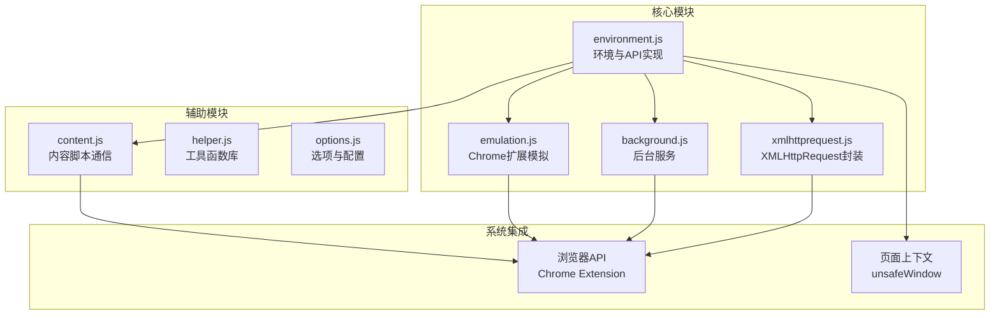
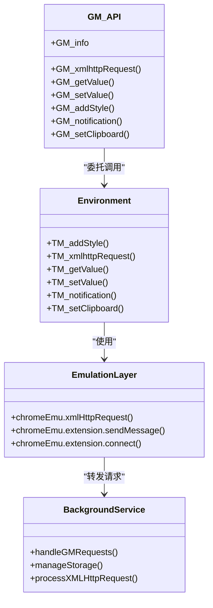
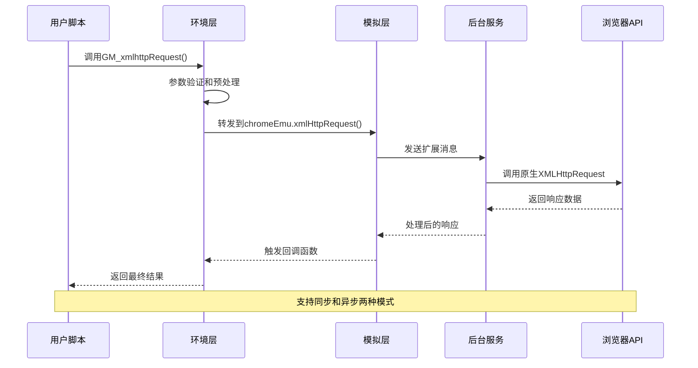
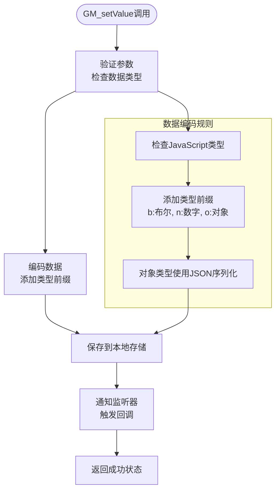
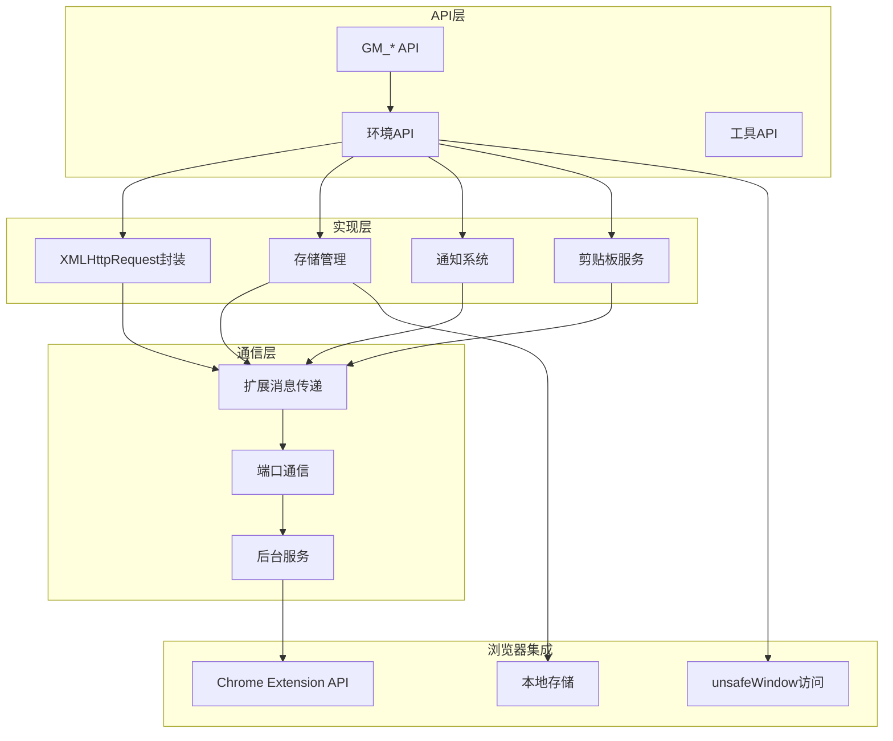

# GM_* API 完整参考

<cite>
**本文档引用的文件**
- [environment.js](file://src/environment.js)
- [xmlhttprequest.js](file://src/xmlhttprequest.js)
- [background.js](file://src/background.js)
- [emulation.js](file://src/emulation.js)
- [content.js](file://src/content.js)
- [helper.js](file://src/helper.js)
- [options.js](file://src/options.js)
- [README.md](file://README.md)
</cite>

## 目录
1. [简介](#简介)
2. [项目结构](#项目结构)
3. [核心组件](#核心组件)
4. [架构概览](#架构概览)
5. [详细组件分析](#详细组件分析)
6. [依赖关系分析](#依赖关系分析)
7. [性能考虑](#性能考虑)
8. [故障排除指南](#故障排除指南)
9. [结论](#结论)

## 简介

Tampermonkey 是最流行的用户脚本管理器之一，支持完整的 GM_* API 兼容性。本文档提供了 Tampermonkey 中所有 GM_* API 函数的详细参考，包括：

- **网络请求类**: GM_xmlhttpRequest
- **存储类**: GM_getValue、GM_setValue、GM_deleteValue、GM_listValues、GM_addValueChangeListener、GM_removeValueChangeListener
- **样式类**: GM_addStyle
- **标签页操作类**: GM_openInTab
- **通知类**: GM_notification
- **剪贴板类**: GM_setClipboard
- **资源类**: GM_getResourceText、GM_getResourceURL
- **工具类**: GM_log、GM_registerMenuCommand
- **信息类**: GM_info

## 项目结构

Tampermonkey 采用模块化架构设计，主要文件组织如下：



**图表来源**
- [environment.js:1-1337](file://src/environment.js#L1-L1337)
- [xmlhttprequest.js:1-161](file://src/xmlhttprequest.js#L1-L161)
- [background.js:1-800](file://src/background.js#L1-L800)

**章节来源**
- [README.md:1-112](file://README.md#L1-L112)

## 核心组件

### GM_* API 实现架构

Tampermonkey 通过多层架构实现 GM_* API：

1. **环境层 (Environment)**: 提供 API 的主要实现
2. **模拟层 (Emulation)**: 模拟 Chrome 扩展 API
3. **通信层 (Communication)**: 处理内容脚本与后台的通信
4. **存储层 (Storage)**: 管理用户数据持久化



**图表来源**
- [environment.js:1053-1131](file://src/environment.js#L1053-L1131)
- [emulation.js:40-329](file://src/emulation.js#L40-L329)
- [background.js:4523-4541](file://src/background.js#L4523-L4541)

**章节来源**
- [environment.js:646-1131](file://src/environment.js#L646-L1131)

## 架构概览

### 请求处理流程



**图表来源**
- [environment.js:693-747](file://src/environment.js#L693-L747)
- [emulation.js:52-82](file://src/emulation.js#L52-L82)
- [xmlhttprequest.js:17-153](file://src/xmlhttprequest.js#L17-L153)

### 存储管理架构



**图表来源**
- [environment.js:956-978](file://src/environment.js#L956-L978)
- [environment.js:932-954](file://src/environment.js#L932-L954)

**章节来源**
- [environment.js:915-978](file://src/environment.js#L915-L978)

## 详细组件分析

### GM_xmlhttpRequest - 网络请求

#### 函数签名
```javascript
GM_xmlhttpRequest(details) => { abort: function() }
```

#### 参数说明
| 参数 | 类型 | 必需 | 默认值 | 描述 |
|------|------|------|--------|------|
| details | Object | 是 | - | 请求配置对象 |
| details.method | String | 否 | "GET" | HTTP方法 |
| details.url | String | 是 | - | 目标URL |
| details.headers | Object | 否 | {} | 自定义请求头 |
| details.data | Any | 否 | null | 请求体数据 |
| details.responseType | String | 否 | "" | 响应类型 |
| details.onload | Function | 否 | null | 成功回调 |
| details.onerror | Function | 否 | null | 错误回调 |
| details.onreadystatechange | Function | 否 | null | 状态变化回调 |

#### 返回值
返回一个包含 `abort()` 方法的对象，用于取消请求。

#### 使用示例
```javascript
// 基础GET请求
GM_xmlhttpRequest({
    method: "GET",
    url: "https://api.example.com/data",
    onload: function(response) {
        console.log("响应状态:", response.status);
        console.log("响应数据:", response.responseText);
    }
});

// POST请求带JSON数据
GM_xmlhttpRequest({
    method: "POST",
    url: "https://api.example.com/submit",
    headers: {"Content-Type": "application/json"},
    data: JSON.stringify({key: "value"}),
    onload: function(response) {
        // 处理成功响应
    },
    onerror: function(response) {
        // 处理错误
    }
});
```

#### 功能特性
- **跨域支持**: 通过后台服务处理跨域请求
- **进度监控**: 支持 `onreadystatechange` 监控下载进度
- **错误处理**: 完善的异常捕获和错误回调
- **请求取消**: 支持 `abort()` 取消进行中的请求

**章节来源**
- [environment.js:693-747](file://src/environment.js#L693-L747)
- [xmlhttprequest.js:17-153](file://src/xmlhttprequest.js#L17-L153)

### GM_getValue - 获取存储值

#### 函数签名
```javascript
GM_getValue(name[, defaultValue]) => Any
```

#### 参数说明
| 参数 | 类型 | 必需 | 默认值 | 描述 |
|------|------|------|--------|------|
| name | String | 是 | - | 存储键名 |
| defaultValue | Any | 否 | undefined | 默认值 |

#### 返回值
返回存储的值，如果不存在则返回默认值。

#### 数据类型支持
| 类型 | 编码前缀 | 序列化方式 |
|------|----------|------------|
| String | 无前缀 | 直接存储 |
| Number | n | 数字字符串 |
| Boolean | b | "true"/"false" |
| Object | o | JSON.stringify() |

#### 使用示例
```javascript
// 获取用户偏好设置
var theme = GM_getValue("theme", "light");
var fontSize = GM_getValue("fontSize", 14);

// 获取复杂对象
var userData = GM_getValue("userData", {});
if (typeof userData === 'string') {
    try {
        userData = JSON.parse(userData);
    } catch(e) {
        userData = {};
    }
}
```

**章节来源**
- [environment.js:932-954](file://src/environment.js#L932-L954)

### GM_setValue - 设置存储值

#### 函数签名
```javascript
GM_setValue(name, value) => void
```

#### 参数说明
| 参数 | 类型 | 必需 | 默认值 | 描述 |
|------|------|------|--------|------|
| name | String | 是 | - | 存储键名 |
| value | Any | 是 | - | 要存储的值 |

#### 功能特性
- **自动类型检测**: 根据 JavaScript 类型自动添加编码前缀
- **异步保存**: 异步写入本地存储，不阻塞主线程
- **监听器通知**: 自动通知值变化监听器
- **数据持久化**: 使用浏览器本地存储 API

#### 使用示例
```javascript
// 存储简单值
GM_setValue("username", "john_doe");
GM_setValue("autoSave", true);
GM_setValue("timeout", 30000);

// 存储复杂对象
var config = {
    theme: "dark",
    notifications: true,
    preferences: {
        language: "zh-CN",
        timezone: "Asia/Shanghai"
    }
};
GM_setValue("userConfig", config);
```

**章节来源**
- [environment.js:956-978](file://src/environment.js#L956-L978)

### GM_deleteValue - 删除存储值

#### 函数签名
```javascript
GM_deleteValue(name) => void
```

#### 参数说明
| 参数 | 类型 | 必需 | 默认值 | 描述 |
|------|------|------|--------|------|
| name | String | 是 | - | 要删除的键名 |

#### 使用示例
```javascript
// 删除用户配置
GM_deleteValue("userConfig");

// 清除缓存数据
GM_deleteValue("apiCache_" + apiUrl);
```

**章节来源**
- [environment.js:915-921](file://src/environment.js#L915-L921)

### GM_listValues - 列出所有存储键

#### 函数签名
```javascript
GM_listValues() => String[]
```

#### 返回值
返回包含所有存储键名的数组。

#### 使用示例
```javascript
// 获取所有存储的键
var allKeys = GM_listValues();
console.log("已存储的键:", allKeys);

// 遍历所有存储的数据
allKeys.forEach(function(key) {
    var value = GM_getValue(key);
    console.log(key + ":", value);
});
```

**章节来源**
- [environment.js:923-930](file://src/environment.js#L923-L930)

### GM_addValueChangeListener - 添加值变化监听器

#### 函数签名
```javascript
GM_addValueChangeListener(name, callback) => Number
```

#### 参数说明
| 参数 | 类型 | 必需 | 默认值 | 描述 |
|------|------|------|--------|------|
| name | String | 是 | - | 监听的键名 |
| callback | Function | 是 | - | 回调函数 |

#### 回调函数参数
| 参数 | 类型 | 描述 |
|------|------|------|
| key | String | 键名 |
| oldValue | Any | 旧值 |
| newValue | Any | 新值 |
| remote | Boolean | 是否由远程更改 |

#### 返回值
返回监听器ID，用于后续移除监听器。

#### 使用示例
```javascript
// 添加监听器
var listenerId = GM_addValueChangeListener("theme", function(key, oldValue, newValue, remote) {
    console.log(`主题从 ${oldValue} 变更为 ${newValue}`);
    
    if (!remote) {
        // 本地更改，更新UI
        updateTheme(newValue);
    }
});

// 移除监听器
GM_removeValueChangeListener(listenerId);
```

**章节来源**
- [environment.js:889-902](file://src/environment.js#L889-L902)
- [environment.js:904-914](file://src/environment.js#L904-L914)

### GM_removeValueChangeListener - 移除值变化监听器

#### 函数签名
```javascript
GM_removeValueChangeListener(id) => Boolean
```

#### 参数说明
| 参数 | 类型 | 必需 | 默认值 | 描述 |
|------|------|------|--------|------|
| id | Number | 是 | - | 监听器ID |

#### 返回值
返回是否成功移除监听器。

**章节来源**
- [environment.js:904-914](file://src/environment.js#L904-L914)

### GM_addStyle - 注入CSS样式

#### 函数签名
```javascript
GM_addStyle(css) => void
```

#### 参数说明
| 参数 | 类型 | 必需 | 默认值 | 描述 |
|------|------|------|--------|------|
| css | String | 是 | - | CSS样式字符串 |

#### 使用示例
```javascript
// 注入基础样式
GM_addStyle(`
    .my-custom-button {
        background-color: #007bff;
        color: white;
        padding: 10px 20px;
        border: none;
        border-radius: 4px;
    }
    
    .highlight {
        background-color: yellow !important;
    }
`);

// 条件注入
if (isDarkMode()) {
    GM_addStyle(`
        body.dark-theme {
            background-color: #1a1a1a;
            color: #ffffff;
        }
    `);
}
```

**章节来源**
- [environment.js:1008-1016](file://src/environment.js#L1008-L1016)

### GM_openInTab - 在新标签页中打开

#### 函数签名
```javascript
GM_openInTab(url[, options]) => { close: function() }
```

#### 参数说明
| 参数 | 类型 | 必需 | 默认值 | 描述 |
|------|------|------|--------|------|
| url | String | 是 | - | 要打开的URL |
| options | Object | 否 | {} | 打开选项 |

#### 选项参数
| 选项 | 类型 | 默认值 | 描述 |
|------|------|--------|------|
| active | Boolean | true | 是否激活标签页 |
| insert | Boolean | true | 是否插入到当前标签页后 |
| setParent | Boolean | false | 是否设置为父标签页 |

#### 返回值
返回包含 `close()` 方法的对象，用于关闭新打开的标签页。

#### 使用示例
```javascript
// 基础使用
var tab = GM_openInTab("https://www.google.com");
// 稍后关闭
tab.close();

// 高级选项
var tab = GM_openInTab("https://github.com", {
    active: false,
    insert: true,
    setParent: true
});

// 监听标签页事件
tab.onClosed = function() {
    console.log("标签页已关闭");
};
```

**章节来源**
- [environment.js:669-691](file://src/environment.js#L669-L691)

### GM_notification - 显示通知

#### 函数签名
```javascript
GM_notification(message[, title, image, callback, delay]) => void
```

#### 参数说明
| 参数 | 类型 | 必需 | 默认值 | 描述 |
|------|------|------|--------|------|
| message | String | 是 | - | 通知消息内容 |
| title | String | 否 | 脚本名称 | 通知标题 |
| image | String | 否 | 脚本图标 | 图标URL |
| callback | Function | 否 | null | 点击回调 |
| delay | Number | 否 | 3000 | 显示延迟(毫秒) |

#### 使用示例
```javascript
// 基础通知
GM_notification("任务已完成！");

// 带标题和图标
GM_notification(
    "新版本可用！",
    "更新提醒",
    "https://example.com/icon.png",
    function() {
        console.log("用户点击了通知");
    },
    5000
);

// 错误通知
GM_notification(
    "网络连接失败，请检查设置",
    "错误",
    null,
    null,
    0
);
```

**章节来源**
- [environment.js:1018-1028](file://src/environment.js#L1018-L1028)

### GM_setClipboard - 设置剪贴板内容

#### 函数签名
```javascript
GM_setClipboard(content[, type, callback]) => void
```

#### 参数说明
| 参数 | 类型 | 必需 | 默认值 | 描述 |
|------|------|------|--------|------|
| content | String | 是 | - | 要复制的内容 |
| type | String | 否 | "text" | 内容类型 |
| callback | Function | 否 | null | 复制完成回调 |

#### 类型支持
| 类型 | 描述 |
|------|------|
| text | 纯文本内容 |
| html | HTML格式内容 |
| image | 图片数据 |

#### 使用示例
```javascript
// 复制纯文本
GM_setClipboard("Hello World!");

// 复制HTML内容
GM_setClipboard(
    "<strong>加粗文本</strong>",
    "html",
    function() {
        console.log("HTML内容已复制到剪贴板");
    }
);

// 复制图片URL
GM_setClipboard(imageUrl, "text");
```

**章节来源**
- [environment.js:1030-1038](file://src/environment.js#L1030-L1038)

### GM_info - 获取脚本信息

#### 函数签名
```javascript
GM_info => Object
```

#### 返回对象属性
| 属性 | 类型 | 描述 |
|------|------|------|
| scriptHandler | String | 脚本处理器名称 |
| version | String | 版本号 |
| scriptSource | String | 脚本源代码 |
| scriptMetaStr | String | 脚本元数据字符串 |
| scriptWillUpdate | Boolean | 是否会更新 |
| scriptUpdateURL | String | 更新URL |
| script | Object | 脚本配置对象 |

#### 脚本配置对象
| 属性 | 类型 | 描述 |
|------|------|------|
| name | String | 脚本名称 |
| namespace | String | 命名空间 |
| version | String | 版本 |
| description | String | 描述 |
| author | String | 作者 |
| license | String | 许可证 |
| homepage | String | 主页 |
| updateURL | String | 更新URL |
| downloadURL | String | 下载URL |
| exclude | String[] | 排除规则 |
| include | String[] | 包含规则 |
| match | String[] | 匹配规则 |
| unwrap | Boolean | 是否解包 |

#### 使用示例
```javascript
// 获取脚本基本信息
console.log("脚本名称:", GM_info.script.name);
console.log("版本信息:", GM_info.version);
console.log("处理器:", GM_info.scriptHandler);

// 检查更新
if (GM_info.scriptWillUpdate) {
    console.log("脚本有新版本可用");
}

// 获取元数据
var meta = GM_info.scriptMetaStr;
console.log("元数据:", meta);
```

**章节来源**
- [environment.js:803-818](file://src/environment.js#L803-L818)
- [environment.js:1129-1131](file://src/environment.js#L1129-L1131)

### GM_getResourceText - 获取资源文本

#### 函数签名
```javascript
GM_getResourceText(name) => String|null
```

#### 参数说明
| 参数 | 类型 | 必需 | 默认值 | 描述 |
|------|------|------|--------|------|
| name | String | 是 | - | 资源名称 |

#### 返回值
返回资源文本内容，如果资源不存在返回 `null`。

#### 使用示例
```javascript
// 获取模板内容
var template = GM_getResourceText("emailTemplate");
if (template) {
    // 使用模板渲染邮件
    renderEmail(template);
}

// 获取配置文件
var config = GM_getResourceText("config.json");
if (config) {
    try {
        var parsedConfig = JSON.parse(config);
        applyConfig(parsedConfig);
    } catch(e) {
        console.error("配置解析失败:", e);
    }
}
```

**章节来源**
- [environment.js:980-988](file://src/environment.js#L980-L988)

### GM_getResourceURL - 获取资源URL

#### 函数签名
```javascript
GM_getResourceURL(name) => String|null
```

#### 参数说明
| 参数 | 类型 | 必需 | 默认值 | 描述 |
|------|------|------|--------|------|
| name | String | 是 | - | 资源名称 |

#### 返回值
返回资源的可访问URL，如果资源不存在返回 `null`。

#### 使用示例
```javascript
// 获取图片资源URL
var imageUrl = GM_getResourceURL("logo");
if (imageUrl) {
    var img = document.createElement("img");
    img.src = imageUrl;
    document.body.appendChild(img);
}

// 获取字体文件URL
var fontUrl = GM_getResourceURL("customFont");
if (fontUrl) {
    injectFontFace(fontUrl);
}
```

**章节来源**
- [environment.js:990-998](file://src/environment.js#L990-L998)

### GM_log - 日志输出

#### 函数签名
```javascript
GM_log(message) => void
```

#### 参数说明
| 参数 | 类型 | 必需 | 默认值 | 描述 |
|------|------|------|--------|------|
| message | String | 是 | - | 要记录的消息 |

#### 使用示例
```javascript
// 基础日志
GM_log("脚本开始执行");

// 调试信息
GM_log("用户ID: " + userId);
GM_log("请求URL: " + requestUrl);

// 错误日志
if (error) {
    GM_log("错误发生: " + error.message);
}
```

**章节来源**
- [environment.js:1000-1006](file://src/environment.js#L1000-L1006)

### GM_registerMenuCommand - 注册菜单命令

#### 函数签名
```javascript
GM_registerMenuCommand(name, callback) => Number
```

#### 参数说明
| 参数 | 类型 | 必需 | 默认值 | 描述 |
|------|------|------|--------|------|
| name | String | 是 | - | 菜单命令名称 |
| callback | Function | 是 | - | 点击回调函数 |

#### 返回值
返回菜单命令ID，用于后续注销。

#### 使用示例
```javascript
// 注册常用命令
var cmd1 = GM_registerMenuCommand("导出数据", exportData);
var cmd2 = GM_registerMenuCommand("导入配置", importConfig);
var cmd3 = GM_registerMenuCommand("重置设置", resetSettings);

// 条件注册
if (canExport()) {
    var exportCmd = GM_registerMenuCommand("导出数据", exportData);
}

// 动态注销
function cleanup() {
    GM_unregisterMenuCommand(cmd1);
    GM_unregisterMenuCommand(cmd2);
    GM_unregisterMenuCommand(cmd3);
}
```

**章节来源**
- [environment.js:648-667](file://src/environment.js#L648-L667)

## 依赖关系分析

### 模块依赖图



**图表来源**
- [environment.js:1-1337](file://src/environment.js#L1-L1337)
- [background.js:1-800](file://src/background.js#L1-L800)
- [emulation.js:1-329](file://src/emulation.js#L1-L329)

### 关键依赖关系

| 组件 | 依赖组件 | 用途 |
|------|----------|------|
| GM_xmlhttpRequest | XMLHttpRequest | 网络请求处理 |
| GM_getValue/GM_setValue | 本地存储 | 数据持久化 |
| GM_notification | 后台通知服务 | 用户界面交互 |
| GM_setClipboard | 剪贴板API | 系统级操作 |
| GM_addStyle | DOM操作 | 样式注入 |
| GM_openInTab | 标签页管理 | 浏览器窗口控制 |

**章节来源**
- [environment.js:646-1131](file://src/environment.js#L646-L1131)
- [background.js:4523-4541](file://src/background.js#L4523-L4541)

## 性能考虑

### 内存管理
- **对象池**: 避免频繁创建和销毁大型对象
- **垃圾回收**: 及时清理事件监听器和定时器
- **内存泄漏防护**: 使用弱引用和及时释放机制

### 网络优化
- **请求缓存**: 对重复请求进行缓存
- **并发控制**: 限制同时进行的请求数量
- **超时处理**: 合理设置请求超时时间

### 存储优化
- **批量操作**: 合并多个存储操作
- **异步处理**: 非阻塞的存储操作
- **数据压缩**: 对大数据进行压缩存储

## 故障排除指南

### 常见问题及解决方案

#### 网络请求失败
**问题**: GM_xmlhttpRequest 返回错误或超时
**解决方案**:
1. 检查URL格式和协议
2. 验证跨域设置
3. 检查网络连接状态
4. 使用错误回调处理异常

#### 存储数据丢失
**问题**: GM_getValue 返回默认值而非预期值
**解决方案**:
1. 验证键名拼写
2. 检查数据类型兼容性
3. 确认存储权限
4. 检查浏览器存储限额

#### API不可用
**问题**: 某些GM_* API在特定环境下不可用
**解决方案**:
1. 检查Tampermonkey版本
2. 验证脚本运行环境
3. 查看浏览器兼容性
4. 检查扩展权限设置

### 调试技巧

#### 启用详细日志
```javascript
// 在脚本开头添加
console.log("GM_* API测试开始");
console.log("GM_info:", GM_info);

// 监听值变化
GM_addValueChangeListener("testKey", function(key, oldVal, newVal) {
    console.log(`值变化: ${key} from ${oldVal} to ${newVal}`);
});
```

#### 错误处理模式
```javascript
// 使用try-catch包装API调用
try {
    GM_setValue("key", value);
    console.log("存储成功");
} catch(e) {
    console.error("存储失败:", e.message);
}

// 为回调函数添加错误处理
GM_xmlhttpRequest({
    method: "GET",
    url: apiUrl,
    onload: function(response) {
        try {
            processResponse(response);
        } catch(e) {
            console.error("响应处理失败:", e);
        }
    },
    onerror: function(response) {
        console.error("请求失败:", response);
    }
});
```

**章节来源**
- [environment.js:1000-1006](file://src/environment.js#L1000-L1006)
- [environment.js:693-747](file://src/environment.js#L693-L747)

## 结论

Tampermonkey 的 GM_* API 提供了完整的用户脚本开发能力，涵盖了网络请求、数据存储、界面交互等各个方面。通过模块化的架构设计和完善的错误处理机制，确保了API的稳定性和易用性。

### 主要优势
- **完整的API覆盖**: 支持所有标准GM_* API
- **良好的性能表现**: 优化的内存管理和网络处理
- **强大的调试能力**: 详细的日志和错误报告
- **广泛的兼容性**: 支持多种浏览器和运行环境

### 最佳实践建议
1. **错误处理**: 始终为关键API调用添加适当的错误处理
2. **性能优化**: 合理使用缓存和异步操作
3. **内存管理**: 及时清理不需要的监听器和定时器
4. **安全考虑**: 验证用户输入和外部数据
5. **兼容性**: 检查API在不同环境下的可用性

通过遵循这些指导原则，开发者可以充分利用Tampermonkey的GM_* API，构建功能强大且可靠的用户脚本。