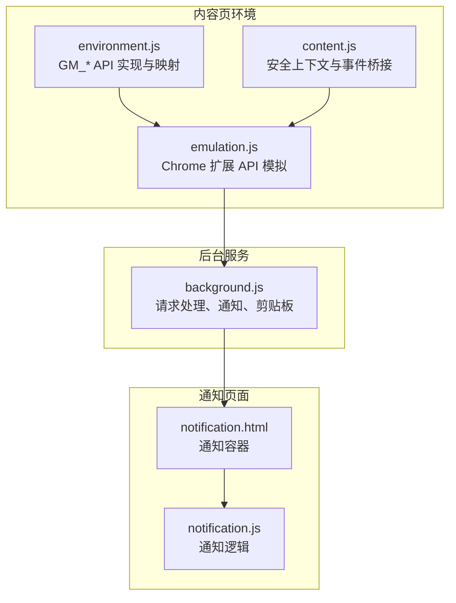
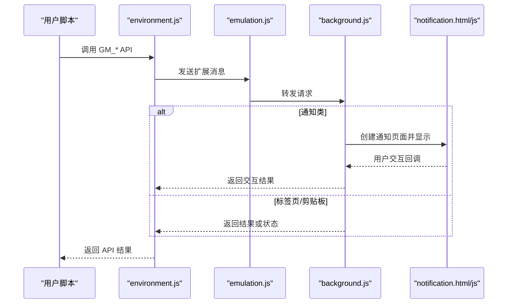
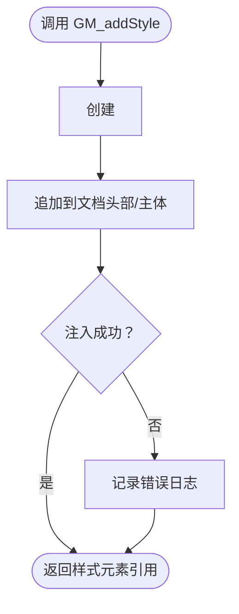
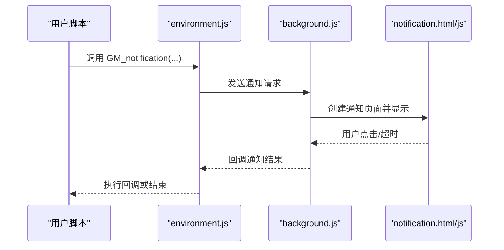
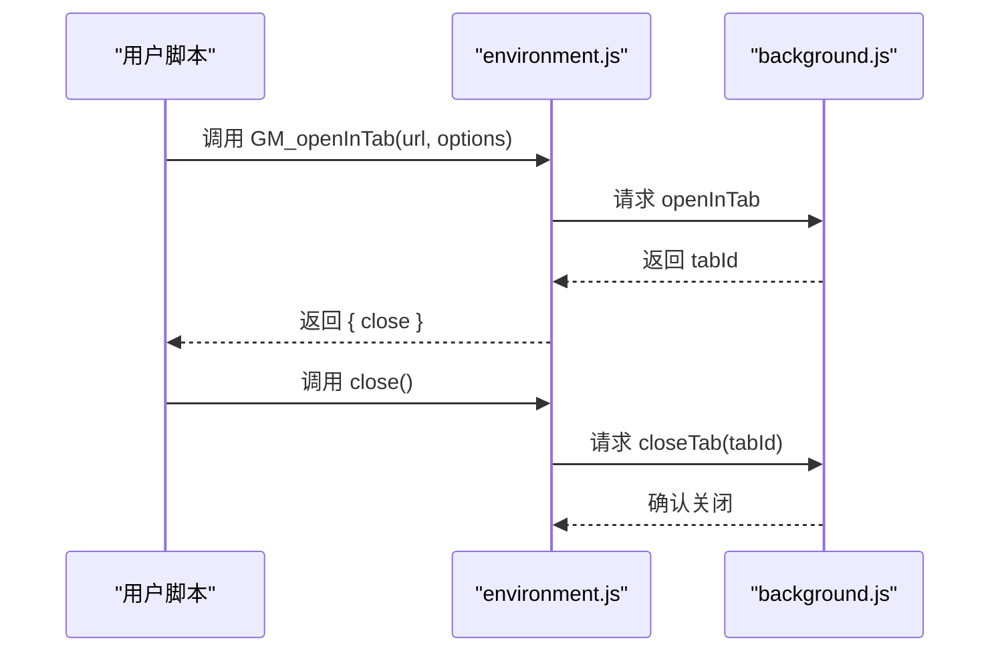
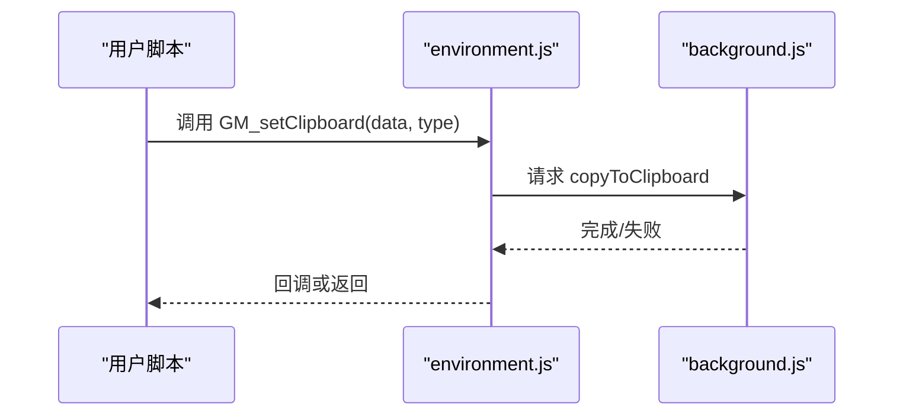
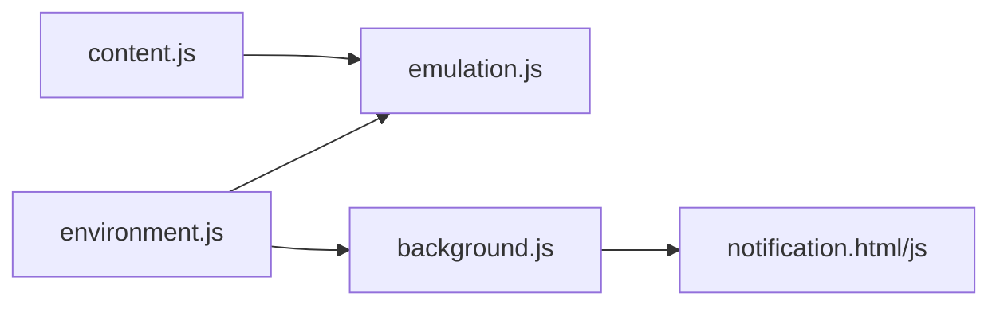

# UI 交互 API

<cite>
**本文引用的文件**
- [environment.js](file://src/environment.js)
- [background.js](file://src/background.js)
- [notification.js](file://src/notification.js)
- [notification.html](file://src/notification.html)
- [content.js](file://src/content.js)
- [emulation.js](file://src/emulation.js)
</cite>

## 目录
1. [简介](#简介)
2. [项目结构](#项目结构)
3. [核心组件](#核心组件)
4. [架构总览](#架构总览)
5. [详细组件分析](#详细组件分析)
6. [依赖关系分析](#依赖关系分析)
7. [性能考量](#性能考量)
8. [故障排查指南](#故障排查指南)
9. [结论](#结论)
10. [附录：使用示例与最佳实践](#附录使用示例与最佳实践)

## 简介
本文件面向 Tampermonkey 用户脚本开发者，系统化梳理与 UI 交互相关的 GM_* API 参考，重点覆盖以下函数：
- GM_addStyle：动态注入样式，说明注入机制、样式优先级与作用域控制
- GM_notification：通知展示，说明通知类型、显示位置、持续时间与交互行为
- GM_openInTab：在新标签页打开链接，说明标签页创建、URL 处理与目标窗口控制
- GM_setClipboard：写入剪贴板，说明数据格式与权限要求

同时给出丰富的使用场景与最佳实践，并解释与浏览器安全策略的交互与限制。

## 项目结构
与 UI 交互 API 相关的关键模块分布如下：
- 环境适配层（内容页）：负责将 GM_* API 映射到内部实现，并通过扩展消息通道与后台通信
- 后台服务：处理跨标签页请求、通知弹窗、剪贴板写入等
- 通知页面：承载通知 UI 的静态页面与脚本
- 内容页注入：在安全上下文中执行脚本与事件桥接

**图表来源**
- [environment.js](file://src/environment.js)
- [content.js](file://src/content.js)
- [emulation.js](file://src/emulation.js)
- [background.js](file://src/background.js)
- [notification.html](file://src/notification.html)
- [notification.js](file://src/notification.js)

**章节来源**
- [environment.js](file://src/environment.js)
- [background.js](file://src/background.js)
- [notification.html](file://src/notification.html)
- [notification.js](file://src/notification.js)
- [content.js](file://src/content.js)
- [emulation.js](file://src/emulation.js)

## 核心组件
- GM_addStyle：在当前页面动态注入样式，返回样式元素引用以便后续管理
- GM_notification：向用户展示通知，支持标题、正文、图标、超链接与权限请求
- GM_openInTab：在新标签页打开指定 URL，支持选项如是否激活、插入位置等，并可关闭已创建的标签
- GM_setClipboard：将数据写入系统剪贴板，支持文本等类型

上述组件均通过扩展消息通道与后台服务协作完成实际操作。

**章节来源**
- [environment.js](file://src/environment.js)
- [background.js](file://src/background.js)

## 架构总览
下图展示了从脚本调用到后台执行再到 UI 呈现的整体流程：

**图表来源**
- [environment.js](file://src/environment.js)
- [emulation.js](file://src/emulation.js)
- [background.js](file://src/background.js)
- [notification.html](file://src/notification.html)
- [notification.js](file://src/notification.js)

## 详细组件分析

### GM_addStyle 动态样式注入
- 注入机制
  - 在内容页环境中，通过创建 style 元素并将 CSS 文本注入到文档头部或主体节点，从而即时生效
  - 若 DOM 尚未就绪，会尝试在 head/body/documentElement 存在时进行注入
- 样式优先级与作用域控制
  - 由于是直接注入 style 标签，其样式优先级遵循浏览器默认规则（例如与页面内样式冲突时以最终渲染为准）
  - 作用域为当前页面文档，不涉及 shadow DOM 或 iframe 边界
- 错误处理
  - 注入过程捕获异常并输出日志，避免影响脚本执行

**图表来源**
- [environment.js](file://src/environment.js)

**章节来源**
- [environment.js](file://src/environment.js)

### GM_notification 通知系统
- 通知类型与参数
  - 支持标题、正文、图标、延迟时间、点击回调、超链接按钮、权限请求等
- 显示位置与生命周期
  - 由后台服务创建 HTML 通知页面并显示，支持自动关闭与手动点击关闭
- 交互行为
  - 点击通知可触发回调；若配置了权限请求，点击后会向后台申请权限并回传结果
- 页面实现
  - 通知页面包含标题、正文、图标与可选链接区域；加载时解析 URL 参数并设置对应 DOM

**图表来源**
- [environment.js](file://src/environment.js)
- [background.js](file://src/background.js)
- [notification.html](file://src/notification.html)
- [notification.js](file://src/notification.js)

**章节来源**
- [environment.js](file://src/environment.js)
- [background.js](file://src/background.js)
- [notification.html](file://src/notification.html)
- [notification.js](file://src/notification.js)

### GM_openInTab 新标签页控制
- 功能概述
  - 在新标签页打开指定 URL，支持选项如是否激活、在当前标签右侧插入等
  - 返回句柄对象，可通过 close 方法关闭该标签页（仅限由该请求创建的标签）
- URL 处理
  - 对双斜杠开头的相对协议 URL 进行协议补齐
- 目标窗口控制
  - 通过后台服务创建标签页，支持插入到当前标签右侧（insert 选项）

**图表来源**
- [environment.js](file://src/environment.js)
- [background.js](file://src/background.js)

**章节来源**
- [environment.js](file://src/environment.js)
- [background.js](file://src/background.js)

### GM_setClipboard 剪贴板写入
- 数据格式
  - 默认类型为文本；可扩展支持其他类型（如图片等，具体取决于后台实现）
- 权限要求
  - 需要扩展具备相应权限；若需要请求权限，通知系统会引导用户授权
- 执行路径
  - 通过扩展消息通道将数据发送至后台，后台使用专用方法写入剪贴板

**图表来源**
- [environment.js](file://src/environment.js)
- [background.js](file://src/background.js)

**章节来源**
- [environment.js](file://src/environment.js)
- [background.js](file://src/background.js)

## 依赖关系分析
- 环境适配层依赖扩展模拟层与内容页安全上下文，确保在受限环境下仍能执行关键操作
- 后台服务集中处理跨标签页请求与系统级能力（通知、剪贴板），并通过消息通道与前端交互
- 通知页面独立于脚本运行，仅负责 UI 呈现与用户交互

**图表来源**
- [environment.js](file://src/environment.js)
- [content.js](file://src/content.js)
- [emulation.js](file://src/emulation.js)
- [background.js](file://src/background.js)
- [notification.html](file://src/notification.html)
- [notification.js](file://src/notification.js)

**章节来源**
- [environment.js](file://src/environment.js)
- [content.js](file://src/content.js)
- [emulation.js](file://src/emulation.js)
- [background.js](file://src/background.js)
- [notification.html](file://src/notification.html)
- [notification.js](file://src/notification.js)

## 性能考量
- 样式注入
  - 频繁注入大量样式可能影响渲染性能，建议合并与去重
- 通知弹窗
  - 后台创建通知页面存在开销，应避免短时间内大量弹窗
- 标签页创建
  - 打开多个标签页会增加内存占用，注意及时关闭不再使用的标签
- 剪贴板写入
  - 写入操作通常很快，但需考虑权限弹窗对用户体验的影响

## 故障排查指南
- GM_addStyle 不生效
  - 检查 DOM 是否已准备好；确认注入位置（head/body/documentElement）是否存在
  - 查看控制台是否有注入异常日志
- GM_notification 无显示
  - 确认后台通知服务可用；检查通知页面是否正确加载
  - 若涉及权限请求，请确认用户已完成授权
- GM_openInTab 无法关闭
  - 仅能关闭由该请求创建的标签；确认 tabId 是否正确
- GM_setClipboard 失败
  - 检查权限是否已授予；查看后台日志中的错误信息

**章节来源**
- [environment.js](file://src/environment.js)
- [background.js](file://src/background.js)
- [notification.js](file://src/notification.js)

## 结论
Tampermonkey 的 UI 交互 API 在内容页与后台之间建立了清晰的消息通道，既保证了安全性，又提供了丰富的用户交互能力。合理使用 GM_addStyle、GM_notification、GM_openInTab、GM_setClipboard，可以显著提升脚本的可用性与用户体验。在实际开发中，应关注样式优先级、通知生命周期、标签页控制与剪贴板权限等关键点，并结合性能与安全策略进行优化。

## 附录：使用示例与最佳实践
- 动态样式修改
  - 使用 GM_addStyle 注入主题色或隐藏特定元素；建议在页面加载完成后执行
- 用户反馈通知
  - 使用 GM_notification 提示任务进度或结果；为重要通知设置合适的延迟与图标
- 页面导航控制
  - 使用 GM_openInTab 打开外部链接或帮助页面；根据需要设置激活与插入位置
- 数据复制功能
  - 使用 GM_setClipboard 复制文本或 JSON；注意权限提示与用户确认

[本节为概念性指导，无需列出具体代码片段]