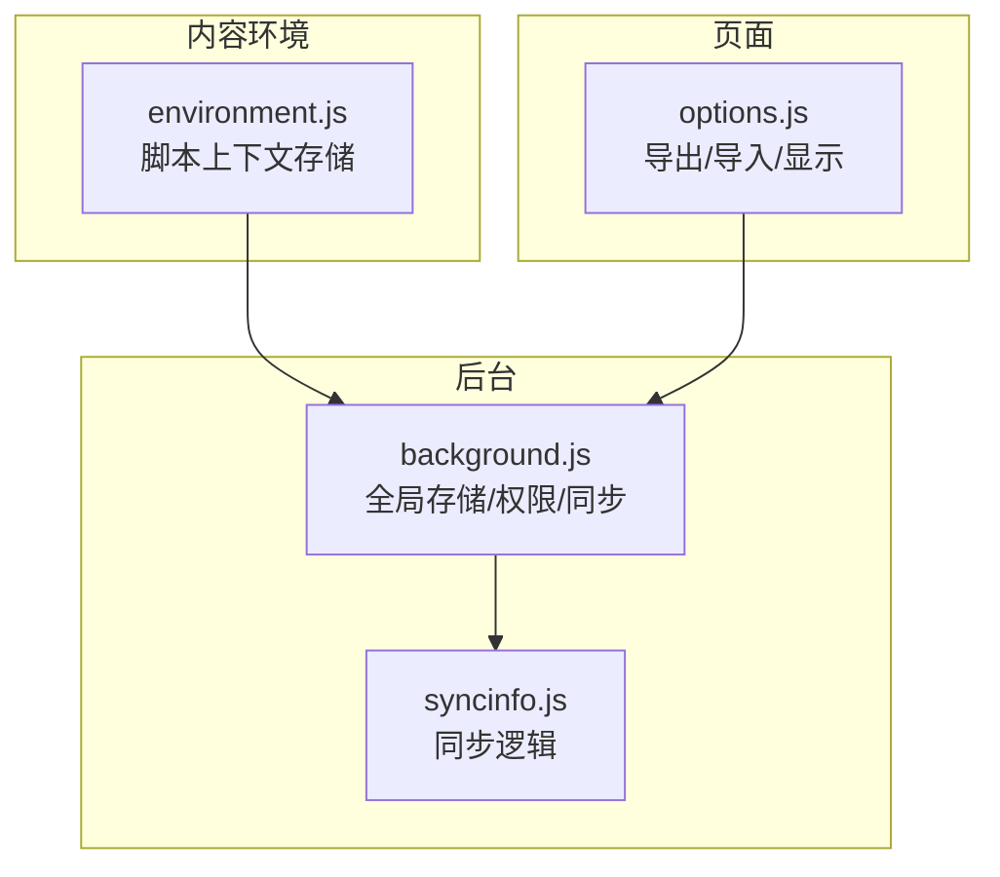
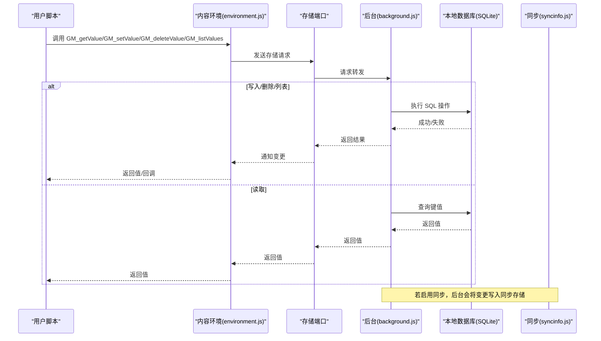
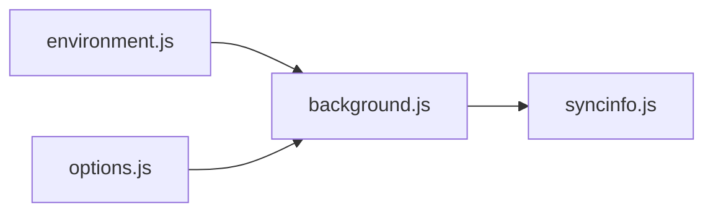

# 存储 API

<cite>
**本文引用的文件**
- [background.js](file://src/background.js)
- [environment.js](file://src/environment.js)
- [content.js](file://src/content.js)
- [syncinfo.js](file://src/syncinfo.js)
- [options.js](file://src/options.js)
</cite>

## 目录
1. [简介](#简介)
2. [项目结构](#项目结构)
3. [核心组件](#核心组件)
4. [架构总览](#架构总览)
5. [详细组件分析](#详细组件分析)
6. [依赖关系分析](#依赖关系分析)
7. [性能考量](#性能考量)
8. [故障排查指南](#故障排查指南)
9. [结论](#结论)
10. [附录](#附录)

## 简介
本文件为 Tampermonkey 的存储相关 GM_* API 提供权威参考，覆盖以下内容：
- GM_getValue、GM_setValue、GM_deleteValue、GM_listValues 的使用方法与行为差异
- 数据类型支持与序列化规则
- 存储容量与持久化机制
- 本地存储与“脚本级”存储（上下文存储）的区别
- 同步存储与跨设备数据同步的工作原理
- 实际使用场景：配置项保存、用户偏好设置、缓存数据管理、批量数据操作
- 安全与隐私：权限请求、数据持久化策略
- 备份与迁移：历史版本迁移、本地数据库与 localStorage 的互转

## 项目结构
与存储 API 相关的核心模块分布如下：
- 背景页（后台）负责全局存储初始化、SQL 本地数据库、权限管理与同步协调
- 内容环境负责脚本上下文内的“脚本级”存储（内存态），并通过端口与背景页通信
- 同步模块负责跨设备同步（Chrome 同步或自定义服务）
- 选项页负责展示与导出/导入脚本存储数据

图表来源
- [background.js:1705-1904](file://src/background.js#L1705-L1904)
- [environment.js:782-978](file://src/environment.js#L782-L978)
- [syncinfo.js:149-393](file://src/syncinfo.js#L149-L393)
- [options.js:1-200](file://src/options.js#L1-L200)

章节来源
- [background.js:1705-1904](file://src/background.js#L1705-L1904)
- [environment.js:782-978](file://src/environment.js#L782-L978)
- [syncinfo.js:149-393](file://src/syncinfo.js#L149-L393)
- [options.js:1-200](file://src/options.js#L1-L200)

## 核心组件
- 全局存储（背景页）
  - 初始化与本地数据库（SQLite/IndexedDB 替代）：用于持久化键值对
  - 类型编码与解码：统一以首字符标记类型（布尔/数字/对象等）
  - 权限与同步：请求存储权限，协调 Chrome 同步或自定义同步
- 脚本上下文存储（内容环境）
  - 内存态存储：每个脚本拥有独立命名空间的内存存储
  - 值变更监听：通过端口接收来自背景页的远程变更通知
- 同步模块
  - 列表、写入、重置、时间校准、监听器注册
  - 支持 Chrome 同步与自定义服务两种模式

章节来源
- [background.js:1705-1904](file://src/background.js#L1705-L1904)
- [environment.js:782-978](file://src/environment.js#L782-L978)
- [syncinfo.js:149-393](file://src/syncinfo.js#L149-L393)

## 架构总览
下图展示了 GM_* API 在脚本运行时的调用路径与数据流。

图表来源
- [environment.js:782-978](file://src/environment.js#L782-L978)
- [background.js:1705-1904](file://src/background.js#L1705-L1904)
- [syncinfo.js:244-393](file://src/syncinfo.js#L244-L393)

## 详细组件分析

### 全局存储（背景页）
- 初始化
  - 使用本地数据库（SQLite/IndexedDB 替代）作为持久化后端，容量上限在初始化时设定
  - 首次访问时创建表结构，加载现有键值到内存缓存
- 键值存储
  - 写入前进行类型编码：首字符标识类型（如布尔、数字、对象等），对象使用 JSON 序列化
  - 读取时按类型解码，返回原生 JavaScript 值
  - 支持删除单个键、清空全部键、列出所有键
- 权限与同步
  - 当使用 Chrome 同步时，需要请求存储权限；若无权限则不执行同步
  - 同步模块负责将脚本存储写入同步存储，并处理冲突与重试

章节来源
- [background.js:1705-1904](file://src/background.js#L1705-L1904)
- [background.js:249-276](file://src/background.js#L249-L276)
- [background.js:5401-5452](file://src/background.js#L5401-L5452)
- [syncinfo.js:244-393](file://src/syncinfo.js#L244-L393)

### 脚本上下文存储（内容环境）
- 上下文存储
  - 每个脚本拥有独立的内存存储对象，包含数据与时间戳
  - 写入时同样进行类型编码并更新时间戳
  - 删除键时从内存中移除
  - 列表键时遍历当前上下文数据
- 值变更监听
  - 通过连接端口接收来自后台的远程变更通知，触发本地监听器回调
  - 通知时区分本地变更与远程变更

章节来源
- [environment.js:782-978](file://src/environment.js#L782-L978)

### 同步存储与跨设备同步
- 同步类型
  - 支持 Chrome 同步与自定义服务两种模式
  - Chrome 同步需请求存储权限；自定义服务通过 HTTP 接口拉取/推送
- 同步流程
  - 后台定时或按需调度同步任务
  - 将脚本存储写入同步存储，处理锁与重试
  - 监听远端变更，合并到本地上下文存储

章节来源
- [syncinfo.js:149-393](file://src/syncinfo.js#L149-L393)
- [background.js:1968-2089](file://src/background.js#L1968-L2089)

### 数据类型支持与序列化规则
- 编码规则
  - 首字符表示类型：布尔、数字、对象等
  - 对象类型使用 JSON 序列化；读取时尝试 JSON 反序列化
- 解码规则
  - 读取时根据首字符还原为原生类型
  - 失败时返回默认值

章节来源
- [background.js:1753-1835](file://src/background.js#L1753-L1835)
- [environment.js:932-978](file://src/environment.js#L932-L978)

### 存储容量与持久化机制
- 容量
  - 本地数据库初始化时指定容量上限
- 持久化
  - 写入成功后立即落盘；读取优先命中内存缓存，再回退到数据库
  - 清空全部键时重建表结构

章节来源
- [background.js:1731-1750](file://src/background.js#L1731-L1750)
- [background.js:1837-1870](file://src/background.js#L1837-L1870)

### 本地存储与“脚本级”存储的区别
- 本地存储（全局）
  - 由背景页维护，持久化于本地数据库
  - 适用于需要跨脚本共享或长期持久化的数据
- 脚本级存储（上下文）
  - 由内容环境维护，仅在当前脚本上下文中可见
  - 适合用户偏好、临时状态等与脚本生命周期绑定的数据

章节来源
- [background.js:1705-1904](file://src/background.js#L1705-L1904)
- [environment.js:782-978](file://src/environment.js#L782-L978)

### 同步存储与跨设备同步的工作原理
- 启用条件
  - Chrome 同步：需要存储权限
  - 自定义服务：通过 URL 拉取/推送
- 写入与监听
  - 后台将变更写入同步存储，带锁与重试
  - 远端变更通过监听器推送到各上下文

章节来源
- [syncinfo.js:244-393](file://src/syncinfo.js#L244-L393)
- [background.js:1968-2089](file://src/background.js#L1968-L2089)

### 实际使用示例（基于 API 行为）
- 配置项保存
  - 使用 GM_setValue 保存用户配置，GM_getValue 读取
  - 若启用同步，配置可跨设备同步
- 用户偏好设置
  - 使用脚本级存储（上下文）保存偏好，避免与其他脚本冲突
- 缓存数据管理
  - 使用 GM_setValue/GM_deleteValue 管理缓存键，GM_listValues 获取缓存键集合
- 批量数据操作
  - 通过 GM_listValues 遍历键，结合 GM_getValue/GM_setValue/GM_deleteValue 批量处理

章节来源
- [background.js:1705-1904](file://src/background.js#L1705-L1904)
- [environment.js:782-978](file://src/environment.js#L782-L978)

### 数据加密、安全存储与隐私保护
- 权限请求
  - 使用存储权限接口请求 Chrome 同步所需的存储权限
- 数据隐私
  - 同步模块支持重置同步存储，清理远端数据
- 最佳实践
  - 对敏感数据建议在脚本侧自行加密后再写入存储
  - 合理使用脚本级存储减少全局暴露面

章节来源
- [background.js:5401-5452](file://src/background.js#L5401-L5452)
- [syncinfo.js:312-330](file://src/syncinfo.js#L312-L330)

### 存储迁移与备份恢复
- 历史版本迁移
  - 启动时检测版本并迁移旧数据（如从 localStorage 迁移到本地数据库）
- 备份与恢复
  - 选项页支持导出/导入脚本存储数据，便于备份与迁移

章节来源
- [background.js:249-276](file://src/background.js#L249-L276)
- [options.js:1-200](file://src/options.js#L1-L200)

## 依赖关系分析
- 组件耦合
  - 内容环境依赖后台提供的存储端口与监听器
  - 后台依赖同步模块进行跨设备同步
- 外部依赖
  - Chrome 存储 API（当使用 Chrome 同步时）
  - 本地数据库（SQLite/IndexedDB 替代）

图表来源
- [environment.js:782-978](file://src/environment.js#L782-L978)
- [background.js:1705-1904](file://src/background.js#L1705-L1904)
- [syncinfo.js:149-393](file://src/syncinfo.js#L149-L393)
- [options.js:1-200](file://src/options.js#L1-L200)

## 性能考量
- 读取路径优化
  - 优先命中内存缓存，减少数据库查询
- 写入路径优化
  - 批量写入与去重插入，减少事务开销
- 同步开销
  - 同步采用锁与重试机制，避免并发冲突
- 建议
  - 大量键值操作时尽量合并为一次写入
  - 对频繁读取的键值进行本地缓存

## 故障排查指南
- 无法读取/写入
  - 检查是否正确使用 GM_* API
  - 确认类型编码/解码是否符合预期
- 同步未生效
  - 确认已授予存储权限
  - 检查同步类型与网络状态
- 数据丢失
  - 检查是否误用“脚本级”存储导致作用域错误
  - 使用选项页导出/导入进行恢复

章节来源
- [background.js:1753-1835](file://src/background.js#L1753-L1835)
- [background.js:5401-5452](file://src/background.js#L5401-L5452)
- [syncinfo.js:244-393](file://src/syncinfo.js#L244-L393)

## 结论
- GM_* API 提供了统一的键值存储接口，底层分别对接“脚本级”内存存储与“全局”本地数据库
- 类型编码/解码确保跨语言与跨平台一致性
- 同步模块支持跨设备数据同步，但需注意权限与隐私
- 建议在脚本内合理选择存储位置与同步策略，并做好备份与迁移准备

## 附录
- API 行为对照
  - GM_getValue：读取键值，支持默认值
  - GM_setValue：写入键值，自动类型编码
  - GM_deleteValue：删除键
  - GM_listValues：列出所有键

章节来源
- [background.js:1705-1904](file://src/background.js#L1705-L1904)
- [environment.js:782-978](file://src/environment.js#L782-L978)